# The Floodplain Planner, end to end

A tour of the PSPE flood portal as it ships: Onion Creek, Austin, Texas. Every
screenshot here is a real session against the live service — no mock-ups, no
composites — and every number in the captions is the number the page printed
on the day it was taken.

The tool answers five questions, in the order a flood actually forces them:


| #   | Question                                              | Where                    |
| --- | ----------------------------------------------------- | ------------------------ |
| 1   | What is happening, and what would a storm do here?    | **Forecast** tab         |
| 2   | Can people get out?                                   | **Roads** tab            |
| 3   | Where would a wall pay for itself?                    | **Plan → Build a plan**  |
| 4   | How high does it have to be, and what does that cost? | **Plan → Cross-section** |
| 5   | Whose floor does the water get over?                  | **Street** view          |


Read it in that order the first time. Each step narrows the question, and each
one costs more computer time than the one before it.

Those five are everything the screen answers. The Plan tab carries one more
control that is not a question about the future but about the present — once
a floodgate and a pump station are built, **how do you run them** — and that
is §5.

There is a seventh thing the service does that the screen does not — let the
river set the boundary, re-run a flood that actually happened, and have the
satellite mark the result — and it is §8. It is `curl` rather than clicks, and
it is where the portal stops being a scenario simulator.

---


## Before you start

Two processes. The solver is a FastAPI service; the portal is a Next.js app
that talks to it.

```bash
# the solver — leave it running
cd ~/pspe
python3 -m uvicorn service.app:app --port 8000

# the portal, in another shell
cd ~/pspe/portal
npm run dev            # http://localhost:3000
```

Check the service is up before you open the page:

```bash
curl -s localhost:8000/health
```

The portal works without it — the shipped study is a static file — but every
button that solves something will fail.

**What loads on first paint.** `public/data/austin/study.json`, 2.9 MB (1.3 MB
gzipped): the solved depth field, the terrain, nine instantaneous frames of the
run, 3,624 OpenStreetMap road features and the quantised grids behind the
click-anywhere readout. Until it arrives the map pane is a pulsing grey block.
There is no retry — if it fails you get a "No study is built" banner.

**Deep links.** `?view=forecast` · `?view=roads` · `?view=plan` ·
`?view=plan&budget=35`. The budget is in US$ millions and is clamped to 2–80.
Note that opening straight into `?view=plan` skips the Forecast panel, so the
bank search is sent with the name `Area` instead of the place name, and the
live gauge feed is never fetched at all — nothing on any tab calls it except
the Forecast tab's Layers panel.

---


## The shape of the screen

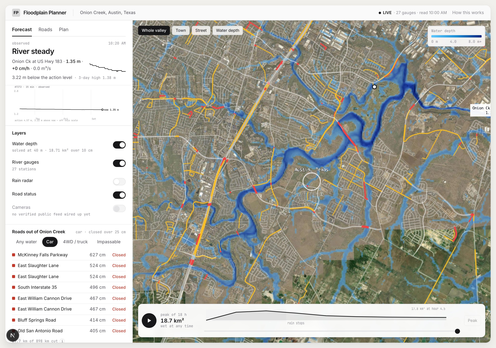

Left: one scrolling panel, with three tabs at the top — **Forecast**, **Roads**,
**Plan**. Right: the map. Four chips sit over the map's top-left corner —
**Whole valley**, **Town**, **Street**, **Water depth** — and they are not tabs:
they change the camera and the layers, not the question.


| Chip             | What it does                                                                                                                                                                                                          |
| ---------------- | --------------------------------------------------------------------------------------------------------------------------------------------------------------------------------------------------------------------- |
| **Whole valley** | Frames the whole solved box. The default.                                                                                                                                                                             |
| **Town**         | One zoom step in on the same centre — the neighbourhood rather than the catchment.                                                                                                                                    |
| **Street**       | Opens the street view (§6). The left column is replaced.                                                                                                                                                              |
| **Water depth**  | Draws the flood as a **body** of water standing on the ground, and tilts the camera so you can see it as one. Off by default: a flood map is read as a map, north up and flat, and this is the opt-in second reading. |


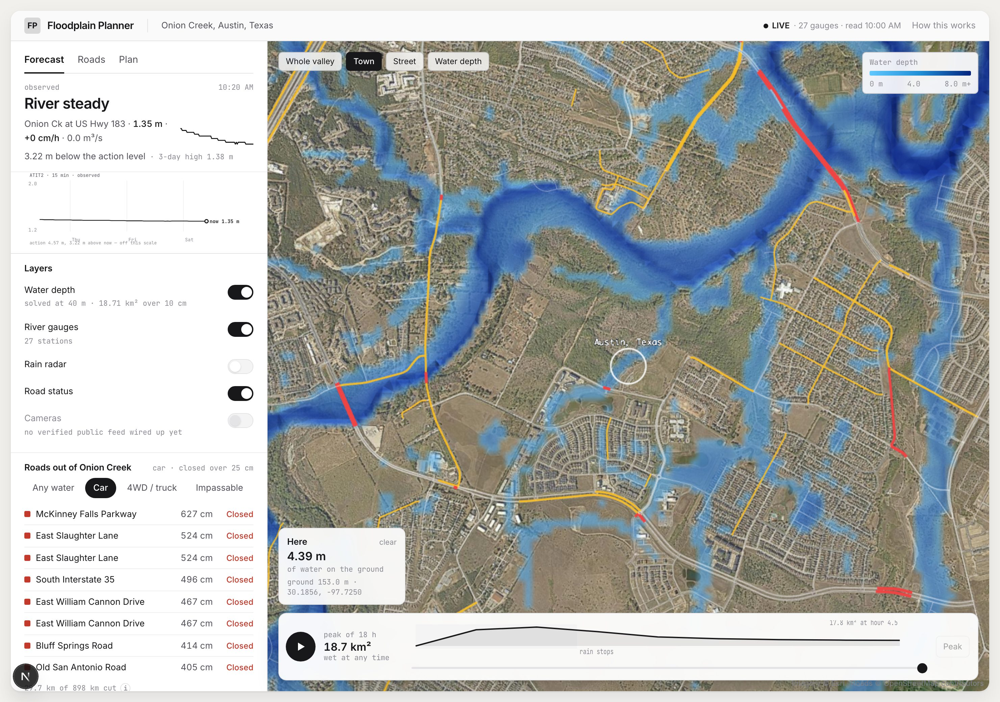

*The **Town** chip: the same flood, one zoom step in.*

Note that **Water depth** appears twice, meaning two different things: the chip
over the map builds the solid body, and the switch in the Layers list paints
the flat blue wash on the terrain. The legend's heading is a third.

Top right: `LIVE · 27 gauges · read 11:45`, and **How this works**, which
leads to the research pages (§9). The badge names the time of the reading on
screen, not the publisher's cadence — the panel re-fetches every five minutes
against a feed USGS updates every fifteen.

### Where the detail went

The panels carry the verdict, the numbers and anything that changes what you
would do. Everything else — how a figure was derived, where the data came
from, why a default is what it is — sits behind a small **(i)** next to the
thing it explains. Click it, read it, press Escape.

That is a deliberate trade, and it is measurable: the five views carried 8,251
characters of text and now carry 4,953, with the explanatory share down from
52% to 30%. Nothing that changes a decision was moved. If you want the full
account of what this tool cannot tell you, it is §10 — written out in prose,
not hidden behind anything.

> **"LIVE" now means polled.** The gauge feed re-fetches every five minutes
> against a USGS cadence of fifteen, so the badge, the reading and the
> hydrograph are at most one cycle behind, and the badge states the time of
> the reading it is showing. It used to be fetched once at page load and
> went stale in silence while printing the publisher's cadence as though it
> were its own. The rain radar is still fetched only when you switch it on.

---


## 1 · Forecast — what is happening, and what a storm would do

The default tab. It stacks four things: a live gauge reading, the layer
switches, the roads this flood closes, and the controls to re-solve somewhere
else.

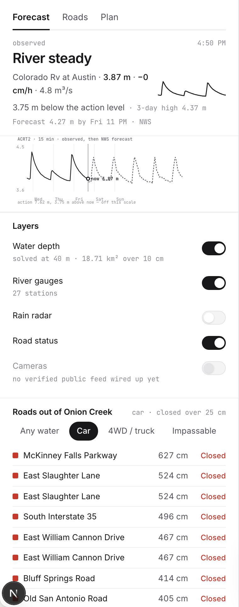

### The gauge headline

```
observed                                         10:20 AM
River steady
Onion Ck at US Hwy 183 · 1.35 m · +0 cm/h · 0.0 m³/s
3.22 m below the action level · 3-day high 1.38 m
```


| Phrase                            | What it is                                                                                                                                            |
| --------------------------------- | ----------------------------------------------------------------------------------------------------------------------------------------------------- |
| `River rising / falling / steady` | Sign of the stage trend at ±1 cm/h                                                                                                                    |
| `10:20 AM`                        | The time of the reading on screen. The panel re-fetches every five minutes against a feed USGS publishes every fifteen                                |
| `1.35 m`                          | Latest USGS instantaneous stage, feet × 0.3048                                                                                                        |
| `+0 cm/h`                         | Latest minus the fifth-latest sample × 100. That is four reporting intervals, which equals an hour only on a 15-minute site                           |
| `0.0 m³/s`                        | Latest discharge, cfs × 0.0283168466. **Not** necessarily the number `river_q_observed` drives the solver with — see below                            |
| `3.22 m below the action level`   | Position in the NOAA NWPS category ladder (action / minor / moderate / major)                                                                         |
| `Forecast … by …`                 | The NWS forecast **peak** stage and its valid time. Absent above because NWPS publishes no forecast for this gauge; it appears only when one exists   |
| the **LIVE · 27 gauges** badge    | Every USGS site in the study box **padded by 0.12°** — about ±13 km, because the gauge that matters is usually upstream and outside the modelled area |


The sparkline to the right of the reading is min–max normalised with no
absolute scale; two gauges' sparklines are not comparable. The chart below it
is the three-day record thinned to roughly hourly, headed with the NWS site
code and the cadence (`ATIT2 · 15 min · observed`), and with the published
flood levels drawn as dashed lines where they fit the window — when they do
not, it says so: `action 4.57 m, 3.22 m above now — off this scale`.

**The gauge is the study's own reach.** The feed is ranked by name match
before anything else — the same matcher the Plan tab's flood record uses — so
a study of Onion Creek reports `Onion Ck at US Hwy 183` and not the Colorado
River, which is two orders of magnitude larger and merely shares a city. The
headline and the chart beneath it take the same gauge; they used to pick by
different rules and could describe two different creeks.

> **The headline gauge and the gauge that drives the model are allowed to
> differ, and on this reach they do.** They answer different questions. The
> headline wants the gauge that can say whether this is a *flood*, which
> means one with NWS category levels — `08159000` at US Hwy 183. The solver
> wants the gauge that says what is *entering the box*, which means one
> upstream of the inflow edge — `08158827` at Twin Creeks Rd, which has no
> categories. Reading `Onion Ck at US Hwy 183` in the headline while §8's
> `driver_note` names Twin Creeks is the two rules working, not disagreeing.
> Both are on Onion Creek; one is at each end of the modelled reach.

### Layers


| Switch           | Default  | What it gates                                                                                                 |
| ---------------- | -------- | ------------------------------------------------------------------------------------------------------------- |
| **Water depth**  | on       | The blue wash painted on the terrain, and the depth legend. Sub-line: `solved at 40 m · 18.71 km² over 10 cm` |
| **River gauges** | on       | The white gauge dots and up to six reading labels on the map                                                  |
| **Rain radar**   | off      | One NOAA base-reflectivity image stretched over the padded box                                                |
| **Road status**  | on       | The red/amber road list in this panel                                                                         |
| **Cameras**      | disabled | Nothing — "no verified public feed wired up yet"                                                              |


Two cautions worth carrying:

- **Rain radar is fetched once.** "every 6 min" is the product's cadence, not
this layer's. The image URL carries no time parameter and the layer only
rebuilds if the bounds change, so what you see is whatever the service
returned when you flipped the switch.
- **The depth legend is linear; the paint is not.** The PNG ramp is
`(d / 8.0) ** 0.42`. Four metres renders about three-quarters of the way
along the bar, not at the middle tick. Read the legend for *deeper/shallower*,
and click the map when you want a number.


### Playing the run

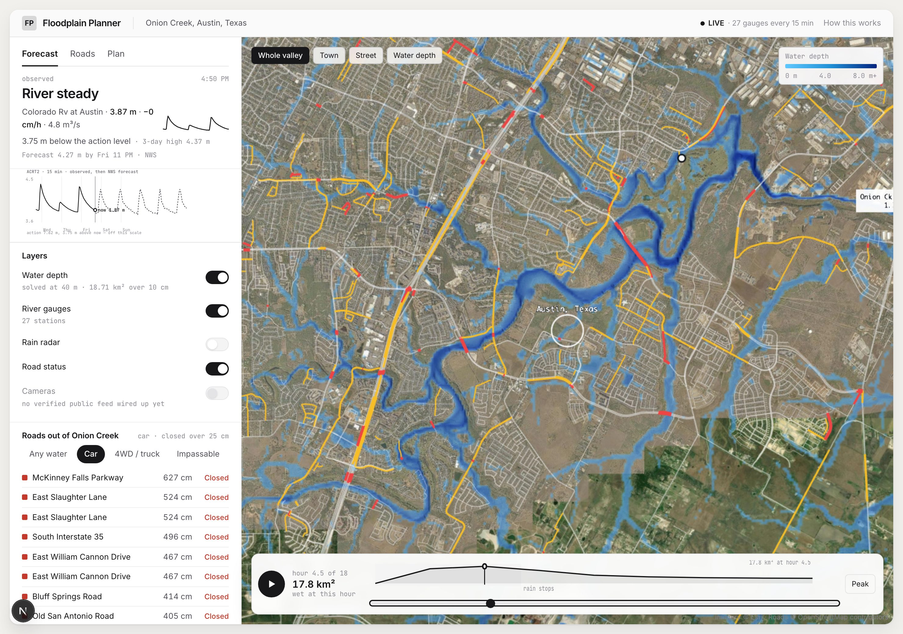

The bar across the bottom of the map is the **run scrubber**: nine solved
snapshots, 2.25 model hours apart, 0 → 18 h. Press play and it steps through
them at 650 ms a frame — about five seconds for the whole flood — then returns
to the peak.

- `peak of 18 h · 18.7 km² · wet at any time` — the **envelope**: every cell
that is wet at any point in the run.
- `hour 4.5 of 18 · 17.8 km² · wet at this hour` — one instant.

The envelope is always the larger of the two, and the difference is not a
trend. The shaded block on the little chart ends at `rain stops` (hour 6); the
tick reads `17.8 km² at hour 4.5`, the worst single hour.

**Hour 0 is when the storm starts, not when you opened the page.** Nothing in
this model is anchored to a wall clock.

### Clicking the map

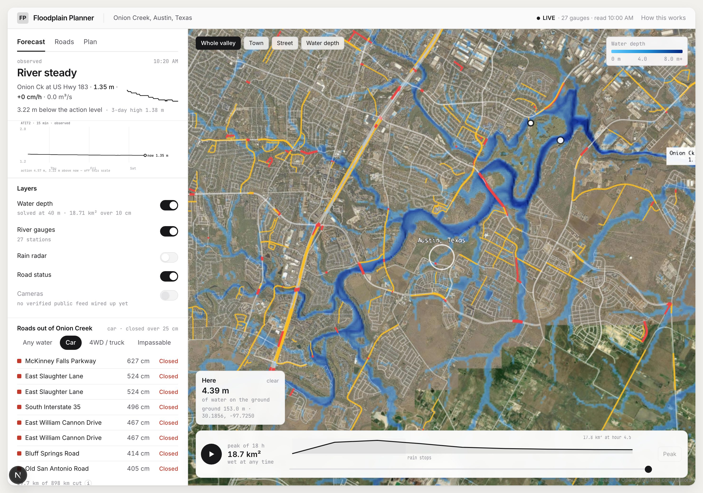

Click anywhere inside the study box. A card appears in the bottom-left corner,
above the scrubber:

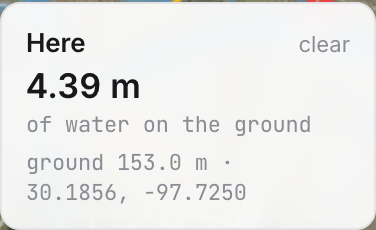

```
Here                                    clear
4.39 m
of water on the ground
ground 153.0 m · 30.1856, -97.7250
```

The depth is read from an 8-bit grid — `byte / 255 × 8.0 m`, so 3.1 cm per
level — and **it is the peak over the whole run**, not the depth at the hour
the scrubber is showing. `dry` means at or under 10 cm, not zero. Outside the
study box the card simply does not appear.

### Which roads this flood closes

At the bottom of the Forecast panel:

```
Roads out of Onion Creek                    car · closed over 25 cm
[ Any water ] [ Car ] [ 4WD / truck ] [ Impassable ]
■ McKinney Falls Parkway        627 cm   Closed
■ East Slaughter Lane           524 cm   Closed
■ South Interstate 35           496 cm   Closed
…
29.7 km of 898 km cut  (i)
```

The four pills are depth thresholds: **0.10 m**, **0.25 m**, **0.45 m**,
**0.80 m**. They are four constants with one-line notes, not vehicle
engineering, and depth is the *only* variable — flow velocity, which is what
actually sweeps a car away, is solved by the model and never used here.

Two things about this list that matter when you quote it:

- The rows are **OSM way segments**, not streets. East William Cannon Drive is
125 separate features; East Slaughter Lane can appear twice with two
different depths.
- The denominator, 898 km, is every LineString in the bundle — residential and
unclassified included — not "roads out of town".


### Re-solving somewhere else

Below the roads: a place search, three driver pills (**River** / **Coastal** /
**Rainfall**), three storm pills (**Heavy rain** 20 mm/h, **Severe storm**
50 mm/h, **Extreme** 80 mm/h, all for 6 hours), and
**Re-run Austin, Texas**.

That button posts a fresh solve: the same 12 km box at 60 m over 12 hours,
about a minute. While it runs you get a seconds counter and a bar whose width
is `elapsed × 1.6%` — a timer, not progress; it parks at 96% after a minute and
stays there.

> **Two things change when you press it.** The map and the scrubber are both
> replaced — the re-run asks for its own nine snapshots, so the timeline plays
> the flood on screen rather than the shipped study's. And the PROJECTION
> badge, the FEMA skill score and the "What this answer is not" fold all
> disappear, because they belong to the shipped study and the new field has
> never been scored against anything.

Also here: **See what the satellite saw**, which runs Sentinel-1 change
detection over the box (a minute is normal) and reports two numbers —
`Observed flooding X km²` and the permanent water it excluded — with the
acquisition date and orbit. The SAR image itself is downloaded and discarded;
only the numbers reach the screen.

### What the shipped flood actually is

At the bottom, with the evidence chip:

```
● PROJECTION
Onion Creek, Austin, Texas
a 300 mm, 6-hour storm — near the 1% annual chance 6-hour depth for Travis
County, solved here on USGS 3DEP bare earth. This is our solver's answer, not
a reference flood.

Overlap with FEMA's 1% floodplain      CSI 0.39
Of it we find                                50%
Of what we call wet, outside it              37%
18.72 km² against 23.69 km² over 116 mapped polygons
```

A uniform design rainstorm — 50 mm/h for six hours over the whole box, all four
edges open — not a replay of a recorded event. It finds about half of what FEMA
maps. Both facts are on the page; neither is buried.

---


## 2 · Roads — can people get out

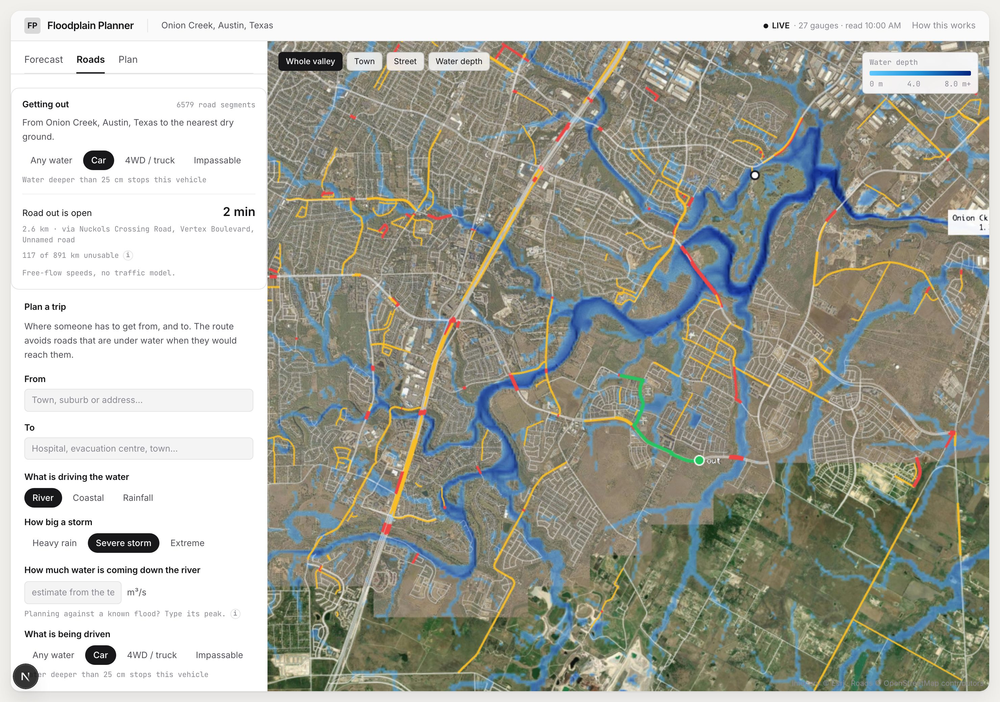

Click **Roads**. Two cards, and they answer two different questions with two
different methods.

### Getting out

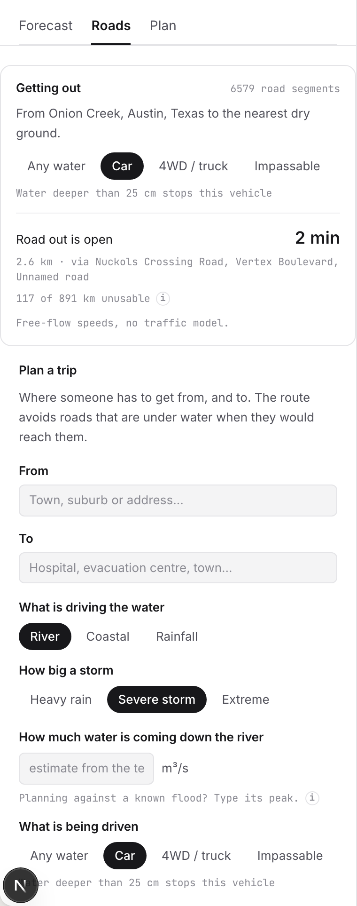

```
Getting out                                 6579 road segments
From Onion Creek, Austin, Texas to the nearest dry ground.
[ Any water ] [ Car ] [ 4WD / truck ] [ Impassable ]
Water deeper than 25 cm stops this vehicle

Road out is open                                   2 min
2.6 km · via Nuckols Crossing Road, Vertex Boulevard, Unnamed road
117 of 891 km unusable  (i)
Free-flow speeds, no traffic model.
```

- **Origin** is the centre of the study box, not a place you choose.
- **Destination** is the nearest junction that is dry and at least 2 km away.
The panel tries the ten nearest such junctions in order and reports the first
one it can reach. If all ten fail it says **No way out by road** — which means
"none of ten candidates", not "nowhere". That verdict used to fire on Onion
Creek with 97% of the network open; it is now the honest ten-candidate
statement, and the harness `verify-getting-out.mjs` exists to keep it that way.
- **Time** is `length / free-flow class speed`. Nine hardcoded speeds, motorway
100 km/h down to track 20, no intersections, no signals, no congestion — on a
page about everyone leaving at once.
- **117 of 891 km** counts an edge's whole length if any sample on it is over
the threshold, because a route can only refuse a whole segment. The Forecast
tab's "29.7 km of 898 km" asks how much tarmac is wet and counts only the
sub-segments that are. Same network, same flood, same 25 cm, about 4× apart —
both right for their own question, and each now states its rule in its own
(i) rather than leaving you to discover the discrepancy.

`Getting out` scores roads against the **peak** field, so a road that is dry for
the first three hours is Closed all day. The card below it does not.

### Warning time

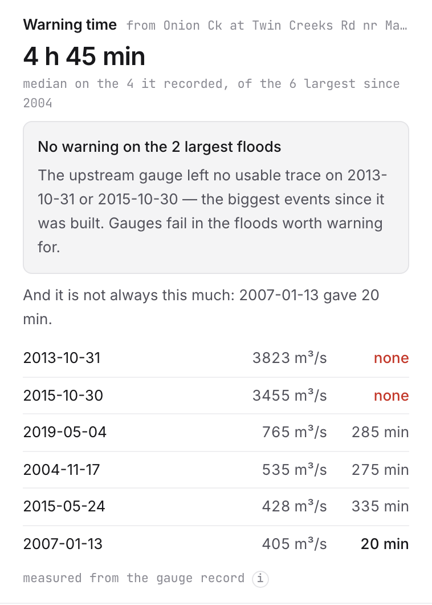

`Getting out` says which roads close. It does not say whether anyone would
know in time, and that is a different question with a different answer and a
different source. This card is the only panel in the portal that reports no
model output at all: every figure on it is read out of the USGS record by
`/warning`, which fetches the annual peaks at the outlet gauge and, for each
one, the instantaneous series at the gauge upstream, and times the lag between
the two peaks.

```
Warning time              from Onion Ck at Twin Creeks Rd nr Manchaca
4 h 45 min
median on the 4 floods it recorded, of 6 since 2004

No warning on the 2 largest floods
The upstream gauge left no usable trace on 2013-10-31 or 2015-10-30 —
the biggest events since it was built. Gauges fail in the floods worth
warning for.

And it is not always this much: 2007-01-13 gave 20 min.
```

The median is the smallest true thing on the card. The two facts under it are
the reason it is a panel rather than a number:

- **The gauge slept through both of the floods anyone would build a warning
system for.** 2013-10-31 and 2015-10-30 are the two largest events on this
reach since the upstream gauge was installed, at 3,823 and 3,455 m³/s, and
neither left a usable trace on it. A median computed over the days the
instrument worked describes the warning available during the floods nobody
needed warning for.
- **The spread is most of the story.** Four measured lags: 285, 275, 335 and
20 minutes. The last one is not a tail, it is a quarter of the sample, and
20 minutes is below the 120-minute lead at which the evacuation study stops
finding a route out for everyone — measured on this same road network in
`pspe/envs/evacuate.py` and written up in `docs/THESIS_AND_RESULTS.md`, not
on this tab.

Three choices in that card are worth stating because each of them could have
been made the flattering way:

- **Floods that predate the upstream gauge are excluded, not counted as
failures.** The outlet's record reaches back to 1921; the upstream gauge
starts 2004-10-26. Ranking the peaks by size and taking the top ten put
1921, 1929 and 1941 in the denominator and scored them as gauge failures —
which read as a much worse warning system than the one that exists. "Not yet
instrumented" and "instrumented and silent" are different facts and only the
second says anything about a warning system.
- **The failures are listed individually, with dates and discharges**, rather
than folded into a success rate. `4 of 6` is a number you can look at without
learning which two.
- **A negative or near-zero lag is reported, not clipped.** A storm centred
below the upstream gauge peaks downstream first; that is a real hydrological
case and not an error to be hidden at zero.

What it does *not* claim: this is the lag between two instruments, not the
notice a resident would get. Detection, decision and dissemination all come
out of it, and none of the three is measured here.

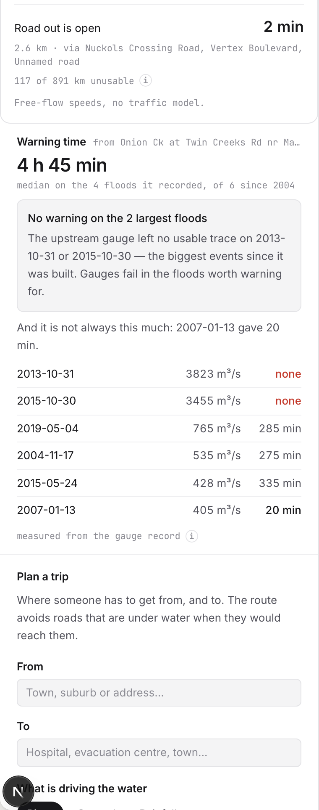

The two cards are worth reading as one screen. The road out is open and takes
**2 minutes**; the warning that would tell anyone to take it arrives **4 h 45
min** ahead — and on 2013-10-31 and 2015-10-30 it did not arrive. An
evacuation route is only as good as the notice to use it, and those are
measured by different instruments with different failure modes. The portal
shows both because showing either alone is the more comforting picture.

### Plan a trip

**From** and **To** are place searches (three characters, 350 ms debounce,
Nominatim through `/api/geocode`). Pick a driver, a storm, optionally type a
discharge, then **Find a way through**. A minute or two.

This one is *timed*: the service solves 13 snapshots over 12 hours and routes
against the water that is on the ground at the moment the driver reaches each
edge. It returns, in order:

- the written brief, in this shape: *decision, drive time and distance, the
roads it goes via, the deepest water on it and how far in, what it avoids and
how deep that is, and the deadline.* It is rendered from the route record and
then re-parsed and checked against it; if any checkable claim disagrees the
brief is withheld and the panel says which claims failed. There is no
language model in this path — `render` and `parse` are declared inverses;
- three tiles: drive time, distance by road, and the delay against a dry day;
- **How long this stays possible** — the last of 25 half-hourly departure slots
from which a route exists;
- **Water on the way** — every crossing over 5 cm, with the depth at the moment
the driver gets there;
- **Why not the direct road** — the crossings the water-blind route would hit;
- **Roads lost as the flood arrives** — one bar per snapshot; click a bar to
paint that instant on the map, and `back to peak` to return.

> **A discharge typed here runs as typed.** The control sends the design flag
> with the number, so Onion Creek's recorded 3,823 m³/s runs as 3,823 whatever
> storm pill is lit. Left *empty*, the estimate from the terrain is multiplied
> by the storm — 1× / 2.5× / 4×. Until recently this card sent the number
> without the flag and silently ran 9,557 m³/s at **Severe storm**; the Plan
> tab never had the bug and this card no longer does.

> **The conformal-margin blocks on this tab need a plan first.** "If the
> recommended walls are built … Stays open, 90% of the time" and "Route that
> still works if the water is deeper than estimated" are computed from the Plan
> tab's solved levee heights. On a fresh visit to Roads they are simply absent.
> Solve a plan (§3) and come back.

---


## 3 · Plan → Build a plan — where a wall would pay

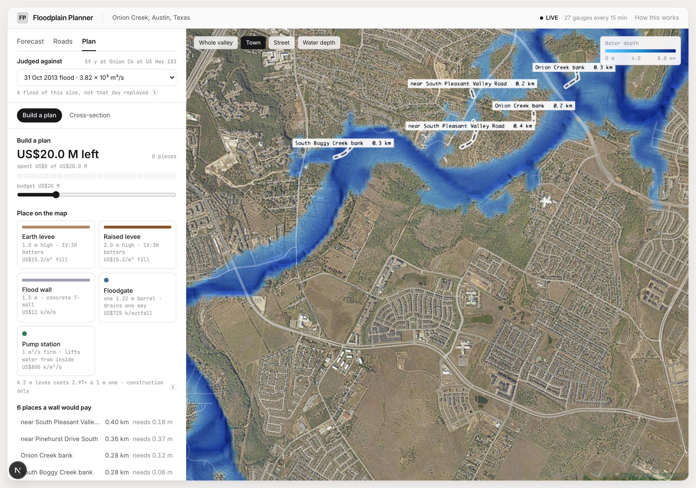

Click **Plan**. It opens in **Build a plan**. Two things happen without a
click: the gauge's flood record is read, and a bank search starts.

### Judged against


```
Judged against                       59 y at Onion Ck at US Hwy 183
[ 31 Oct 2013 flood · 3.82 × 10³ m³/s                             ▾ ]
A flood of this size, not that day replayed  (i)
```

The dropdown has three groups:


| Group                             | What it offers                         | Where it comes from                                                                      |
| --------------------------------- | -------------------------------------- | ---------------------------------------------------------------------------------------- |
| **Floods this reach has carried** | up to 4 recorded peaks                 | USGS NWIS annual peak streamflow, cfs → m³/s                                             |
| **Fitted from the record**        | the 1% and 4% annual chance discharges | log-Pearson III on the same record — log-space moments, Wilson–Hilferty frequency factor |
| **The study's own storm**         | 50 mm/h for 6 h                        | the shipped design event                                                                 |


Changing it throws away the bank list, every placed piece, the solved plan and
the cross-section, and starts the search again.

The line under it is the most important sentence on the tab — **a flood of
this size, not that day replayed.** Open its (i) for why:

> The discharge is the recorded one; what the map draws is this solver's
> response to it. The flow enters at the edge of the box rather than down
> eighty kilometres of catchment, and the model recovers about half of FEMA's
> mapped floodplain.

Two caveats the page does not spell out. The fit is station-skew log-Pearson III
— **not** Bulletin 17C: no regional skew weighting, no Expected Moments
Algorithm, no low-outlier test. And the inflow is held flat for `storm_hours`
(6 h, inherited from the design storm) and then released.

**And 31 October 2013 in particular cannot be replayed, by anything.** The
service *can* re-run a dated flood from the gauge's own hydrograph (§8), but
Onion Creek's gauge stopped for twenty-four hours across that peak — which is
also why the `3.82 × 10³ m³/s` in the dropdown is an annual-peak figure measured
afterwards from high-water marks rather than a reading. The nearest comparable
event the instrument survived is 30 October 2015, and §8 gives what the model
does with it.

### The kit

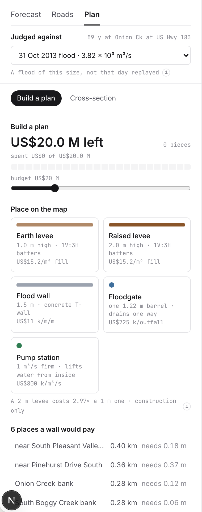

Five pieces. Click one to arm it, click a bank to place it.


| Piece            | Geometry                              | Rate             | Cost model                                |
| ---------------- | ------------------------------------- | ---------------- | ----------------------------------------- |
| **Earth levee**  | 1.0 m high · 1V:3H batters            | US$15.2/m³ fill  | `length × (3.048·H + 3·H²) × 15.2`        |
| **Raised levee** | 2.0 m high · 1V:3H batters            | US$15.2/m³ fill  | same — so 2 m costs **2.97×** 1 m, not 2× |
| **Flood wall**   | 1.5 m · concrete T-wall               | US$11 k/m/m      | linear in height                          |
| **Floodgate**    | one 1.22 m barrel · drains one way    | US$725 k/outfall | per structure                             |
| **Pump station** | 1 m³/s firm · lifts water from inside | US$800 k/m³/s    | per structure                             |


The panel shows one line — **a 2 m levee costs 2.97× a 1 m one · construction
only** — and its (i) carries the rates: USACE NLSP (Nov 2023, Mar 2023 price
level), escalated to 2025 by CWCCIS and × 0.88 for Texas. The gate and the pump are **real solver terms**,
not line items: the gate is a one-way `max(ΔH, 0)` exchange across the bank, the
pump a 1 m³/s lift with wet-well hysteresis at 0.30 m on / 0.10 m off.

> The prices are construction only. The panel says design, land and contingency
> roughly double the bill (2.1×) — and that factor is printed, never multiplied
> in. The budget bar understates project cost by about half, deliberately and
> in writing.


### The banks

```
6 places a wall would pay
near South Pleasant Valley Road   0.40 km   needs 0.18 m
near Pinehurst Drive South        0.36 km   needs 0.37 m
Onion Creek bank                  0.28 km   needs 0.12 m
…
Height is what the lowest point needs  (i)
```

A site is a contiguous run of **dry** cells that touch wet ones and are within
2 m of being overtopped, found from a full 40 m baseline solve — about 72
seconds. They are drawn on the map as dashed white-cased alignments; a taken
one goes solid.

A piece shorter than the bank needs says so. Put a 1.0 m Earth levee on a
bank reading `needs 1.83 m` and the row reads **`0.83 m short`** in the
warning colour instead of quietly swapping to a cost. It still lets you place
it — a short levee is a legitimate thing to price — but it will not let you
believe it holds.

### Placing and solving

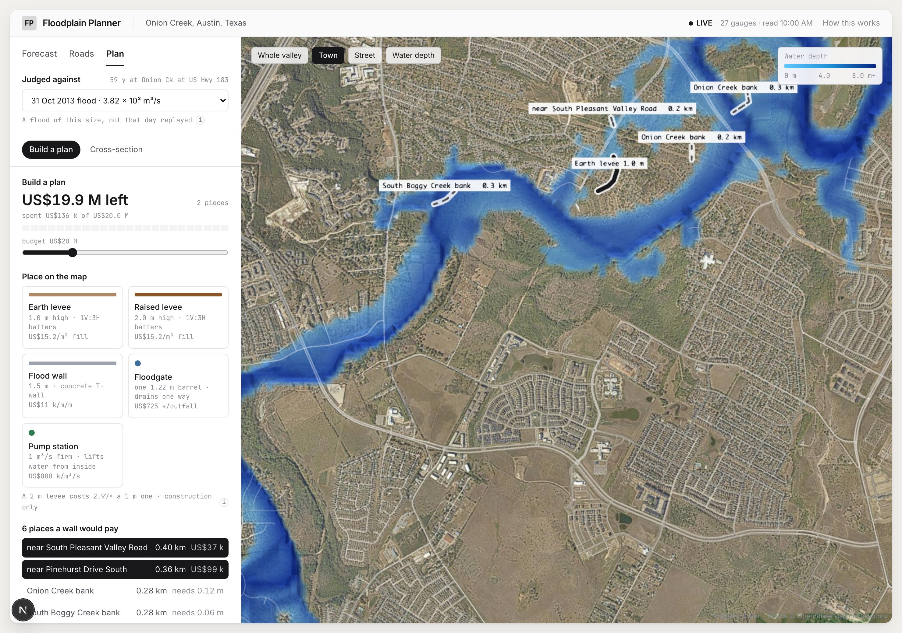

Arm **Earth levee**, click a bank; arm **Raised levee**, click another. The
header counts `2 pieces` and the budget bar fills. **Undo**, **Clear** and
**Save plan** sit at the bottom — Save writes a JSON file locally with the
scenario, the gauge fit, every piece and its cost, and the solved result.

**Solve this plan** needs at least two pieces. It enumerates a library of
candidate plans and solves one bed per plan in a single batched timestep loop
at 60 m over 12 hours — minutes, not seconds.

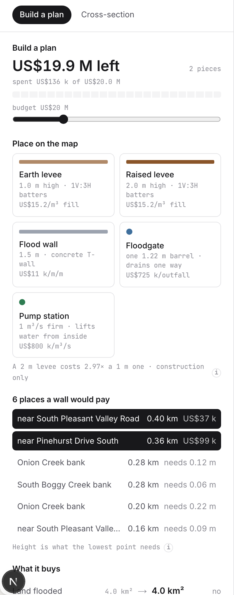

```
What it buys
Land flooded        4.0 km² → 4.0 km²     no change
Homes over floor        —  →  —             –
Road cut                —  →  —             –
```

That is the real readout for two levees on Onion Creek under the 2013 peak, and
it is the honest answer, not a loading state. §5.14m in the results log measured
the same thing: on this reach, under this scenario, two 2 m levees moved the
flooded area by -0.05% — slightly *worse*, not better.

- **Land flooded** is box-wide area over 10 cm, at the library's 60 m grid.
- **At least X% less flooding**, where a plan does buy something, is the change
in *mean depth over the protected strip* — the ground landward of your
alignments, a couple of km² — minus the conformal margin. It is a different
quantity over a different denominator from "Land flooded", and the panel
names the footprint underneath it: *"Per cent of mean depth over the ground
landward of 2 alignments, within 400 m of each — 0.7 km²."* It also says why
that denominator and not the box: *"a wall that halves the water behind it
moves a box-wide average by almost nothing."* A plan can move one of these
two numbers and not the other.
- Below four placed pieces there is no margin at all, and the panel says what
would buy one: **"No guarantee on this one — place 2 more pieces and the
margin can be calibrated. Split conformal needs nine combinations of two or
more sites before any finite order statistic carries 90%, and 2 sites
yields 2. Four yields seventeen."** Where the service itself refuses, its
refusal is shown verbatim instead, in the form
`NOT ATTAINABLE: 7 calibration runs, 9 needed for delta = 0.1; no margin is applied`.
- **Homes over floor** and **Road cut** are dashes because they are not
computed, and the panel says so: "the dash is 'not computed', not
'unchanged'".

> **The grids differ and the panel says so.** The bank search runs at 40 m, the
> plan library at 60 m. The totals in this table are not the area quoted beside
> the map; the *change* is sound because both of its columns come from the same
> grid.


### Before / With plan

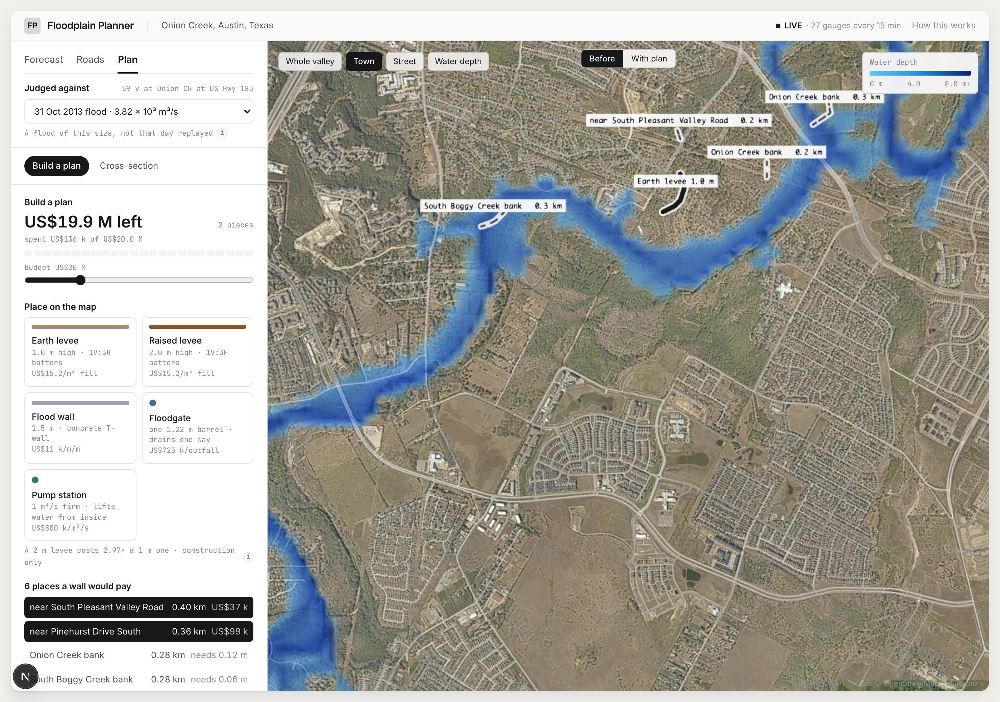

Once a plan is solved, a pair of pills appears over the top of the map. They
swap the painted flood between the do-nothing bed and the best solved option —
both from the library's own grid, so the pair on the map is the pair in the
table. When no solved option beats doing nothing, the map says
`no option beat doing nothing — same water` rather than repainting the same
field and letting you conclude the plan did nothing.

That is a real outcome here, not a defect: on this reach, under the design
storm, two 2 m levees made the flooded area very slightly *worse*.

Changing the pieces after a solve retires the readout and brings the solve
button back, so a result can never sit beside a plan that is no longer on the
map.

---


## 4 · Plan → Cross-section — how high, and what it costs

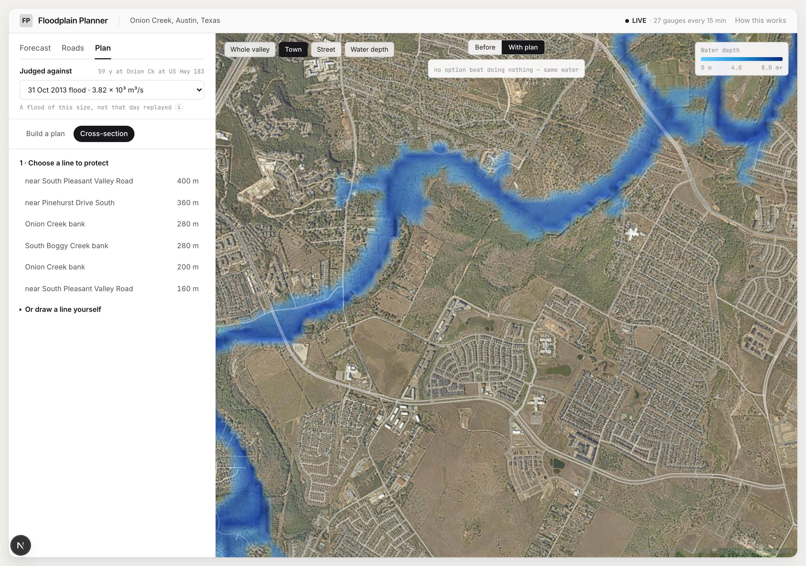

Click the **Cross-section** pill. Three numbered steps.

### 1 · Choose a line to protect

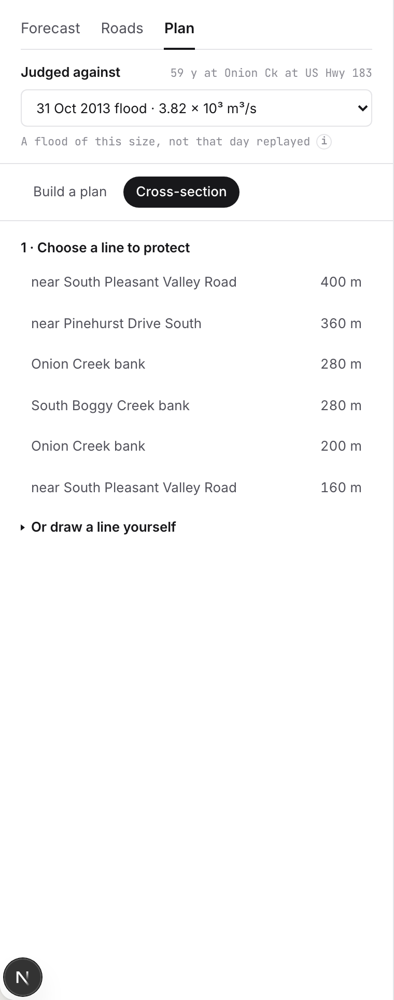

The same banks as the kit, listed by length. Click one and its precomputed
section line loads as ends **A** (town side) and **B** (river side). Or open
**Or draw a line yourself** → **Pick on the map** and click twice.

### 2 · Cut the section


**Cut the section** derives a box around A–B with at least 3 km of pad each
side, solves a 12-hour flood with a 6-hour storm, and returns ground and peak
water every ~30 m along the line. The strip under the map is the result:

```
A · town side        near South Pleasant Valley Road · elevation section        B · river side
                                                                 solved peak 167.08 m
        ╭───╮
   crest 167.38 m
0.80 km · sampled every 31 m from a 50 m model
```

The panel beside it:

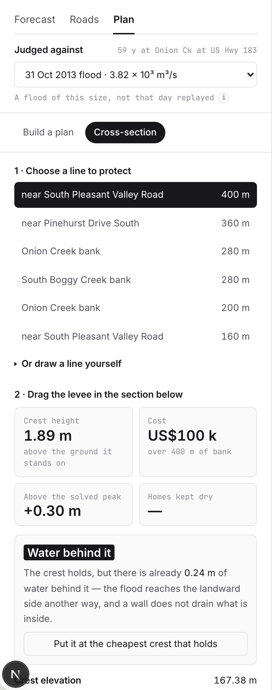

```
Crest height    1.89 m        Cost         US$100 k
above the ground it stands on  over 400 m of bank
Above the solved peak  +0.30 m      Homes kept dry  —  not counted
```

`Homes kept dry` reads `—  not counted`, not a zero. A bare dash would say the
wall saves nothing; the words say nobody counted. That distinction is asserted
by `verify-section.mjs` (§11), which caught it being lost once.


### 3 · Move the wall

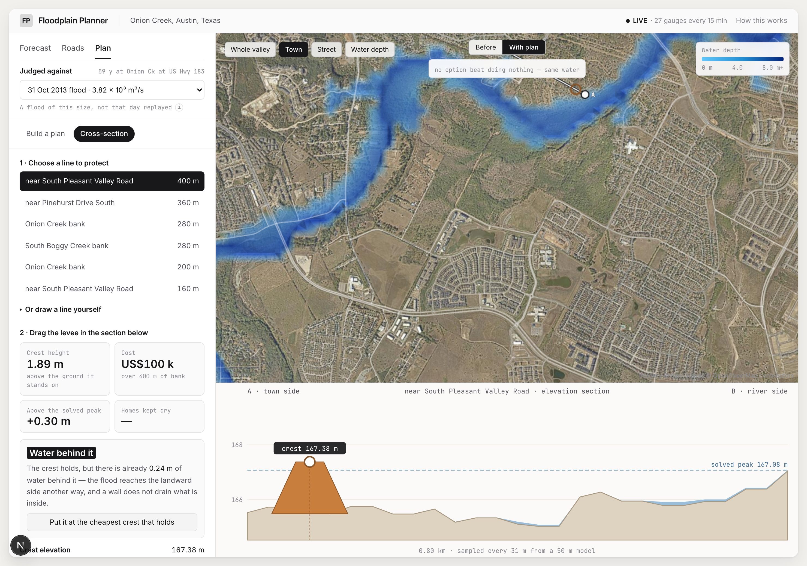

Two ways to move it:

- **Drag the white handle on the section.** Sideways moves the wall along the
line; upwards raises the crest. One drag sets both.
- **Crest elevation** slider — height only, in metres on the DEM datum,
0.05 m steps.

**Put it at the cheapest crest that holds** moves the wall to the highest ground
on the landward side (excluding the outer 8% of the line) and sets the crest to
the highest water on the river side plus 0.3 m of freeboard. In the capture
above it changed nothing, because the hand-placed wall was already there.

The verdict card under the numbers is the part worth reading:

> **Water behind it** — The crest holds, but there is already 0.24 m of water
> behind it — the flood reaches the landward side another way, and a wall does
> not drain what is inside.

Four verdicts: **holds**, **overtops**, **wet behind**, and **in the channel** —
the last reading "a wall here is a weir — drag it onto the bank", with its (i)
explaining that the section cannot tell a bank from a riverbed by elevation.

**What this costing assumes** folds open to the crest-height × length × rate
arithmetic, the service's own note, and the `driver_note` — which is where the
discharge that actually ran is written down.

---


## 5 · Plan → Operate — running what you built

The first two pills on this tab answer *what to build*. This one answers *how
to run it*, which has a different kind of answer: not one number but an
hour-by-hour schedule, and not one schedule but a comparison.

It exists because two of the five pieces in the kit have a **setting**. A levee
is either there or it is not. A floodgate can be open or shut, and a pump can
be running or idle, and both of those are decisions somebody has to take while
the water is rising.

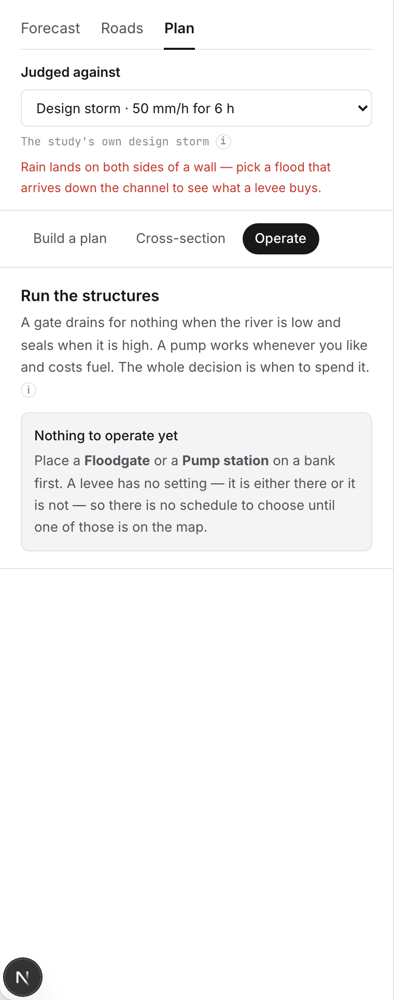

```
Run the structures
A gate drains for nothing when the river is low and seals when it is
high. A pump works whenever you like and costs fuel. The whole
decision is when to spend it.  (i)

Nothing to operate yet
Place a Floodgate or a Pump station on a bank first. A levee has no
setting — it is either there or it is not — so there is no schedule
to choose until one of those is on the map.
```

**That refusal is the design, not a gap.** There is no polder at Onion Creek.
A tab that showed a worked demonstration of gate-and-pump scheduling on a
reach that has neither would be showing something the portal cannot do, and
the easiest fiction to ship by accident. What it operates is the structures
**on the map**, so until you place one there is nothing to say.

### Placing something with a setting

Go back to **Build a plan**, arm **Floodgate** or **Pump station**, and click a
bank — the same placement the levee kit uses, and the gate and the pump are
already in the kit because `/plan` has priced and solved them since the
pluvial case made it necessary (§3).

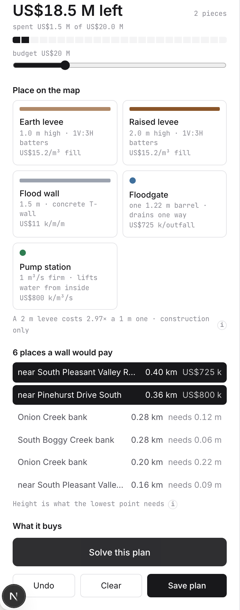

Then come back to **Operate**.

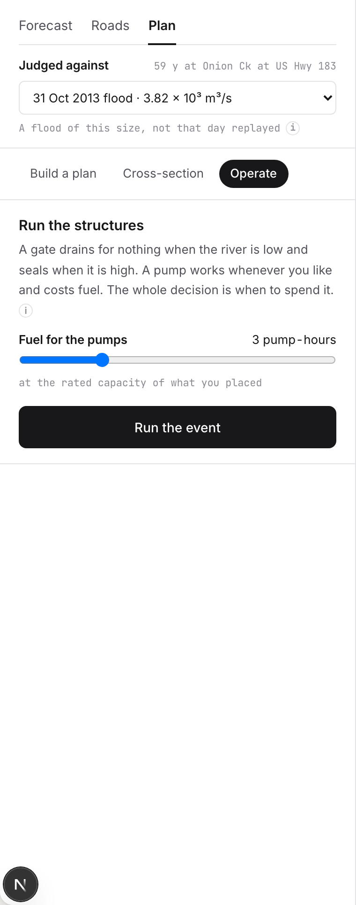

### The one control

**Fuel for the pumps**, in pump-hours at the rated capacity of what you
placed. This is the whole constraint, and it is deliberately the only thing
you set: the schedule is what is being chosen, not the hardware.

### What comes back

Every row runs the *same* structures on the *same* terrain through the *same*
event. Only the schedule differs, so the difference between two rows is the
operating decision and nothing else.

| controller | what it does |
| ---------- | ------------ |
| Do nothing | gate shut, pumps off — the floor to beat |
| Gate open, no pumping | gravity only, which is free and unavailable at the peak |
| Automatic level control | the solver's own deadband: pump when the sump is deep, stop when it is shallow. No model of the river. The incumbent |
| Pump only while the gate is sealed | spend the fuel in the window when gravity cannot help |
| Pump flat out | the upper bound, usually far over budget |

Under each result is the **schedule strip**: one column per control interval,
gate opening on top and pump on the bottom, darker meaning more. That strip is
the answer — the single number beside it is just how the answer scored.

### The honest result on this reach

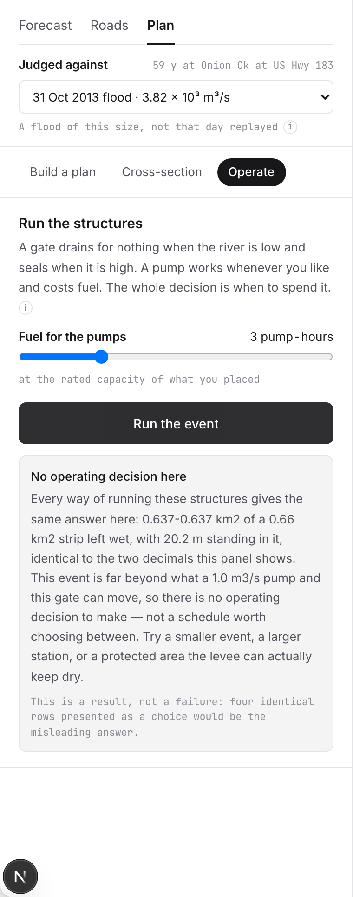

On the shipped study, at the 2013 peak, it refuses — and that refusal is the
most useful thing on the tab:

```
No operating decision here
Every way of running these structures gives the same answer here:
0.637–0.637 km2 of a 0.66 km2 strip left wet, with 20.2 m standing in
it, identical to the two decimals this panel shows. This event is far
beyond what a 1.0 m3/s pump and this gate can move, so there is no
operating decision to make — not a schedule worth choosing between.
Try a smaller event, a larger station, or a protected area the levee
can actually keep dry.

This is a result, not a failure: four identical rows presented as a
choice would be the misleading answer.
```

Ninety-six per cent of the protected ground is wet whatever you do, with
twenty metres standing in it. The arithmetic is not close: three pump-hours at
1 m³/s is 10,800 m³, which spread over that 0.66 km² strip is **16 mm** —
against 20.2 m of water. The structures are not a decision at this scale, and
four rows reading `0.64 km²` offered as a choice would be the most misleading
thing this endpoint could return.

**Two versions of that guard were not enough.** The first compared the spread
against the protected area, and let four rows through that the panel
*displayed* identically — a difference in the third decimal, presented as a
schedule worth picking. It now also refuses when the rows round to the same
number at the two decimals shown. If the figures on screen are the same
figure, there is nothing to choose, whatever is underneath them.

> This is the failure `pspe/envs/task.py` warns about for testbeds — *check
> that the RETURN separates, not only that the cost does* — arriving on real
> terrain. An environment where no action changes the outcome fails silently,
> because it still produces a ranking.

### Where it does have something to say

A gate and a pump answer the **pluvial** case: the levee keeps the river out,
and the rain falling inside the ring has no way out except gravity through the
gate or lift through the pump. That is the case `Structures` was written for —
§5.9 of the results log measured a quarter of the rain falling inside the area
being protected, where no levee placement helped at all.

So the tab is worth opening when the water inside is **rain**, and worth
closing when the river is over the levee anyway. The scenario picker at the top
of the tab is what moves you between those two worlds.

### What it actually runs

`pspe.envs.flood_env.FloodOperateEnv` — the same object a controller is
trained in, handed this domain's real terrain and the structures you placed
instead of a synthetic basin. That is deliberate rather than tidy: a portal
that scored a controller in a second implementation of its environment would
agree with training right up until it did not.

It is a constrained MDP. The state is the depth field, the bed, the ground
being protected and how far into the event you are; the action is a gate
opening and a pump capacity per interval; the reward is minus the
depth-weighted wet fraction of the protected ground; the cost is pump-hours
against the budget you set. §9 has what that environment is for beyond this
tab.

> **What this cannot tell you.** No observational record contains the
> counterfactual. Nobody logged what this ground would have done under a pump
> schedule other than the one its operator ran — and on this reach nobody ran
> one, because there are no such structures here. Every row is a model run
> compared with another model run, and the dynamics carry the defects §10
> lists: no culverts or bridges, a uniform Manning's *n*, a clipped catchment.

---


## 6 · Street — whose floor

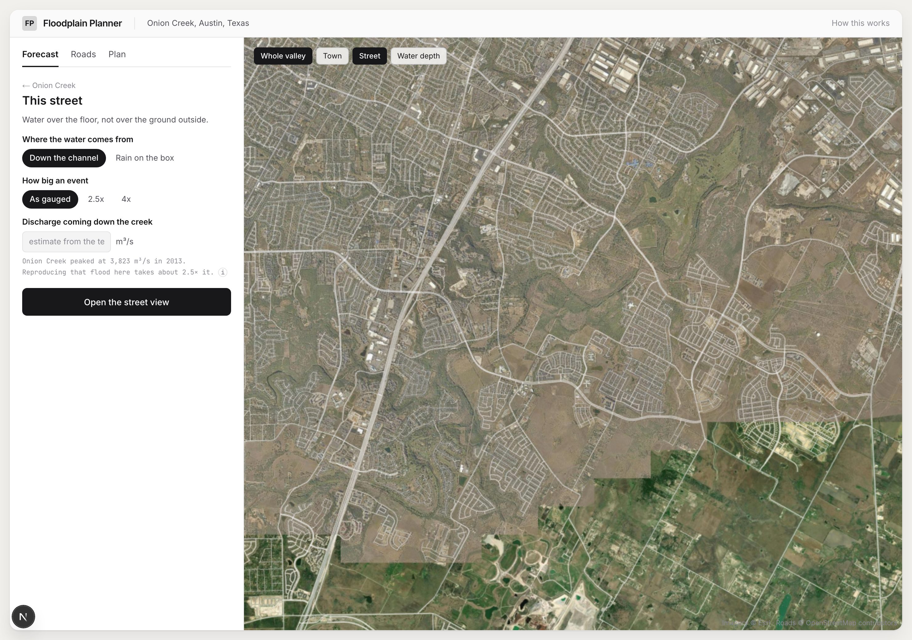

Click the **Street** chip over the map (its accessible name is "Zoom to street
level"). The whole left column is replaced.

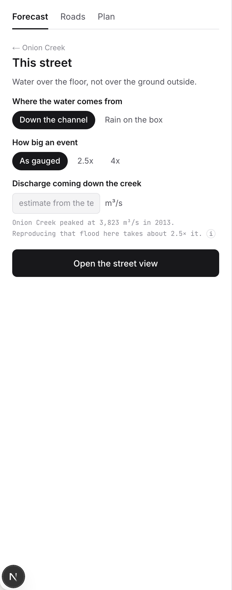

```
← Onion Creek
This street
Water over the floor, not over the ground outside.

Where the water comes from     [ Down the channel ] [ Rain on the box ]
How big an event               [ As gauged ] [ 2.5x ] [ 4x ]
Discharge coming down the creek  [ estimate from the te ] m³/s
Onion Creek peaked at 3,823 m³/s in 2013. Reproducing that
flood here takes about 2.5× it.  (i)

                      [ Open the street view ]
```

That last line is the one to read before you quote a count off this view. Its
(i) says why:

> At 3,823 m³/s with no multiplier this model puts 31 of this block's 78
> houses over their floors, with 2.90 m against the worst-hit one. At 2.5× it
> puts 60 of 78 over, with 4.85 m. 2013 flooded this neighbourhood severely
> enough to buy most of it out, so the multiplier is calibration against the
> recorded outcome — not a model that says nothing happens without it.
>
> What the multiplier stands in for is missing physics: a 14 km box truncates
> a catchment draining hundreds of square kilometres, and nothing here knows
> about the bridges and culverts that backed the water up. It is not the shape
> of the forcing — replaying the gauge's own hydrograph against the same peak
> held flat moves the flooded area by about 6% (§8).
>
> 3,823 m³/s is USGS's annual peak for 31 October 2013 at Onion Ck at US Hwy
> 183 — 135,000 cfs, measured indirectly from high-water marks after the
> event, because the gauge stopped recording across the peak.

> **That (i) used to say "no house over its floor at 1×", and it was not
> true.** Measured: 31 of 78. The sentence had been carried along unchecked
> while the discharge beside it changed, and it was the stated *reason* for
> the multiplier — so the knob was being justified by a model behaviour the
> model does not have. `verify-street-1x.mjs` (§11) asserts the real
> numbers now.

Treat the multiplier as the calibration knob it is — and note what it is
*not*. §8 runs the one comparison that separates the forcing's shape from the
model's physics: the same 3,455 m³/s peak held flat for six hours against the
same peak arriving as the gauge's own hydrograph, same box, same `dx`, same
driver. The two differ by about 6% of flooded area. **Shape is not the
multiplier**, which leaves the missing physics named in that (i) — the
truncated catchment, the absent culverts and bridges — as what the 2.5× is
standing in for.

### Opening it

This is the longest solve in the service: a 14 km parent catchment at 40 m with
13 snapshots over 18 hours, then a separate terrain fetch for the 1.7 km block
at 10 m, then building footprints and address points from the City of Austin.
**Two minutes is normal and cold it runs past the five minutes a browser's**
`fetch` **will wait.**

That limit is in the client, not the solver, and the page is built for it: the
work is keyed by request hash, so pressing **Look again** joins the run already
going instead of starting a second one. If it times out, ask again. Verified
end to end: two requests three seconds apart both reported `pending` at 240 s
and 243 s of one shared solve; the run finished, cached, and the next ask
returned 188 buildings instantly.

### The answer

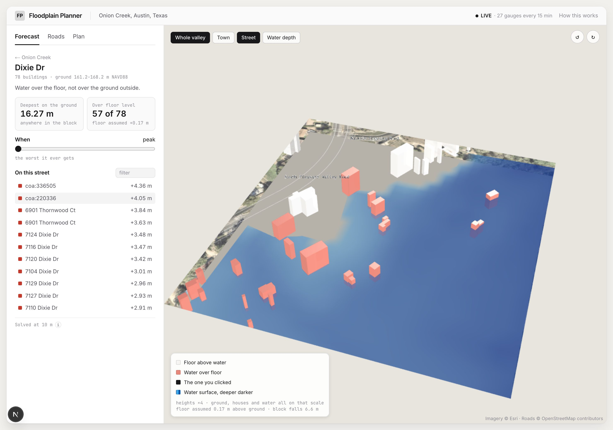

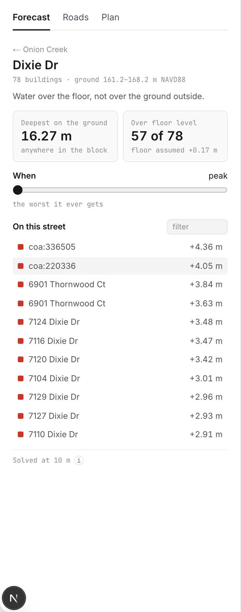

```
Dixie Dr
78 buildings · ground 161.2–168.2 m NAVD88

Water over the floor, not over the ground outside.

Deepest at a house       Over floor level
4.85 m                   60 of 78
16.7 m in the channel    floor assumed +0.17 m
```

**Those two depths used to be one number, and it was the wrong one.** The tile
read `Deepest on the ground · 16.27 m · anywhere in the block`, and 16 m of
water on a block whose ground spans 7.0 m (161.2–168.2 m) reads as a broken
model. It was not: that is the water standing in the **creek channel**, which
is incised well below the houses and is inside the 1.7 km box. The figure a
reader of this panel wants is the depth at a *building* — 4.85 m — so the
headline is now that, with the channel maximum demoted to the sub-line where
it cannot be mistaken for a street depth. Neither number is clipped: the 8 m
`DEPTH_VMAX` and the 6 m street ramp bound the *colour*, not the reported
depth.

Click any row — or any building on the map — for the per-building card:

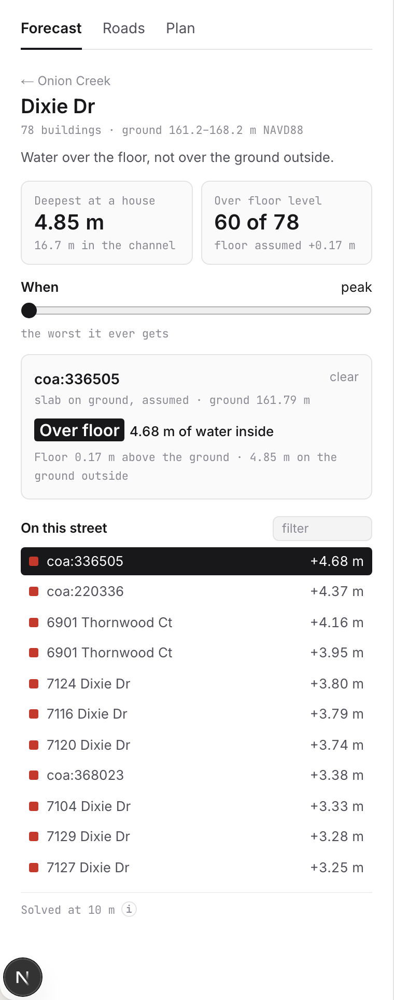

```
coa:336505                                          clear
slab on ground, assumed · ground 161.79 m
[ Over floor ]  4.68 m of water inside
Floor 0.17 m above the ground · 4.85 m on the ground outside
```


### Reading the model on the table

The street view is not a flood map. It is a scale model of one block, seen at
about 50°, and everything in it is drawn in one vertical frame:

- **The ground** is a matte stone slab with a visible lip — the solved 10 m
bare-earth terrain, with the satellite photograph left as context around it.
- **Each house** is an extruded box standing on *its own* ground. Bone means
the floor is above the water; salmon means the water is over the floor; the
one you clicked is near-black.
- **The water** is a surface, not a colour: a translucent mesh at the solved
water-surface elevation, cell by cell, so it carries the creek's gradient
and its edge is the shoreline. Deeper water reads darker.
- **Heights are exaggerated ×4**, and the legend says so. At true scale a 6 m
house against 2 m of water is six pixels against two — geometrically honest
and visually nothing. The *plan* is not exaggerated, and ground, houses and
water all go through the same multiplier, so the waterline sits where the
two surfaces really cross.

The legend, bottom-left, carries all four colours and the scale:

```
▢ Floor above water     ▢ Water over floor
▪ The one you clicked   ▬ Water surface, deeper darker
heights ×4 · ground, houses and water all on that scale
floor assumed 0.17 m above ground · block falls 6.6 m
```

Street names are drawn on the slab. The two buttons at the top right turn the
block 45° at a time, because the house you want is sometimes behind another
one.

> **The drawing and the panel use two different grounds, on purpose.** The
> boxes stand on the *solver's* DEM and the water is built from it, so the
> colours and the waterline agree. The panel quotes the *city survey* ground,
> which is the better number for a reader. On this block the two differ by up
> to 2.1 m, which is why the water plane is not built from the response's own
> `water_surface_m` field — that one mixes the two frames.

**Clicking behaves differently in the two places.** A click on the map selects
a house and does not move the camera — you are already looking at it. A click
in the list *navigates*, because the list is a directory sorted by depth and
its top row is often nowhere near the street on screen. On Onion Creek the
worst-hit house stands alone in open floodplain four hundred metres from the
nearest street.

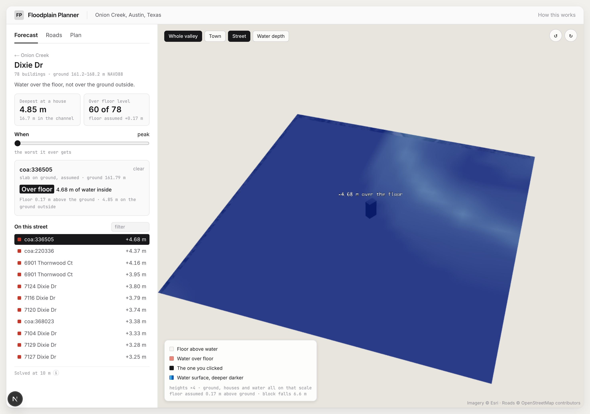

*That frame is the claim, not a nice picture of the street: clicking the top
row flew the camera off the block to `coa:336505`, which is a single box in
open water with no street anywhere near it. Compare it with the view above,
which is where the houses are.*

Selecting a house also draws a **probe**: a stick from its floor up to the
waterline, captioned with the figure — `+4.68 m over the floor` on the frame
above, floating over the one box in shot.

### The clock

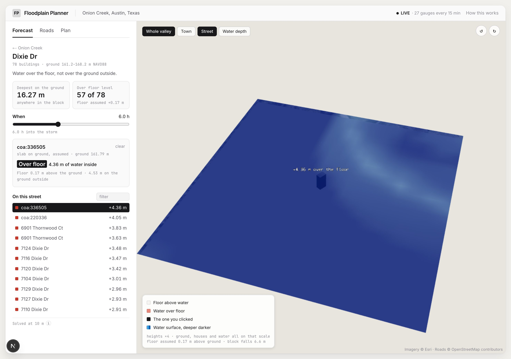

**When** runs from `peak` (the default) through the thirteen solved snapshots.
Move it and the water surface rises or falls, its edge moves across the block,
the building colours change and the per-building numbers follow. On Onion Creek
the block is dry at hour 0, peaks around hour 3, and is dry again by hour 9.

> **Two things to hold on to.** The floor height is a single assumed constant,
> `FLOOR_ABOVE_GROUND_M = 0.17 m`, applied to every building, because Austin
> does not publish finished floor elevations — and it is not a control. And no
> hydraulics are solved at 10 m: the 40 m catchment's water *surface* is
> sampled onto the fine grid and depth recomputed as surface minus fine ground.
> The 10 m is the ground, not the flow.

---


## 7 · What is slow, and why


| Action                     | Typical     | Hard limit             | What you see                               |
| -------------------------- | ----------- | ---------------------- | ------------------------------------------ |
| First paint                | seconds     | none                   | grey pulsing map                           |
| Gauge feed                 | seconds     | 110 s                  | no headline at all; Layers says `loading…` |
| Re-run with this storm     | ~60–90 s    | 280 s                  | seconds counter + a timer bar              |
| See what the satellite saw | 1–2 min     | 280 s                  | button text only                           |
| Find a way through (trip)  | 1–2 min     | 580 s                  | counter in the button                      |
| Finding banks              | ~72 s       | 580 s, shared          | counter + pulsing bar                      |
| Solve this plan            | minutes     | 280 s per ask, retried | button text only                           |
| Cut the section            | ~1 min      | 580 s                  | counter in the button                      |
| Open the street view       | ~2 min cold | 580 s, shared          | counter in the button                      |
| Run the event (Operate)    | ~5 min      | shared, joined on retry | counter in the button                      |


Four endpoints — `/sites`, `/plan`, `/buildings` and `/operate` — share
in-flight work: the first caller starts the solve, every other caller waits on
the same event, and asking again is free. `/operate` needs that more than the
others, because it runs one event per controller and outlives the five minutes
a browser's `fetch` will wait; the panel rejoins the same run rather than
asking you to. `/analyse`, `/route` and `/section` do not, so two
submissions of the same long request start two solves and each makes the other
slower. Wait rather than retry on those three.

The two endpoints in §8 have no button and therefore no progress bar — `curl`
sits there until they answer:

| Call        | Typical | What it is doing                                                       |
| ----------- | ------- | ---------------------------------------------------------------------- |
| `/validate` | ~40 s   | one solve of the box, plus a Sentinel-1 fetch and a 50-step threshold sweep |
| `/replay`   | ~500 s  | a 48 h run with the boundary re-interpolated from 576 gauge readings at every timestep |

Both can also come back in **seconds**, refused: `/validate` returns at about
10 s when the scene carries no usable water/land split, and `/replay` returns
almost immediately when the gauge record has a hole in it. Neither of those is
a failure — see §8.

---


## 8 · Reality in the loop — three things the service does and the screen does not

Everything in §1–§6 answers *what would happen if*. The three capabilities
below are the other direction: the river setting the boundary instead of a
slider, a day that really happened re-run from the record, and the satellite
marking the model's homework.

**None of them is a button.** They live on the solver's HTTP interface and
nothing in the portal sends them yet, so this section is `curl`, not clicks.
They are here because they are what a model coupled to its river would be
built on — and because running them changed what this guide says elsewhere:
the satellite's own water figures turned out to be wrong and are now withheld,
the gauge this reach is driven from turned out to be at the wrong end of the
box, and the street view's `2.5x` multiplier turned out not to be an artefact
of the forcing's shape.

### The gauge can drive the model

All six solving endpoints — `/analyse`, `/route`, `/section`, `/sites`,
`/plan` and `/buildings` — take `river_q_observed`, because it sits in the
forcing builder they share. Set it and the inflow comes from the reach's own
USGS gauge, the latest published discharge, instead of any chosen figure:

```bash
curl -s localhost:8000/analyse -H 'content-type: application/json' -d '{
  "west": -97.82, "south": 30.11, "east": -97.69, "north": 30.21,
  "name": "Onion Creek", "driver": "river", "river_q_observed": true }' \
| python3 -c 'import json,sys; d=json.load(sys.stdin); print(d["driver_note"])'
```

The gauge is matched by reach name against a box padded 0.12° beyond the study
area, on the reasoning that the gauge governing a reach usually sits outside
it. The reply's `driver_note` names the site and the reading it used:

```
0.01 m3/s on the west edge (channel from the mapped network), measured at
Onion Ck at Twin Creeks Rd nr Manchaca at 11:00. Held as a 0.0 m stage over a
180 m channel at a 0.0034 bed slope, draining to the east edge. No rain on
the box.
```

That run floods 0.01 km². Read the note as a chain of custody: which
instrument, at what time, applied to which edge, draining to which other
edge. Until recently it named a different gauge, and that is the next
paragraph.

**Expect that number to be small, and the flood with it.** Onion Creek runs
near zero most days — the headline in §1 was reading 0.0 m³/s when these
frames were captured — so an observed-driven run on a dry afternoon correctly
floods almost nothing. That is the feature working, not failing: the discharge
is printed to two decimals below 10 m³/s precisely so a dry day reads as a
number rather than as `0`. For a run with water in it, give the solver a date
that had some — which is the next endpoint.

**It used to pick the gauge at the wrong end of the box.** The selector
preferred whichever gauge carried NWS flood categories. On Onion Creek that is
`08159000`, *Onion Ck at US Hwy 183*, which NWIS puts at **30.17799,
−97.68861** — 0.13 km **past the box's east edge**, which is where this
model's water *leaves*. The gauge that feeds the box is `08158827`, *Onion Ck
at Twin Creeks Rd*, 0.11 km before the **west** edge; it has no flood
categories, so it was passed over.

The study box is, almost exactly, the reach between those two gauges, so every
observed-driven run was injecting the **outlet** discharge at the **inlet**.
On 30 October 2015 the daily means were 342.6 m³/s at Twin Creeks and
1,101.5 m³/s at US 183: **69% of that flood was generated inside the box**,
and the run fed all of it in from upstream, a box-length too early.

Two changes fix it. The gauge is now chosen **after** the channel is found, so
there is an inflow edge to reason about, and position along the flow axis
outranks flood categories — a gauge at the wrong end is physically wrong
whatever else it carries. Where nothing sits upstream, the nearest gauge is
still used, because most gauges are at outlets and refusing outright would
remove the feature from most rivers; but the reading is then marked
`position: "downstream"` and the note says so in the sentence a reader
actually sees:

```
… measured at Onion Ck at US Hwy 183 at 10:20 -- which is downstream of this
box, so the reading already contains runoff generated inside it.
```

**The figures below this line were produced before that fix**, so they carry
the defect. They are kept because what they measure — the difference between
two forcings that share it — is unaffected.

**It refuses rather than substituting.** No gauge on the reach, no discharge
published, or no channel to apply a reading to, and the request comes back
`422` with a reason:

```json
{"ok": false, "stage": "forcing",
 "reason": "this run was asked to be driven by the reach's own gauge, but no
            gauge on this reach is publishing discharge. Nothing was
            substituted: drive it with a discharge you choose, or pick a
            reach with a reporting gauge."}
```

That is the whole point: an observation that can be silently replaced by a
scenario is not an observation. Four separate bugs in the building of this
feature each ended in a confident number from the wrong evidence — the wrong
creek's gauge, the first gauge reporting anything, a rainfall fallback that
ran *before* the observed branch, and then the observed branch **returning**
to that same fallback when the gauge had nothing to give. The third and
fourth are the same mistake found twice: an earlier draft of this guide
claimed this refusal while the code still quietly produced a rainstorm.

### A dated flood can be re-run from the record

`POST /replay` takes a window and pulls the gauge's own hydrograph through it,
reading by reading, instead of holding one discharge flat for `storm_hours`:

```bash
curl -s localhost:8000/replay -H 'content-type: application/json' -d '{
  "west": -97.82, "south": 30.11, "east": -97.69, "north": 30.21,
  "name": "Onion Creek", "dx": 60,
  "start": "2015-10-30T00:00", "end": "2015-11-01T00:00" }'
```

That is the shipped study box at `dx` 60. The window returns 576 readings
over 48 h with no gaps, and the model says what it was driven by:

```
Replayed from the gauge: 576 readings over 48.0 h, peaking at 3,455 m3/s
(4.3 m stage) on the west edge. No rain on the box -- the hydrograph already
contains whatever rain fell upstream.
```

A peak of **3,455 m³/s** — the same order as 2013 — floods **3.51 km²**. It
took 501 s.

**What the replay is for: separating the forcing's shape from missing
physics.** The street view needs a `2.5x` multiplier to reproduce what
Halloween 2013 did to this neighbourhood. One explanation is that a design
discharge *held flat* for six hours is the wrong shape; the other is that the
model is missing physics. Only one comparison separates them — the **same
peak, same box, same `dx`, same driver, delivered two ways**:

| forcing of the same 3,455 m³/s peak      | water delivered | flooded  |
| ---------------------------------------- | --------------- | -------- |
| held flat for 6 h                        | 74.6 Mm³        | 3.74 km² |
| the gauge's own hydrograph, over 48 h    | 109.4 Mm³       | 3.51 km² |

**Forcing shape is worth about 6% of flooded area — it is not the
multiplier.** And the result is the opposite of the intuition that produced an
earlier, wrong version of this section: the real hydrograph delivers **47%
more water** than six hours held at the peak, and still floods slightly less,
because peak extent is set by the peak discharge and both peak at the same
3,455 m³/s. A 6% effect cannot account for a 2.5× calibration knob, so the
gap is **consistent with missing physics** — no culverts or bridges, a uniform
n = 0.035, and, for the street view's typed discharge, a 14 km box truncating
an eighty-kilometre catchment. That last one is *not* available as an excuse
for the two rows above: their inflow is measured at the outlet, so the whole
catchment is already in the number.

Three caveats, since this is the number most worth attacking:

- **The inflow is the wrong gauge**, per the defect above — 3,455 m³/s was
measured at the box's *outlet*, and about 69% of that flood was generated
inside the box. Both rows carry the same defect, so the *comparison* is
sound even though neither row is a good reconstruction of the day.
- **No rain falls on the box** in either row. 30 October 2015 was a heavy
local rain event in Austin, so a faithful replay needs the hydrograph at the
upstream gauge *plus* rain on the 138 km² under the model. That run has not
been done.
- **Neither figure is scored.** Nothing grades 3.51 or 3.74 km², so this
measures a difference between two model runs, not either one's accuracy.

For scale, the design storm the portal ships floods 18.71 km² (rain on the
box, 40 m) and FEMA's 1% map covers 23.69 km². Those are not rows in the table
above, because they change the driver and the grid as well as the forcing, and
changing three things at once measures none of them.

**2013 itself cannot be replayed, and that is the finding.** Ask for it and the
endpoint refuses:

```
the record at site 08159000 has a 24-hour hole from 2013-10-30T23:45 to
2013-11-01T00:00. Gauges fail in the floods worth replaying, and interpolating
across the gap would invent the event. Use the annual-peak value for this day,
or replay a window the instrument survived.
```

The refusal also reports `peak_in_record_m3s: 84.7`. That is the highest
discharge anywhere in the instrument's own record for 30 October – 2 November
2013, against the 3,823 m³/s the event actually ran. The gauge stopped before
midnight on the 30th and did not report again until a day later, by which time
the water had gone — so the flood is absent from the record of the gauge that
was standing in it.

Onion Creek's gauge at US Hwy 183 stopped across the peak of the flood this
portal is largely about. The first version of this endpoint interpolated
through the hole and reported 0.01 km² — a model calmly stating that nothing
happened during the flood the neighbourhood is named for. Any gap over two
hours now refuses and names it. It is also the answer to where the
**3,823 m³/s** everyone quotes for that day comes from: USGS's annual-peak
dataset, measured indirectly from high-water marks afterwards, precisely
*because* the instrument did not record it.

### The satellite can mark the model

`POST /validate` solves the box, pulls the most recent Sentinel-1 pass, and
scores the two against each other on the satellite's own footprint —
CSI, POD and FAR, the same three statistics as the FEMA comparison on
`/methodology/flood` (§9), so they read side by side.

The model's wet threshold is swept 0.02–1.0 m in 0.02 m steps unless you pin
`wet_m`, and the row returned at the top level is the **best** of those fifty.
That is choosing the answer after seeing the mark, so the reply also carries
`at_pinned`: the same comparison at the fixed 0.10 m this portal calls *wet*
everywhere else. **Quote both or neither** — the swept figure bounds what the
model could do, the pinned one is what it actually does. The response also
carries both masks as PNGs, so a reader can see *where* the two disagree
rather than accept one number for it.

The discharge used is the one measured **at the pass**, not the latest. The
first run of this endpoint scored CSI 0.0, and the fault was the test's: it
drove the solve with that minute's flow and marked it against a scene five days
old. The endpoint now refuses if no gauge reading sits within six hours of the
acquisition, because a skill score is only as good as the simultaneity behind
it. (That run is void twice over: the 2.58 km² it was marked against was
itself fabricated by the detector, as the next paragraphs explain. **No
Sentinel-1 skill score is reported as a result anywhere in this guide** — the
0.0 above is the account of a bug, not a measurement. Every skill score this
guide does quote is against FEMA's map, in §9.)

**At this site the satellite usually refuses to answer, and that is correct.**
Sentinel-1 flies this box on one orbit with a twelve-day repeat; Onion Creek
rises and drains inside a day. No pass in the record coincides with a flood
peak. The nearest to the May 2019 event — 765 m³/s, peaking 4 May 09:25 — is
8 May 00:35, by which time the creek was at 139 m³/s and falling. Asked to
score it, the detector refuses:

```
detection failed: no water/land split in this scene: Otsu put the threshold at
-8.4 dB with a trough depth of 0.00 (need < -12 dB and > 0.35). A unimodal
backscatter histogram means no open water large enough to see, not a flood
covering half the scene.
```

That guard exists because the loop immediately falsified a shipped number.
With model and observation finally in one frame, the detector claimed 2.58 km²
of new water on a day the creek ran at 0.138 m³/s, and 71 km² of a 138 km² box
as *permanent* water — displayed under the `OBSERVED` badge, the one that
means *a satellite recorded this, no model in between*. Otsu's threshold
cannot refuse: handed a unimodal histogram it splits the land distribution
down the middle and calls half of it water.

**The first version of that guard was itself wrong, in both directions.** It
floored Otsu's own separability (between-class variance over total variance)
at 0.55. That statistic measures class *balance*, not bimodality:

| scene                            | separability | trough depth |
| -------------------------------- | ------------ | ------------ |
| unimodal Gaussian                | 0.577        | 0.013        |
| unimodal, left-skewed            | 0.559        | −0.007       |
| bimodal, water 50% of the box    | 0.906        | 0.998        |
| bimodal, water **3%** of the box | 0.355        | 0.842        |

A split at the mean of *any* symmetric distribution captures 2/π ≈ 0.637 of
the variance, so a perfectly unimodal scene scores 0.58 — **above** the floor
meant to reject it. And a genuine flood covering 3% of the box scores 0.355 —
**below** it. Onion Creek in flood is about 2.5% of this study box, so the
floor was set to reject exactly the case it exists to measure. It passed its
two field tests by accident: both of those scenes also failed the
threshold-location test, which is what was really doing the work.

The guard now asks the question that was meant — **is there a valley where the
threshold was put, or does it sit on the slope of a single hump** — and gates
on that (`MIN_TROUGH = 0.35`) together with the requirement that the water
class land below −12 dB, where smooth water in VV actually sits. Separability
is still reported, and nothing gates on it. `tests/test_shadow_refusals.py`
pins both directions so the old floor cannot come back.

So **extent validation at this site has to come from FEMA's map or from
high-water marks**, which is what the limits page (§9) and §10 already say. This
is a mismatch between the sensor's revisit and the hazard's timescale, and no
amount of code closes it.

### What could grade the model here, and what cannot

The satellite cannot, for the reason above. The obvious alternative is the
gauge itself: the replay already carries the observed stage at every reading,
so comparing the modelled water surface at the gauge against it would give a
peak error, a timing error, and a rising-limb shape — the model-versus-reality
residual the conformal margin actually wants, available for every event the
instrument survived.

**It is not available at this site with this domain.** A stage comparison
needs a gauge *inside* the model. Both of this reach's gauges sit on its
boundaries:

| gauge                   | position                     | what the model does there      |
| ----------------------- | ---------------------------- | ------------------------------ |
| `08158827` Twin Creeks  | 0.11 km before the west edge | stage is **imposed** from the inflow discharge |
| `08159000` US Hwy 183   | 0.13 km past the east edge   | outside the grid; the nearest cell is the outflow boundary |

At the inflow the stage is computed *from* the discharge, so scoring it
against the gauge tests the channel-geometry arithmetic, not the hydraulics.
At the outflow there is no cell at the gauge at all, and the nearest one is
governed by the drain condition. Either way the comparison would grade a
boundary condition rather than the interior solution.

So the gauge test is real and worth having — it just needs a **domain that
contains a gauge**, which means moving the box rather than writing more code.
That is the next thing to do here, and it is not done. Until it is, the only
scored comparison this project has for flood extent is against FEMA's map
(§9), and the only one for depth is the Richmond reference solution.

### Where that leaves the claim

Carefully, because the obvious sentence here is an overclaim. **The solver can
now be coupled to its river and graded by a satellite — but nothing runs that
coupling on its own, and at this site the satellite cannot grade it.** All
three are on-demand API calls: no control on any panel sends
`river_q_observed`, nothing re-solves on a schedule, `/validate` has never
produced a reported score here, and the extent validation that does exist
falls back to FEMA's map and to high-water marks, neither of which is
automated.

So this is a **shadow-capable API**, not a digital shadow. The gap between the
two is a scheduler, a corrected inflow gauge, and a reference the satellite can
actually supply — not more code in the solver. It is certainly not a twin:
nothing here acts on the world, and that is an operational question rather than
a code one.

---


## 9 · How this works — the research pages

**How this works**, top right, opens four pages.

### /methodology — the overview

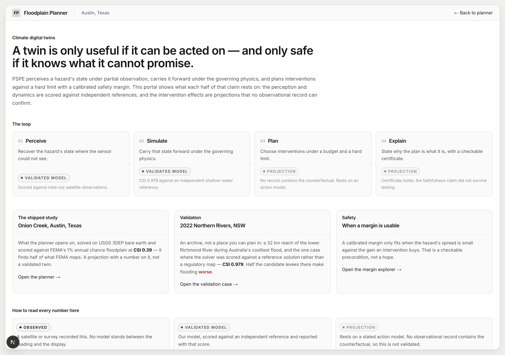

The four-stage loop with an evidence badge on each: Perceive and Simulate are
**VALIDATED MODEL**, Plan and Explain are **PROJECTION**. Three panels below
link out: the shipped Austin study, the Richmond validation case, and the margin
explorer.

The three badges are the portal's central honesty device, and their definitions
live in hover tooltips:

- **OBSERVED** — a satellite or survey recorded this; no model in between.
Read that strictly: it holds for a gauge reading, and only loosely for a SAR
water extent, where a threshold model stands between the measurement and the
polygon (§8). Nothing independent — JRC permanent water, for instance —
cross-checks a SAR figure before it gets this badge.
- **VALIDATED MODEL** — our model, scored against an independent reference and
reported with that score.
- **PROJECTION** — rests on a stated action model. No observational record
contains the counterfactual, so this is not validated.


### /methodology/flood — the validation case

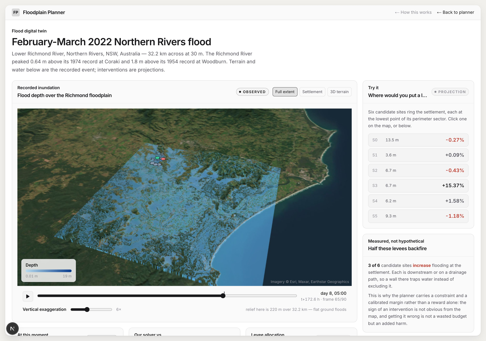

The February–March 2022 Northern Rivers flood, a 32.2 km reach of the lower
Richmond River — the one case where the solver was scored against a *reference
solution* rather than a regulatory map, CSI 0.979. Play the 90-frame replay,
tilt the terrain, raise the vertical exaggeration, and click any of the six
candidate levee sites.

The result that earns the page: **three of the six make flooding worse.** Each
of those is downstream or on a drainage path, so a wall there traps water
instead of excluding it. That is why the planner carries a constraint and a
calibrated margin rather than a reward alone.

Read the percentages carefully: +15.37% is 15.37% of an exposure-weighted peak
depth of 0.279 m — about 4 cm — and the absolute figure appears nowhere on the
page.

### /methodology/margin — when a guarantee is possible

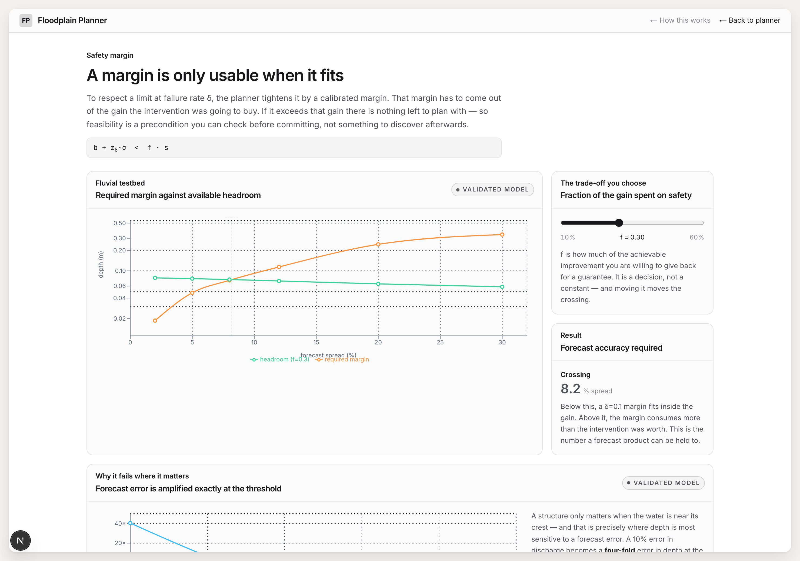

```
b + z_δ·σ  <  f · s
```

The feasibility precondition: the calibrated margin has to fit inside the
fraction `f` of the gain the intervention was going to buy. One slider — **f**,
10% to 60% — and the crossing moves with it. At f = 0.30 the crossing is 8.2%
forecast spread: below that a δ = 0.1 margin fits inside the gain; above it the
margin eats more than the intervention was worth.

The second chart is why it fails where it matters: a 10% error in discharge
becomes a several-fold error in depth right at the threshold, because that is
where a structure's effect is most sensitive.

δ is fixed at 0.1 on this page; the only control is f. The testbed terrain is
constructed, not surveyed.

### /methodology/limits — what this cannot show

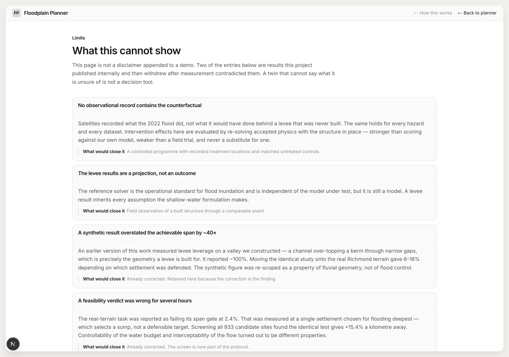

Eight entries, and two of them are results this project published internally and
then withdrew after measurement contradicted them — including a synthetic result
that overstated achievable span by about 40× and a feasibility verdict that was
wrong for several hours. They are kept because the correction *is* the finding.

---


## 10 · What it will not tell you

Collected in one place, because a tool that cannot say what it is unsure of is
not a decision tool.

**About the flood**

- The shipped field is a **uniform design rainstorm**, not a recorded event, and
it finds about half of FEMA's mapped 1% floodplain (CSI 0.39).
- Manning's *n* is 0.035 everywhere — channel and floodplain alike, no
land-cover field.
- Bankfull discharge, where you do not supply one, is DEM arithmetic: bank level
from the 20th percentile of box elevation, incision clamped to 0.5–6 m, slope
floored.
- A river or coastal boundary is held flat for `storm_hours` and then
released — *unless* a hydrograph is supplied, which only `/replay` does
(§8). Nothing you can reach from the screen moves the boundary.
- Culverts, bridges and storm drains are not modelled anywhere.
- Depth is quantised to 3.1 cm and clipped at 8 m for display and for every
click-anywhere reading, even where the solve itself is deeper.

**About the satellite**

- Sentinel-1 flies this box on one orbit with a twelve-day repeat, and Onion
Creek peaks and drains inside a day. **No pass in the record coincides with a
flood peak here**, so the satellite can confirm persistent inundation but
cannot grade a flash flood on this creek.
- The detector refuses when the scene's backscatter histogram carries no
water/land split, rather than reporting a number. Before that guard existed
it called 71 km² of a 138 km² box permanent water. The guard gates on the
depth of the valley at the threshold, **not** on Otsu's separability — that
first version admitted unimodal scenes and rejected floods covering a few
per cent of the box, which is what a flood here looks like (§8).
- The threshold that decides water is Otsu's, so `OBSERVED` on a SAR figure
means *a threshold model applied to a satellite measurement*, not a direct
observation. No independent check — against JRC permanent water, say —
stands behind it yet.
- The model *can* be scored against a pass (`/validate`, §8 — CSI, POD, FAR on
the satellite's own footprint), but because of the revisit mismatch above, at
this site it usually refuses. Extent validation here comes from FEMA's map or
from high-water marks instead.

**About the roads**

- Depth is the only passability variable. Velocity is solved and unused.
- Travel times are free-flow class speeds with no intersections, signals or
congestion, and every edge is bidirectional — a quoted detour can be an
illegal manoeuvre.
- "Getting out" uses the peak field; "Plan a trip" uses a 13-snapshot schedule.
They can disagree, and that is the methods differing, not the roads.
- The two "km cut" figures use different accounting (see §2).

**About operating what you built**

- A schedule only exists where a gate or a pump is on the map. A levee has no
setting, so the tab refuses rather than demonstrating on structures nobody
placed.
- Where every controller gives the same answer — which is what the shipped
study's 2013 peak does — it refuses rather than ranking four identical rows
(§5).
- The pump's rated capacity is whatever you placed, and the budget is in
pump-hours at that rating. Neither is a cost in money: fuel, power and crew
are not priced here the way construction is.
- No observational record contains the counterfactual. Nobody logged what this
ground would have done under a different pump schedule, and on this reach
there are no such structures at all, so every row is a model run compared
with another model run.

**About the plan**

- Homes over floor and road cut are not scored for a plan.
- Costs are construction only; the 2.1× all-in factor is printed, not applied.
- The published range behind each rate (earth fill is 4.64–49.9 US$/m³) is in
the code and not on the screen.
- The modelled embankment is floored at one cell wide, so at 60 m it occupies
more ground than the one you priced.
- The conformal band is calibrated on interaction residuals of multi-site
library plans; it is not a guarantee about an arbitrary plan you draw.

**About the buildings**

- One assumed floor height, 0.17 m, for every building in Austin.
- Addresses are a nearest-point join within 25 m, not a match.
- No hydraulics at 10 m — the fine grid carries the coarse solve's water
surface.

**Now behind an (i) rather than on the panel**

These are unchanged in substance; they simply no longer sit between you and a
control. Each is one click away in the place it applies.

- How the scenario discharge becomes a boundary condition, and why a recorded
flood is "a flood of this size" rather than that day replayed.
- The USACE rate provenance, the 2.1× all-in factor, and why an embankment's
cost is quadratic in height.
- How the candidate banks were found, and that they are not chosen by anyone.
- Why the street multiplier needs calibrating, and what the 10 m grid is and
is not.
- The travel-time model, the road-cut accounting, and the trip solve's own
statistics.
- That the river forecast "spread" is the day-to-day scatter of seven daily
forecast maxima, with no ensemble and no hindcast behind it.

**About "live"**

- The model can be driven by the gauge rather than by a storm preset
(`river_q_observed`), and refuses rather than substituting a design storm
when the reach has no instrument reporting. **No control on any panel sends
it** — it is an API flag (§8).
- The gauge it picks is now chosen by position along the flow axis, not by
which one carries flood categories. Where no gauge sits upstream of the
box, the reading is still used and marked `downstream`, which means it
already contains runoff generated inside the domain (§8).
- A dated flood can be re-run from the gauge record (`/replay`, §8), which
refuses when the record has a hole — Onion Creek's own gauge stopped for
24 hours across the peak of 31 October 2013, so the event this portal is
largely about is the one it cannot replay.
- The gauge feed polls every five minutes; nothing else does. Nothing on the
Roads or Plan tabs fetches it at all, so those tabs show whatever the
Forecast tab last read.
- The rain radar image is fetched once when you switch it on.
- A failed gauge fetch and a genuinely ungauged reach used to produce the
same message. They no longer do: an outage reads *"No reading right now"*
and says it is retried every five minutes, a reach with no instrument
reads *"No gauged stream in this box"*. The service had always
distinguished them; the panel was flattening both to the permanent one.

---


## 11 · Checking it yourself

The portal ships its own harness. With both servers up:

```bash
cd ~/pspe/portal
node scripts/verify-austin-default.mjs # the shipped study, the chrome, the click readout
node scripts/verify-getting-out.mjs    # the evacuation verdict is true, not just present
node scripts/verify-kit.mjs            # the levee kit end to end
node scripts/verify-section.mjs        # cut, drag, snap
node scripts/verify-section-math.mjs   # the trapezoidal volume and its cost
node scripts/verify-street.mjs         # the street view and the floor frame
node scripts/verify-before-after.mjs   # Before / With plan paint two different floods
node scripts/verify-street-1x.mjs      # the street multiplier's stated reason is true
node scripts/verify-operate.mjs        # the Operate panel, including its refusal
node scripts/verify-warning.mjs        # the warning card reports its failures, not just its median
node scripts/panel-weight.mjs          # how much text each panel puts on screen
```

and the service's own tests:

```bash
cd ~/pspe && python3 -m pytest tests/ -q
```

Each script prints one `ok` or `FAIL` line per claim and exits non-zero on any
failure. They are written against the *statements on the screen*, not against
internal state — which is why they have caught false headlines that every unit
test passed.

`tests/test_shadow_refusals.py` is the one to read if you care about §8. It
pins the five refusals that keep the observed path honest — the wrong-creek
match, the no-discharge refusal, the gauge-at-the-wrong-end fix, the replay
gap check, and the trough guard in both directions — with eleven tests and no
network. Each of those exists because the corresponding bug shipped: none of
them raised anything, they each produced a plausible flood.

One test fails at `HEAD`:
`test_safe_rl_correctness.py::test_algorithm_converges_to_the_closed_form_constrained_optimum[saute]`.
Nothing in the portal depends on it and it fails in a clean checkout, so it is
not something you broke — but it is not nothing either. Sauté RL is a reported
baseline in this project's safe-RL comparisons, and the canary catches it
collapsing to the tanh boundary on one seed in three, where a reward 3.2×
worse than achievable still scores a 0% violation rate. §3.4g of the results
log has the diagnosis and the rule it produced: *a zero violation rate and a
collapsed policy are the same measurement.*

---

*Captured against Onion Creek, Austin, Texas — USGS 3DEP bare earth, FEMA NFHL,
USGS NWIS, NOAA NWPS, OpenStreetMap, City of Austin building footprints and
address points, Esri World Imagery.*