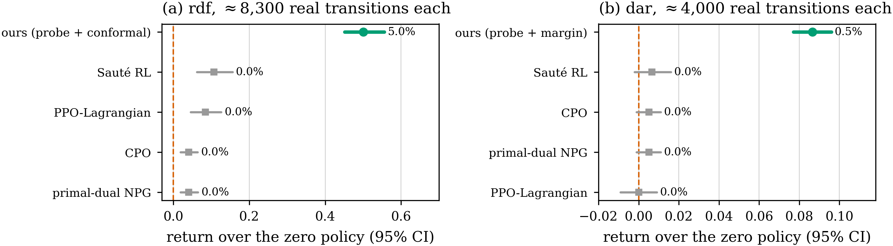
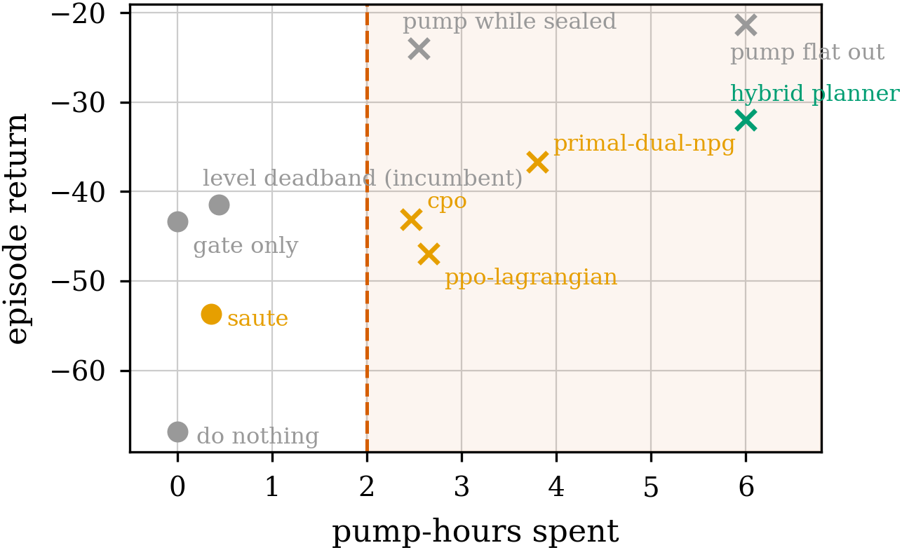
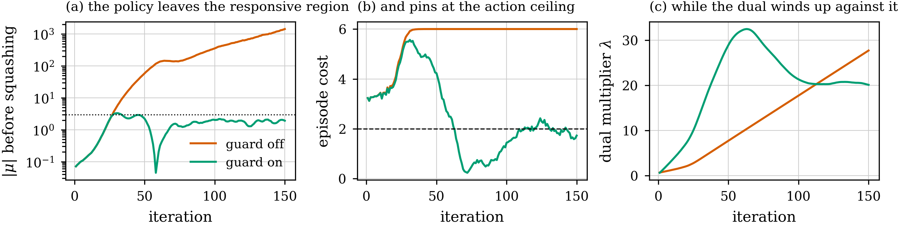
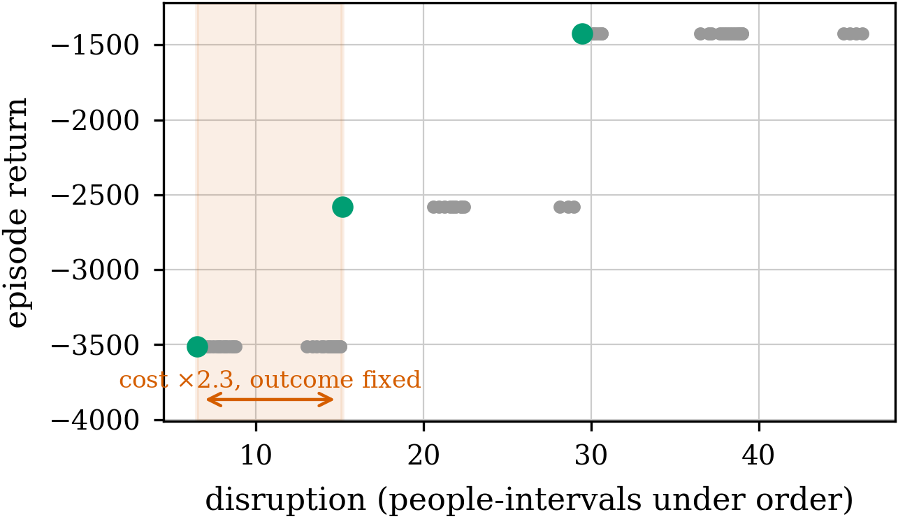
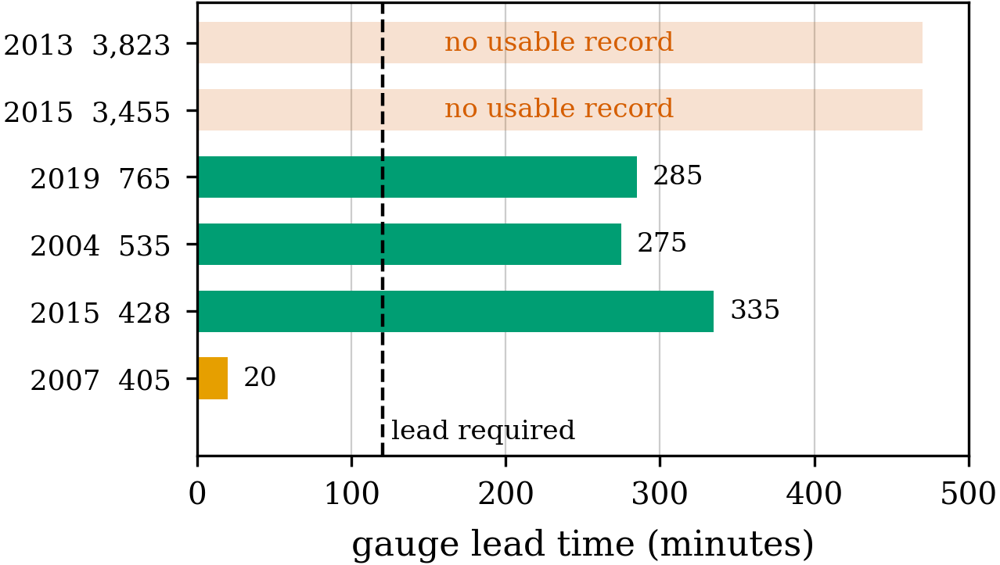

# PSPE — Constrained planning under learned dynamics

**A reading document for a technical audience.** It assumes comfort with
measure-theoretic probability at the level of quantiles and exchangeability,
with policy-gradient methods, and with PDEs as objects you discretise rather
than solve. It does **not** assume familiarity with this repository.

This is the project explained in the order the ideas depend on each other:
thesis, formalism, data, method, results, then the two applications. It is not
the project's history. `THESIS_AND_RESULTS.md` is the chronological record of
record and contains every experiment including the ones that failed; this
document contains the argument.

**Contents**

1. [The thesis](#1-the-thesis)
2. [Formalism](#2-formalism)
3. [The theory: what a margin must bound](#3-the-theory-what-a-margin-must-bound)
4. [Data](#4-data)
5. [Method](#5-method)
6. [Results](#6-results)
7. [Application I — the wildfire twin](#7-application-i--the-wildfire-twin)
8. [Application II — the flood twin and the decision gym](#8-application-ii--the-flood-twin-and-the-decision-gym)
9. [What the project claims, and what it does not](#9-what-the-project-claims-and-what-it-does-not)

---

## 1. The thesis

A planner that optimises inside a learned model inherits that model's errors.
Under an **expectation constraint** it inherits them *invisibly*.

The precise statement, which the rest of the document makes formal: a
Lagrangian dual controller enforcing `E[cost] ≤ d` is fed cost measured **in the
model**, while violation is realised under **true dynamics**. The dual
converges. Its diagnostics report the constraint satisfied. The real system
violates it. Nothing in the loop is in a position to notice, because the
discrepancy is exactly the difference between the dual's measurement and the
truth.

The project's contributions are:

1. **A characterisation of this failure**, in a form that predicts when it
   occurs rather than only reporting that it did (§3).
2. **An impossibility result.** The natural correction — inflate the cost
   estimate by how wrong the model is — *cannot* work. No margin measurable
   with respect to the model-error distribution alone controls violation
   probability uniformly in the spread of realised cost (Proposition 10.1).
3. **The admissible correction**, which follows from the same statement:
   calibrate against the quantity the dual actually controls, not against the
   model's error. A split-conformal quantile of realised episode cost attains
   the stated level, and refuses when its calibration set cannot support it.
4. **Two applications** on real observational data, where the method is
   measured against operational practice rather than against itself.

A fifth thing is worth stating as a thesis rather than a result, because it
shaped the whole project: **the map from component metric to decision quality
is not monotone.** A surrogate with better rollout error, or a state estimate
with better reconstruction accuracy, does not imply a better decision — and in
three measured instances the relationship inverts. Every evaluation in §6
therefore scores the decision, not the component.

---

## 2. Formalism

### 2.1 The control problem

A field `u(x,t)` on a spatial domain `Ω ⊂ ℝ²` evolves under a PDE with a
control term:

```
∂u/∂t  =  𝒩[u]  +  ℬ(a(t)),        u(·,0) = u₀,        x ∈ Ω
```

`𝒩` is the (nonlinear) spatial operator — diffusion, advection, reaction, or
shallow-water dynamics. `ℬ` maps an actuator vector `a ∈ [−1,1]^K` to a forcing
field through a Gaussian basis:

```
ℬ(a)(x)  =  Σ_{k=1..K}  A · a_k · exp( −‖x − c_k‖² / 2σ² )
```

`A` is the actuator amplitude. It is not a nuisance parameter: it determines
whether a testbed can separate planners at all, and a family whose achievable
return band is narrow cannot rank methods however carefully they are run.

Discretised on an `N × N` grid with step `Δt`, the true transition is
`u_{t+1} = F(u_t, a_t)`, and the learned surrogate is `G_θ ≈ F`.

### 2.2 The constrained objective

A CMDP over horizon `H`:

```
maximise    J_R(π)  =  E_π [ Σ_{t<H} γ^t r(u_t, a_t) ]
subject to  J_C(π)  =  E_π [ Σ_{t<H} c(u_t, a_t) ]  ≤  d
```

with tracking reward and cost

```
r(u,a)  =  −w_track ‖u_[ch] − u*‖²_Ω  −  w_act ‖a‖²
c(u,a)  =  Σ_x relu( |u_[ch](x)| − u_max )  +  relu( mean|a| − budget )
```

A second dual enforces an equity constraint penalising concentration of harm
across sub-regions.

**The limit is calibrated, not chosen.** With `c₀` the cost of doing nothing
and `c_g` the cost a reward-greedy policy incurs,

```
d  =  c₀  +  0.35 · (c_g − c₀)
```

so a constrained learner must surrender a real share of greedy behaviour. This
is necessary for a meaningful comparison and, as §6.4 notes, not sufficient.

### 2.3 The hybrid policy gradient

The per-step Lagrangian is `ℒ = −(r − λ c)`. Two estimators of `∇_φ E[ℒ]`:

```
pathwise (reparameterised, through G_θ)
    g_pw  =  ∇_φ ℒ( rollout(G_θ, π_φ) )          low variance, biased by ‖G_θ − F‖

likelihood ratio (score function, critic baseline)
    g_lr  =  −E[ ∇_φ log π_φ(a|u) · Â ],   Â = (R − V(u))/σ_R      unbiased, high variance
```

mixed as `g(α) = α g_pw + (1−α) g_lr`. Minimising the MSE of the mixture,

```
MSE(α)  =  α²(B² + V_p)  +  (1−α)² V_L  +  2α(1−α) Cov

α*  =  (V_L − Cov) / (B² + V_p + V_L − 2 Cov)                           (Eq. 8)
```

where `B = ‖E[g_pw^{G_θ}] − E[g_pw^{F}]‖` is the pathwise bias induced by
surrogate error. Setting `B = 0` recovers the variance-only rule.

Two properties of this rule matter later and are easy to miss:

- `B` must be **measured**, which costs real rollouts. A sample-efficiency
  claim that ignores the probe cost is not a claim about this method.
- The rule selects on variance. A branch whose gradient is identically zero has
  zero variance, which the rule reads as perfect precision. §8.5 is an instance
  where this happens physically, and it is a property of any variance-selecting
  estimator, not of this one.

### 2.4 The dual

A PID-Lagrangian controller on the constraint error `e_k = Ĵ_C,k − d`:

```
λ_k  =  clip( K_p e_k  +  K_i I_k  +  K_d max(0, e_k − e_{k−1}),  0,  λ_max )
I_k  =  max(0, I_{k−1} + e_k)
```

with `Ĵ_C` an EMA of measured episode cost. `K_i` is the gain that decides
whether the controller holds or oscillates.

### 2.5 The surrogate

A Fourier Neural Operator. Per block, with `ℱ` the 2-D DFT and modes truncated
at `k ≤ k_max = 12`:

```
v_{ℓ+1}(x)  =  σ(  W v_ℓ(x)  +  ℱ⁻¹[ R_ℓ · ℱ[v_ℓ] ](x)  )
```

`R_ℓ ∈ ℂ^{k_max × k_max × w × w}` are learned spectral weights; `W` is a 1×1
convolution carrying the high frequencies truncation discards. Trained on

```
ℒ_sim  =  ‖G_θ(u,a) − u'‖²  +  β_roll Σ_{h≤H} ‖G_θ^h(u,a) − u_{t+h}‖²
                             +  β_phys ‖ℛ[G_θ(u,a)]‖²
```

Optional spectral normalisation projects each `R_ℓ` to bound the operator norm,
supplying the Lipschitz constant the continuity assumption requires.

### 2.6 The twin loop

A belief `û_t`, model `G_θ`, and an observation operator `𝒪` returning a
partially observed field with validity mask `m_t`:

```
forecast:   ũ_{t+1}  =  G_θ(û_t, a_t)
observe:    (y_{t+1}, m_{t+1})  =  𝒪(u_{t+1})
sync:       û_{t+1}  =  m_{t+1} ⊙ y_{t+1}  +  (1 − m_{t+1}) ⊙ Φ(ũ_{t+1}, y_{t+1})
adapt:      θ  ←  θ − η ∇_θ ℓ( G_θ(û_t, a_t), y_{t+1} )      [on observed cells]
```

`Φ` is the imputation rule for unobserved cells. The open-loop baseline is
`m ≡ 0` for all `t > 0` — never look again.


*Figure 1. The combined architecture. Green paths carry real measurement back
into the loop and are validated against observation. The dashed path is model
based and cannot be validated on any observational record; §9 states why.*

---

## 3. The theory: what a margin must bound

This section is the technical core. It is short because the result is sharp.

### 3.1 Setup

Write the realised episode cost of a trained policy as

```
c_i  =  μ + b + σ ξ_i ,        ξ_i ~ F ,   E ξ = 0 ,   scale 1          (1)
```

- `μ` — the quantity the dual holds, i.e. the surrogate's own estimate of `E[c]`
- `b` — the surrogate's **bias** on episode cost, `b = E[c] − μ`
- `σ` — the policy's **episode-to-episode spread** of realised cost
- `F` — the standardised shape of that spread

The surrogate's per-instance estimate satisfies

```
c_i − g_i  =  b − e_i ,        e_i ~ G ,   E e = 0 ,   scale ε          (2)
```

so `G` is the **model-error** distribution. Define the only dimensionless
quantity in the theory:

```
ρ  =  σ / ε                                                             (3)
```

Write `z^F_δ = F⁻¹(1−δ)`. A margin `q ≥ 0` lowers the effective limit to
`d_eff = d − q`, so

```
violation_i  ⟺  c_i > d  ⟺  σ ξ_i > q − b
```

giving the realised violation rate and the coverage condition:

```
R(q; σ)  =  1 − F( (q − b)/σ )                                          (4)

coverage at δ   ⟺   R(q; σ) ≤ δ   ⟺   q ≥ b + z^F_δ σ                   (5)
```

**Equation (5) is the entire problem in one line: the margin must scale with
`σ`.**

Call a margin rule **model-error measurable** if `q = Q(b, G)` — a function of
how wrong the model is, with no dependence on `F` or `σ`. Every correction of
the form "inflate by model uncertainty" is of this type, however the
uncertainty is summarised: an error bound, an ensemble spread, a learned
variance, a pessimism bonus, a cost critic.

### 3.2 The silent failure, formally

Set `q = 0` in (4). For symmetric `F`,

```
R(0; σ)  =  1 − F(−b/σ)  =  F(b/σ)                                      (6)
```

With no margin the violation rate is **the bias measured in units of spread**,
and nothing else. Three consequences:

1. A surrogate can be arbitrarily accurate in relative `L²` and still produce
   any violation rate, because (6) depends on `b/σ`, not on `‖G_θ − F‖`. This
   is why a surrogate-quality sweep finds violation uncorrelated with rollout
   error.
2. The dual converges on `μ`, and `μ` is *defined* to satisfy `μ ≤ d`. Its
   diagnostics are therefore correct and uninformative: the dual cannot see `b`,
   because `b` is the difference between its measurement and the truth.
3. Detection requires a statistic the surrogate does not supply. Probing the
   true environment every `k` iterations yields matched pairs `(c_i, g_i)` and
   hence `b` and `σ`. Nothing internal to the loop does.

### 3.3 The separation theorem

**Proposition 1 (separation).** Let `Q` be model-error measurable, `q = Q(b,G)`,
and let `F` have full support on `ℝ` with positive density. Then

1. `σ ↦ R(q; σ)` is strictly increasing on `σ > 0` whenever `q > b`;
2. `R(q; σ) → 1 − F(0)` as `σ → ∞`, which is `½` for symmetric `F`;
3. `R(q; σ) > δ` for every `σ > (q − b)/z^F_δ`.

Consequently, for any `δ < 1 − F(0)`,

```
sup_{σ>0}  R(Q(b,G); σ)  =  1 − F(0)  >  δ
```

so **no model-error-measurable margin attains level δ uniformly in σ.**

*Proof.* Put `t(σ) = (q−b)/σ`. If `q > b` then `t > 0` and `t` is strictly
decreasing in `σ`; `F` is strictly increasing by positive density; so
`R = 1 − F(t)` is strictly increasing, giving (1). As `σ → ∞`, `t → 0⁺`, and
continuity of `F` gives `R → 1 − F(0)`, which is (2); symmetry makes
`F(0) = ½`. For (3), `R > δ ⟺ F(t) < 1−δ ⟺ t < z^F_δ ⟺ σ > (q−b)/z^F_δ`. The
supremum follows from (1) and (2). ∎

**Read the hypotheses carefully.** Full support and positive density give
*strictness* in (1); without them `R` is non-decreasing, which still suffices.
Symmetry is used only to evaluate the limit. The restriction `δ < 1 − F(0)` is
not a technicality: a user asking for `δ ≥ ½` on a symmetric cost is asking for
something a zero margin already provides.

**What the result is.** Not a tightness statement about a particular estimator,
and not asymptotic. It says the *class* of margins measurable with respect to
model error has a coverage ceiling independent of how the margin is computed
inside that class, and gives the exact `σ` at which each member breaks. **The
choice of which distribution to conformalise is a feasibility constraint, not a
modelling preference.**

### 3.4 Closed-form coverage, and an exact crossover

**Corollary 1.** For Gaussian `F` and `G`, the matched-pair recipe's realised
violation rate is

```
R(ρ)  =  1 − Φ( z_δ / ρ ) ,        z_δ = Φ⁻¹(1−δ)                       (7)
```

Two testable properties. First, **exact calibration at the crossover**:
`R(1) = 1 − Φ(z_δ) = δ` identically, for every `δ`. Second, (7) describes the
entire departure from exactness as a function of the single quantity `ρ`.

This is the project's sharpest empirical prediction, and §6.1 reports it
measured to within 0.003 across two orders of magnitude in `ρ`.

### 3.5 What a valid margin must use

**Corollary 2 (necessity).** Any margin attaining `δ` uniformly in `σ` must
depend on `F` and `σ`. *Immediate from Proposition 1.*

**Corollary 3 (sufficiency of the realised-cost score).** Let `μ̂` be the
quantity the dual controls and define `s_i = c_i − μ̂`. Then `Q_{1−δ}(s)`
attains `δ`.

*Proof.* With `μ̂ = μ` at the dual's fixed point, (1) gives `s_i = b + σ ξ_i`, so

```
Q_{1−δ}(s)  =  b + z^F_δ σ                                              (8)
```

which is exactly the right-hand side of the coverage condition (5). ∎

The recipe is therefore forced, not chosen: conformalise **realised episode
cost against the quantity the dual controls**.

### 3.6 Finite samples, and the refusal

Given `n` exchangeable calibration scores, split conformal takes

```
k  =  ⌈(n+1)(1−δ)⌉ ,        q̂  =  s_(k)
```

and gives `P[s_{n+1} ≤ q̂] ≥ 1−δ`. The construction requires `k ≤ n`:

```
⌈(n+1)(1−δ)⌉ ≤ n   ⟺   n  ≥  1/δ − 1                                    (9)
```

Below (9) **no order statistic of the sample carries the guarantee.** The
implementation returns `None` rather than the sample maximum. Three
consequences used throughout:

- `δ = 0.1` needs `n ≥ 9`; `δ = 0.05` needs `n ≥ 19`; `δ = 0.01` needs `n ≥ 99`.
- With `n` fixed the highest attainable confidence is `1 − 1/(n+1)`: at `n = 30`
  held-out runs, **96.8%**.
- A normal-approximation interval always returns a number. (9) is the reason to
  prefer a method that can decline.

---

## 4. Data

### 4.1 Synthetic testbeds

Three PDE families, each discretised to a CMDP as in §2:

| id | PDE | state channels | calibrated limit `d` | role |
|---|---|---|---|---|
| `dar` | diffusion–advection–reaction | 1 | 0.936 | primary testbed |
| `rdf` | reaction–diffusion front | 2 | 3.26 | where the margin separates |
| `swe` | shallow water | 3 | 1.1437 | third family, anchored by a trained greedy policy |

The limits are calibrated by §2.2's rule rather than chosen, which is what
makes the three comparable.

### 4.2 Real observational data

| dataset | content | scale | used for |
|---|---|---|---|
| **PDEBench** 2-D shallow water | solver trajectories | 512 trajectories | surrogate benchmark |
| **NDWS** (Next Day Wildfire Spread) | real US fire days: day-`t` mask + 11 remote-sensing drivers, 64 km patches | ~18k fire days, 2.3 GB | forecasting, planning, partial observation |
| **FIRMS** VIIRS active fire | 8 large wildfires, 14–20 consecutive days of real detections | per-fire download | the sequential twin loop |
| **USGS 3DEP** | bare-earth elevation, 1/3 arc-second | per study box | flood terrain |
| **USGS NWIS** | river stage and discharge, instantaneous values and annual peaks | 27 gauges on the shipped reach | flood forcing, and the warning-time study |
| **OpenStreetMap** | road network geometry and class | 3,659 segments on the shipped reach | evacuation routing |
| **Sentinel-1 SAR** | flood extent observation | per event | independent validation of the flood solver |

NDWS drivers are themselves real remote-sensing products (MODIS NDVI, gridded
meteorology, VIIRS/MODIS fire masks). FIRMS supplies what NDWS structurally
cannot — **sequences of the same fire** — because NDWS records carry no date,
no fire identifier and no location.

---

## 5. Method

The system is four modules around a measurement loop. What distinguishes it is
not the modules but **which paths carry real measurement**.

### 5.1 Perceive

Reconstruct a belief `û` from partial observation. The design decision that
matters is the scoring rule: a belief is scored on **the decision it supports**,
not on reconstruction accuracy. §9 explains why this is not pedantry.

### 5.2 Simulate

The FNO surrogate of §2.5, trained with a rollout term so that multi-step error
is penalised directly rather than inherited from one-step training.

### 5.3 Plan

The hybrid gradient of §2.3 inside the surrogate, with the PID dual of §2.4 on
the budget, and — this is the contribution — a **periodic probe of the true
environment** supplying matched pairs `(c_i, g_i)`. The probe does two jobs:

1. It measures the pathwise bias `B` that Eq. 8 needs.
2. It supplies the conformal calibration set of §3.5, from which the margin is
   the `⌈(n+1)(1−δ)⌉`-th order statistic of `s_i = c_i − μ̂`.

The planner targets `d_eff = d − q̂` rather than `d`.

### 5.4 Explain

A brief `b` is parsed by a frozen deterministic parser into an action
distribution `π̂_b` and scored

```
F(b)  =  exp( −KL( π_φ(·|u) ‖ π̂_b ) / K )
```

KL **per dimension**: summed KL is incomparable across action spaces and
collapses to zero above roughly 16 dimensions. A split-conformal certificate
over `s_i = 1 − F(b_i)` gives `P[F(b) ≥ 1 − ŝ] ≥ 1 − δ`.

The control this definition requires is a permutation statistic:

```
Δ  =  E_i[ F(b_i ; π_i) ]  −  E_i[ F(b_i ; π_{σ(i)}) ],     σ a derangement
```

`Δ ≈ 0` means the brief carries no state-specific information, whatever `F`
reports. §9 records the outcome.

---

## 6. Results

Every number below is seed-paired against a **do-nothing policy on its own
initial conditions**, because a 0% violation rate is what inaction scores and a
comparison that omits it rewards methods for not acting.

### 6.1 The theory is quantitatively right

With `σ` and `ε` dialled independently on a synthetic harness, Eq. (7) predicts
measured violation to within **0.003** across two orders of magnitude in `ρ`,
and locates the transition at `ρ = 1` as the corollary requires.

This is the strongest form of evidence available for a result like this: not
"the method helps", but "the closed form predicts the number".

### 6.2 The margin works, and the probe is what makes it work

Reaction–diffusion front, 20 seeds, `δ = 0.1`:

| arm | violating % | 95% CI | return (IQM) |
|---|---|---|---|
| baseline (no margin) | 14.1 | [9.1, 17.3] | −6.917 |
| margin alone | 14.1 | [9.1, 17.3] | −6.917 |
| probe alone | 10.9 | [6.4, 15.5] | −6.850 |
| **probe + conformal margin** | **5.0** | **[0.9, 8.2]** | −6.884 |

Seed-paired against baseline: **−9.1 points, 95% CI [−11.8, −5.5]**, paired
`t = −4.59`, `p = 0.0002`, Wilcoxon `p = 0.0008`, better on 15 of 20 seeds.

**The margin-alone arm is identical to baseline to four decimal places**, and
this is the internal check that the mechanism is the one the theory describes:
with no probe there are no matched pairs, so there is nothing to calibrate and
the margin is correctly inert. Violations fall threefold **at no cost in
objective value**.


### 6.3 Against the field's default correction

Three published disagreement-based corrections, measured at matched budget on
the same testbed, 20 seeds:

| correction | violating % |
|---|---|
| no margin at all | 14.1 |
| CAP (conformal ensemble disagreement) | 11.99 |
| SMBPO (pessimism) | 12.20 |
| SafeDreamer (cost critic) | 13.17 |
| **ours (realised-cost conformal)** | **5.00** |

**None of the three is distinguishable from applying no margin** — SafeDreamer
at `p = 0.97`, CAP at `z = −0.43`. Ours beats CAP by +7.0 points (`p = 0.0003`)
and SMBPO by +7.20 (`p = 0.00135`); CAP against SMBPO is `p = 0.83`.

That is Proposition 1's prediction rather than three baselines that happened to
lose: all three are model-error measurable, and the theorem says the class has a
coverage ceiling. The SafeDreamer result was **pre-registered at 12% before the
implementation was written**. An adapted
mean + kσ and an unadapted max land 0.2 points apart, which is the corollary
again — the *summary* of disagreement is irrelevant, because the distribution
being conformalised is the wrong one.

### 6.4 Against model-free constrained RL, at a matched budget

A sample-efficiency claim is a **comparison, not a ratio**. Reporting "12.5×
fewer transitions" states an input. The result is what each method achieves at
the same budget, so each baseline is capped at the planner's own real-transition
count and re-run, 20 seeds, same pairing.



Reaction–diffusion front, ≈8,300 real transitions each:

| method | return | over null | seed-paired vs ours | violating |
|---|---|---|---|---|
| **ours** | **−6.899** | **+0.501** | — | 5.0% |
| Sauté RL | −7.293 | +0.107 | +0.394 [+0.318, +0.472] | 0.0% |
| PPO-Lagrangian | −7.316 | +0.084 | +0.417 [+0.358, +0.476] | 0.0% |
| CPO | −7.360 | +0.041 | +0.460 [+0.407, +0.513] | 0.0% |
| primal-dual NPG | −7.360 | +0.041 | +0.460 [+0.407, +0.513] | 0.0% |

**Every interval excludes zero.** The one baseline not separable at full budget
separates at matched budget: PPO-Lagrangian moves from +0.070 [−0.039, +0.167]
to +0.417 [+0.358, +0.476].

> Stated as a quantity rather than a ratio: **PPO-Lagrangian needs 4.6× our real
> transitions to draw level.**

On diffusion–advection at matched budget **no baseline clears the null floor at
all** — the best is +0.0066 [−0.0021, +0.0158] and PPO-Lagrangian is +0.0001 —
while ours returns +0.0866 on 20 of 20 seeds.

**The trade, stated plainly.** We violate more often than any of them: 5.0% on
`rdf` and 0.5% on `dar` against 0.0% for all four, with a worst excursion of
1.54× the limit against their 0.23–0.33×. Three of them reach 0% by operating
at a quarter of the limit, *below a do-nothing policy's own cost*. A method that
never approaches the constraint is not safe; it is inactive, and the null-anchor
column is what makes that visible.

### 6.5 The mixing rule is a variance effect

20 seeds, matched budget:

| arm | violating % | seeds violating | real transitions |
|---|---|---|---|
| fixed `α` | 3.18 | 5/20 | 5,120 |
| variance rule | 0.45 | 1/20 | 5,120 |
| Eq. 8 (measured bias) | 0.00 | 0/20 | 8,960 |

The budget column must be read before the violation column: Eq. 8 spends 75%
more real data, so its zero is not attributable to the rule. The only
budget-matched comparison is variance-rule against fixed-`α`, at `p = 0.083`,
which **does not separate on the mean**.

**What the evidence supports is a variance claim, not a mean claim.** Adaptive
`α` removes the tail — one fixed-`α` seed diverged to cost 8.1 with `λ = 19.1`;
the adaptive rules did not — and Eq. 8 is never worse than fixed `α` on any of
the twenty seeds. This is a smaller claim than "adaptive mixing improves
returns", and it is the one that survives twenty seeds.

### 6.6 The assumption the guarantee rests on

Split conformal requires exchangeability of the calibration scores. We tested
it rather than assuming it: **not violated** on `dar` (0.0771 vs shuffled
0.0854, Fisher `p = 0.723`), **violated** on `rdf` through lag-1 serial
dependence (`p = 0`, three seeds) — and the fixed margin attains `δ = 0.1` on
both regardless.

The honest reading is that the guarantee is more robust than its hypothesis on
these problems, not that the hypothesis is unnecessary.

---

## 7. Application I — the wildfire twin

### 7.1 The loop closed on observation

Using FIRMS VIIRS detections over 8 large fires, 14–20 consecutive days each,
the loop of §2.6 runs with `𝒪` the satellite overpass and `m_t` its coverage
mask.

| arm | day-1 skill |
|---|---|
| state sync | **0.608 ± 0.110** |
| model adaptation | 0.237 ± 0.093 |
| open loop | 0.085 ± 0.047 |

Synchronising to observation is worth **8.4×** at one day, on every fire.

**Read this as a control, not a finding.** It mostly demonstrates the loop is
wired correctly: a system that does not improve when shown the answer is
broken. The result that cost us something is the replication — at **607 fires**
on the WildfireSpreadTS benchmark the same benefit is **a third the size** and
holds on 76% rather than 8 of 8. The eight-fire estimate was roughly 3×
generous, which is what a sample of eight buys.

### 7.2 Planning on observed records

NDWS, U-Net spread surrogate frozen, an 8×8 grid of firebreak intensities per
day, a 3%-of-patch daily crew budget, three days ahead, population-weighted
burn as the objective. The per-instance planner solves

```
min_{b ∈ [0,1]^{T×K}}   E[ burned_{t+T} · (1 + w·pop) ]      s.t.  mean_k b_{t,k} ≤ B  ∀t
```

by projected gradient through the autoregressive surrogate rollout, with exact
Euclidean projection onto the budget simplex at every step.

**Result: +12.0 points of burned-area reduction over the operational
forecast-then-treat heuristic, paired `t = 11.15`.**


The mechanism is visible in the ablation and is the part worth presenting:

| horizon | gap vs heuristic |
|---|---|
| 1 day | +0.6 (n.s.) |
| 3 days | +12.0 |
| 5 days | +14.3 |

**The advantage appears only as the decision becomes sequential.** At one day a
greedy allocation is optimal and the gap vanishes — which is what theory
requires, and is the strongest available evidence that the planner is exploiting
the structure it claims to exploit rather than a tuning artefact.

**The caveat belongs in the same breath.** Prior work on firebreak placement
over simulators (Cell2Fire and successors) can evaluate the counterfactual
exactly, because the simulator *defines* the intervention. Ours is fitted to
what real fires did, so we cannot. That is a trade-off, not a win: we buy
realism and lose counterfactual validity.

---

## 8. Application II — the flood twin and the decision gym

The wildfire twin tests the framework on observed data. The flood twin tests
whether the framework can be *operated* — and then whether the decisions it
supports can be posed as control problems at all.

### 8.1 What the twin is

A live digital twin of Onion Creek, Austin, Texas. Real bare-earth terrain, the
real road network, live river gauges.

```
inputs                      model                         outputs
──────────────────────────  ────────────────────────────  ─────────────────────
USGS 3DEP bare earth        LISFLOOD-FP local-inertial    depth of water
rainfall (design or radar)  shallow water, 40 m grid      everywhere, per hour
USGS NWIS gauge stage       18 h of flood in ~2 min         │
                                                          ├─ road closures
                                                          ├─ building flooding
                                                          ├─ levee siting
                                                          └─ evacuation routing
```

The architecture point: there is **one** model. "Which roads close" is a routing
question asked of the depth field; "whose floor floods" is a building-height
question asked of the same field. Not four models with four error budgets.

### 8.2 Where the framework is used

- **Simulate** — the shallow-water solver is the truth model `F`; a UNet
  interval surrogate plays `G_θ` where a gradient is needed.
- **Plan** — levee siting and gate/pump scheduling use the hybrid gradient and
  PID dual of §2.3–2.4 against a real budget.
- **Calibrate** — the conformal margin of §3.5 is reported beside every
  recommendation, and **refuses** when `n < 1/δ − 1` by (9).
- **Perceive** — the live gauge corrects the model during an event; Sentinel-1
  SAR provides independent validation of flood extent.

### 8.3 A measurement result worth more than it looks

The default global elevation product in this field is a **surface** model: it
includes vegetation and buildings. Water ponds on a forest canopy.

| elevation source | area flooded, same storm |
|---|---|
| Copernicus GLO-30 (surface) | 28.84 km² |
| USGS 3DEP (bare earth) | **18.71 km²** |

**54% more flood from the elevation product alone**, and a *finer* grid makes it
worse, because more resolution resolves more spurious canopy. Every number was
internally self-consistent. This is §1's thesis appearing inside our own
application: no component metric would have flagged it.

### 8.4 The twin as a decision environment

Two operating problems, both with real geometry:

**Operate.** A floodgate and pump station. The gate drains by gravity when the
river is below the water behind it and seals when the river rises; the pump
works at any time and consumes fuel. The decision is purely *when* to spend the
fuel, over 12 intervals at a 2.0 pump-hour budget.

**Evacuate.** Eight neighbourhoods with populations, an evacuation order
issuable at any interval, and a cost for issuing it early — people-intervals
under order. Egress is resolved by **time-dependent routing on the real
3,659-segment network**: a road that floods while a household is driving on it
blocks them. The routing is precomputed into a `(member, zone, slot)` table, so
an episode costs microseconds while the geometry stays real.

Both expose the Gymnasium interface and the Safety-Gymnasium cost convention,
so published algorithms run unmodified.

### 8.5 What the environments measured



On the operating problem the **incumbent level-deadband controller wins** —
pump when the sump is deep, stop when shallow, no model of anything — at −41.50
return on 0.44 of its 2.0 pump-hours. Three of four published safe-RL methods
finish *outside* the budget, two on every evaluation episode, and still score
below it.

We draw the feasibility boundary rather than tabulating returns across it. **A
constrained method that terminates outside its constraint has not produced a
worse solution; it has not produced a solution.**

Our own planner also finished outside the budget, for a reason that generalises
and is worth the space. Its policy's pre-squashing mean grew without bound,
reaching `|μ| ≈ 1.4 × 10³`. Past `|μ| ≈ 3` the `tanh` is flat to machine
precision, so every gradient through the policy vanishes — including the
constraint gradient the dual multiplies. Cost pinned at the action ceiling and
the multiplier grew **linearly** thereafter, winding up against a frozen error.



Two consequences:

1. **A working dual does not imply a binding constraint.** From the dual's own
   logs this is indistinguishable from §3.2's silent failure, and no
   constraint-satisfaction metric reports the policy's pre-squashing magnitude.
2. **§2.3's warning, realised.** In the saturated regime the pathwise branch has
   zero gradient and therefore zero variance, which the variance-minimising rule
   reads as perfect precision: `α → 0.979`. The estimator confidently selects a
   branch carrying no signal.

With a saturation penalty enabled the mechanism is repaired — the policy settles
at `|μ| ≈ 1.9`, cost enters the budget at 1.62, the multiplier rises and then
releases — and it still loses to the deadband.

### 8.6 Why the incumbent is hard to beat: a property of the task



Sweeping the baseline's own threshold across its entire range, 70 values, the
one-parameter family reaches **three distinct outcomes**. Across a band in which
its cost varies by a factor of 2.3, the outcome does not change at all.

This reframes the comparison. The question is not whether a learned policy beats
a one-parameter rule, but whether it can reach outcomes **between** that rule's
three steps — which are roughly 1,100 units of return apart. On a problem whose
achievable set is three points, the expected gain from any learner is small and
the between-seed variance is not.

### 8.7 Instrument availability is part of the hazard model

Every result above assumes the decision is taken in time. On this reach that is
testable against the instrument record.



The lag between the upstream gauge's peak and the outlet's, on the six largest
floods since the upstream gauge was built: median **4 h 45 min**, comfortably
above the 120 minutes the routing requires.

But **the two largest events produced no usable record at all**, and one of the
four captured gave 20 minutes. A median over the occasions an instrument worked
describes the warning available during the events that needed it least.

Stated as a modelling obligation: **a warning system evaluated on the days its
sensors worked is evaluated on the complement of the set it exists for.**

---

## 9. What the project claims, and what it does not

### 9.1 Claimed

- **A theorem** with a closed-form consequence, verified to 0.003 — that no
  model-error-measurable margin controls violation uniformly in policy spread,
  and that conformalising realised episode cost against the dual's controlled
  quantity does.
- **A measured threefold reduction** in constraint violations at no cost in
  objective value, with the probe-versus-margin decomposition showing which
  component does the work.
- **A matched-budget comparison** against four published safe-RL algorithms, won
  on both families, with the sample-efficiency advantage stated as a quantity.
- **A validated application** on observed wildfire records, with the horizon
  ablation showing the advantage appears exactly where sequential structure does.
- **An operable flood twin** and two decision environments on real geometry, with
  an account of why an operational heuristic is hard to displace on one of them.

### 9.2 Not claimed

- **The constraint is on an expectation**, and the guarantee is marginal, not
  per-step. It bounds the probability that a trajectory's total cost exceeds the
  limit, not cost at every timestep.
- **The method is the least safe arm wherever it is compared.** We buy return
  with occasional violation and report the rate rather than the preference.
- **Our margin contributes nothing to a discrete decision.** On evacuation
  routing the route-level margin is exactly 0.000 m on all 96 decisions: the
  uncertainty lives in *which roads exist*, and a margin on a continuous scalar
  cannot represent variation in a discrete feasible set. Corollary 2 says which
  distribution a margin must use, not that one exists for every decision.
- **The intervention arm is unvalidated in reality.** No fire in any archive had
  a firebreak cut on our instruction. No retrospective dataset can fix this, and
  it is the dashed path in Figure 1.
- **Learned control does not beat the incumbent on the flood polder**, ours
  included, and §8.6 argues the reason is the task rather than the baselines.
- **The explanation module's faithfulness claim was withdrawn.** `F = 0.47`
  against a post-hoc `0.18` at `t = +21`, and the permutation control of §5.4
  returned `Δ ≈ 0`: the briefs carried **zero** state-specific information. The
  metric was measuring fluency against a parser, not fidelity to a policy.

### 9.3 The methodological position

Three of the project's own published numbers were moved **down** by applying its
own rule to itself: scoring the reference rather than only our agreement with
it, re-running a finished result at 75× the sample, and controlling an
explanation metric against a permuted state.

That is the thesis as practice. A component metric is a hypothesis about
decision quality, and it is testable.

---

## Reproducing the figures

```bash
python scripts/make_paper_figures.py     # docs/figures/paper/   ICML column widths
python scripts/make_thesis_figures.py    # docs/figures/         architecture diagrams
python scripts/make_deck_figures.py      # docs/figures/deck/    presentation figures
```

Figures that depend on measured runs read their inputs from `data/deck/*.json`,
so re-running an experiment updates the figure rather than leaving a stale one
in the document.

**Source of record.** `THESIS_AND_RESULTS.md` holds every experiment in
chronological order, including the ones that failed and the corrections they
forced. Where this document gives a number, that document gives the job id, the
date and the measurement that produced it.
