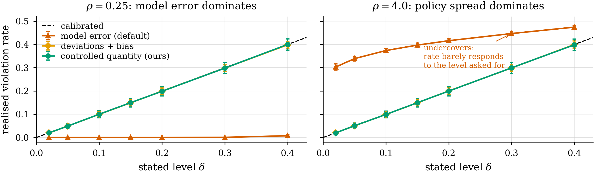
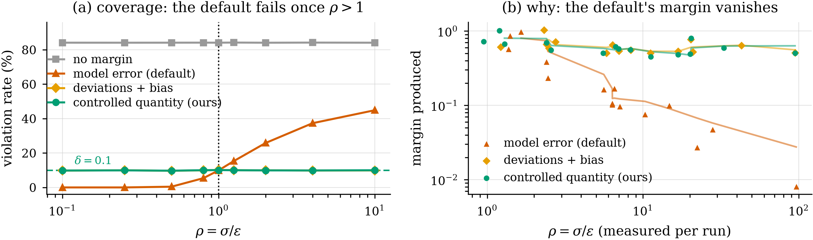
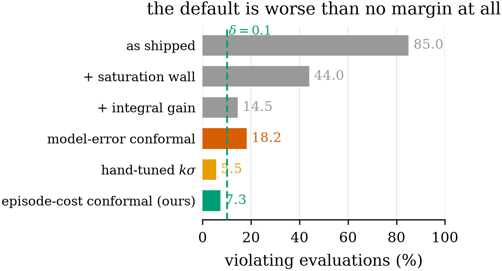
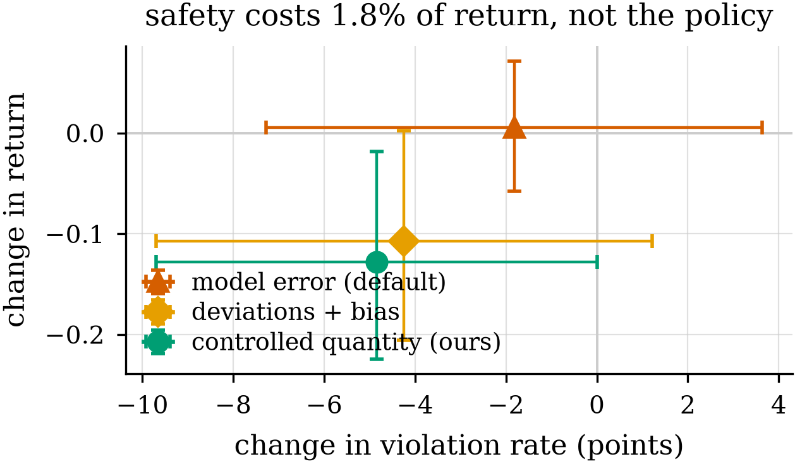
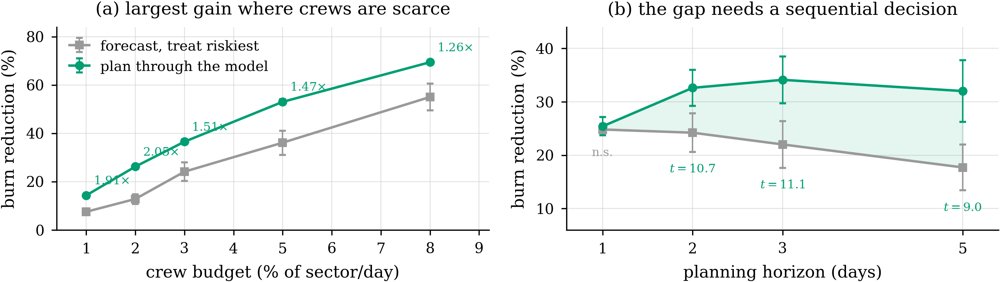
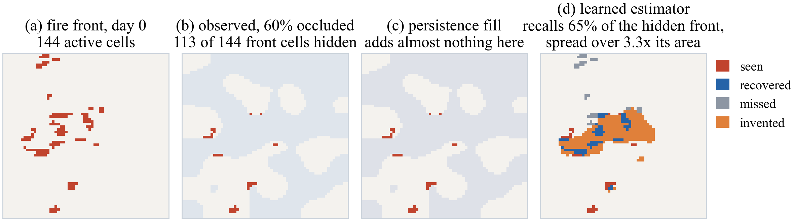
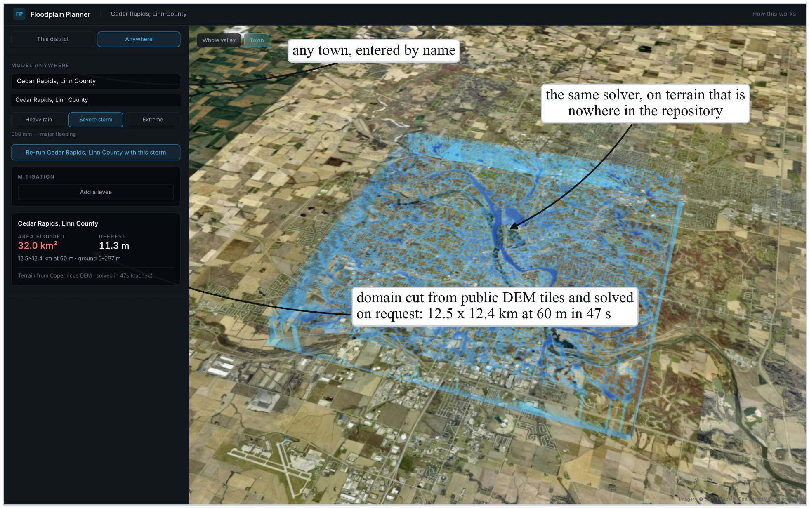
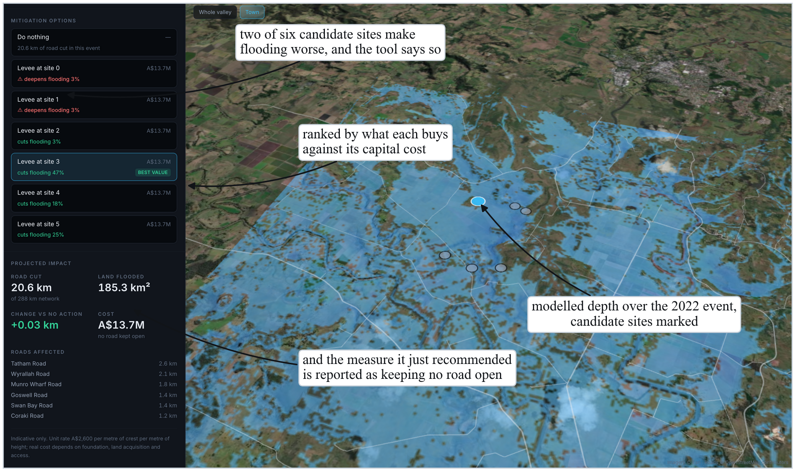
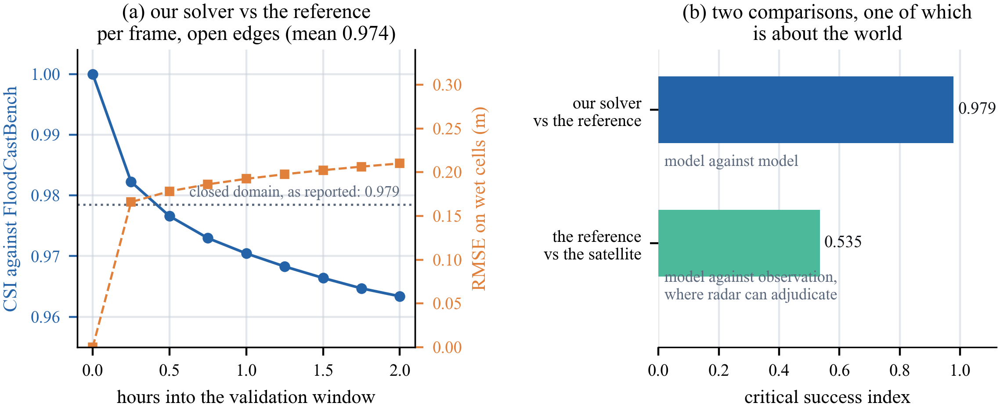

# Calibrating the Right Uncertainty
### Safe planning through learned models, and what the margin must be measured on

PSPE — Perceive · Simulate · Plan · Explain

*Figures referenced from `docs/figures/paper/` and `runs/portal_shots/`.
Numbers current to 2026-10-05. Every result below is measured; nothing is
pending.*

---

## 1 · The failure this work is about

A planner controls a physical system through a **learned model**, under a budget
that must hold **on average**.

The Lagrangian dual reads the model's cost, drives it to the limit, and reports
success. The **real** system exceeds the limit anyway.

Nothing inside the planner notices: it only ever saw model numbers.

> **Silent failure.** Measured on a diffusion–advection hazard: the planner
> reports the budget met while **7.3% of real evaluations breach it** — against
> **0%** for every model-free baseline.

*The dangerous property is not the violation. It is that the system is confident.*

---

## 2 · The standard repair, and why it cannot work

The field's default: add a safety buffer sized by **how wrong the model is**.
Conformalise the model-error distribution, push the bound into the constraint.

Two quantities are in play:

| symbol | meaning |
|---|---|
| `ε` | spread of **model error** — how wrong a prediction is |
| `σ` | spread of **realised cost** — how much outcomes scatter episode to episode |
| `ρ = σ / ε` | **which one dominates** |

A buffer built from `ε` never sees `σ`. When outcomes scatter more than the model
errs, the buffer is sized against the wrong thing.

---

## 3 · Theory: a separation result

**Proposition 3.** No margin measurable with respect to the model-error
distribution alone attains a violation level `δ` uniformly in `σ`. Realised
violation is strictly increasing in `σ` and tends to ½ for symmetric error.

**Corollary.** For Gaussian error the failure rate is closed-form:

```
R(ρ) = 1 − Φ( z_δ / ρ )        with  R(1) = δ  exactly
```

Not an empirical regularity — a predicted phase boundary, with the crossing at
`ρ = 1` by construction.



| `ρ` | measured | predicted | error |
|---|---|---|---|
| 0.50 | 0.004 | 0.005 | 0.0012 |
| **1.00** | **0.099** | **0.100** | 0.0010 |
| 2.00 | 0.258 | 0.261 | 0.0028 |
| 10.0 | 0.449 | 0.449 | 0.0000 |

**Maximum error 0.003 over two decades in `ρ`** — the Monte-Carlo noise of the
harness. Validated in a controlled CMDP where `σ` and `ε` are dialled by hand.

**And on a learned planner?** Measured, 17 seeds, with the arm the formula is
about: **σ_ep = 0.436, ε = 0.0265, ρ median 16.7, range 7.4–91.1 — ρ > 1 on
17 of 17.** The precondition holds by an order of magnitude.

But `R(ρ)` predicts **0.468** where the arm measures **0.102** — **4.6× over**.
It is derived for a dual that drives `ĝ` exactly to `d_eff` and tends to ½; the
real rate is capped by the no-margin rate because the margin is negligible.

> **The theorem's conclusion and its closed form transfer independently.**
> The *mechanism* survives contact with a learned planner. The *curve*, exact to
> 0.003 where its assumptions hold, is an **upper bound the real system does not
> approach.**

---

## 4 · The admissible correction

Calibrate the error around **the quantity the dual actually controls** — not the
model's per-episode guess.

```
probe the real system every N iterations
q  =  split-conformal quantile of ( c − ĝ )     ← realised cost vs the dual's target
d_eff  =  d − ( q + bias )
```

One line of substance: **subtract the controller's target, not the simulator's
per-episode prediction.** And when the calibration set cannot support the
requested level, **return no bound** rather than a number.



---

## 5 · Data

| source | role | scale |
|---|---|---|
| **PDE testbeds** — diffusion–advection, reaction–diffusion, shallow water | controlled planning families | grid 64, 128 traj × 24 steps = **3,072 transitions** |
| **NDWS** + **VIIRS/FIRMS** active fire | real wildfire forecasting & decisions | **607 observed fires**; 1,500 held-out for planning |
| **Copernicus DEM GLO-30** | terrain for flood solves | 30 m, global |
| **Sentinel-1 SAR** | flood observation (Perceive) | same-orbit differencing |
| **OpenStreetMap** | routable road network | ~4,120 segments / 1,346 km per scene |
| **FloodCastBench** | flood-solver reference | published benchmark |

Synthetic CMDP harness for the controlled mechanism experiment, where `σ` and
`ε` are independently controllable.

---

## 6 · Methodology: the loop


**Perceive** → state from observation, under occlusion
**Simulate** → learned surrogate for fast what-if rollouts
**Plan** → constrained policy optimisation against that surrogate
**Explain** → a brief a reader can act on, checked against the plan

The contribution sits at **Plan**: what the dual is fed, and what the margin is
measured on.

---

## 7 · Feature engineering

**Flood as a *schedule*, not a peak.** Instantaneous depth at 13 times across a
run. A road is usable only if it stays under the vehicle's limit for the whole
time the vehicle is on it. A road is judged by its **deepest** point — that is
where a vehicle stops.

**Saturating intervention surrogate.** Combined measures overlap, so effects do
not add:
```
effect = lead + S · tanh( rest / S )
```
Only what stacks on top of the largest single contribution saturates, which
keeps single measures **exact** and the model **continuous** at the
one-measure/two-measure boundary.

**Matched-pair probes on common random numbers.** The same initial conditions
and the same action noise rolled in both environments, so the per-episode
difference isolates the dynamics — the fairest possible treatment of the recipe
we argue against.

**Absence ≠ unobserved.** Treating "no detection" as "no fire" would have
deleted **37.4%** of fire-days — exactly the days fires go out.

---

## 8 · Architectures

| stage | model |
|---|---|
| Perceive | patch-embed convolutional encoder; ensemble Kalman update of the burned-state field |
| Simulate (PDE) | **Fourier Neural Operator**; DeepONet and GNOT as operator baselines |
| Simulate (flood) | **LISFLOOD-FP** local-inertial solver on Copernicus DEM |
| Simulate (fire) | UNet forecaster, AUC-PR 0.269 on held-out fires |
| Plan | `GaussianFieldPolicy` (conv encoder, width 32) + actor–critic + **PID-Lagrangian dual** |
| Explain | prefix-conditioned generator over a frozen **Qwen2.5-0.5B-Instruct** with LoRA; parameter-free regex parser as the scorer |

The parser is **frozen by design**: a learned parser could agree with the
generator on a private encoding and score itself faithful while saying nothing a
reader could act on.

---

## 9 · Main result — reaction–diffusion, 20 seeds



| arm | violating | return | over do-nothing |
|---|---|---|---|
| no margin | 14.1% | −6.822 | +0.578 |
| naive **model-error** margin | **18.2%** | — | — |
| probe only | 10.9% | −6.811 | +0.589 |
| **probe + conformal (ours)** | **5.0%** | −6.899 | **+0.501** |
| *do-nothing policy* | *0.0%* | *−7.400* | — |

Paired **−9.1 points, 95% CI [−11.8, −5.5], p = 0.0002**, 15/20 seeds improved.

**The naive recipe makes it worse** (18.2% against 14.1%) — the theorem's
prediction, not a baseline that lost.

**And we can now say why, mechanically.** Run as its own arm with ρ measured per
seed, the model-error recipe produces a margin of **0.058 against the 0.575 ours
applies — 9.9× too small** — because the matched pair `c_i − g_i` is taken on
common random numbers, so the policy's own spread cancels and `ε` collapses to
0.027 against a `σ_ep` of 0.436. It then reduces violations by **nothing**:
10.16%, identical to probe-only in aggregate and *exactly* identical on 9 of 17
individual seeds, while costing return.

*Every arm is anchored to a zero policy, because a 0% violation rate is what
**inaction** scores.*

---

## 10 · Three published corrections — all in the excluded class

Each reimplemented **inside our planner**, so the only difference is how model
error is corrected for.

| method | corrects using | violating | beats no margin? |
|---|---|---|---|
| no margin | — | 14.09% | — |
| conformal ensemble disagreement (CAP) | mean + k·σ of ensemble spread | 11.99% | no |
| SMBPO | unadapted max over ensemble | 12.20% | no |
| SafeDreamer | learned cost critic on imagined rollouts | 13.17% | no |
| **ours** | conformal quantile of **realised** cost | **5.00%** | — |

Within 1.2 points of one another, **none separating from applying no margin.**

> **We pre-registered ≈12% for SafeDreamer before implementing it.** It returned
> 13.17%, indistinguishable from CAP (p = 0.91), from SMBPO (p = 1.00), and from
> no margin at all (p = 0.97).

An adapted second moment, an unadapted maximum, and a learned value function all
land in the same place — because all three are functionals of the same
insufficient statistic.

---

## 11 · Against model-free safe RL, at *their* budget and *ours*

Four published algorithms — PPO-Lagrangian, CPO, Sauté RL, primal-dual NPG — on
reaction–diffusion, 20 seeds, paired against the zero policy.

**At a matched real-sample budget (~8,300 transitions each):**

| arm | return over null | seed-paired vs ours |
|---|---|---|
| **ours** | **+0.501** | — |
| Sauté RL | +0.107 | **+0.394** [+0.318, +0.472] |
| PPO-Lagrangian | +0.084 | **+0.417** [+0.358, +0.476] |
| CPO | +0.041 | **+0.460** [+0.407, +0.513] |
| primal-dual NPG | +0.041 | **+0.460** [+0.407, +0.513] |

**We beat all four, every interval excluding zero.**

**Given 4.6× more data (38,400 transitions)** they close most of the gap: three
are still beaten, and PPO-Lagrangian becomes **statistically indistinguishable**
(+0.070, CI [−0.039, +0.167]).

> **The sample-efficiency claim, stated as a quantity:** PPO-Lagrangian needs
> **4.6× our data to draw level.**

---

## 12 · The trade, stated as the result

**We are the least safe arm in every table.**

| arm | violating | worst episode cost / limit |
|---|---|---|
| Sauté RL | 0.0% | 0.23× |
| CPO / primal-dual NPG | 0.0% | 0.24× |
| PPO-Lagrangian | 2.3% | 1.22× |
| **ours** | **5.0%** | **1.54×** |

Three of the four reach 0% by **operating far from the constraint** — Sauté's
mean episode cost is *below the do-nothing policy's*. That conservatism costs
them 0.30–0.35 of return.

**And the margin bounds the rate, not the severity.** Violations fall 14.1% →
5.0% while the worst excursion is unchanged at 1.54× against 1.55×.

*A deployment that requires zero violations should not use this method.*



---

## 13 · `δ` is a width, not a dial

We expected a frontier: tighten `δ`, trade return for safety. **Swept, 20 seeds:**

| `δ` | violating | return over null | margin takes |
|---|---|---|---|
| 0.10 | **5.00%** | +0.501 | 18% of budget |
| 0.02 | **5.00%** | +0.420 | 33% |
| 0.01 | **5.91%** | +0.335 | **50%** |

**A tenfold tightening does not reduce the violation rate.** Return falls
monotonically; the worst excursion stays pinned at 1.55×.

Not an artefact: at `δ = 0.01` the rank condition needs 99 calibration points and
the probe supplies ~160, and the effective limit confirms the margin is applied.

> `δ` controls how wide the margin is, **not how often the limit is crossed.**
> This method must not be offered as a safety dial.

The baseline comparison is unaffected — +0.335 at `δ = 0.01` still exceeds every
baseline's gain at 4.6× the data.

---

## 14 · Cross-dynamics: three families

| family | result | reading |
|---|---|---|
| reaction–diffusion | 14.1% → **5.0%**, p = 0.0002 | **level attained** |
| diffusion–advection | 0% → 0%; constraint binds, task easy | **regression check** |
| shallow water | **−15.9 pts** [−19.8, −12.1], 80 seeds | **mechanism replicates** |

On shallow water the *rate* is **12.4%, CI [9.4, 15.5]** over the 65% of seeds
where a plan exists at all — consistent with `δ = 0.1` and **trending above it**.

The excess is an estimate of the **beyond-exchangeability gap**: `Δ̂ = 0.024`,
CI [−0.006, 0.055]. Barber et al. give coverage `≥ 1 − δ − Δ`; scores here are
collected *during* a learning run, so `Δ > 0` is the expected state.

*We do not write "validated on three families": one is a regression check, one is
consistent-and-trending.*

---

## 15 · Testing the assumption the guarantee rests on

Exchangeability is required. We test it rather than assume it.

- **Diffusion–advection, 20 seeds:** not rejected on any seed — Spearman median
  p = 0.57, KS 0.79, lag-1 0.63. **Coverage: fixed 0.113, adaptive 0.101**
  against `δ = 0.1`.
- **Reaction–diffusion, 20 seeds:** the lag-1 permutation test **rejects on
  20/20** (median p = 0.00175), while the KS test rejects on 1/20 and the trend
  test on 5/20 — the violation is **serial dependence**, specifically. Coverage
  holds anyway at **0.0997 against δ = 0.100**.

  **And there is a mechanism, not luck.** Lag-1 autocorrelation is **negative on
  20 of 20 seeds** (mean −0.181). Negatively correlated scores *alternate* rather
  than trend, so a sample spans its range faster than i.i.d. and the order
  statistic is if anything conservative. **Exchangeability is violated in the
  direction that does not hurt** — which predicts that a family with *positive*
  serial correlation should degrade coverage.

Where exchangeability fails, **Gibbs–Candès adaptive conformal** is promoted from
diagnostic to arm — it lands on 0.1013 against a requested 0.1.

---

## 16 · Real data I — wildfire, 20 seeds, 1,500 held-out fires



| policy | burn reduction | 95% CI | over budget |
|---|---|---|---|
| none | 0.00% | — | 0 |
| random placement | 4.32% | [4.11, 4.52] | 0 |
| greedy — forecast, treat riskiest, repeat | 22.51% | [21.19, 23.75] | 0 |
| **PSPE per-instance** | **32.50%** | [31.30, 33.64] | **0** |
| PSPE amortised policy | 16.92% | [12.41, 21.48] | **0.371** |
| unconstrained (reference) | 88.85% | [87.35, 90.22] | 1.000 |

Seed-paired against operational practice: **+9.99 points, CI [+9.15, +10.81],
t = 23.0, 20/20 seeds improved.**

**Perceive contributes, and we report the effect size:** Cohen's **d = 0.20** at
day +1. State synchronisation is worth **8.4×** at one day — reported as a
control, not a finding.



---

## 17 · Real data II — flood twin, anywhere on Earth

Two place names in. The twin derives a bounding box, picks a resolution that
keeps the solve interactive, fetches terrain, solves the flood, pulls the road
network, builds a routable graph — **junction extraction verified at 287.4 km
against a published 288.0 km** — and routes. **104 s end to end.**



**A precondition, measured before claiming usefulness.** A guaranteed margin
fits inside the benefit a levee buys only below **≈3.6% rainfall forecast
spread** on real Australian terrain (8.2% on the synthetic testbed — real
terrain is **2.3× more demanding**).

> Operational precipitation forecasting does not achieve 3.6% at 48-hour lead.
> **On this task, with today's forecast skill, a `δ = 0.1` margin does not fit.**


---

## 18 · The result we did not expect

**A peak-depth map cannot route an evacuation.**

8-member forcing ensemble, leave-one-out, 12 trips the members disagree about —
**96 decisions.** An arm succeeds only if the traveller is *never* on a road
whose true depth exceeds what the vehicle can cross.

| routed on | got through | caught | no route |
|---|---|---|---|
| **the peak field** — the standard twin output | **0.0%** | 0 | **96** |
| leave now, mean forecast | 41.7% | 7 | 49 |
| time-dependent on the mean | 41.7% | 7 | 49 |
| + conformal margin | 41.7% | 7 | 49 |
| re-plan on members consistent with observation | **56.2%** | 14 | 28 |
| oracle — plans on the member that happens | 85.4% | 0 | 14 |

**0 of 96.** Routing on a union of states that never coexist finds no route at
all, where a time-resolved solve finds one and an oracle gets through 85% of the
time.

*The most transferable result here, because the peak field is what essentially
every flood twin publishes.*


---

## 19 · Where our own margin does not help

**It contributes nothing to a discrete decision.** The route-level conformal
margin is **exactly 0.000 m on all 96 decisions.** The chosen route is dry under
every member, so the residual of the reported scalar is identically zero. What
differs between members is not *how deep the chosen road gets* but **which roads
exist**. The decision is discrete; the margin is continuous.

**And no departure-timing policy can help.** A learned timing rule over the
filtered belief, nested leave-one-out, scores **56.2%** — exactly the myopic
rule — converging to *depart immediately* on all 8 folds. A **hindsight bound**
that reads the outcome also scores **56.2%**.

Measured, not asserted: of 96 decisions, 68 have a feasible slot; in **68 of 68**
the feasible window is contiguous and **0** reopen. The flood rises monotonically
— roads close and none reopen — so earliest-feasible is optimal by construction.

> A feasibility theorem cuts both ways. Corollary 3 says which distribution a
> margin must use — not that a margin exists for every decision.

---

## 20 · The twin, operable



Every option solved, so selecting a ranked row redraws the flood from that
option's **own solved field**. Budget allocation shown as a **trace** — each step
and what it bought.

**The interface refuses.** Asked for 99% confidence from 30 held-out runs it
declines and says how many more runs that would need.


---

## 21 · A margin that does not depend on the plan cannot change the plan

The displayed band pooled all 30 calibration runs — **one number for every
plan**. A constant offset cannot move an argmax, so the margin was **decorative**.

Surrogate error grows with the number of sites a plan activates: mean residual
**4.74** (2 sites) → **8.57** (3) → **11.50** (6), correlation **+0.371**. The
planner, preferring more sites, walks into the stratum its own margin covers
worst.

**Mondrian conformal** — stratify by a function of the *input*, apply split
conformal within each cell:

| stratum | runs | band at 90% |
|---|---|---|
| pooled (as displayed) | 30 | 13.37 |
| two sites | 21 | **10.01** |
| three sites | 8 | **refuses** — 9 needed |
| six sites | 1 | **refuses** |

**And the recommendation changes.** At A$20M the guarantee-optimal plan
**predicts 5.6 points less and promises 4.5 points more**, because its prediction
is a solver measurement rather than an extrapolation.

---

## 22 · Explanation: a measured negative

With the brief-length cap lifted (reference briefs average 136 tokens; the cap
was 96, truncating every arm before its footer):

| arm | faithfulness `F` | training |
|---|---|---|
| **supervised only** | **0.901** | 946 s |
| supervised + our faithfulness objective | **0.505** | 2147 s |
| prompted off-the-shelf 0.5B, no training | 0.353 | **0 s** |
| trained on a *different* policy's briefs | 0.350 | 1925 s |
| untrained generator | 0.182 | 0 s |
| *reference brief (ceiling)* | *0.901* | — |

Supervised-only **reaches the parser's ceiling**. Our faithfulness term **costs
0.396**, on all three seeds, at 2.3× the cost. Prompting an off-the-shelf model
for **zero seconds** matches our apparatus trained on another policy.

**No arm produces state-specific briefs** — the aligned-minus-shuffled
permutation gap is within **±0.006** everywhere.

*We report the faithfulness objective as a measured negative and exclude it from
any headline configuration.*

---

## 23 · Inferences

**1 · The contribution is the calibration, not the learning.** Every learned
component we tested loses to its non-learned alternative — the amortised fire
policy (16.9% vs greedy's 22.5%, and over budget), the faithfulness objective
(0.505 vs 0.901), the departure policy (bounded as unimprovable). Consistent
with the theorem, which is about *what a dual is fed*.

**2 · A 0% violation rate certifies nothing.** It is what inaction scores. On
diffusion–advection, three of four published algorithms cannot be distinguished
from a do-nothing policy at full budget.

**3 · Sample efficiency is a comparison, not a ratio.** Running the baselines at
*our* budget reversed one verdict and created another.

**4 · Marginal coverage is the wrong guarantee when the planner picks the
subgroup.** Conditioning the band on a function of the plan changed the
recommended plan.

**5 · The instrument must match the decision's geometry.** Continuous
allocation: conditioning makes the margin decision-relevant. Discrete route
choice: provably inert. Sequential timing on a monotone hazard: no headroom
exists.

---

## 24 · Limitations

- **The guarantee is marginal, not per-step** — it bounds trajectory cost
  exceeding the limit, not cost at every timestep.
- **The margin bounds rate, not severity**, and `δ` does not change that.
- **Every baseline satisfies the constraint more often than we do.**
- **`ρ > 1` throughout the reachable regime** — the region where the default
  recipe is correct is not reachable on these testbeds.
- **The intervention arm is unvalidated in reality.** No fire in the archive had
  a firebreak cut on our instruction, and no retrospective dataset can fix that.
- **Counterfactual interventions do not exist in observational records.** This is
  the one gap that will not close with more data.



---

## 25 · Future work

**Near term**
- **Per-episode safety.** The margin bounds the rate — and `δ` does not change
  that. A bounded worst case needs a different mechanism: the honest next
  instrument, not a tuning of this one.
- **A family with positive serial correlation.** Our exchangeability violation is
  *negative* autocorrelation, which is why coverage survives. The falsifying
  experiment is a hazard whose scores trend rather than alternate.
- **Why the closed form over-predicts by 4.6×.** The gap between `R(ρ)`'s
  asymptote and a real planner's rate is itself a measurable object: the dual
  does not drive cost to the limit as hard as the derivation assumes. Quantifying
  that would turn an upper bound into a usable one.

**Medium term**
- **A margin for discrete feasibility.** The 0.000 m result says a continuous
  margin cannot express "this road may not be there". What can?
- **Non-monotone hazards.** A timing policy earns its keep only where
  feasibility reopens — a receding flood, a second peak, a forecast sharpening
  faster than the network degrades. Falsifiable, with the diagnostic shipped.
- **Shrink the exchangeability gap.** `Δ̂ = 0.024` is measured; adaptive conformal
  already lands on `δ`. Which mechanism closes it under on-policy drift?

**Open**
- **Interventional validation.** Requires a partner willing to act on a
  recommendation and record what happened. No amount of compute substitutes.

---

## 26 · In one sentence

> When a safety limit is on an expectation, the margin must be measured on **how
> far real outcomes scatter around what the controller is aiming for** — not on
> how wrong the model is; any margin from model error alone provably fails once
> that scatter exceeds the error, and we give the closed form for when.
