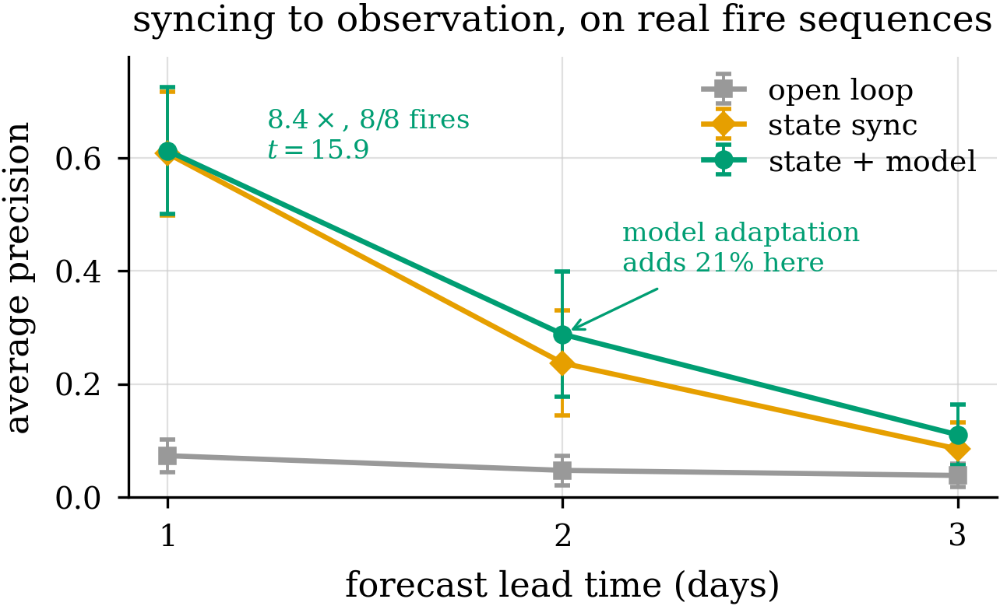
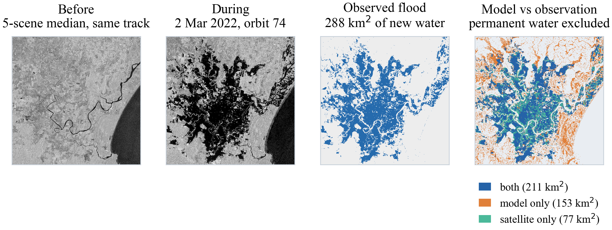
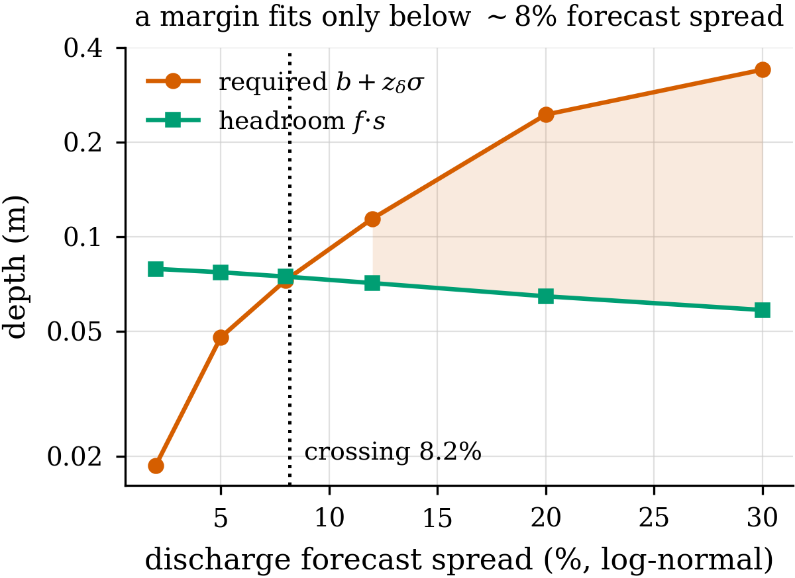

# A Climate Digital Twin That Refuses
### Perceive · Simulate · Plan · Explain, operable anywhere on Earth

Workshop track — digital-twin **systems**

*All screenshots from `runs/portal_shots/`, captured against live runs.
Numbers current to 2026-10-05.*

---

## 1 · What a decision-support twin is for

Three jobs:

1. **Stay in sync** with a real system from observation
2. **Answer what-if questions** through a model
3. **Help decide** — pick actions under a limit

Most twin work is jobs 1 and 2: better models, better assimilation.

**This is about job 3** — and specifically about whether the twin's promises can
be trusted when someone acts on them.

---

## 2 · The failure mode that matters for a twin

A twin recommends a plan, checks it against its **own model**, and reports
"the hospital stays under 30 cm".

Reality differs twice: the model has error, **and** real events scatter between
storms under the same plan.

> So a twin can say *safe*, be wrong, and **nothing inside it notices.**

That is the most dangerous property a decision-support twin can have, because
people act on it.

---

## 3 · Anywhere on Earth, in 104 seconds

Two place names in. The twin:

- derives a bounding box containing both, with room to detour
- picks a resolution that keeps the solve **interactive**
- fetches **Copernicus DEM GLO-30** terrain on demand
- solves the flood across it
- pulls the road network from **OpenStreetMap**
- builds a routable graph — junctions from coincident vertices
- routes

**Lismore → Coraki, 20 km, ~4,120 road segments over 1,346 km: 104 s end to end.**

Junction extraction verified at **287.4 km against a published 288.0 km**; 98% of
junctions in one component.

> The twin runs on terrain that is **nowhere in the repository.**

---

## 4 · Perceive — synchronising to the satellite

**Sentinel-1 SAR**, same-orbit differencing, **permanent water held separately**
so rivers are not scored as model error.

Validated on Richmond NSW, 2022:

| comparison | CSI |
|---|---|
| our fast solver vs the reference hydrodynamic model | **0.979** |
| the reference model vs the **satellite** | **0.535** |

**The second number belongs in an operational discussion and is not flattering.**
0.98 is a statement about our numerics. 0.53 is a statement about how well
*anyone's* hydrodynamics matches a real flood at 30 m.

We report both, because quoting only the first is how decision-support tools
acquire unearned authority. **One validated event is also one event** — a
demonstration of a validation *method*, not an established skill score.

---

## 5 · Simulate — and getting the forcing physical

A **LISFLOOD-FP-style local-inertial solver**, batched over candidate plans, with
forcing from river discharge, coastal surge or rainfall — whichever the site
actually has.

**We got the forcing wrong twice, and it changed the answer completely:**

| forcing | best single site | best plan | verdict |
|---|---|---|---|
| rainfall across the box | 0.4% | — | *"no measure worth building"* |
| river, as a **volume** | 7.6% | 8.5% | physically void — **112 m deep** |
| river, as a **stage** | **16.2%** | **21.3%** (guaranteed 20.8%) | 17 held-out combinations |

- Rain falling across the whole box gives a levee **nothing to block** — and the
  tool correctly recommends nothing. A real answer.
- Discharge as a volume makes water arrive faster than the grid can spread it.
- A boundary sets a **stage**, which Manning's normal depth gives with **no free
  parameters**.
- Separately: DEM nodata filled with sea level produced a **247 m trench**
  ringing every inland domain, draining the catchment into it.

---

## 6 · Plan — levees against a real budget

Every candidate option is solved in **one batched timestep loop**, so a ranked
list of plans costs about what a single scenario costs.

> **A$20M** → site 3 (3.0 m) + site 5 (1.0 m), A$18.2M of A$20M
> → **estimated 52%, at least 39% nine times in ten**
> → *"Write the business case against the lower figure."*

**Attribution by counterfactual, not narration:** site 3 **+43%** (47% alone) ·
site 5 **+6%** (9% alone) — the gap in each is overlap.

**And it flags measures that make things worse:** site 1 (−9%) and site 0 (−9%),
measured as **deepening** flooding at the settlement rather than reducing it. A
planner that assumed a levee helps would have built them.

---

## 7 · Every option's own water, and the trace that produced it

The planner solves every option it offers, so selecting a ranked row redraws the
flood from **that option's own solved field** — the comparison the list exists
for.

Budget allocation is shown as a **trace** — each 0.5 m step and what it bought —
so an engineer sees where the marginal return fell off instead of being handed a
height vector.

---

## 8 · The flood as a body of water

This terrain has **220 m of relief over 32 km** while the water reaches **19 m
deep**. The *water* is the three-dimensional object in the scene, and painting it
flat hides the one quantity with real vertical extent.

Each cell becomes a column on its own ground at its own depth, so a levee reads
as a **wall holding a volume back** rather than a marker beside a blue shape.

*Same event, as a volume and as paint.*

---

## 9 · Roads, and the result we did not expect

The flood is carried as a **schedule**, not a peak: instantaneous depth at 13
times across the run. A road is usable for a crossing only if it stays under the
vehicle's limit **for the whole time the vehicle is on it**, and a road is judged
by its **deepest** point — that is where a vehicle stops.

8-member forcing ensemble, leave-one-out, 12 trips the members disagree about —
**96 decisions:**

| routed on | got through | caught | no route |
|---|---|---|---|
| **the peak field** — the standard twin output | **0.0%** | 0 | **96** |
| time-dependent on the mean forecast | 41.7% | 7 | 49 |
| re-plan on members consistent with observation | **56.2%** | 14 | 28 |
| oracle — plans on the member that happens | 85.4% | 0 | 14 |

> **0 of 96.** Routing on a union of states that never coexist finds **no route
> at all**, where a time-resolved solve finds one and an oracle gets through 85%
> of the time.

**The most transferable result here, because the peak field is what essentially
every flood twin publishes.**

---

## 10 · A trip, with a deadline and an explanation

Leaving now: **22 minutes and dry.** Leaving at the last possible departure:
**25.5 minutes on a different road**, because by then Coraki Road is under
**1.0–2.9 m** where the direct line crosses it.

**Neither the deadline nor the detour is computable from a peak.**

Up to **157 km of the 1,308 km network** goes impassable at the worst of this
flood — 12.0% of it.

---

## 11 · The twin refuses

Our own portal displayed a confidence it had no data to support:
`1.645 · RMSE · √(1 + 1/n)` — a normal-approximation interval described in its
own code as "the product-facing form of the framework's safety margin". **It was
not.**

Two errors compounded: the fit used **six** multi-measure runs where 90%
coverage requires at least **nine**, and a Gaussian places the 90% point at
1.64×RMSE where the honest order statistic is roughly twice that. **The
displayed band was about half the width it should have been.**

A normal-approximation interval **always returns something.** The conformal
quantile **refuses** — with 30 held-out runs it declines a request for 99% and
says how many more runs that would need.

> That is not a detail of the method. It is the reason to prefer it, and why
> stage 4 is in the loop at all.

**But the band is not a safety control, and we say so in the tool.** Swept over
20 seeds on the method paper's testbed, the realised violation rate is
**non-monotone in δ**: 5.00% at δ = 0.10, **4.09% at 0.05**, 5.00% at 0.02,
5.91% at 0.01 — while the margin grows to consume **half the budget** and the
worst excursion stays pinned at 1.54–1.55× the limit.

The portal fixes δ = 0.1. **An operator who needs fewer violations cannot get
them by asking for higher confidence**: δ sets the band's *width*, not how often
the limit is crossed. The band is honest about what it covers. It is not a dial.

---

## 12 · The trade-off is a control, and the limits have a page

`/methodology/margin` makes the fraction of achievable gain you give back for a
guarantee a **slider**, and shows the crossing move as you drag it — because it
is a decision, not a constant.

`/methodology/limits` writes **what the tool cannot show** into the tool.

---

## 13 · A margin that does not depend on the plan cannot change the plan

The displayed band pooled all 30 calibration runs — **one number for every
plan**. A constant offset cannot move an argmax, so the margin was
**decorative**: the tool displayed a correct conformal guarantee and chose its
plan with the margin switched off.

Surrogate error **grows with the number of sites** a plan activates:

| active sites | runs | mean &#124;measured − predicted&#124; |
|---|---|---|
| 2 | 21 | 4.74 |
| 3 | 8 | 8.57 |
| 6 | 1 | 11.50 |

Correlation **+0.371**. The planner, preferring more sites, walks into the
stratum its own margin covers **worst**.

**Mondrian conformal** — stratify by a function of the *input*, apply split
conformal within each cell, each satisfying the rank condition on its own:

| stratum | runs | band at 90% |
|---|---|---|
| pooled (as displayed) | 30 | 13.37 |
| two sites | 21 | **10.01** |
| three sites | 8 | **refuses** — 9 needed |
| six sites | 1 | **refuses** |

**Wrong in both directions:** too wide for the plan the tool recommends, and
displayed at all for plans the evidence cannot support.

---

## 14 · And the recommendation changes

Exhaustive over 7⁶ height vectors, δ = 0.1:

| budget | best **predicted** effect | best **guaranteed** floor |
|---|---|---|
| A$10M | 1 site @ 2.0 m, 31.0 — **no valid band** | 2 sites, 27.2 → floor **17.2** |
| A$15M | 1 site @ 3.0 m, 46.5 | same plan, floor 46.5 |
| **A$20M** | 2 sites, **52.1** → floor 42.0 | 1 site @ 3.0 m → floor **46.5** |
| A$30M | 3 sites, 52.5 — **no valid band** | 1 site → floor **46.5** |

At A$20M the framework's plan **predicts 5.6 points less and promises 4.5 points
more**, because its prediction is a **solver measurement** rather than an
extrapolation.

Two strata are in no calibration file and both matter: one site at **full
height** owes **no margin** (the prediction *is* the solver run that measured
it); one site at a **partial** height is **not** exact and refuses rather than
borrow the two-site band.

> The method's own thesis, executed on the twin's own task: **bound the quantity
> the decision commits to, and the decision changes.**

---

## 15 · Explain — a brief the service will not ship unless it matches

The written brief is generated from the same record the map is drawn from, and a
**faithfulness guard** compares what the brief says against what the plan
actually does. Mismatch → the service does not ship the brief.

Attribution is by **leave-one-out counterfactual**, not narration — *"remove this
levee from this plan and you lose X"* depends on what else is in the plan, so it
cannot be reused for a different plan and is checkable against a solver run.

*Why not a learned explainer: a brief that scores well against the model while
carrying zero state-specific information is the failure this project already
measured. A permutation control exposed it — a brief written for one state scored
just as well on another.*

---

## 16 · How the twin uses the framework — and what it does not

**Live framework code, not a reimplementation:**

| module | what the twin calls |
|---|---|
| `plan.margins` | `min_calibration`, `margin("residual", …)` — **the Anywhere tab's guaranteed floor** |
| `plan.surrogate` | `effect`, `fit`, `enumerate_plans` |
| `plan.routes` | `build_graph`, `fastest_at`, `latest_departure`, `cut_at`, `cut_km`, `edge_cells` |
| `simulate.flood` / `simulate.real` | the local-inertial solver and real forcing |
| `observe.sar` | `search`, `pick_pair`, `detect` |
| `explain.route_brief` | `checked` — the faithfulness guard |

**Both implementations of the guarantee are checked against each other.**
`portal/scripts/verify-margin-parity.mjs` agrees on **five quantities** — the
conformal band 108/108 across nine δ and twelve sample sizes, the refusal
threshold 108/108, the conditional band **6/6** across strata and both refusals,
the saturating form 6/6, and the end-to-end effect 5/5.

**What the twin does *not* use, stated plainly:**

`perceive` (the learned encoder) · `plan.policy` / `plan.trainer` / `plan.joint`
(the learned policy stack) · `explain.model` / `explain.trainer` (the trained
generator)

> The twin runs the framework's **guarantee and simulation** machinery. The
> **learned-policy** stack is absent, and Observe uses SAR retrieval rather than
> the learned encoder. This is a systems contribution about honest claim-making,
> **not** evidence for the learned-control half.

---

## 17 · Where the twin's own margin does not help

**Route choice.** The route-level conformal margin is **exactly 0.000 m on all
96 decisions.** The chosen route is dry under every member, so the residual of
the reported scalar is identically zero. What differs between members is not
*how deep the chosen road gets* but **which roads exist**. The decision is
discrete; the margin is continuous.

**Departure timing.** A learned timing policy over the filtered belief, nested
leave-one-out, scores **56.2%** — exactly the myopic rule — converging to
*depart immediately* on all 8 folds. A **hindsight bound** reading the outcome
also scores **56.2%**: no timing rule can do better.

Measured, not asserted: of 96 decisions, 68 have a feasible slot; in **68 of 68**
the feasible window is contiguous and **0** reopen. The flood rises monotonically
— roads close and none reopen — so earliest-feasible is optimal by construction.

> A feasibility statement cuts both ways. It says which distribution a margin
> must use — **not that a margin exists for every decision.**

---

## 18 · An acceptance test before trusting a twin

A guaranteed margin only helps if it **fits inside the benefit** the intervention
buys. That is checkable before adoption:

| rainfall forecast spread | headroom as % of achievable span | verdict |
|---|---|---|
| 2% | **17%** | **PASS** |
| 5% | 43% | fail |
| 10% | 92% | fail |

Crossing at **≈3.6%** on real Australian terrain, against **8.2%** on the
synthetic testbed — **real terrain is 2.3× more demanding**.

> Operational quantitative precipitation forecasting does not achieve 3.6% at
> 48-hour lead; errors of tens of percent are normal. **On this task, with
> today's forecast skill, a δ = 0.1 margin does not fit inside the gain a levee
> buys.**

The margin is not unusable in principle — it passes at 2%. The forecast accuracy
it requires is beyond what is available. **An agency can run this test before
trusting the twin, or treat it as a sign to invest in forecasts first.**

---

## 19 · What the twin demonstrates

| digital-twin property | status | evidence |
|---|---|---|
| A model synchronised to a real system from observation | **demonstrated** | SAR validation; state sync 8.4× at one day |
| What-if rollouts through that model | **demonstrated** | every option solved, ranked list at single-scenario cost |
| Decisions under constraints | **demonstrated** | budget allocation with attribution, harmful measures rejected |
| Reality correcting model **and decision** | **half** | state and model correction yes; correction from *intervention outcomes* **no** |

**The gap that will not close with more data:** no observational record contains
counterfactual interventions. No archive shows what a flood *would have done* had
the levee been built.

**And the assumption underneath the band is tested, not assumed.** On the method
paper's reaction–diffusion family, exchangeability is **rejected on 20 of 20
seeds** — specifically serial dependence, by a lag-1 permutation test, while
drift rejects on 5 and distribution shift on 1. Coverage holds anyway at
**0.0997 against δ = 0.100**, and the reason is measurable: the autocorrelation
is **negative on every seed**, so scores *alternate* rather than trend and a
sample spans its range faster than an i.i.d. one.

> **Exchangeability is violated in the direction that does not hurt.** A twin
> whose scores *trend* instead should expect the band to degrade — which is the
> falsifier, stated rather than hoped for.

---

## 20 · Inferences for twin builders

**1 · Report what uncertainty you measured, not just model skill.** CSI 0.98
says nothing about whether a plan is safe. What matters is how far real outcomes
scatter around what the plan was aiming for.

**2 · A twin that cannot refuse will mislead.** Ours displayed a 90% band on six
runs where nine were needed, at half the honest width. The refusal is the
feature.

**3 · Publish the peak field at your peril.** 0 of 96 evacuation decisions
routable on the standard twin output.

**4 · A margin that does not depend on the decision cannot improve the
decision.** Check whether the chosen action would change if the margin were
removed. Ours would not have, until it was conditioned on the plan.

**5 · Match the instrument to the decision's geometry.** Continuous allocation:
conditioning makes the margin decision-relevant. Discrete route choice: provably
inert. Timing on a monotone hazard: no headroom exists.

---

## 21 · Future work

**The twin**
- **Per-episode safety.** The margin bounds how *often* a limit is crossed, not
  how badly — the worst excursion is unchanged at 1.54× across a tenfold sweep
  in δ, so **tightening the stated confidence is not a substitute**. A bounded
  worst case needs a different mechanism.
- **A margin for discrete feasibility.** The 0.000 m result says a continuous
  margin cannot express *"this road may not be there"*. What can?
- **Non-monotone hazards.** A timing policy earns its keep only where
  feasibility reopens — a receding flood, a second peak, a forecast sharpening
  faster than the network degrades. Falsifiable, with the diagnostic shipped.

**The loop**
- **Close the fourth property.** Correction from intervention outcomes needs a
  partner willing to act on a recommendation and record what happened.
- **Learned stages in the twin, if they earn it.** Every learned component we
  tested loses to its non-learned alternative. We would rather ship the greedy
  search and say so than ship a policy for the look of it.

---

## 22 · In one sentence

> The twin turns *"the model says it's safe"* into *"this plan breaks the limit
> at most 1 time in 10, here is the evidence, and here is what I cannot tell
> you"* — and refuses when it cannot honestly make that promise.

