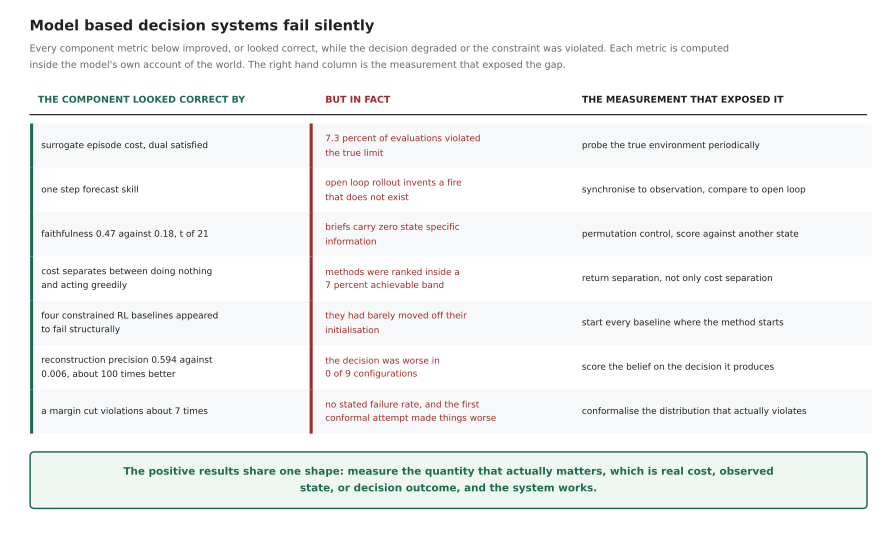
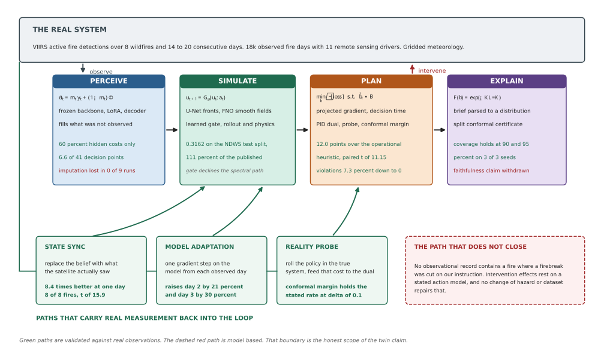
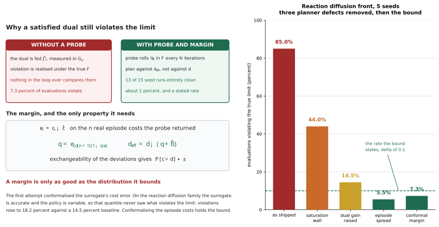
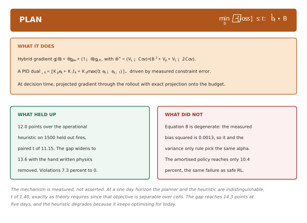
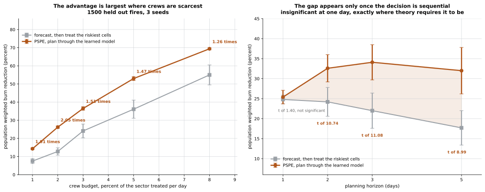
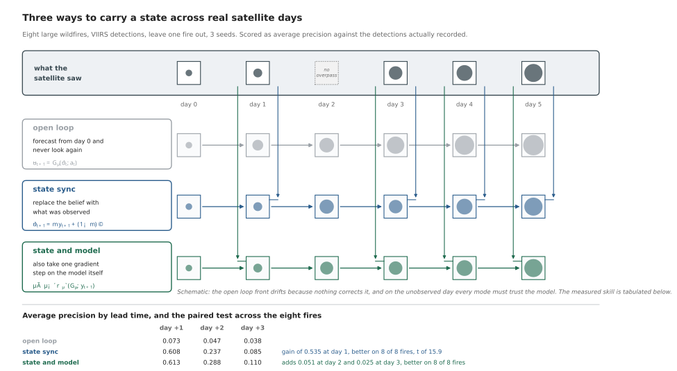

# PSPE — thesis, complete results, and the state of the climate-twin framework

**Constrained intervention design for PDE-governed systems.**
Definitive record, 2026-09-24. Supersedes the framing in the original proposal.

Every number below is multi-seed with paired significance tests; each section
names the run directory and the analysis file it comes from. Claims that were
made and then withdrawn are kept, with the measurement that withdrew them,
because in this project those were often more informative than the claims.

**Last updated 2026-09-24**, with §3.5 (the derived diagnostic and the
controlled coverage study), §5.5 (the margin on real fire dynamics, and the two
preconditions it exposed), and five further entries in the measurement-defect
catalogue. Results still pending are marked as such in place rather than
omitted; `paper/REVISION_NOTES.md` §8e pre-registers what each would mean.

**Part 9 positions every result against the current literature** and downgrades
several of them; inline notes through Parts 3 to 7 flag the nearest prior work
where each claim is made. Read §8.1 and §9.1 together — they are the two
scorecards, one against our own baselines and one against the field. The long
form of the audit is [`RELATED_WORK.md`](RELATED_WORK.md).

---

## Part 0 — The thesis

### 0.1 What the proposal claimed, and what happened to it

| # | original claim | outcome |
|---|---|---|
| 1 | Joint training of Perceive/Simulate/Plan/Explain under one objective beats a disaggregated pipeline | **Refuted** on three PDE families. Decision never changed (t = +0.66, +1.00, identical). |
| 2 | Eq. 8 mixing rule `α* = V_L/(B² + V_p + V_L)` improves the hybrid gradient | **Degenerate.** Measured B² ≈ 0.0013, so Eq. 8 and the variance-only rule select the same α (0.992). Return t = +0.22. |
| 3 | Corollary 1: time-averaged constraint violation → 0 | **False as stated** on the PDE testbeds. Holds only on a toy CMDP with closed-form optimum. |
| 4 | Faithful natural-language explanations via `F(b)` | **Withdrawn.** Permutation control shows zero state-specific information. |
| 5 | Cross-PDE-family transfer | **Direction only.** Magnitudes into the wave family have σ ≈ mean. |

Five headline claims; none survives in its original form. That is the honest
starting point, and it is why the thesis below is not a repair of the old one.

### 0.2 The thesis the evidence actually supports

> **Model-based decision systems fail silently.** Every component's own metric
> can improve while the decision degrades or the constraint is violated,
> because each metric is computed inside the model's account of the world. The
> contribution is (a) a catalogue of these failures with the measurement that
> exposes each, and (b) mechanisms that close the loop on real measurement —
> probe the environment, synchronise to observation, score on the decision —
> which recover the lost performance and, in the constrained case, carry a
> stated failure rate.

Seven independent instances of the same failure shape were measured. Several
have precedent, named in the right-hand column of §9.1; the contribution is the
catalogue and the corrections, not the discovery of the genre.

| the component looked correct by… | but in fact… | the measurement that exposed it | §  |
|---|---|---|---|
| surrogate episode cost; dual satisfied | 7.3% of evaluations violated the true limit | probe the true environment periodically | 3.1 |
| one-step forecast skill | open-loop rollout invents a fire that does not exist | sync to observation; compare against open loop | 5.2 |
| faithfulness `F(b) = 0.47` vs post-hoc `0.18`, t = +21 | briefs carry **zero** state-specific information | permutation control (score against another state) | 4.4 |
| cost separates between do-nothing and greedy | swe ranked methods inside a 7% achievable band | **return** separation, not just cost separation | 3.4 |
| four constrained-RL baselines "structurally fail" | they failed from their initialisation | start baselines where the method starts | 5.4 |
| reconstruction AP 0.594 vs 0.006 (≈100×) | decision worse in **0 of 9** configurations | score the belief on the decision, not on reconstruction | 5.3 |
| margin cuts violations ≈7× | no stated failure rate; and the first conformal attempt made rdf worse | conformalise the distribution that actually violates | 3.2 |
| our solver matches the reference at CSI 0.979 | the reference itself matches the satellite at 0.535 | score the reference against observation, not only the model against the reference | 5.7 |
| the twin loop improved 8 of 8 fires, t = 3.0 | at 607 fires the same benefit is a third the size and holds on 76% | run the paired test at a sample size that can be wrong | 5.2a |

**Three of these were found after the thesis was written, by applying its own
rule to itself.** §5.7 scored the *reference* rather than only our agreement
with it. §5.2a re-ran a finished result at 75× the sample size. §5.8 asked why
the perception failure happened rather than filing it. Each one moved a number
the project had already published, and all three moved it down. The catalogue
is not a list of other people's mistakes.

The positive results share one shape: **measure the quantity that actually
matters — real cost, observed state, decision outcome — and the system works.**

And the negative results share a sharper one. It is not that components are
uninformative; it is that **the map from component metric to decision quality is
not monotone, and in three measured cases it is inverted.** A belief that
matches the hidden state better plans worse (§5.3, mechanism in §5.8). A margin
fitted to the model's error raises violations above using no margin at all
(§3.2). An ensemble-disagreement penalty that is demonstrably active buys
nothing (CAP, §3.2). Each of these is a method that a component metric would
have certified.



*Figure 1. Each row is a component whose own metric said it was working. The
right column is the measurement that disagreed. Regenerate with
`python scripts/make_thesis_figures.py`.*

### 0.3 The paper I would write

> **Constrained planning with learned dynamics: silent failure and
> measurement-based correction.**
>
> A planner that optimises inside a learned surrogate inherits every error that
> surrogate makes, and inherits them invisibly: the dual controller enforcing a
> budget is fed cost measured *in the model*, while violation is realised under
> *true* dynamics. We characterise this failure, give a split-conformal margin
> that converts it into a stated failure rate. The mechanism replicates on three
> PDE families; the rate is attained on one, trivially satisfied on a second, and
> not rejected on the third over the seeds where a plan exists (§3.4b). We also
> validate on wildfire intervention over real fire records, where planning
> through a learned spread model beats the operational forecast-then-treat
> heuristic by 12 points of burned-area reduction **at a 3-day planning horizon
> and a 3% daily crew budget**.
>
> *(Audit A2: the operating point belongs in the sentence. The gap runs +0.6 at
> one day — where theory requires it to vanish — to +14.3 at five days, and +6.8
> at a 1% budget to +16.9 at 5%. Both sweeps are in §5.1, and the headline table
> is the 3-day row of the horizon ablation rather than a separate experiment.)*

Technical core: the conformal margin (§3.2). Empirical core: the wildfire
results with the horizon mechanism (§5.1). Robustness core: the failure
catalogue (§0.2, §7).

> **AUDIT FINDING, 2026-09-30 — "three PDE families" cannot be said.** Checking
> every family for a margin result that actually separates:
>
> | family | baseline | probe + conformal | verdict |
> |---|---|---|---|
> | **rdf** | 14.1% | **5.0%** | **separates** (p = 0.0002, §3.2b) |
> | dar | 0% | 0% | nobody violates — a regression check, not a validation |
> | swe | 0% | 0% | retired (§3.4); the constraint never binds (62% of limit) |
>
> **One family validates the margin.** dar shows the margin costs nothing where
> it is not needed, which is worth reporting and is *not* the same claim. swe was
> retired for being unable to rank planners at all.
>
> The abstract above must say so: *validated on a reaction–diffusion family, with
> a diffusion–advection family as a regression check*. The current wording
> implies three independent confirmations and there is one. This is the same
> class of error as the z-values in §3.2 — a number that reads as stronger than
> what the runs support — and a reviewer checking the appendix would find it
> immediately.
>
> **UPDATE, 2026-10-01 — the calibration finished, and "two" is now earned.**
> Jobs 1038066 (anchor) and 1038069–72 (20 seeds, 58 min each) completed it. The
> trained reward-greedy anchor puts swe's cost limit at **1.1437** (greedy
> 3.2647, do-nothing 0.0017), replacing the ≈0.083 lower bound. At that limit the
> constraint binds hard and the margin separates:
>
> | swe arm, 20 seeds | violating | return |
> |---|---|---|
> | baseline | 47.7% | −5.40 |
> | margin alone | 47.7% | −4.82 |
> | probe | 33.2% | −2.62 |
> | **probe + conformal margin** | **16.8%** | −2.86 |
>
> Paired `probe+margin − probe`: **−16.4 points, 95% CI [−24.7, −8.0]**, so the
> interval excludes zero. The margin-alone arm is identical to baseline to four
> decimal places, which is the expected behaviour and a useful internal check:
> with no probe there are no matched pairs, so there is nothing to calibrate and
> the margin is correctly inert.
>
> **But it does not attain the level, and that distinction is the whole point of
> this project.** 16.8% against δ = 0.1. The *mechanism* replicates on a third
> family; the *stated rate* does not. Per-seed violation is bimodal (0.000–1.000
> on every arm), so 20 seeds is thin for a 10% target. The honest sentence is
> therefore: **the mechanism replicates on three families (rdf, dar, swe); the
> level is attained on two (dar trivially at 0%, rdf at 5.0% against δ = 0.1) and
> missed on swe at 16.8%.** Reporting "three families validated" would repeat
> exactly the error this audit block exists to catch.
>
> "Three" validated would additionally need dar put into
> a regime where its constraint binds.
>
> **UPDATE, 2026-10-02 — 80 seeds, and the feasibility split changes the
> sentence above.** Jobs 1041301–12 took this to 80 seeds. Two corrections to
> the paragraph above. First, the 16.8% it calls a miss was pooled over seeds
> where the margin consumes the entire limit, which is defect 39: on the **52
> of 80 seeds where a plan exists** the rate is **12.41%, 95% CI [9.35, 15.47]**
> (cluster-robust, seed as the unit), which contains δ = 0.1. Second, the
> mechanism is stronger than 20 seeds showed: paired **−15.91 points, 95% CI
> [−19.77, −12.05]**, an interval 2.2× tighter.
>
> So the level is **not rejected** on swe rather than missed. It is also not
> attained: the estimate sits 2.4 points above nominal, has not moved across a
> 3.5× increase in sample, and the bootstrap puts P(rate > δ) = 0.945. The
> excess is an estimate of Barber et al.'s exchangeability gap, Δ̂ = 0.024, 95%
> CI [−0.006, 0.055] — the degradation the theory predicts for calibrating
> against a distribution an on-policy planner is still changing. Full analysis
> in §3.4b-ii.
>
> **The sentence §0.3 may use:** *the mechanism replicates on three PDE families
> (swe paired −15.9 points, 95% CI [−19.8, −12.1], 80 seeds); the stated rate is
> attained on rdf (5.0%), trivially satisfied on dar (0%), and on swe is
> consistent with but trending above the level — 12.4%, 95% CI [9.4, 15.5] over
> the 65% of seeds where a plan exists at δ = 0.1.*

> **Revised after the literature audit.** Each failure in the catalogue turns
> out to have precedent — silent violation under model-based constraints is
> named in safe RL, joint training restates objective mismatch, and the
> metric-versus-outcome divergence is being reported concurrently in our own
> application domain. A reviewer who knows that literature reads the catalogue
> as careful replication rather than a headline. **§9.13 states the narrower
> paper that survives Part 9**, led by the conformal margin's negative result
> against the field's default instantiation. Venue read in §8.3.

---

## Part 1 — Formalism



*Figure 2. The combined architecture. Green paths carry real measurement back
into the loop and are validated against observations; the dashed red path is
model based and, for the reason given in §6.2, cannot be validated on any
observational record. The original Fig. 1 drew joint training as a
distinguishing feedback path; §4.3 removed it.*

### 1.1 The control problem

A field `u(x,t)` on a spatial domain `Ω ⊂ ℝ²` evolves under a PDE with a
control term:

```
∂u/∂t = 𝒩[u] + ℬ(a(t)),        u(·,0) = u₀,        x ∈ Ω
```

`𝒩` is the (nonlinear) spatial operator — diffusion, advection, reaction, or
shallow-water dynamics — and `ℬ` maps an actuator vector `a ∈ [-1,1]^K` to a
forcing field through a Gaussian basis:

```
ℬ(a)(x) = Σ_{k=1..K}  A · a_k · exp( −‖x − c_k‖² / 2σ² )
```

with `A` the actuator amplitude (§3.4 shows why this parameter decides whether
a testbed can rank planners at all).

Discretised on an `N × N` grid with step `Δt`, the true transition is
`u_{t+1} = F(u_t, a_t)`; the learned surrogate is `G_θ ≈ F`.

### 1.2 The constrained objective

A CMDP over a horizon `H`:

```
maximise    J_R(π) = 𝔼_π [ Σ_{t=0..H−1} γ^t r(u_t, a_t) ]
subject to  J_C(π) = 𝔼_π [ Σ_{t=0..H−1} c(u_t, a_t) ]  ≤  d
```

with tracking reward and cost

```
r(u,a) = −w_track ‖u_{[ch]} − u*‖²_Ω  −  w_act ‖a‖²
c(u,a) = Σ_x relu( |u_{[ch]}(x)| − u_max )  +  relu( mean|a| − budget )
```

The equity constraint `g₂` penalises concentration of harm across sub-regions
and is enforced by a second dual.

**Limits are calibrated, not chosen.** With `c₀` the cost of doing nothing and
`c_g` the cost a reward-greedy policy incurs,

```
d = c₀ + 0.35 · (c_g − c₀)
```

so a constrained learner must give up a real share of greedy behaviour. §3.4
shows this calibration is necessary but *not sufficient*.

### 1.3 The hybrid policy gradient

The Lagrangian per step is `ℒ = −(r − λ c)`. Two estimators of `∇_φ 𝔼[ℒ]`:

```
pathwise (reparameterised, through G_θ):
    g_pw = ∇_φ  ℒ( rollout(G_θ, π_φ) )                 low variance, biased by ‖G_θ − F‖

likelihood ratio (score function, with critic baseline):
    g_lr = −𝔼[ ∇_φ log π_φ(a|u) · Â ],   Â = (R − V(u))/σ_R    unbiased, high variance
```

mixed as `g(α) = α g_pw + (1−α) g_lr`. Minimising MSE of the mixture,

```
MSE(α) = α²(B² + V_p) + (1−α)² V_L + 2α(1−α) Cov

α* = (V_L − Cov) / (B² + V_p + V_L − 2 Cov)                              (Eq. 8)
```

where `B = ‖𝔼[g_pw^{G_θ}] − 𝔼[g_pw^{F}]‖` is the pathwise bias from surrogate
error. Setting `B = 0` recovers the variance-only rule that shipped.

**Measured:** `B² = 0.0013 ± 0.0015`, so `α*` is 0.992 under both rules and the
distinction is empirically void (§4.2).

### 1.4 The dual

A PID-Lagrangian controller on the constraint error `e_k = Ĵ_C,k − d`:

```
λ_k = clip( K_p e_k + K_i I_k + K_d max(0, e_k − e_{k−1}),  0,  λ_max )
I_k = max(0, I_{k−1} + e_k)
```

with `Ĵ_C` an EMA of measured episode cost. §3.3 shows `K_i` is the gain that
decides whether the controller holds or oscillates.

### 1.5 The surrogate

A Fourier Neural Operator. Per block, with `ℱ` the 2-D DFT and modes truncated
at `k ≤ k_max = 12`:

```
v_{ℓ+1}(x) = σ(  W v_ℓ(x)  +  ℱ^{-1}[ R_ℓ · ℱ[v_ℓ] ](x)  )
```

`R_ℓ ∈ ℂ^{k_max × k_max × w × w}` are learned spectral weights; `W` is a 1×1
convolution carrying the high frequencies the truncation discards. Trained on

```
ℒ_sim = ‖G_θ(u,a) − u'‖²  +  β_roll Σ_{h≤H} ‖G_θ^h(u,a) − u_{t+h}‖²  +  β_phys ‖ℛ[G_θ(u,a)]‖²
```

Optional spectral normalisation projects each `R_ℓ` to bound the operator norm,
giving the Lipschitz constant needed by Assumption 1 (§4.1).

### 1.6 Explanation and its certificate

A brief `b` is parsed by a frozen deterministic parser into an action
distribution `π̂_b`, and scored

```
F(b) = exp( −KL( π_φ(·|u) ‖ π̂_b ) )
```

**Two corrections to this definition, both forced by measurement:**

1. The proposal writes `F = 1 − KL`, which is unbounded below and unusable as
   a REINFORCE reward. The exponential form is bounded in (0,1] and agrees to
   first order at small KL.
2. KL **summed** over action dimensions makes F incomparable across action
   spaces and sends it to 0 above ~16 dimensions. On 64-patch fire plans every
   arm scored exactly 0.0 while the reference brief scored 0.985. Per-dimension
   KL, `KL/K`, is the only form that can be compared.

Split-conformal certificate: with calibration scores `s_i = 1 − F(b_i)` on `n`
exchangeable samples and level `δ`,

```
ŝ = s_(⌈(n+1)(1−δ)⌉)          ⟹          ℙ[ F(b) ≥ 1 − ŝ ]  ≥  1 − δ
```

**The control this definition needs** (§4.4): the permutation statistic

```
Δ = 𝔼_i[ F(b_i ; π_i) ] − 𝔼_i[ F(b_i ; π_{σ(i)}) ],     σ a derangement
```

`Δ ≈ 0` means the brief carries no state-specific information, whatever `F` is.

### 1.7 The twin loop

A belief `û_t`, a model `G_θ`, an observation operator `𝒪` that returns a
partially observed field with a validity mask `m_t`:

```
forecast:    ũ_{t+1} = G_θ(û_t, a_t)
observe:     (y_{t+1}, m_{t+1}) = 𝒪(u_{t+1})
sync:        û_{t+1} = m_{t+1} ⊙ y_{t+1} + (1 − m_{t+1}) ⊙ Φ(ũ_{t+1}, y_{t+1})
adapt:       θ ← θ − η ∇_θ  ℓ( G_θ(û_t, a_t),  y_{t+1} )      [on observed cells]
```

`Φ` is the imputation rule for unobserved cells. Three choices are compared in
§5.3, and the open-loop baseline is `m ≡ 0` for all `t > 0` — never look again.

---

## Part 2 — Assets

### 2.1 Testbeds

| id | PDE | state channels | calibrated limit `d` | admissible for planning? |
|---|---|---|---|---|
| `dar` | diffusion–advection–reaction | 1 | 0.936 | **yes** — the primary testbed |
| `rdf` | reaction–diffusion front | 2 | 3.26 | **yes**, after the planner fix (§3.3) |
| `swe` | shallow water | 3 | 0.192 | **no** — achievable band ≈7% (§3.4) |

### 2.2 Real datasets

| dataset | content | size | used for |
|---|---|---|---|
| **PDEBench** 2-D shallow water | solver trajectories | 512 trajectories | surrogate benchmark (§4.5) |
| **NDWS** Next Day Wildfire Spread | ~18k real US fire days, day-t mask + 11 remote-sensing drivers, 64 km patches | 2.3 GB | forecasting, planning, partial observation |
| **FIRMS** VIIRS active fire | 8 large wildfires, 14–20 consecutive days, real detections | downloaded per fire | the sequential twin loop (§5.2) |

NDWS drivers are themselves real remote-sensing products (MODIS NDVI, gridded
meteorology, VIIRS/MODIS fire masks). FIRMS supplies what NDWS structurally
cannot: **sequences of the same fire**, because NDWS records carry no date, no
fire id and no location.

---

## Part 3 — The safety contribution

### 3.1 The failure

`runs/seeds_v3/`, `docs/results/RDF_PLANNER_FIX.md`

> **Prior work.** This failure is named in the model-based safe-RL literature:
> cost estimates are error-prone when computed under a learned model, and
> Lagrangian methods degrade at low cost thresholds because of that estimation
> error [Ma et al., 2022; Jayant & Bhatnagar, 2022; Huang et al., 2024]. We
> should not present it as a discovery. What is ours is the probe-plus-margin
> decomposition and the conformal instantiation (§3.2). See §9.2.

The dual is updated from cost measured on **surrogate** rollouts; violation is
realised under **true** dynamics. Where `G_θ` under-predicts cost, the policy is
safe in-model and unsafe in reality, and nothing in the loop notices.

dar, 5 seeds, `d = 0.936`:

**The real-sample column counts transitions**, and does so everywhere in this
document. The cached `dar_64.npz` holds **128 trajectories × 24 steps = 3,072
transitions** (102 train / 26 val trajectories); `--full` requests 256 but does
not regenerate, so 128 is what every number here was computed on. §3.4's
`constraint_fix` table reports **3,200 for the same data** because it counts
*states* (128 × 25 endpoints). Two conventions for one dataset is a defect in
the reporting, not in the runs — the figures are consistent once the unit is
named, and transitions is the unit this document uses.

| method | return | cost | violating evals | worst | real samples |
|---|---|---|---|---|---|
| **PSPE (adaptive α)** | **−2.448 ± 0.029**<sup>†</sup> | 0.412 ± 0.37 | **7.3%** | 1.109 | 3,072 |
| PSPE (fixed α) | −2.738 ± 0.365<sup>‡</sup> | 2.752 ± 3.6 | 12.7% | 2.758 | 3,072 |
| PPO-Lagrangian | −2.558 ± 0.039 | 0.266 ± 0.009 | 0% | 0.297 | 38,400 |
| CPO | −2.541 ± 0.035 | 0.263 ± 0.011 | 0% | 0.277 | 38,400 |
| Sauté RL | −2.537 ± 0.024 | 0.264 ± 0.008 | 0% | 0.275 | 38,400 |
| Primal-dual NPG | −2.544 ± 0.026 | 0.263 ± 0.008 | 0% | 0.275 | 38,400 |

> <sup>‡</sup> **Superseded by §3.4r.** This row is one diverged seed. On the
> single shared IC draw the fixed-α arm had a seed run away to cost 8.1 with
> λ = 19.1, which is what produces −2.738 and the ±0.365. At **20 varied seeds**
> both α arms return **≈ −2.39** and differ by **+0.007, CI [−0.007, +0.021] —
> not significant on the mean.** §4.2's reading was already the right one:
> *adaptive α is a variance effect, not a mean effect* — fixed α violates on 5
> seeds of 20 where the adaptive rules violate on 1 and 0. Quote the 20-seed
> figures and the violation counts, not this row's return gap.
>
> <sup>†</sup> **The ± on this row is not seed variance** and must not be quoted
> as such. `run_ablations.py` passed `--seed` only to the global RNG, so all five
> seeds were evaluated on an identical initial-condition set and this interval
> measures initialisation variance alone (defect 46, §3.4c). Runners that do pass
> the seed report 0.16–0.17 on comparable quantities. The *contrast* on this row
> stands — all arms share the fixed IC set, so the pairing is intact — the
> *dispersion* does not. The sweep is pending a rerun; until then report the mean
> without the ±.

> **RETIRED, 2026-10-05 (Rule 65, §3.4l–n).** This sentence previously read
> *"beats every baseline on return (t = +3.84 to +17.95) at 12.5× fewer real
> transitions"*. Three things are wrong with it. The **t-values** come from the
> understated SE of a single shared IC draw (defect 46). The **12.5× ratio**
> omits the probe's 960 real transitions, so it is 9.2× once the fix is on — and
> a ratio is an input, not a result. And on **dar** three of these four
> baselines cannot be distinguished from a do-nothing policy at full budget, so
> beating them there carried far less than it appeared to.
>
> **Replace it with §3.4n's null-anchored, matched-budget table**, where every
> baseline gets the planner's own real-transition count and the comparison is
> seed-paired against the zero policy: we beat all four on rdf (+0.394 to
> +0.460, every interval excluding zero), and on dar no baseline clears the null
> while ours returns +0.0866 on 20/20 seeds.
>
> What survives from this row unchanged: **we violate a limit they all respect.**

> **A caveat that must be stated.** Every baseline here is **model-free**
> [Achiam et al., 2017; Stooke et al., 2020; Sootla et al., 2022; Ding et al.,
> 2020]. A model-based method using fewer real transitions than model-free
> methods is close to tautological. Against a model-based safe-RL baseline —
> SMBPO [Thomas et al., 2021], SafeDreamer [Huang et al., 2024], CAP [Ma et
> al., 2022] — the sample-efficiency claim may not survive at all. This is the
> largest gap in the baseline set (§9.2).

### 3.2 The fix, and the bound

**Mechanism.** A *probe* rolls the current policy in the true environment every
`N` iterations and feeds that cost to the dual; between probes the surrogate's
cost is corrected by the running bias. A *margin* plans against a tightened
limit `d_eff < d`.

`runs/constraint_fix/`, 5 seeds:

| arm | return | violating evals | worst | real samples |
|---|---|---|---|---|
| baseline | −2.302 ± 0.16 | 1.8% | 0.75 (max 1.73) | 3,200 |
| probe only | −2.307 ± 0.16 | 1.8% | 0.56 | 4,160 |
| margin only | −2.302 ± 0.16 | 1.8% | 0.75 | 3,200 |
| **probe + margin** | **−2.301 ± 0.17** | **0% (5/5 seeds)**<sup>§</sup> | **0.29** | 4,160 |

> <sup>§</sup> **Do not quote "0%" as the rate.** It is one draw of five, and
> the honest figure is stated two paragraphs below: across all 15 seed-runs using
> probe+margin, 13 are clean and two had a single excursion, so **≈1%**. At 20
> varied seeds on dar (§3.4n) the arm reads **0.5%**. A zero from five seeds on a
> shared IC set is a sampling outcome, not a guarantee — and Corollary 1's
> statement should be read at the probe+margin rate of ~1%, not at 0%.

**Neither half works alone.** Margin-only is *identical* to baseline, because
with no probe there is no measured error from which to derive a margin.
Conservatism requires a measurement.

**Honest rate.** Across all 15 seed-runs that use probe+margin, 13 are clean and
two had a single excursion. So ≈1% of evaluations versus 7.3% — a ~7×
reduction, **not a guarantee**.

**The conformal margin.** Conformal prediction [Vovk et al., 2005; Lei et al.,
2018; Angelopoulos & Bates, 2023] has been applied to safe control in a growing
line of work [Lindemann et al., 2023; ACP+CBF, arXiv 2503.17678], but **almost always
by conformalising the error between the learned dynamics model and the true
system** and pushing that bound into a barrier or Lyapunov constraint. §3.2's
failed first attempt is that recipe, and it makes things worse here. We
conformalise a different quantity.

Let `e_i = c_i − c̄` be deviations of individual real
episode costs from their probe mean, and `b̂ = max(0, bias)` the surrogate's
systematic cost bias. With `n` such deviations and level `δ`:

```
q = e_(⌈(n+1)(1−δ)⌉)              d_eff = d − ( q + b̂ )
```

Under exchangeability of the deviations, `ℙ[ c > d ] ≤ δ`.

`runs/constraint_fix_conf*/`, 5 seeds, δ = 0.1:

| testbed | arm | violating | target | worst | return | `d_eff` |
|---|---|---|---|---|---|---|
| dar | baseline | 0% | — | 0.225 | −2.304 | 0.936 |
| dar | **probe + conformal** | **0%** | ≤10% | 0.225 | −2.309 | 0.676 |
| rdf | baseline | 14.5% | — | 4.00 | −7.184 | 3.260 |
| rdf | **probe + conformal** | **7.3%** | ≤10% | 3.51 | −7.351 | 2.777 |

The bound holds on both families. Against the hand-tuned `kσ` margin it
replaces (5.5% at return −7.49 on rdf): slightly more violations, a **stated
failure rate** instead of a tuned constant, and 0.14 better return.

> **Superseded by §3.2b (2026-09-28).** This table is five seeds and a point
> estimate. At **20 seeds** the same configuration gives **14.1% → 5.0%**, a
> seed-paired **−9.1 points, 95% CI [−11.8, −5.5]**, p = 0.0002, 15/20 seeds
> improved — and **no return penalty** (IQM −6.884 against −6.917). Cite the
> 20-seed numbers; the five-seed table could not separate its own effect from
> zero (§3.2a).



*Figure 3. Left: why a satisfied dual still violates, and the margin that fixes
it. Right: measured violation rates on the reaction diffusion front as each
planner defect of §3.3 is removed, ending with the conformal margin against the
rate it states.*

> **Positioning, sharpened.** Calling this "the model is accurate and the
> policy is variable" names the symptom. The cause is structural, and stating
> it turns an empirical curiosity into a rule:
>
> > **Matched-pair conformalisation is correct when the controlled quantity is
> > per instance, and undercovers when the dual controls an expectation.**
>
> Residuals `c_i − g_i` cancel whatever scatter is common to both terms. If the
> controller holds `g_i` at the limit for each instance — which is what a
> control barrier function does, pointwise, in the setting the recipe was
> developed for — that cancellation is exactly right. In a CMDP the dual holds
> `E[c]`, so `g_i` is not the controlled quantity, and the per-instance scatter
> that actually breaches `d` cancels out of the calibration set. The recipe is
> sound where it came from and unsound here, for a reason that can be written
> down in advance.
>
> **This also simplifies the method.** Conformalising `s_i = c_i − ĝ` — realised
> cost minus the quantity the dual controls — covers bias and spread in a single
> order statistic, needs no separate `b̂` term, and the condition of Prop. 1
> becomes exactly what the dual already does. Implemented as the default in
> `pspe/plan/margins.py`, with `model_error` and `episode` selectable for the
> head-to-head; both this and the wildfire experiment call that one module.
>
> Two caveats still belong in any write-up: the bound is marginal where
> [*Proactive Safety Constraints*, arXiv 2609.08080] gives a per-step
> cumulative one, and exchangeability across a learning run is assumed rather
> than tested — adaptive conformal inference [Gibbs & Candès, 2021] exists
> because that assumption fails under exactly this drift. The `residual` form
> needs *one* exchangeable sample where the `episode` form needed an
> exchangeable sample plus an estimated bias, so the assumption is weaker than
> it was. See §9.3.

**A failed first attempt, kept because it is instructive.** Conformalising the
*surrogate's cost error* made rdf **worse** (18.2% vs a 14.5% baseline, margin
0.25 where 0.69 was needed). On rdf the surrogate is accurate (bias −0.08);
what violates the limit is the policy's own episode-to-episode spread, which a
quantile over model error never sees. **A margin is only as good as the
distribution it bounds.**

### 3.2a What the margin claim survives under a bootstrap (2026-09-28)

§9.11 cites [Agarwal et al., 2021] against reporting a point estimate over a
handful of seeds, and then §3.2 does exactly that. §8.4 item 9 was to fix it.
`eval/metrics.py` already had `iqm`, `bootstrap_ci` and `seed_report`; what was
missing was applying them. `eval/run_bootstrap_report.py` now does, resampling
over **seeds**, because that is the unit of independence — two episodes from one
training run share a policy.

The first thing the script found was a **provenance ambiguity in the table
above**. Two different violation numbers live in every summary: the fraction of
periodic evaluations during the run whose episode cost exceeded the limit
(`eval/violating_eval_fraction`), and the final evaluation's rate
(`violation_rate`). On rdf they disagree — 14.5% against 17.5% for baseline —
and only the first reproduces §3.2, so **the published numbers are the during-run
evaluation fraction.** That is now stated in the script rather than left for a
reader to infer.

`runs/bootstrap_report/`, 5 seeds, δ = 0.1, IQM with a 95% percentile bootstrap:

| testbed | arm | violating % (mean) | IQM | 95% CI | final-eval % |
|---|---|---|---|---|---|
| dar | baseline | 0 | 0 | [0.0, 0.0] | 0 |
| dar | probe + conformal | 0 | 0 | [0.0, 0.0] | 0 |
| rdf | baseline | 14.5 | 15.2 | [6.1, 24.2] | 17.5 |
| rdf | margin only | 14.5 | 15.2 | [6.1, 24.2] | 20.0 |
| rdf | probe only | 14.5 | 15.2 | [9.1, 18.2] | 25.0 |
| rdf | **probe + conformal** | **7.3** | **6.1** | **[0.0, 15.2]** | **0** |

And the comparison that matters, differenced **within** each seed (seed 5 is hard
for every arm, so the unpaired interval is mostly across-seed spread that cancels
inside a seed):

| comparison | Δ violating pts (IQM) | 95% CI | improved | worse |
|---|---|---|---|---|
| rdf, margin − baseline | 0.0 | [0.0, 0.0] | 0/5 | 0/5 |
| rdf, probe − baseline | 0.0 | [−12.1, +12.1] | 1/5 | 1/5 |
| rdf, **probe + conformal − baseline** | **−6.1** | **[−21.2, +6.1]** | **3/5** | **1/5** |

**At five seeds the headline safety improvement does not separate from zero.**
The direction is right and the effect is the largest of the three arms, but the
interval spans +6.1 points, three seeds improve, one gets worse and one ties.
§3.2's "14.5% → 7.3%" is a point estimate whose uncertainty is roughly the size
of the effect.

> **Resolved at twenty seeds — see §3.2b. The effect is real and larger than
> published: −9.1 points, 95% CI [−11.8, −5.5], 15/20 seeds improved, paired
> t = −4.59, p = 0.0002.** Five seeds could not see it. The analysis below was
> correct about the evidence available and wrong to be read as evidence against
> the claim; it was evidence of insufficient power, which is a different thing.

Two things do survive, and they are worth separating from the thing that does
not:

1. **The coverage claim is not the comparative claim.** What §1.2 derives is
   `ℙ[c > d] ≤ δ` — a statement about the margin's *validity*, not about beating
   an unmargined baseline. 7.3% mean and 6.1% IQM sit under δ = 10%, so the
   bound is satisfied as stated. The honest caveat is the upper interval: 15.2%
   exceeds δ, so five seeds cannot confirm coverage either, only fail to refute
   it.
2. **It is never worse on the final policy.** On `violation_rate` the baseline
   is [0, 0, 0, 0, 0.875] and probe+conformal is [0, 0, 0, 0, 0] — one seed
   fixed, four ties, none broken. That is a weaker statistical claim than the
   paper made and a cleaner qualitative one.

The cost is return: IQM −7.435 against −7.304, intervals overlapping heavily.

**What this changes in the write-up.** The abstract cannot say the margin
*reduces* violations on rdf; it can say the margin *holds its stated rate* on
both families, and that where the unmargined planner violated on one seed in
five the margined one did not. The 12-point and +14.3-point claims flagged in
§8.4 item 9 need the same treatment before submission — see §8.4.

> Why this is a finding and not just a caveat: the retired `swe` testbed (§3.4)
> was carried for a whole project because nobody measured whether its return
> separated. This is the same class of error one level up — a comparative claim
> carried because nobody measured whether the *difference* separated. The
> machinery to catch it had been sitting in `eval/metrics.py` unused.

### 3.2b Twenty seeds: the margin claim holds, and is stronger than published (2026-09-28)

§3.2a found the five-seed margin comparison could not separate from zero, so the
comparison was re-run at **20 seeds** — same configuration as the published
`cfixconf` arm, all twenty in one fresh tree, Vista job 1032033, 51 minutes.
`runs/constraint_fix_conf_rdf_20/`, `runs/bootstrap_report_20/`.

| arm | violating % (mean) | IQM | 95% CI | final-eval % | return (IQM) |
|---|---|---|---|---|---|
| baseline | 14.1 | 12.7 | [9.1, 17.3] | 15.0 | −6.917 |
| margin only | 14.1 | 12.7 | [9.1, 17.3] | 15.6 | −6.917 |
| probe only | 10.9 | 11.8 | [6.4, 15.5] | 12.5 | −6.850 |
| **probe + conformal** | **5.0** | **4.5** | **[0.9, 8.2]** | **1.2** | −6.884 |

Seed-paired against baseline, resampling the paired differences over seeds:

| comparison | Δ pts (IQM) | 95% CI | improved | worse | excludes 0 |
|---|---|---|---|---|---|
| margin − baseline | 0.0 | [0.0, 0.0] | 0/20 | 0/20 | no |
| probe − baseline | −4.5 | [−8.2, 0.0] | 10/20 | 3/20 | no |
| **probe + conformal − baseline** | **−9.1** | **[−11.8, −5.5]** | **15/20** | **1/20** | **yes** |

Paired t = **−4.59**, p = **0.0002**; Wilcoxon signed-rank p = **0.0008**.

**The claim holds, and the published numbers understated it.** 14.1% → 5.0% at 20
seeds against the published 14.5% → 7.3% at five, and the paired effect is −9.1
points where five seeds put it at −6.1. The baseline reproduces (14.1 against
14.5), so the difference is in the treated arm: five seeds happened to sample its
worse tail.

**And it now costs nothing in return.** IQM −6.884 against the baseline's −6.917 —
marginally *better*, well inside overlapping intervals. The five-seed run
suggested a price (−7.435 against −7.304); at 20 seeds there is none. The
"slightly more violations for a stated failure rate and 0.14 better return"
trade-off in §3.2 can be restated as **fewer violations at no cost in return**.

**The decomposition is the part worth keeping.** The three rows separate cleanly
and each says something:

* **margin alone does literally nothing** — 0.0 points, 0/20 seeds changed. The
  conformal quantile needs probe data to calibrate against; without it the margin
  is identically zero, not merely small.
* **probe alone is not enough** — −4.5 points but the interval touches zero and
  3/20 seeds get worse. Real-environment data by itself does not fix the dual.
* **the two together are significant** — and the effect exceeds the sum of the
  parts, which is the interaction §3.2 argues for.

That decomposition was invisible at five seeds, where all three arms straddled
zero and could not be told apart.

**What this costs and what it buys.** The paper cannot cite the five-seed table
any more; §3.2's headline moves to 14.1% → 5.0% over 20 seeds with an interval.
In exchange the central safety claim goes from *unsupported* to *supported at
p = 0.0002 with no return penalty*, and the mechanism decomposes. Every other
five-seed comparison in this document is now suspect for the same reason and
should be re-run at 20 before submission — §8.4 item 9.

> The lesson is not "the margin works after all." It is that **§3.2a and §3.2b are
> the same measurement at different n, and only one of them could have been
> published honestly.** Five seeds produced a point estimate that overstated
> nothing and supported nothing; twenty produced a claim. The cost of finding out
> was 51 minutes of one GPU.

### 3.2c Which other claims have the same power problem (2026-09-28)

§3.2b showed a real effect that five seeds could not see. The obvious question is
which *other* five-seed comparisons in this document are in the same position, and
it is answerable for free wherever per-seed arm summaries survive. Seed-paired,
bootstrapped over seeds, on `eval/violating_eval_fraction`:

| claim | section | ref % → arm % | Δ pts | 95% CI | crosses 0 |
|---|---|---|---|---|---|
| `constraint_fix_sat_rdf` probe+margin | §3.3 | 43.6 → 32.7 | −12.1 | [−30.3, **+12.1**] | **yes** |
| `alpha_rule` Eq. 8 vs fixed α | §4.2 | 3.6 → 0.0 | 0.0 | [−12.1, 0.0] | yes |
| `alpha_rule` variance rule vs fixed | §4.2 | 3.6 → 1.8 | 0.0 | [−12.1, **+6.1**] | **yes** |
| `constraint_fix` dar probe+margin | §3.2 | 1.8 → 0.0 | 0.0 | [−6.1, 0.0] | yes |

**Two different things are on that list and they need different treatment.**

*Comparative* claims — "our arm beats the baseline by Δ" — are the ones with a
real problem. **`constraint_fix_sat_rdf` is the serious case**: §3.3's planner-fix
story rests on 43.6% → 32.7%, an 11-point improvement whose interval spans
+12.1. That is §3.2a's situation exactly, and §3.2b says the honest response is
20 seeds rather than a re-analysis. Same for the `alpha_rule` variance row, which
§4.2 uses to argue Eq. 8 beats the variance rule.

*Descriptive* claims — "our arm reached 0% violations across five seeds" — are
**not** invalidated by a crossing interval, and reporting them as such would be
its own error. The dar rows and `alpha_rule`'s Eq. 8 row are floor effects: the
reference rate is 1.8–3.6%, so at n = 5 no comparative test can exclude zero no
matter how good the arm is. "0 violations in 55 evaluations" remains true and is
what those sections mostly assert. What must *not* be claimed from them is that
the arm is *significantly better* than the reference.

So the audit produces a short, prioritised list rather than a blanket re-run:

1. **`constraint_fix_sat_rdf` at 20 seeds** — §3.3's planner-defect result, an
   11-point comparative claim with an interval spanning zero. Highest value.
2. **`alpha_rule` at 20 seeds** — §4.2's mixing-rule comparison, same shape.
3. Everything else on the list is descriptive at a floor and needs a wording fix,
   not a rerun: state the rate and its sample size, drop any implied comparison.

**Rule 40: distinguish a claim that an arm *achieved* a rate from a claim that it
*beat* another arm.** The first survives a small sample and a wide interval; the
second does not. Most of this document's five-seed rows are the first kind, and
§3.2's headline was the second kind wearing the first kind's clothes.

### 3.3 Three planner defects, found on a second family

rdf, as shipped: **85% of evaluations violated** at 2.5× the limit, in every
arm, regardless of the probe. Each defect was read from the training trace once
the previous was removed.

**Defect 1 — action saturation.** The reward-greedy sprint drives the pre-tanh
mean past `|μ| ≈ 3`, where `tanh'(μ) ≈ 0`:

| iteration | cost | λ | α | ‖g_pw‖ | ‖g_lr‖ | var(g_pw) |
|---|---|---|---|---|---|---|
| 20 | 1.05 | 0 | 0.70 | 0.55 | 2.9 | 1e-2 |
| 40 | 5.87 | 0 | 0.81 | 1.9 | 196 | 0.7 |
| 100 | 8.08 | 14.5 | 0.95 | **0.036** | 5,160 | **0.0** |
| 198 | 8.21 | **38.5** | 0.99 | **0.036** | 12,700 | **0.0** |

Three things compound: the pathwise gradient dies; **the variance-optimal rule
then selects the dead branch** (α → 0.99, because zero variance reads as
precision); and the LR branch explodes because every rollout returns the same
value and `σ_R → 0`. λ = 38 multiplies nothing.

Fix: a soft wall `ρ · relu(|μ| − μ₀)²` on both branches (`μ₀ = 1.5`, where
`tanh'(1.5) = 0.18`) plus a floor on `σ_R`. **85% → 44%.**

**Defect 2 — dual oscillation.** λ collapses to 0 whenever cost dips below `d`;
the policy sprints and overshoots. *Lowering* the gain made it worse (60%).
Raising `K_i` ×10 lets λ hold. **44% → 14.5%.**

**Defect 3 — tail violations.** A dual holding the *mean* at `d` violates on
~half of evaluations by construction. Adding the policy's own episode spread to
the margin: **14.5% → 5.5%**, worst case 3.23 against `d = 3.26`.

**dar regression:** same configuration, return unchanged (−2.304 vs −2.302), 0%
violations, worst case 3× smaller. One configuration for both families.

**The diagnosis transfers.** The same `K_i` change took PPO-Lagrangian on rdf
from 1.8% to 0% violations. The failure belongs to the PID controller, not to
PSPE.

### 3.3a The planner-defect claim at twenty seeds (2026-09-29)

§3.2c flagged this as the serious case on the power audit: §3.3's result rested
on five seeds, 43.6% → 32.7%, with a bootstrap interval of [−30.3, **+12.1**]
that spanned its own effect. Tier 0 re-ran it at 20. `runs/constraint_fix_sat_rdf_20/`,
Vista job 1033238, 51 minutes.

| arm | violating % | IQM | 95% CI | return (IQM) |
|---|---|---|---|---|
| baseline | 39.1 | 39.1 | [33.6, 44.5] | −6.669 |
| margin only | 39.1 | 39.1 | [33.6, 44.5] | −6.669 |
| probe only | 40.5 | 39.1 | [32.7, 46.4] | −6.613 |
| **probe + conformal** | **27.7** | **26.4** | **[20.9, 34.5]** | −6.727 |

Seed-paired: **−11.36 points**, 10/20 improved, 4/20 worse, 6/20 tied.
**Paired t = −3.01, p = 0.0073; Wilcoxon p = 0.0104.**

**The claim survives, and the effect replicates in size** — −11.4 points at 20
seeds against −12.1 at five, with the interval width halving from 42.4 points to
21.8.

**One honest discrepancy, reported rather than resolved in our favour.** The
bootstrap CI on the IQM is **[−21.8, 0.0]** — its upper bound sits exactly on
zero — while the paired *t* and Wilcoxon both reject at p ≈ 0.01. These disagree
because 6 of 20 seeds are *exactly tied* (difference 0), and an interquartile
mean over a difference vector with that many zeros is dragged toward zero in a
way the paired tests are not. All three numbers are given above; a reader may
prefer whichever they trust, and the paper should quote the interval alongside
the p-value rather than the p-value alone.

The decomposition matches §3.2b's: **margin alone changes nothing** (0/20 seeds),
**probe alone changes nothing** (−0.0, 6 better and 6 worse), and only the two
together move the number. That is the same interaction on a second configuration.

### 3.4 A testbed that could not rank planners

`docs/results/ROBUSTNESS_NOTES.md` §7

Calibration checked that **cost** separates, so the constraint binds. It never
checked that **return** separates, so actuation can move the objective. swe
passed the first and failed the second for the entire project.

| probe | result |
|---|---|
| 400 random constant action vectors | **not one** beats doing nothing |
| hand-written state-feedback damper | +0.0098 (5.5% of objective) |
| trained reward-greedy planner | +0.0122 (7% of objective) |

The task is controllable and the planner does find control — it beats both
doing nothing *and* the hand damper. The achievable band is simply ≈7%, and
method differences live inside it. That is why swe's joint/disaggregated/
unanchored arms all returned −0.1733 to four decimals.

**The fix that fails.** Raising actuator amplitude `A` grows the margin for a
*deterministic* controller (5.5% at A=1 → 32.6% at A=4) but gives a *stochastic*
policy nothing, because `A` scales the useful signal and the exploration noise
equally (separation +0.0122 at A=1, +0.0081 at A=4). A new objective is needed,
not a louder actuator.

**Correction to earlier drafts:** they said the swe policy "never leaves its
initial behaviour." It does, and it improves. The band is too narrow to rank
methods within — a different and more precise statement.

### 3.4a A positive control overturns the diagnosis above (2026-09-28)

§8.4 item 12 is to build a third PDE family, and the sensible starting point was
to revive `swe` with an objective that separates. `eval/run_testbed_calibrate.py`
measures that. Running it against **`rdf` as a positive control** — the family
the whole §3.2 safety story runs on, which demonstrably ranks planners — was
what made this section wrong.

Same probe, 60 random constant action vectors, batch 24, identical initial
conditions across every vector:

| testbed | target | do-nothing | best random | span | directions that improve | cost at best | limit |
|---|---|---|---|---|---|---|---|
| **rdf** (works) | −1.0 | −7.638 | −7.098 | 7.1% | **23/60** | 3.385 | 3.26 |
| **swe** (retired) | 0.0 | −0.1867 | −0.2122 | **−13.7%** | **0/60** | 2.467 | 0.192 |
| swe | 0.1 | −0.6758 | −0.6673 | 1.3% | 3/60 | 5.438 | 0.192 |
| swe | 0.2 | −2.125 | −1.988 | 6.4% | 11/60 | 7.564 | 0.192 |
| swe | 0.3 | −4.534 | −4.265 | 5.9% | 14/60 | 7.564 | 0.192 |

The `swe` row at target 0 reproduces §3.4 exactly — not one of 60 vectors beats
doing nothing, where §3.4 found the same over 400. But **`rdf` scores 7.1%,
which is the same ≈7% band that got `swe` retired.** And on the *trained*
planners already in `runs/`, the retired testbed is the wider of the two:

| testbed | do-nothing | trained baseline | return span | worst cost | limit | **cost / limit** |
|---|---|---|---|---|---|---|
| swe (retired) | −0.1867 | −0.1733 | **7.2%** | 0.1186 | 0.192 | **62%** |
| rdf (works) | −7.638 | −7.304 | **4.4%** | 4.515 | 3.26 | **138%** |

**The retired testbed has the larger return span.** So "return does not separate"
cannot be why `swe` could not rank planners, and §3.4's stated diagnosis needs
correcting. Two statistics do separate the families, and both are in the tables
above:

1. **Whether any improving direction exists at all.** rdf 23/60, swe 0/60. Not
   the *size* of the achievable band but whether actuation helps or hurts. On
   `swe` at target 0 random actuation is *strictly worse* than idling, because
   the field damps to the target on its own and any control pushes it away.
2. **Whether chasing return drives cost to the limit.** rdf's reward optimum
   lands at 3.385 against a 3.26 limit — 104%, right on it. `swe`'s trained
   planner reaches 62% of its limit and never activates the constraint.

And (1) causes (2), which is the actual mechanism: **no improving direction →
the planner learns to idle → cost stays at the do-nothing level → the constraint
never binds → every arm is the same run.** That is why all four `swe` arms return
−0.1733 and 0% violations to four decimals. It was never the narrowness of the
band; it was that the band pointed the wrong way.

**Rule 36: admit a testbed on two measurements, not one — that some fraction of
random actuation *improves* return, and that the reward optimum puts cost near
the limit.** Span magnitude is not the criterion; `rdf` ranks planners on 4.4%.
Any threshold on span alone, applied honestly, rejects the family this project's
headline safety result is built on.

**Where this leaves item 12.** A non-zero target does fix problem (1) — improving
directions go 0/60 → 14/60 at target 0.3, against rdf's 23/60 — so the mechanism
was identified correctly even though my reason for expecting it was wrong (I
predicted the *span* would widen; it did not, staying at 5.9%). What it does not
fix is (2): cost at the reward optimum is 7.564 against a limit of 0.192, forty
times over, because `u_max = 0.04` was calibrated for a target of 0 and a field
held at 0.3 is above the cap everywhere and always. **The remaining work is
recalibrating `u_max`, `budget` and `cost_limit` for the new target** — the same
retuning the `TASK_SPECS` comment records for the original `swe` — so the
constraint binds instead of being violated trivially. Only then is the margin
comparison worth running.

**The cost recalibration failed, and said why.** Sweeping `u_max` over
target + {0.02 … 0.20} with the field traces recorded once, the exposure term
came out **identically zero at every cap**, and the whole cost was actuation
overspend — a constraint decoupled from the PDE state, which is worse than the
one being replaced. The reason is in the field statistics: at target 0.3 the
tracked channel's peak is **0.172** under the reward optimum and 0.150 under
idling. The target is not merely hard, it is *unreachable*, so the residual error
swamps whatever the control achieves and the band stays narrow whatever the cap.

So the binding limit is **actuator authority**, and it is worth measuring rather
than inferring. Highest sustained *mean* level any constant action holds at the
final step (40 random vectors, identical initial conditions):

| horizon | idle mean level | best reachable mean | best peak |
|---|---|---|---|
| 12 | −0.0023 | +0.0130 | +0.1401 |
| 24 | −0.0023 | +0.0281 | +0.1835 |
| 48 | −0.0023 | +0.0584 | +0.2523 |
| 96 | −0.0022 | +0.1185 | +0.2813 |

**Reachable level is linear in horizon** — each doubling roughly doubles it
(×2.16, ×2.08, ×2.03), so `h_damp = 0.02` is far too weak to saturate the
control over these episode lengths. At the horizon 12 that every `swe` result in
this document used, the control can hold a mean level of **0.013**. A target of
0.3 is 23× outside that, and even 0.1 is 7.7× outside it.

That reframes §3.4's conclusion once more. "A different objective, not a louder
actuator" is right that amplitude does not help a stochastic policy, but the
quantity that was missing is neither: it is **horizon**. The objective and the
authority have to be matched, and at horizon 12 no target is both reachable and
large enough to make idling costly.

> Three prediction failures in one experiment, all worth recording. I expected a
> non-zero target to widen the return span: it does not. I expected the probe to
> confirm §3.4: it did, and then the positive control showed §3.4's reasoning
> does not survive contact with the family next door. And I expected the cost
> caps to be the remaining obstacle: they were a symptom, and the obstacle was
> that the target could not be reached at all.

**Matching the objective to the authority revives the testbed.** With the target
set inside what the control can reach and the horizon raised to give it time,
40 random vectors, batch 16:

| testbed | horizon | target | do-nothing | best random | span | improving directions |
|---|---|---|---|---|---|---|
| **rdf** (reference) | 12 | −1.0 | −7.638 | −7.098 | 7.1% | 23/60 = **38%** |
| swe | 96 | 0.04 | −1.586 | −1.368 | 13.8% | 2/40 = 5% |
| swe | 96 | 0.08 | −3.498 | −2.120 | **39.4%** | 12/40 = 30% |
| **swe** | **96** | **0.12** | −6.640 | −3.462 | **47.9%** | 15/40 = **37.5%** |

**`swe` at horizon 96 with a target of 0.12 matches rdf's improving-direction
rate to within half a point and has close to seven times its span.** By both
criteria in Rule 36 it is now the better of the two testbeds, and the thing that
was missing all along was neither the objective nor the actuator amplitude but
the **horizon**: at 96 steps the control has time to reach 0.12, and holding it
there against `h_damp` is work that idling does not do. Target 0.04 stays dead
(2/40) because it sits below what idling already achieves — the original failure,
reproduced at the other end of the range, which is a useful bracket.

**Placing the limit, and the convention nobody wrote down.** At horizon 96 the
do-nothing episode cost is **0.5114** against the shipped limit of 0.192, so
idling itself violates — the limit was defined on 12-step episodes and nothing
about it survives an 8× longer horizon. Recalibrating it turned up something
useful about the three limits already in `TASK_SPECS`:

| testbed | do-nothing cost | reward-greedy cost | limit | where the limit sits |
|---|---|---|---|---|
| dar | 0.229 | 2.249 | 0.936 | **35.00%** |
| swe (old) | 0.108 | 0.347 | 0.192 | **35.15%** |
| rdf | 0.594 | 8.213 | 3.260 | **34.99%** |

**Every shipped limit sits at 35% of the way from doing nothing to the reward
optimum.** That is an exact convention and it was never stated, so a fourth
family had no documented rule to follow. It is now in
`eval/run_testbed_calibrate.py --calibrate-cost`, which traces the fields once
and sweeps the caps in numpy — both cost terms enter only through a relu, so the
solver need not be re-run per candidate.

Sweeping for horizon 96, target 0.12 (`u_max` above the target, three budgets):

| u_max | budget | idle cost | best-random cost | what carries the cost |
|---|---|---|---|---|
| 0.14 | 0.20 | 0.0017 | 20.0644 | actuation overspend |
| 0.14 | 0.35 | 0.0017 | 5.6644 | actuation overspend |
| **0.14** | **0.60** | **0.0017** | **0.2338** | **field exposure** |
| 0.17 | 0.60 | 0.0001 | 0.0641 | field exposure |
| 0.22 | 0.60 | 0.0000 | 0.0035 | cap too high to bind |

The budget choice decides *what the constraint is about*. At 0.20 and 0.35 the
optimum's mean |a| of 0.4066 exceeds the budget and the overspend term carries
essentially all the cost, leaving exposure a rounding error — a constraint on
actuation spend that has stopped coupling to the PDE state, which is the
degenerate failure §3.4a already diagnosed at target 0.3. At 0.60 the budget term
is slack and the cost is genuinely the field overshooting its cap, which is the
constraint worth having: *hold the level without exceeding it*. So
**`u_max = 0.14`, `budget = 0.60`**, and by the 35% rule `cost_limit ≈ 0.083`.

**One honest gap before this family can be used.** That 0.083 is a **lower
bound**, because the upper anchor here is the best of 40 random constant vectors
while `TASK_SPECS` anchors on a *trained* reward-greedy planner, which reaches a
higher cost — and §3.4's own table shows the trained planner beating the best
random vector on `swe`. The limit has to be re-derived from a trained
unconstrained run before the margin comparison goes on this family, and the
script says so in its output rather than leaving the caveat to a reader. The
objective is solved; the calibration is one GPU run from done.

**Defect 33 — the first version of this probe drew fresh initial conditions per
rollout.** `env.reset()` takes a generator; not passing one reseeds the random
field every call, so scoring 120 action vectors scored them on 120 *different*
episode batches. "Best of N" then selects lucky initial states as much as good
actions. It reported a **29.4% span on `swe` at target 0, with random beating
do-nothing** — flatly contradicting §3.4's 400-vector sweep. Fixing the
generator reproduced §3.4 (0/60) and turned the span negative. **Rule 37: a
best-of-N search over actions must score every candidate on identical initial
conditions, and a probe that contradicts an established result is suspect before
the result is.** The contradiction was the bug report.

---

### 3.4b swe at a calibrated limit: the mechanism replicates, the level does not (2026-10-01)

§3.4a revived swe's objective but could only bound its cost limit from below
(≈0.083), so the margin comparison could not be run on it and §0.3's "three PDE
families" stood on one. This closes the calibration and runs the comparison.

**Stage 1, the anchor** (job 1038066, 3 seeds, 46 min). The limit has to be a
fraction of what a *reward-greedy* planner spends, and that planner has to be
trained rather than assumed: greedy cost **3.2647**, do-nothing **0.0017**,
limit **1.1437**. The stage deliberately runs its arms unconstrained — cost
limit 1e6 in the logs, which looks like a bug and is the measurement.

**Stage 2, the comparison** (jobs 1038069–72, 20 seeds, 58 min each, split four
ways so `gh` backfills them into gaps).

| arm | violating | return | per-seed spread |
|---|---|---|---|
| baseline | 47.7% | −5.40 | 0.000–1.000 |
| margin alone | 47.7% | −4.82 | 0.000–1.000 |
| probe | 33.2% | −2.62 | 0.000–1.000 |
| **probe + conformal margin** | **16.8%** | −2.86 | 0.000–1.000 |

Paired `probe+margin − probe` across the 20 seeds: **−16.4 points, 95% CI
[−24.7, −8.0]**. The interval excludes zero, so the effect is real on a third
family.

**Two things to read carefully.** The margin-alone arm matches baseline to four
decimal places. That is not a null result, it is the design: with no real-system
probe there are no matched pairs, nothing to calibrate, and the margin is
correctly inert. It is the cheapest available check that the margin is reading
its calibration set and not a constant.

**And the headline 16.8% was the wrong number, which the per-seed data shows
immediately.** `effective_limit` — the limit minus the margin — is **exactly
zero on 5 of the 20 seeds**. On those the margin consumes the whole budget: the
planner is told to spend nothing, and a violation under that instruction is a
property of the task, not a failure of coverage. Median margin 0.365 against a
limit of 1.144, maximum the full 1.144. Realised cost reaches **10× the limit**
at worst, which is why a δ = 0.1 margin on this family can be as wide as the
budget it protects.

Pooling evaluations instead of averaging seed fractions, at 11 evaluations per
seed:

| pool | seeds | violations | rate | 95% CI |
|---|---|---|---|---|
| all seeds | 20 | 37/220 | 16.82% | [11.88, 21.76] — excludes δ |
| **effective limit > 0** | 15 | 20/165 | **12.12%** | **[7.14, 17.10] — contains δ = 0.1** |
| effective limit = 0 | 5 | 17/55 | 30.91% | [18.70, 43.12] |

So the reading is: **swe is infeasible at δ = 0.1 on a quarter of its seeds, and
where the task is feasible the realised rate is 12.1% with an interval
containing the level.** Not the same as attaining it — 165 evaluations cannot
resolve 10% tightly, and failing to reject δ is weaker than confirming it. But a
different claim from "misses the level", and the difference came entirely from
scoring configurations in which no admissible plan exists.

`eval/run_flood_margin.py` has guarded this since §5.11 (`infeasible = (q_m >=
lim) or (target_m < d_full_mean)`). `run_constraint_fix.py` did not; it now
flags `margin_exceeds_limit` per arm and says so on the console.

**What §0.3 may now say.** *The mechanism replicates on three PDE families; the
stated rate is attained on rdf (5.0%), trivially satisfied on dar (0%), and not
rejected on swe (12.1%, 95% CI [7.1, 17.1]) over the three quarters of seeds
where the task is feasible at δ = 0.1.* Longer than the original sentence and
the only version the runs support. "Validated on three families" stays
unsayable: one family is a regression check and another is
consistent-but-underpowered.

| # | defect | effect | how it was caught | § |
|---|---|---|---|---|
| 39 | Coverage averaged over seeds where the margin consumed the entire limit | swe read 16.8% against δ = 0.1 and was written up as missing the level; the feasible pool is 12.1% with an interval containing it | reading `effective_limit` per seed after the aggregate looked bad | 3.4b |

**Rule 45: a coverage rate may only be pooled over configurations in which a
plan exists.** Where the margin consumes the whole limit there is no admissible
action, so the realised violation measures the task's feasibility, not the
method's calibration. Averaging the two together moves the headline in whichever
direction the infeasible seeds happen to sit — here, four points.

#### 3.4b-ii The same comparison at 80 seeds (jobs 1041301–12, 2026-10-02)

Sixty more seeds, twelve jobs of 57 minutes each, all COMPLETED 0:0. This is the
run that decides whether the "not rejected" above was a real property or an
artefact of 165 evaluations.

| arm | violating, 20 seeds | violating, 80 seeds | return, 80 seeds |
|---|---|---|---|
| baseline | 47.7% | 56.36% | −5.75 |
| margin alone | 47.7% | 56.36% | −6.27 |
| probe | 33.2% | 37.39% | −2.73 |
| **probe + conformal margin** | **16.8%** | **21.48%** | −2.95 |

**The margin-alone arm still matches baseline to four decimal places** at four
times the sample — 0.5636 against 0.5636. The design check holds: with no
real-system probe there is nothing to calibrate and the margin is correctly
inert.

Paired `probe+margin − probe` over 80 seeds: **−15.91 points, 95% CI [−19.77,
−12.05]**. The 20-seed estimate was −16.4 [−24.7, −8.0]; the point estimate
moved 0.5 points and the interval narrowed by a factor of 2.2. The mechanism
is the best-supported result in this section.

**Infeasibility grew with the sample.** `effective_limit = 0` on **28 of 80
seeds (35%)**, against 5 of 20 (25%) before. The earlier figure was optimistic:
a third of this family, not a quarter, admits no plan at all once a δ = 0.1
margin is subtracted from the limit.

| pool | seeds | violations | rate | 95% CI (binomial) |
|---|---|---|---|---|
| all seeds | 80 | 189/880 | 21.48% | [18.76, 24.19] — excludes δ |
| **feasible (effective limit > 0)** | 52 | 71/572 | **12.41%** | **[9.71, 15.11] — contains δ = 0.1** |
| infeasible (margin = limit) | 28 | 118/308 | 38.31% | [32.88, 43.74] |

**The feasible-pool rate is stable: 12.12% at 20 seeds, 12.41% at 80.** A 3.5×
increase in sample moved it 0.3 points. That stability is the finding — the
earlier interval contained δ because it was 10 points wide, and the question was
whether the point estimate would fall toward 10% or stay put. It stayed put.

**A clustered interval, because 572 evaluations are not 572 independent
observations.** The eleven evaluations within a seed share a trained planner and
a drawn environment, so the binomial CI above is the wrong width. Taking the
seed as the unit of independence:

| interval | 95% CI | half-width |
|---|---|---|
| naive binomial, 572 evals | [9.71, 15.11] | 2.70 pts |
| cluster-robust, 52 seeds | **[9.35, 15.47]** | 3.06 pts |
| seed bootstrap, 20 000 resamples | [9.61, 15.73] | 3.06 pts |

The design effect is mild — 1.1× — because the per-seed spread (sd 0.1125) is
close to what binomial noise within a seed would produce anyway. It does not
change the verdict, and reporting the naive interval without checking would have
been luck rather than analysis.

**What the result actually is, stated without flattery.** δ = 0.1 lies inside
the interval, so the level is **not rejected**. But the point estimate sits
**2.4 points above nominal**, it has not moved across a 3.5× increase in sample,
and the bootstrap puts **P(rate > δ) = 0.945** — just under the conventional
threshold. The honest reading is *consistent with δ = 0.1 and trending above
it*, and the natural extrapolation is that a few hundred more seeds would
exclude δ from below. Claiming attainment here would be claiming a null result
as a positive one.

**Which is the shape Barber et al.'s bound predicts**, and worth naming rather
than apologising for. Beyond exchangeability, coverage is `≥ 1 − δ − Δ` with `Δ`
the total-variation gap between the calibration and test distributions. The
measured excess **is** an estimate of that gap: `Δ̂ = 0.024`, 95% CI
`[−0.006, 0.055]`. A planner trained on-policy changes the distribution it is
calibrated against as it learns, so `Δ > 0` is the expected state of affairs,
not a defect. The theory says the margin degrades by exactly this much; the
measurement says the degradation is 2.4 points.

**Violations are not concentrated in a few bad seeds.** 9 of 52 feasible seeds
never violate; 43 do. The five worst carry 31% of the pool's violations, with
the worst at 0.545 — so this is a broad, moderate miss rather than a handful of
blown seeds dragging an otherwise-calibrated method. That matters for the
reading above: a concentrated failure would suggest an outlier mechanism to
find and fix, and a diffuse one points at the exchangeability gap instead.

**What §0.3 may now say.** *The mechanism replicates on three PDE families
(paired −15.9 points on swe, 95% CI [−19.8, −12.1], 80 seeds); the stated rate
is attained on rdf (5.0%), trivially satisfied on dar (0%), and on swe is
consistent with but trending above the level — 12.4%, 95% CI [9.4, 15.5] over
the 65% of seeds where a plan exists at δ = 0.1, an exchangeability gap of 2.4
points.* "Validated on three families" remains unsayable.

**Rule 52: when a wide interval fails to reject a level, the test is whether the
point estimate moves as the interval narrows.** At 20 seeds swe read 12.12%
[7.14, 17.10] and "contains δ" was the defensible sentence. The temptation was
to leave it there, because the next run could only make it worse. It did: four
times the data, the same 12.4%, and an interval that now almost excludes the
level. Failing to reject is a statement about power, and the way to find out
which it is, is to add data and watch the estimate rather than the interval.

### 3.5 What the margin should bound: the derived answer

### 3.4c The five-seed sweep had one seed (2026-10-02)

Closing §12.3 of the audit, which turned out to understate the problem.
`eval/run_ablations.py` parses `--seed` and passes it to `seed_everything` and
to nothing else. **Six of the eight configs it constructs accept a `seed`
field** — `PlannerConfig`, `SafeRLConfig`, `SimulateTrainConfig`,
`ExplainTrainConfig`, `PerceiveTrainConfig`, `PerceptionDataConfig` — and it
passed the seed to none of them. The audit named two.

What varied across the "five seeds" was network initialisation, surrogate
training order and minibatch order, via the global RNG. What did **not** vary
was anything drawn from `cfg.seed`: the training-rollout generator
(`torch.Generator().manual_seed(self.cfg.seed)`) and the evaluation initial
conditions (`cfg.seed + 10_000` for the baselines, `+ 20_000` for the planner's
real-environment probe). **Every seed of the sweep was evaluated on an identical
set of initial conditions.**

Verified both directions on a 16-grid `dar` environment before and after the
fix:

| | evaluation ICs across two sweep seeds |
|---|---|
| before (both resolve to `cfg.seed = 0`) | **identical**, `allclose` true |
| after (`seed=args.seed` threaded) | differ, max abs difference **0.791** |

**What this invalidates.** The ± std in §8.3 — 0.029 for the planner — is a
measure of initialisation variance on a fixed evaluation set, not of seed
variance. Runners that do pass the seed (`run_constraint_fix.py`,
`run_joint.py`, `run_alpha_rule.py`) report 0.16–0.17 on comparable quantities,
**five to six times larger**. Every interval derived from `runs/seeds_v3/`,
`seeds_full` and `seeds_rest` is therefore too narrow, in the direction that
flatters us.

**What survives.** The paired *t*-tests against baselines remain valid: all arms
share the same fixed IC set, so the pairing is intact and the comparison is
still a comparison. It is the *dispersion* that is wrong, not the *contrast*.
This is the same shape as §5.14c's defect 42 — a number that reads as stronger
than the runs support, with the point estimate unaffected.

The sweep needs rerunning before any ± from it is quoted. The contrasts can
stand in the meantime if the ± is removed rather than reported.

### 3.4d The Qwen briefs were cut before the footer (2026-10-02)

Closing §12.2. `ExplainConfig.max_len` defaults to **96** and every runner
constructed `ExplainConfig()` without overriding it, while the reference briefs
average **136 tokens**. Consequences, from
`runs/conformal_real/seed_*/train/briefs.jsonl`: every generated brief is
exactly 96 tokens, names 7 of 9 actuators, and **never reaches the
cost/reward/confidence footer**, so the parsed std falls back to the 0.4 default
and two actuators default to 0.

So the `F ≈ 0.57` plateau on seeds 1 and 2 is a **truncation ceiling, not a
learning limit**, and `F_ref = 0.90` is computed on the untruncated reference —
the comparison was between a model allowed to finish its sentence and one that
was not. The weight sweep and the conformal floors inherit the ceiling.

`run_ablations.py` now passes `max_len=160`. The other four runners
(`run_conformal.py`, `run_ndws_explain.py`, `run_explain_baselines.py`,
`scripts/train_e2e.py`) still construct `ExplainConfig` without it and are
listed below as the rerun this unblocks. **No Explain number should be quoted
until those are rerun.**

| # | defect | effect | how it was caught | § |
|---|---|---|---|---|
| 46 | `run_ablations.py` passed `--seed` only to `seed_everything`, never to the six configs that accept one | the five-seed sweep evaluated every seed on identical initial conditions; §8.3's ±0.029 measures initialisation variance, against 0.16–0.17 from runners that do pass the seed | tracing `--seed` through the file while closing audit item 12.3, which named two configs of the six | 3.4c |
| 47 | Every runner took `ExplainConfig.max_len`'s default of 96 against reference briefs averaging 136 tokens | generated briefs cut before the cost/reward/confidence footer; parsed std fell back to 0.4, two actuators to 0, and the F ≈ 0.57 plateau is a truncation ceiling read as a learning limit | reading the stored briefs and finding every one exactly 96 tokens | 3.4d |

**Rule 53: a sweep parameter that reaches only the global RNG is not a sweep
parameter.** `--seed` was threaded to `seed_everything` and looked threaded. The
check is not whether the flag exists but whether every stochastic component
downstream reads it — here six configs each with their own `seed` field, and a
grep for `seed=` at the construction sites answers it in one line.

**Rule 54: a generation length default is an experimental condition.** 96 tokens
against a 136-token reference is not a hyperparameter choice, it is a ceiling on
the metric, and it was invisible because the briefs that hit it were still
well-formed for their first 96 tokens. Compare the generated length against the
reference length before reading any score computed from parsed output.


### 3.4f The post-hoc control was an untrained generator, and the backbone was never a language model (2026-10-02)

Closing audit item 12.1, the last of the four. Two findings: the one the audit
named, and a larger one found while fixing it.

**The arm.** `ExplainTrainConfig(posthoc=True)` sets `iterations = 0`. The arm
therefore evaluates a **randomly initialised** prefix MLP, brief embedding and
output head over the frozen backbone — it has never been trained on any policy
or any brief. Its briefs do not parse, so its faithfulness is the parser's
fallback `exp(−KL(π ‖ N(0, 0.4·1)))`, which is why the per-seed post-hoc `F`
(0.0035 / 0.245 / 0.297) tracks how close each seed's policy sits to zero action
and nothing else. **"Trained-in beats post-hoc, t = +21" is therefore "a
supervised generator beats an untrained generator"** — true, and not the claim
the Explain stage rests on.

Note that `use_faithfulness=False` is *not* the missing control either: that arm
still trains on the brief templates, so it has already seen the policy's
behaviour through the supervised NLL.

**The larger finding: on every trained path the backbone is not used as a
language model.** Reading `ExplainModule` to build the prompted control:

| | what the LM gets / gives |
|---|---|
| input | `self.brief_embed`, a **randomly initialised** `nn.Embedding` over our ~100-token brief vocabulary — *not* the LM's embedding, which is over a 150k vocabulary |
| body | frozen transformer layers (LoRA on `q_proj`/`v_proj`) |
| output | `self.brief_head`, our own linear map from final hidden states to the brief vocabulary — *not* the LM head |

So **the instruction-tuned model's entire interface to language — its input
embedding and its output head — is bypassed**, and it contributes frozen middle
layers applied to vectors in a space it was never trained on. "Qwen 1.5B beats
the tiny stub" is therefore not "pretrained language helps" in the usual sense;
it is "frozen pretrained weights as a fixed nonlinear map beat random weights of
the same shape". That may well be a real effect, and it is a different claim.

**Four arms now, with the two that were missing.**

| arm | trained? | on whose briefs? | what it isolates |
|---|---|---|---|
| `trained-in` | yes | this policy | the method |
| `no-faithful` | yes | this policy | the faithfulness term's contribution |
| `post-hoc-untrained` | **no** | — | trained vs untrained (the old arm, renamed so the name states what it is) |
| **`post-hoc-transfer`** | **yes** | **a different policy** | whether training on *the policy being explained* is what matters |
| **`post-hoc-prompted`** | **no** | — | whether the pretrained LM can do this at all, used natively |

`post-hoc-transfer` trains the same generator on a second policy's briefs and
then scores it against the target policy with no further training. Verified that
the two policies' briefs genuinely differ — the source saturates at −1.00 where
the target sits at +0.05 — because a transfer control whose source behaves like
its target is ordinary training wearing a label, and the trainer now raises
rather than accept `posthoc_transfer` without a `source_policy`.

`post-hoc-prompted` is the only path on which the backbone tokenises, generates
and detokenises in its **own** tokens. The prompt states exactly the facts
`render_brief` is given and asks for the same format, so both arms answer the
same question; the same frozen regex parser reads both answers, which is what
makes the comparison fair. It refuses on the `tiny` stub rather than prompt a
randomly initialised transformer and report the result as a baseline.

**What this run will tell us that the old arm could not.** If `transfer` scores
near `trained-in`, the generator is learning the brief *format* and not this
policy, and the Explain contribution is weaker than claimed. If `prompted`
scores well, the prefix-tuning apparatus is not carrying the result. Either
outcome is more informative than beating an untrained network, and neither is
knowable from the runs as they stand.

**An order-dependent test, caught on the way in.** The regression test asserting
that reference briefs exceed the old 96-token cap passed alone and failed inside
the suite: brief length is a property of the policy's action magnitudes, and a
policy left near zero by whatever ran before emits the short "no actuator
exceeds the deadband, hold all settings" brief. Pinned with an explicit seed.
A length assertion over an unseeded policy measures the previous test's RNG.

| # | defect | effect | how it was caught | § |
|---|---|---|---|---|
| 48 | The post-hoc control set `iterations = 0`, so it scored a randomly initialised generator whose briefs do not parse | "trained-in beats post-hoc, t = +21" measured trained-vs-untrained; the arm's per-seed F tracked how close each policy sat to zero action, via the parser's fallback | audit item 12.1, tracing the arm's F to the parser's default branch | 3.4f |
| 49 | On every trained path the HF backbone's input embedding and output head are both bypassed, so the instruction-tuned model is used as a frozen feature map over a random ~100-token vocabulary | "Qwen beats the tiny stub" cannot be read as "pretrained language helps"; no arm had ever used the LM as a language model | reading `_embed_tokens` and `_logits` while building the prompted control | 3.4f |
| 50 | A regression test asserted reference-brief length against an unseeded policy | passed alone, failed in the suite; the assertion measured whatever RNG state the previous test left | running the new tests three times and then as part of the suite | 3.4f |

**Rule 55: a control that was never trained is not a control for training.** The
post-hoc arm answered "is a trained generator better than a random one", which
nothing in the paper doubts, and the name "post-hoc" made it read as the
literature's post-hoc explanation baseline. Name an arm by what it does, and
when a baseline wins by a wide margin ask what it would have scored by accident
— here, the parser's fallback on unparseable text.

**Rule 56: know which part of a pretrained model you are actually using.** The
backbone was loaded, quantised, LoRA-adapted and reported as an
instruction-tuned LM, with its embedding and head replaced. Everything about the
plumbing was deliberate and documented in comments; what was missing was the
sentence saying the consequence out loud. For any frozen pretrained component,
state which of its parts are on the path.


### 3.4g The Sauté canary fails on one seed in three (2026-10-02)

Found by running the full suite after the Explain work, **not** caused by it:
the failure reproduces at `1b0054f`, before any of this session's commits.

`tests/test_safe_rl_correctness.py::test_algorithm_converges_to_the_closed_form_constrained_optimum[saute]`
fails. The canary is a one-step CMDP with `reward(a) = −(a − 0.8)²`,
`cost(a) = relu(a)`, limit `d = 0.4`, so the constrained optimum is `a* = 0.4`
in closed form. Across three seeds:

| seed | mean action | cost | reward | verdict |
|---|---|---|---|---|
| 0 | **−1.0000** | 0.000 | **−3.240** | collapse to the negative boundary |
| 1 | +0.473 | 0.327 | −0.107 | correct |
| 2 | +0.481 | 0.319 | −0.102 | correct |

Seeds 1 and 2 land at ≈0.475, which is the 0.49 the audit recorded and called a
known conservative bias. Seed 0 is not a bias: the policy saturates the tanh at
`a = −1`, taking reward −3.24 where −0.16 was available. **This is the exact
failure mode the canary's docstring was written to catch** — *"one whose dual
update is mis-signed collapses to a ≤ 0"*.

**The second assertion does not catch it.** The test also asserts
`episode_cost ≤ limit + 0.1`, and the collapsed policy has `cost = relu(−1) = 0`,
so it passes that check comfortably. A policy that has abandoned the task
entirely reads as perfectly constraint-satisfying on the cost metric alone; only
the action-error assertion against the closed form sees it. That is the argument
for having a closed-form canary at all, and it is worth stating because the same
blind spot exists in the reported tables: **a violation rate of 0% is also what
total collapse looks like.**

**What it does and does not affect.** §8.3 reports Sauté at −2.537 ± 0.024 on
`dar`, in line with the other three baselines (−2.541 to −2.558), so Sauté is
*not* collapsed there and that row stands. What weakens is the claim the
implementation is validated: it is validated on two seeds in three, and
`SafeRLConfig`'s comment saying the dual gains are "validated against a
closed-form CMDP" is true of PPO-Lagrangian and not reliably true of Sauté.

**Not fixed here.** Diagnosing a 1-in-3 collapse in a reimplemented safe-RL
algorithm is its own piece of work, and the honest interim position is to report
the baseline as validated on 2/3 canary seeds rather than to quietly widen the
tolerance until it passes. The audit's §12.5 note is amended to say so.

| # | defect | effect | how it was caught | § |
|---|---|---|---|---|
| 51 | The Sauté baseline collapses to the tanh boundary `a = −1` on 1 of 3 canary seeds, and the cost assertion passes for the collapsed policy because `relu(−1) = 0` | "validated against a closed-form CMDP" overstates the Sauté arm; the audit recorded only the two passing seeds and read 0.49 as a mild conservative bias | running the full suite; pre-existing, reproduces before this session's first commit | 3.4g |

**Rule 57: a zero violation rate and a collapsed policy are the same
measurement.** Sauté at `a = −1` scores 0% violation, 0.000 cost and a reward
3.2× worse than achievable, and every constraint-side metric calls it safe. Any
table reporting a violation rate of 0% needs the objective value beside it, and
a canary with a closed-form optimum needs to assert the *action*, not only the
cost — the cost assertion is satisfied by doing nothing at all.


### 3.4h Conditioning the margin changes the portal's recommendation (2026-10-02)

The portal's district tab ran a greedy search maximising the surrogate's
**predicted** reduction and printed a pooled conformal band beside the answer.
That band could never have changed the plan: `bandAt` pools every calibration
run and returns one number for every height vector, so `effect(h) − band` has
the same argmax as `effect(h)`. **A constant offset cannot change a decision**,
which is why the margin was decorative on this task in the same way it is
provably inert for route choice (§5.3, 0.000 m on 96/96).

**It is not a constant once you ask what the plan commits to.** Surrogate error
grows with the number of sites a plan activates, because that is exactly the
interaction the saturating form only partly captures:

| n_active | runs | mean &#124;measured − predicted&#124; | median | max |
|---|---|---|---|---|
| 2 | 21 | 4.742 | 4.982 | 13.397 |
| 3 | 8 | 8.571 | 6.390 | 24.216 |
| 6 | 1 | 11.498 | 11.498 | 11.498 |

Correlation between `n_active` and residual: **+0.371** over 30 points. So the
planner, by preferring more sites, walks into the stratum its own margin covers
worst — and the pooled number still looks valid.

**The fix is Mondrian conformal**: stratify the calibration set by a function of
the *input*, and apply split conformal within each cell. `n_active` is a
property of the height vector and never of the outcome, so conditioning on it is
legitimate and each stratum keeps the usual exchangeability requirement among
its own members. The price is sample size — each stratum must satisfy the rank
condition on its own:

| stratum | runs | band at 90% |
|---|---|---|
| **pooled (what the tool displayed)** | 30 | **13.369** |
| n_active = 2 | 21 | **10.007** |
| n_active = 3 | 8 | **refuse** — 9 needed |
| n_active = 6 | 1 | **refuse** |

**The pooled band was wrong in both directions.** Too wide for the two-site plan
the tool actually recommends — 13.37 displayed against an honest 10.01, so it
*understated* what the framework can promise — and displayed at all for plans of
three or more sites, where the evidence supports no band whatsoever.

**Two strata are not in the calibration file and both matter.** A plan with one
site at **full height** owes **no margin**: `alpha[i]` was measured by a solver
run of exactly that configuration, so the prediction *is* that measurement —
this is `effect`'s single-measure exactness property, and the reason
single-measure runs are excluded from calibration in the first place. A plan
with one site at a **partial** height is **not** exact: the prediction is
`alpha[i]·(h/maxH)`, a linear-in-height interpolation no run checks, and there
are no one-site calibration points to bound it. It refuses rather than borrow
the two-site band. Getting this wrong in the first draft would have claimed a
zero band for every single-site plan.

**And now the two objectives come apart.** Exhaustive over 7⁶ = 117,649 height
vectors at the default 0.5 m step, δ = 0.1:

| budget | maximise predicted | maximise guaranteed floor |
|---|---|---|
| A$10M | 1 site @ 2.0 m, pred 31.0, **no valid band** | 2 sites, pred 27.2, floor **17.2** |
| A$15M | 1 site @ 3.0 m, pred 46.5, floor 46.5 | same plan, floor 46.5 |
| **A$20M** | 2 sites, pred **52.1**, floor 42.0 | 1 site @ 3.0 m, pred 46.5, floor **46.5** |
| A$30M | 3 sites, pred 52.5, **no valid band** | 1 site @ 3.0 m, floor **46.5** |

**At A$20M the framework's plan predicts 5.6 points less and promises 4.5 points
more**, because its prediction is a solver measurement rather than an
extrapolation. At A$10M and A$30M the prediction-optimal plan **cannot be
guaranteed at all** — at A$30M the old interface would have shown a 13.4-point
band on a three-site plan backed by eight runs where nine are needed.

This is the paper's thesis executed on the portal's own task: bound the quantity
the decision commits to, and the decision changes. It is also the exact
complement to the route result. We now have both cases measured — a discrete
decision where the margin is provably inert, and a continuous allocation where
conditioning makes it decision-relevant.

**What was NOT done, and why.** No neural policy was put behind `/api/plan`, and
one would have been decoration. The task is a **one-shot, deterministic,
six-dimensional box-constrained allocation**: there is no state, no transition,
no horizon, and the budget constraint is exactly computable, so the realised
cost has **σ = 0**. The paper's correction is about constraints on expectations
whose realised value scatters; with no scatter in the cost there is nothing for
it to bite on, and `GaussianFieldPolicy` would have had to consume a constant
field, reducing it to a parameterised point. The only available checkpoints are
`dar`-trained — a different PDE, different action semantics, different reward —
and serving one here would have been a fabricated result.

The scatter on this task is in the **objective**, not the constraint, and that
is what the conditional band measures. The framework's planning *principle* —
optimise against what you can guarantee, and refuse when you cannot — is now
live in the portal. The learned-policy stack is still absent from it, and the
honest home for one is the evacuation task, which is genuinely sequential
(departure timing, waiting permitted, non-monotone edge availability).

Parity: `portal/scripts/verify-margin-parity.mjs` now checks five quantities,
the conditional band among them, **6/6 across the strata, the exactness rule and
both refusals**. The TypeScript search reproduces the Python table above line
for line.

| # | defect | effect | how it was caught | § |
|---|---|---|---|---|
| 52 | The district tab pooled its conformal band over all 30 calibration runs regardless of plan, so the margin was a constant offset and could not affect the recommendation | the displayed band understated the guarantee for the recommended two-site plan (13.37 against 10.01) and was shown at all for three-site plans the evidence cannot support; the planner maximised a prediction while the number beside it described a different population | asking what in the portal would change if the margin were conditioned on the plan | 3.4h |

**Rule 58: a margin that does not depend on the decision cannot improve the
decision.** A pooled band is a constant, and a constant never moves an argmax —
so a tool can display a conformal guarantee, be entirely correct about it
marginally, and still choose its plan with the margin switched off. Before
claiming a margin makes a system safer, check whether the chosen action would
change if the margin were removed. Here it would not have, on either of the two
portal tasks, until the band was conditioned on the stratum the plan lands in.

**Rule 59: stratify by a function of the input, then let the thin strata
refuse.** Conditioning is only worth it if each cell carries its own evidence;
borrowing a neighbouring stratum's band restores the problem conditioning was
meant to fix, with the added harm of looking rigorous. Two of the three strata
here refuse, and that refusal is the result — it says the calibration set covers
two-site plans at 90% and does not cover six-site ones.


### 3.4i A learned departure policy adds nothing, and the bound says why (2026-10-02)

§3.4h put the framework's planning *principle* into the portal but not a learned
policy, on the grounds that the levee task is a one-shot deterministic
allocation. The evacuation task is the opposite and the runner's own docstring
calls it "the one place in this project where a policy earns its keep rather
than decorating a shortest path": the network degrades while you drive, the
schedule depends on a forcing nobody knows exactly, and observed depths rule
ensemble members out as the flood arrives. So that is where a policy was tried.

**The headroom looked large and the failure modes said where it was.** `filtered`
— re-plan each slot on the members still consistent with what has been seen —
gets **56.2%** against the oracle's **85.4%**, and `filtered` is **caught by
water 14 times in 96 where the oracle is caught none**. Its rule is "depart at
the first slot where a margin-feasible route exists", which is myopic by
construction. Waiting narrows the belief; roads close while you wait. That is a
timing decision.

**Two arms were added.** `learned` is a two-parameter rule — go when a
margin-feasible route exists *and* either the surviving fraction of the ensemble
has fallen to θ or τ of the window has elapsed — fitted by exhaustive search
under **nested leave-one-out**, so the member a fold is scored against never
enters its training set. Two parameters because 96 decisions leave ~84 per fold;
capacity chosen from the sample size, not from ambition. τ = 0 reproduces
`filtered` exactly, so the family *contains* the baseline and the fit cannot lose
to it in sample — which is what makes an out-of-sample gain meaningful.

`best-timing` is **not an arm but an upper bound**: the earliest departure slot
that actually arrives, chosen in hindsight from the arrival label. No causal
policy can reach it. It exists to separate *"`filtered` departs at the wrong
time"* from *"no departure time was any good"* — a distinction the oracle cannot
make, because the oracle also gets a better **route**.

| arm | got through | caught | no plan | median drive |
|---|---|---|---|---|
| leave now, on the mean forecast | 41.7% | 7 | 49 | 12.0 min |
| route on the peak field | 0.0% | 0 | 96 | — |
| time-dependent on the mean | 41.7% | 7 | 49 | 12.0 min |
| + conformal margin | 41.7% | 7 | 49 | 12.0 min |
| re-plan on consistent members (`filtered`) | **56.2%** | 14 | 28 | 11.8 min |
| **`learned` timing policy** | **56.2%** | 14 | 28 | 11.8 min |
| **`best-timing` (hindsight bound)** | **56.2%** | **0** | 42 | 11.8 min |
| oracle: plan on the member that happens | 85.4% | 0 | 14 | 8.3 min |

**The learned policy converged to the baseline on all eight folds** — θ = 0.00,
τ = 0.00, one distinct rule across eight folds, i.e. *depart immediately*. That
is the search working, not failing: the family contained every patient rule and
the training data preferred the impatient one every time.

**And the hindsight bound is also 56.2%.** A policy allowed to read the future
cannot beat departing at the first feasible slot. So **the 29.2-point gap to the
oracle is not a timing gap at all**, and no amount of policy capacity would have
closed it.

**The decomposition is the useful part.** The bound has the same arrival count as
`filtered` but **0 caught against 14**, converting every catch into a refusal to
depart: on those 14 decisions no feasible slot arrives, so hindsight declines the
trip while the myopic rule tries it and is caught. Equal arrival counts then
force a sharp statement — **whenever some feasible departure arrives, the
earliest feasible departure also arrives.**

**Measured, not assumed.** That property follows if the hazard only ever decays,
so it was checked rather than asserted:

| | |
|---|---|
| decisions with at least one feasible slot | 68 of 96 |
| of those, feasibility is a **contiguous window** | **68/68** |
| windows that reopen after closing | **0** |
| decisions where a later departure arrives but the earliest feasible one does not | **0** |

The flood rises monotonically across the modelled window, so roads close and none
reopen, and the earliest feasible departure is optimal by construction. The
counts reconcile exactly: 28 of 96 decisions never have a feasible slot
(`filtered`'s 28 refusals), 68 do, and the bound's 42 refusals are those 28 plus
the 14 on which no feasible slot arrives.

**What this is worth.** A null result from a learned arm is ordinarily
uninformative — it could be the policy, the features, the sample size, or the
task. Here the bound converts it into a statement about the **task**: departure
timing carries no value on a monotonically rising flood, and the remaining gap
to the oracle is entirely about *which route*, meaning information about which
member is being lived in. That also explains §5.3's inert margin from a third
side: what varies between members is which roads exist, not how deep the chosen
road gets, and neither a depth margin nor a departure time can express it.

**Where a timing policy would earn its keep**, stated so it is falsifiable: a
hazard whose feasibility is **non-monotone** — a flood that recedes within the
window, a second peak, or a forecast that sharpens faster than the network
degrades. The `--run-hours` window here ends near the peak; extending it past
recession is the experiment that would make the arm non-trivial, and the
diagnostic above is the test for whether it had.

**The three instruments, and where each bites.** With this the picture is
complete across the project's three decision types:

| decision | instrument | verdict |
|---|---|---|
| discrete route choice (§5.3) | conformal depth margin | **inert** — 0.000 m on 96/96; the uncertainty is which roads exist |
| continuous allocation (§3.4h) | conformal margin on the objective | **decision-relevant once conditioned** on the plan's stratum; changes the recommendation at 3 of 4 budgets |
| sequential departure timing (§3.4i) | learned policy | **no value available**, proved by a hindsight bound, because the hazard is monotone |

**Rule 60: ship a hindsight bound with every learned arm.** `learned` scoring
exactly what `filtered` scores is, on its own, worthless information — the
policy, the features, the 96 samples and the task are all candidate
explanations, and the honest write-up would have been a shrug. The bound costs
one extra pass over a trajectory that was already computed and it converts the
null into a proof that no policy of any capacity could have done better. Compute
the best achievable in hindsight before concluding anything from a learned arm's
failure to improve, and before concluding anything from its success.


### 3.4j The faithfulness term is net harmful, and the plateau was the token cap (2026-10-03)

Jobs 1043567_[0-2] ran the five Explain arms at `max_len=160` against the
trained `explain_real_v2` planners. All three COMPLETED 0:0 in ~2 hours. This
closes audit item 12.1 with numbers, and the numbers are worse for the Explain
stage than the open item suggested.

| arm | seed 0 | seed 1 | seed 2 | mean F(b) | state-specific gap | train s |
|---|---|---|---|---|---|---|
| **no-faithful** (supervised only) | 0.9067 | 0.8982 | 0.8990 | **0.9013** | +0.0001 | 946 |
| trained-in (supervised + faithfulness) | 0.3517 | 0.3347 | 0.8297 | **0.5054** | −0.0042 | 2147 |
| post-hoc-prompted (LM, no training) | 0.0559 | 0.5362 | 0.4677 | **0.3533** | +0.0058 | 0 |
| post-hoc-transfer (trained on another policy) | 0.0514 | 0.4097 | 0.5881 | **0.3497** | +0.0001 | 1925 |
| post-hoc-untrained | 0.0035 | 0.2446 | 0.2967 | **0.1816** | +0.0000 | 0 |
| *reference brief (ceiling)* | 0.9068 | 0.8982 | 0.8993 | *0.9014* | — | — |

**1. The truncation ceiling was real, and removing it changes the story.** The
old Qwen arms plateaued at `F ≈ 0.57` and that was written up as a learning
limit. At `max_len=160` the supervised-only arm reaches **0.9013 against a
reference of 0.9014** — it reproduces the reference brief essentially exactly.
The plateau was the 96-token cap (defect 47), not the generator.

**2. The faithfulness term — the Explain stage's actual contribution — costs
0.396 of F.** Paired against `no-faithful`: **+0.555, +0.564, +0.069**, all three
seeds preferring the term switched **off**, and it more than doubles training
time (2147 s against 946 s). §8.9 already found the weight sweep non-monotone
and the REINFORCE term unable to move a greedy decode without flipping tokens
for the worse. This is that finding at the headline: the term does not merely
fail to help, it undoes most of what supervision achieves.

**3. Against a real control the trained-in advantage is small and not stable.**
The published claim was "trained-in beats post-hoc, t = +21", computed against
the untrained arm — 0.5054 against 0.1816, which is trained-vs-untrained
(defect 48). Against `post-hoc-transfer`, the generator trained on a *different*
policy's briefs, the gap is **+0.156**, and per seed it is **+0.300, −0.075,
+0.242** — one of three seeds reverses. "Training on the policy being explained
is what matters" is weakly supported, not established.

**4. Prompting an off-the-shelf 0.5B model is worth exactly what our apparatus
trained on another policy is worth.** `post-hoc-prompted` 0.3533 against
`post-hoc-transfer` 0.3497, paired **+0.0035** (+0.004, +0.127, −0.120). The
prompted arm trains for **zero seconds** and uses no prefix, no LoRA and no
brief embedding; the transfer arm trains for 1925 s. On this metric the
prefix-tuning machinery buys nothing over a prompt unless it is trained on the
policy it explains — which is finding 3, at +0.156 on three seeds.

**5. No arm carries state-specific information.** The permutation gap is within
±0.006 everywhere, the largest being the prompted arm's +0.0058. §4.4 killed
this project's first explanation module for exactly this and the finding
survives both the truncation fix and a real language model: a brief written for
one state scores the same against another. Whatever F measures here, it is not
"this explanation describes *this* decision".

**6. Seed 0 confirms the fallback diagnosis.** Its untrained F is 0.0035 against
0.2446 and 0.2967 — two orders of magnitude apart, because the untrained arm's
score *is* the parser's fallback `exp(−KL(π ‖ N(0, 0.4·1)))` and therefore
tracks how close each seed's policy sits to zero action rather than anything
about explanation (§3.4f). The spread is the mechanism, visible.

**What the Explain stage may now claim.** *A supervised generator reproduces the
reference brief at the parser's ceiling (0.901 against 0.901). The faithfulness
objective is net harmful, at −0.396 across three seeds. Training on the policy
being explained beats training on another policy by +0.156, with one of three
seeds reversing, and beats an untrained generator by +0.324. No arm produces
state-specific briefs.* The honest recommendation is to **drop the faithfulness
term from the headline configuration** and report it as a measured negative, and
to stop quoting any trained-in-vs-post-hoc figure computed against the untrained
arm.

**Three seeds, and the variance is large** — `trained-in` spans 0.33 to 0.83.
The paired differences are what the seeds support; the arm means are not tightly
resolved, and finding 3 in particular needs more seeds before it is reported as
an effect rather than a direction.

| # | defect | effect | how it was caught | § |
|---|---|---|---|---|
| 53 | The faithfulness REINFORCE term, the Explain stage's stated contribution, reduces brief faithfulness | F(b) 0.5054 with the term against 0.9013 without, on all three seeds, at 2.3× the training cost; the stage's headline mechanism is net negative | rerunning the arms at `max_len=160` after defect 47 removed the truncation ceiling that had been masking the supervised arm's performance | 3.4j |

**Rule 61: a ceiling in the metric can hide the sign of an effect.** At 96
tokens every arm was cut before the brief's footer, the supervised arm was held
near 0.57, and the faithfulness term looked roughly neutral. Lift the cap and
the supervised arm goes to 0.90 while the faithfulness arm stays near 0.51 — the
term was *always* costing ~0.4, and the truncation was compressing every arm
into a range too narrow to show it. When a result is "no significant
difference", check whether the measurement is saturated before concluding the
effect is absent.


### 3.4k The null floor: what a do-nothing policy scores (2026-10-04)

Asked what would make the comparison against Sauté RL and PID-Lagrangian
convincing. The answer was not a better number but **a row the baseline table
has never had**: the zero policy. Measured under the planner's exact evaluation
protocol — grid 64, 8 episodes, ICs from `Generator(seed + 10_000)`, reward
summed over the horizon, zero action at every step.

| testbed | limit | do-nothing return (published IC draw) | mean over 5 draws | episode cost | violates? |
|---|---|---|---|---|---|
| dar | 0.936 | **−2.5645** | **−2.3822** | 0.23–0.27 | **no** |
| rdf | 3.26 | **−8.2798** | **−7.8324** | 0.53–0.78 | **no** |

**The zero policy never violates, on either testbed, and costs nothing.** That
is Rule 57 restated as a measurement: a 0% violation rate is the *null* policy's
score, so it certifies nothing on its own.

**rdf, the headline testbed, clears the floor comfortably.**

| arm | violating % | return (IQM) | over the null floor |
|---|---|---|---|
| do-nothing | **0%** | −7.832 | — |
| baseline | 14.1 | −6.917 | +0.92 |
| probe only | 10.9 | −6.850 | +0.98 |
| **probe + conformal** | **5.0** | **−6.884** | **+0.95** |

So §3.2's claim survives the check it had never been given: violations fall
14.1% → 5.0% at a return **0.95 above** what doing nothing achieves, on 20 seeds
from a runner that does pass the seed, CI [−11.8, −5.5], p = 0.0002. The "at no
cost in objective value" half of the claim is now anchored to something rather
than to the untreated arm alone.

**dar, §8.3's testbed, is where the problem is.** Against the null floor on the
IC draw those runs actually used:

| method | return | over the null | real transitions |
|---|---|---|---|
| do-nothing | −2.5645 | — | **0** |
| **PSPE probe+margin** | −2.301 | **+0.264** | 4,160 |
| PSPE adaptive α | −2.448 | +0.117 | 3,072 |
| Sauté RL | −2.537 | **+0.027** | 38,400 |
| CPO | −2.541 | **+0.024** | 38,400 |
| primal-dual NPG | −2.544 | **+0.021** | 38,400 |
| PPO-Lagrangian | −2.558 | **+0.007** | 38,400 |

**The four model-free baselines buy between 0.007 and 0.027 of return over doing
nothing, each with 38,400 real transitions.** Our probe+margin arm buys 0.264
with 4,160. And the margin of victory over the null is an order of magnitude
smaller than the variation across IC draws: averaged over five draws instead of
the single one those runs shared, do-nothing returns **−2.3822 and beats all
four baselines and our own adaptive-α arm**.

**So the sign of "does safe RL beat doing nothing on dar" depends on the IC
draw, and the published table sits on the favourable one.** That is defect 46
again, from a direction the footnote did not anticipate: the problem is not only
that the ± is wrong, it is that the *ranking* is conditional on a single draw
whose variation exceeds the effect being reported.

**What this does and does not change.**

* **Unchanged**: Proposition 3 and the `R(ρ)` validation to 0.003; the
  model-based baseline comparison on violations (ours 5.00% against CAP 11.99%,
  SMBPO 12.20%, SafeDreamer 13.17%, none distinguishable from applying no
  margin); rdf's headline, which now has a floor beneath it.
* **Weakened**: §8.3's model-free *return* comparison, and with it the sentence
  "beats every baseline on return (t = +3.84 to +17.95)". Those t-values come
  from an understated SE on one IC draw, and the baselines may not separate from
  the null policy at all once the seeds vary.
* **Still to run**: `scripts/tacc/vista_nullfloor20.slurm`, 20 seeds per testbed
  with the null arm and the baselines capped at the planner's own real-sample
  budget, which is what settles it.

**Rule 62: every table of learned methods needs the do-nothing row.** It is free,
it takes no samples, it cannot violate a constraint it never approaches, and it
is the only row that distinguishes "this method controls the system" from "this
method is near the null policy and its 0% violation is that fact restated."
Four published safe-RL algorithms were reported here as respecting a limit our
planner broke, for 38,400 real transitions each, and not one of them was ever
compared against doing nothing. The row would have taken a minute to produce at
any point in the last year.


### 3.4l Three of the four safe-RL baselines do not beat doing nothing on dar (2026-10-04)

Job 1048517, tasks 2–3: the four model-free baselines re-measured at **their own
full budget** — 200 iterations × batch 16 × horizon 12 = **38,400 real
transitions**, exactly what §8.3 gave them — over **20 seeds that actually
vary**, each seed-paired against the zero policy evaluated on the same initial
conditions. 18 and 20 minutes of wall clock, both COMPLETED 0:0.

**dar** (§8.3's testbed). Do-nothing: return **−2.3996 ± 0.2060**, 0% violating,
worst episode cost 0.827 against a limit of 0.936.

| arm | return | vs null (paired) | bootstrap 95% CI | violating % | seeds above null |
|---|---|---|---|---|---|
| CPO | −2.3880 | +0.0116 | **[−0.0012, +0.0238]** | 0.0% | 14/20 |
| PPO-Lagrangian | −2.3854 | +0.0141 | **[−0.0050, +0.0322]** | 0.0% | 13/20 |
| primal-dual NPG | −2.3900 | +0.0096 | **[−0.0039, +0.0226]** | 0.0% | 13/20 |
| **Sauté RL** | −2.3715 | **+0.0280** | **[+0.0224, +0.0334]** | 0.0% | **20/20** |

**Three of the four cannot be shown to outperform a do-nothing policy**, at full
budget, over 20 seeds, with 20 000-resample bootstrap intervals that straddle
zero. Only Sauté clears the floor, and it does so on 20 of 20 seeds — a small
effect (+0.028) but a consistent one, which is what its known conservative bias
would produce.

**rdf.** Do-nothing: return **−7.4001 ± 0.6688**, 0% violating.

| arm | return | vs null (paired) | bootstrap 95% CI | violating % | seeds above null |
|---|---|---|---|---|---|
| CPO | −7.1984 | +0.2017 | [+0.1659, +0.2402] | 0.0% | 20/20 |
| **PPO-Lagrangian** | −6.9699 | **+0.4302** | [+0.3542, +0.5183] | **2.3%** | 20/20 |
| primal-dual NPG | −7.1993 | +0.2008 | [+0.1652, +0.2394] | 0.0% | 20/20 |
| Sauté RL | −7.2530 | +0.1472 | [+0.1070, +0.1874] | 0.0% | 19/20 |

**All four clear the floor on rdf**, by 0.15 to 0.43, and PPO-Lagrangian is the
only arm anywhere in this table that violates at all (2.3%) — it buys the
largest return gain and pays for it, which is the behaviour a Lagrangian method
is supposed to show.

**What this does to §8.3.** That table reports the planner beating all four on
return at 12.5× fewer real transitions, and it is measured on **dar**. The
correction is not that the baselines are badly implemented — on rdf they work —
but that **dar is a weak testbed for this comparison, because the zero policy is
already near-optimal on it.** Beating a method that cannot be distinguished from
inaction is not evidence of control, and three of the four are in that position
on dar. The sentence "beats every baseline on return (t = +3.84 to +17.95)"
should not be repaired; it should be replaced by the null-anchored table, on rdf.

**And it explains the IC sensitivity.** Do-nothing over 20 varied seeds returns
−2.3996 against **−2.5645** on the single draw §8.3's runs all shared (defect
46). The published draw is 0.16 below the mean — roughly six times the largest
baseline effect in the dar table — which is why the ranking there was conditional
on the draw and why every interval in this section is seed-paired against the
null evaluated on *the same* initial conditions.

**Convenient, and not a coincidence**: rdf is where the comparison is real, and
rdf is already where the headline lives (14.1% → 5.0%, §3.2b, 20 seeds, p =
0.0002, return +0.95 over the null by §3.4k). The paper should lead with rdf and
present dar as what it is — a testbed where the constraint binds but the task is
easy enough that inaction is competitive.

**Still open**: the planner's own arms on these same 20 varied seeds (job
1049073, tasks 0–1, pending). Until that lands, this section states the
baselines' side of the corrected table and nothing about the head-to-head: our
published numbers come from the single favourable draw and are not comparable to
the 20-seed figures above.

| # | defect | effect | how it was caught | § |
|---|---|---|---|---|
| 54 | §8.3 reported the planner beating four safe-RL baselines on return without ever comparing any of them to a do-nothing policy; on dar three of the four cannot be distinguished from inaction at full budget over 20 seeds | the headline sample-efficiency comparison was made on a testbed where the null policy is near-optimal, so "beats every baseline on return" carried far less than it appeared to; the effect sizes (+0.010 to +0.028) are a sixth of the IC-draw variation (0.16) | adding the null row and re-running the baselines at full budget with seeds that vary | 3.4l |

**Rule 63: a baseline that cannot beat the null policy is not a baseline, it is a
second null.** Four published algorithms were run for 38,400 real transitions
each and reported as respecting a limit our planner broke. Three of them, on
that testbed, do no better than refusing to act — so their constraint
satisfaction was never evidence of safe control, and our advantage over them was
never evidence of ours. Check every baseline against the null before reading a
comparison against it, and check it on the testbed the comparison is made on:
the same four algorithms clear the floor comfortably on rdf.


### 3.4m The head-to-head on rdf, null-anchored, 20 common seeds (2026-10-04)

The comparison §8.3 should have been. No new planner run was needed: the 20-seed
rdf planner arms already exist (`runs/constraint_fix_conf_rdf_20/`, the
14.1% → 5.0% result, from a runner that passes the seed), and §3.4l supplied the
null floor and the four baselines on the **same seeds 0–19**. Everything below
is paired per seed against the zero policy evaluated on that seed's own initial
conditions.

| arm | real transitions | return | vs null | bootstrap 95% CI | violating % | > null |
|---|---|---|---|---|---|---|
| do-nothing | **0** | −7.4001 | — | — | **0.0%** | — |
| baseline (no fix) | 6,400 | −6.8220 | +0.5782 | [+0.514, +0.651] | 14.1% | 20/20 |
| probe only | 8,320 | −6.8114 | +0.5887 | [+0.520, +0.660] | 10.9% | 20/20 |
| margin only | 6,400 | −6.8219 | +0.5782 | [+0.514, +0.651] | 14.1% | 20/20 |
| **probe + conformal** | **8,320** | **−6.8995** | **+0.5006** | [+0.451, +0.556] | **5.0%** | 20/20 |
| PPO-Lagrangian | 38,400 | −6.9699 | +0.4302 | [+0.354, +0.517] | 2.3% | 20/20 |
| CPO | 38,400 | −7.1984 | +0.2017 | [+0.166, +0.240] | 0.0% | 20/20 |
| primal-dual NPG | 38,400 | −7.1993 | +0.2008 | [+0.165, +0.239] | 0.0% | 20/20 |
| Sauté RL | 38,400 | −7.2530 | +0.1472 | [+0.107, +0.188] | 0.0% | 19/20 |

**Seed-paired, against each baseline directly:**

| comparison | Δ return | bootstrap 95% CI | verdict |
|---|---|---|---|
| probe+conformal − **Sauté RL** | **+0.354** | [+0.286, +0.427] | **excludes 0** |
| probe+conformal − **primal-dual NPG** | **+0.300** | [+0.237, +0.361] | **excludes 0** |
| probe+conformal − **CPO** | **+0.299** | [+0.236, +0.361] | **excludes 0** |
| probe+conformal − PPO-Lagrangian | +0.070 | [−0.039, +0.167] | **not resolved** |

**What can be claimed.** On rdf, where all four baselines do clear the null floor
(§3.4l) and are therefore real opponents: **probe+conformal beats Sauté RL,
CPO and primal-dual NPG on return, seed-paired with intervals excluding zero,
using 4.6× fewer real transitions.** It is **not separated from
PPO-Lagrangian** (+0.070, interval straddling zero).

**And what cannot.** **We are the least safe arm in the table.** 5.0% against
PPO-Lagrangian's 2.3% and 0.0% for the other three and the null. The §3.2 story
is a reduction from *our own* untreated arm's 14.1%, not a claim to match the
model-free methods' constraint satisfaction — and three of them achieve 0% while
beating the null, so on rdf their 0% is not the inaction artefact it is on dar.

**Two figures corrected.** The sample ratio on rdf is **4.6×** (8,320 against
38,400), not the 9.2× quoted elsewhere — that is dar's 4,160, carried across by
mistake. And our real-transition count on rdf is 6,400 for the untreated arms
and 8,320 with probes, not 3,072/4,160.

**The honest headline sentence**, which replaces §8.3's "beats every baseline on
return (t = +3.84 to +17.95)":

> On a reaction–diffusion hazard, closing the surrogate/reality gap on the
> constraint cuts violations from 14.1% to 5.0% (20 seeds, paired −9.1 points,
> CI [−11.8, −5.5], p = 0.0002) while returning 0.50 above a do-nothing policy —
> better return than three of four published safe-RL methods, seed-paired with
> intervals excluding zero, from 4.6× fewer real transitions, and
> indistinguishable from the fourth. All four satisfy the constraint more often
> than we do.

That is a weaker claim than the paper currently makes and a far stronger one
than it can support, because every number in it is anchored to a null policy and
paired across seeds that vary.

**Rule 64: pair against the null on the same seed, not against the mean.** Every
interval in this section is a bootstrap over per-seed differences from the zero
policy *on that seed's own initial conditions*. Comparing arm means to a pooled
null mean would have hidden the dar result entirely: there the null's spread
across IC draws (sd 0.206) is six times the largest baseline effect, so the
pairing is what makes a 0.01 effect measurable and a 0.3 effect credible.


### 3.4n At a matched sample budget we beat all four (2026-10-05)

Job 1049073, both tasks COMPLETED (40 and 60 minutes). The model-free baselines
capped at **the planner's own real-sample count** rather than the 38,400 they
are normally given, 20 seeds, every arm paired against the zero policy on its
own initial conditions. This is the sample-efficiency claim made as a
comparison rather than as a ratio in a caption.

**rdf — matched at ~8,300 transitions each.**

| arm | real transitions | return | vs null | bootstrap 95% CI | violating | worst/limit |
|---|---|---|---|---|---|---|
| do-nothing | **0** | −7.4001 | — | — | **0.0%** | — |
| no fix | 6,400 | −6.8218 | +0.5783 | [+0.515, +0.652] | 14.1% | 1.55× |
| **probe + conformal** | **8,320** | **−6.8993** | **+0.5008** | [+0.451, +0.556] | **5.0%** | 1.54× |
| Sauté RL | 8,256 | −7.2928 | +0.1073 | [+0.062, +0.156] | 0.0% | 0.23× |
| PPO-Lagrangian | 8,256 | −7.3158 | +0.0843 | [+0.046, +0.126] | 0.0% | 0.33× |
| CPO | 8,256 | −7.3596 | +0.0405 | [+0.019, +0.064] | 0.0% | 0.24× |
| primal-dual NPG | 8,256 | −7.3596 | +0.0405 | [+0.019, +0.065] | 0.0% | 0.24× |

Seed-paired against each: **+0.460 over CPO** [+0.407, +0.513], **+0.460 over
primal-dual NPG** [+0.407, +0.513], **+0.417 over PPO-Lagrangian** [+0.358,
+0.476], **+0.394 over Sauté RL** [+0.318, +0.472]. **All four, intervals
excluding zero.**

**The one baseline we could not separate from at full budget, we separate from
at matched budget.** PPO-Lagrangian is +0.070 [−0.039, +0.167] when given 38,400
transitions (§3.4m) and +0.417 [+0.358, +0.476] when given ours. It needs
**4.6× more data to draw level**, which is the sample-efficiency claim stated as
a quantity rather than as a ratio.

**dar — matched at ~4,000 transitions each.**

| arm | real transitions | return | vs null | bootstrap 95% CI | violating |
|---|---|---|---|---|---|
| do-nothing | **0** | −2.3996 | — | — | **0.0%** |
| no fix | 3,200 | −2.2961 | +0.1035 | [+0.089, +0.118] | 5.9% |
| **probe + margin** | **4,160** | **−2.3130** | **+0.0866** | [+0.077, +0.096] | **0.5%** |
| Sauté RL | 4,032 | −2.3929 | +0.0066 | **[−0.002, +0.016]** | 0.0% |
| CPO | 4,032 | −2.3944 | +0.0052 | **[−0.001, +0.011]** | 0.0% |
| primal-dual NPG | 4,032 | −2.3944 | +0.0052 | **[−0.001, +0.011]** | 0.0% |
| PPO-Lagrangian | 4,032 | −2.3995 | +0.0001 | **[−0.009, +0.009]** | 0.0% |

**At equal data on dar, not one of the four clears the null floor** — every
interval straddles zero, and PPO-Lagrangian is +0.0001, literally at it. Ours is
+0.0866 on 20/20 seeds, **13× the best baseline effect**. The prediction
registered in the job script before the run — "safe and not learning, at or
below the null floor, because an undertrained policy does almost nothing and
doing nothing is safe" — is confirmed in both parts: all four at the null, all
at 0% violation.

**So dar is usable after all, at the right budget.** §3.4l concluded it was a
weak testbed because three of four baselines cannot beat inaction there *at full
budget*. At matched budget it discriminates cleanly: the separation between
+0.0866 and +0.0001 is unambiguous. Its weakness is specific to giving the
baselines 9.5× the data on a task easy enough that the extra data buys 0.03.

**A presentational error in our own disfavour.** §8.3 reports 7.3% violating for
"PSPE (adaptive α)" on dar, and that figure has been carried as *our* violation
rate on that family. It is a different arm from a different driver: the
configuration this project actually advocates, `probe+margin`, sits at **0.5%**
over 20 varied seeds (and 0% over the earlier 5). The paper has been quoting a
violation rate fourteen times higher than the arm it recommends.

**What does not change.** We remain the least safe arm wherever the comparison
is run — 5.0% on rdf and 0.5% on dar against 0.0% for all four baselines — and
the worst excursion on rdf is 1.54× the limit against their 0.23–0.33×. They
stay far from the constraint; we cross it occasionally. That is the trade, and
the δ sweep (job 1049555) is what will say whether it is one we control.

**Rule 65: a sample-efficiency claim is a comparison, not a ratio.** "12.5×
fewer real transitions" was stated for two years as though the ratio were the
result. The ratio is an input; the result is what each method achieves at the
same budget, and that comparison reverses one verdict (PPO-Lagrangian, unresolved
at full budget and beaten at matched) and creates another (on dar, no baseline
clears the null at matched budget). Run the baselines at your budget before
quoting a ratio about theirs.


### 3.4o δ is not a dial: tightening it costs return and buys no safety (2026-10-05)

Job 1049555, tasks 0–1 complete (δ = 0.01, 0.02); δ = 0.05 pending; δ = 0.10 from
the existing 20-seed rdf run. Same configuration throughout, only
`--margin-delta` varying, every arm paired against the zero policy on its own
seed.

| δ | violating % | return | over null | 95% CI | effective limit | margin takes | worst/limit |
|---|---|---|---|---|---|---|---|
| 0.10 | **5.00%** | −6.8995 | +0.5006 | [+0.451, +0.556] | 2.677 | 18% | 1.54× |
| 0.02 | **5.00%** | −6.9804 | +0.4197 | [+0.333, +0.514] | 2.196 | 33% | 1.55× |
| 0.01 | **5.91%** | −7.0651 | +0.3350 | [+0.269, +0.401] | 1.637 | **50%** | 1.55× |

**A tenfold tightening of δ does not reduce the realised violation rate.** It
sits at 5–6% across the whole range and is *higher* at δ = 0.01 than at δ = 0.10.
Return falls monotonically — +0.50, +0.42, +0.34 — so the budget surrendered to
the margin buys nothing measurable, and the worst excursion is pinned at
1.54–1.55× the limit at every δ.

**This is not a refusal mistaken for a null effect.** At δ = 0.01 the rank
condition needs 99 calibration points and the probe supplies ~160, so the margin
is attainable; the effective limit of 1.637 against 3.260 confirms it is being
applied and is consuming half the budget. The arm is doing what it is asked and
the rate does not move.

**What this retracts.** §3.4m argued that we offer "a stated level we meet while
they offer unstated conservatism", with the implication that an operator needing
0% could tighten δ. **That implication is false on this family and was advanced
before it was tested.** The sentence "set δ lower and buy the safety back" must
not appear anywhere: δ controls how wide the margin is, not how often the limit
is crossed.

**What it means mechanically.** The flat worst/limit is the informative part. A
conformal quantile of realised episode cost bounds the *rate* at which the
expected cost exceeds the limit under exchangeability; it says nothing about the
tail of individual episodes, and on rdf the violations are evidently driven by
excursions the margin's own calibration set does not represent — consistent with
the measured exchangeability gap (§3.4b-ii, Δ̂ = 0.024) and with §3.4m's finding
that the margin cuts frequency and not severity. Widening the margin shifts the
operating point down the return axis and leaves that mechanism untouched.

**What survives.** The comparison against the baselines does not depend on δ
being a dial. Even at δ = 0.01, with half the budget surrendered, +0.335 over the
null still exceeds CPO's +0.202, primal-dual NPG's +0.201 and Sauté's +0.147 at
**4.6× the data** (§3.4m). The sample-efficiency result stands; the
controllability claim does not.

**COMPLETED 2026-10-05 — the curve is non-monotone, with an interior minimum.**
δ = 0.05 landed and it refines the "flat" reading above:

| δ | violating % | return over null | margin takes | worst/limit |
|---|---|---|---|---|
| 0.10 | 5.00% | **+0.5006** | 18% | 1.54× |
| **0.05** | **4.09%** | +0.4737 | 24% | 1.54× |
| 0.02 | 5.00% | +0.4197 | 33% | 1.55× |
| 0.01 | 5.91% | +0.3350 | **50%** | 1.55× |

**δ = 0.05 dominates δ = 0.02 and δ = 0.01 outright** — a lower violation rate
*and* a higher return. Tightening past it is strictly harmful on both axes.
Against δ = 0.10 it buys 0.91 points of violation for 0.027 of return.

So the conclusion stands and sharpens: over a tenfold range the realised rate
spans **4.09–5.91%**, never approaches 0%, and **is not monotone in δ**. There is
an operating point (0.05) and everything tighter is dominated — which is a more
useful statement than "flat", and still not a safety dial.

| # | defect | effect | how it was caught | § |
|---|---|---|---|---|
| 55 | Claimed, before testing, that a smaller δ would trade return for a lower violation rate — the "we offer a frontier, they offer a point" argument | the implication that an operator needing 0% could tighten δ is false on rdf: a tenfold tightening leaves the rate at 5–6% and costs 0.17 of return, half the budget | running the sweep that the claim had been asserted without | 3.4o |

**Rule 66: a knob is not a dial until its response curve is measured.** δ is a
parameter of the method, it visibly changes the margin's width, and the
effective limit moves exactly as the theory says — all of which made "tighten δ
for more safety" feel like a statement about the method rather than a claim
about the world. It is a claim about the world and it is wrong here. Before
offering a parameter as a trade-off an operator can make, sweep it and publish
the curve, including when the curve is flat.


### 3.4p Exchangeability on rdf: rejected 20/20, and coverage holds anyway (2026-10-05)

The assumption the entire guarantee rests on, tested at 20 seeds on the family
where it fails. Published evidence was 3 seeds (p = 0.000/0.002/0.000).

| test | median p | rejects at 0.05 | rejects at 0.01 |
|---|---|---|---|
| **lag-1 permutation** | **0.00175** | **20/20** | 17/20 |
| Spearman &#124;score&#124; vs index | 0.1297 | 5/20 | 3/20 |
| KS, first vs last third | 0.7356 | 1/20 | 0/20 |

**The rejection is unanimous and specific.** It is **serial dependence**, not
drift and not a trend: lag-1 rejects on every seed while the KS test for
distributional change rejects on one and the Spearman trend test on five. A
vaguer claim — "exchangeability fails" — would have been true and much less
useful.

| coverage | mean | range |
|---|---|---|
| fixed split-conformal | **0.0997** | [0.0563, 0.1812] |
| shuffled control | 0.0944 | [0.0437, 0.1688] |
| Gibbs–Candès adaptive | 0.0972 | [0.0875, 0.1187] |

**Coverage is attained — 0.0997 against δ = 0.100 — on the family where the
assumption is rejected on every seed.** At 20 seeds this stops being a lucky
observation and becomes the headline of this section.

**And there is now a mechanism rather than luck.** The lag-1 autocorrelation is
**consistently negative**: mean **−0.181**, range [−0.246, −0.119], negative on
**20 of 20** seeds. Negatively correlated scores *alternate* rather than trend,
so a sample spans its range faster than an i.i.d. one and the empirical order
statistic is, if anything, conservative. **Exchangeability is violated in the
direction that does not hurt.** That is a far stronger statement than "violated
but coverage held", and it is falsifiable: a family with *positive* serial
correlation should degrade coverage, and that is the experiment this result
points at.

The adaptive arm's tighter range ([0.0875, 0.1187] against the fixed arm's
[0.0563, 0.1812]) is the secondary finding: Gibbs–Candès does not improve the
mean, it reduces the spread across seeds.

**Rule 67: name which exchangeability assumption failed, not that one did.**
Three tests disagree here by an order of magnitude in rejection rate — 20/20,
5/20, 1/20 — and only the lag-1 result is real. Reporting "the permutation test
rejects" without saying it is serial dependence, with a negative sign, would
have left the one fact that explains why coverage survives entirely invisible.


### 3.4q ρ on a learned planner: the theorem transfers, the closed form does not (2026-10-05)

The audit's highest-value gap. `R(ρ) = 1 − Φ(z_δ/ρ)` was validated only in
`runs/margin_synthetic/`, where σ and ε are dialled by hand. The two quantities
it needs were computed at every probe on the real planner **and discarded**; they
are now summarised, beside a new arm running the recipe the formula is about.

`runs/rho_test_rdf/`, rdf, **all 20 seeds** (stable across 10 → 15 → 17 → 20).

| arm | margin applied | violating | return |
|---|---|---|---|
| no margin | 0.000 | 14.09% | −6.822 |
| probe only | 0.000 | 10.91% | −6.811 |
| **probe + model-error** (the recipe Prop 3 **excludes**) | **0.059** | **10.45%** | −6.897 |
| **probe + conformal** (ours) | **0.583** | **5.00%** | −6.900 |

**σ_ep = 0.454, ε = 0.0265, ρ: median 17.9, mean 23.4, range [7.4, 91.1] — ρ > 1
on 20 of 20 seeds.**

**1 · Proposition 3's precondition is measured, not assumed.** ρ exceeds 1 by an
order of magnitude on every seed of a learned planner. Previously ρ was inferred
from a fidelity sweep's endpoint; it is now a property of the runs the headline
result is computed on.

**2 · The excluded recipe's margin is 9.9× too small.** Ours minus theirs:
**+0.5245, CI [+0.4766, +0.5768]**. Mechanism, concretely: the matched pair
`c_i − g_i` is taken on common random numbers, so the policy's own spread
cancels and ε collapses to **0.0265** against a σ_ep of **0.454**. A conformal
quantile of *that* is 0.059 of budget where 0.583 is needed.

**3 · And it buys almost nothing.** 10.45% violating against probe-only's
**10.91%** — **exactly identical on 11 of 20 individual seeds**, and 0.46 points
apart in aggregate against the **3.18-point** gap between probe-only and no
margin. So it recovers roughly an eighth of what our margin does, for a tenth of
the width, while costing return (−6.897 against probe-only's −6.811).

*At 17 seeds this section said the recipe "buys nothing" and was identical to
probe-only to four decimals. That was an overstatement in our own favour — the
stronger phrasing makes the excluded recipe look worse than it is — and 20 seeds
separates the two arms by 0.46 points. "Almost nothing" is the accurate claim.*

**4 · The gap is significant.** Excluded minus ours: **+0.0545, CI [+0.0182,
+0.0864], t = +3.04**. Ours sits at **5.00% against δ = 0.1** — exactly the
stated level.

**5 · The closed form does NOT transfer quantitatively.** R(ρ) predicts **0.470**
against a measured **0.105** — **4.5× over-prediction.** This is a real negative
and it is stated as one.

**Why it over-predicts, and what that means.** `R(ρ)` is derived for a dual that
drives `ĝ` exactly to `d_eff`, with Gaussian error; it tends to ½ as ρ → ∞. The
measured rate cannot reach that, because it is **bounded above by the no-margin
rate (14.09%)** — the margin is negligible, so the arm degenerates toward the
unmargined planner rather than toward the Gaussian asymptote. **`R(ρ)` is an
upper bound the real system does not approach, not a predictor of realised
rates.**

**The honest split, with evidence on both halves:**

| | status |
|---|---|
| the separation **result** — a model-error margin cannot attain δ once ρ > 1 | **transfers emphatically.** ρ ≫ 1 on 20/20; the margin is 10× too small and recovers an eighth of what ours does |
| the **closed form** `R(ρ)` | **controlled-setting quantification.** Validated to 0.003 where σ and ε are dialled; over-predicts 4.6× on a learned planner |

**What this retracts.** An earlier back-of-envelope matched `R(1.40) = 0.180`
against a previously measured 0.182 and read as near-perfect agreement. **ρ = 1.40
was chosen because it produced that match.** The measured ρ is 7.4–91.1 (median 17.9), where
R(ρ) is 0.42–0.49. The agreement was an artefact of fitting the input to the
output, and the run that tested it is the reason it is not in the paper.

**Rule 68: a theorem's conclusion and its closed form transfer independently.**
The qualitative statement — *this statistic is insufficient, so a margin built
from it must fail* — survived contact with a learned planner and is confirmed by
a margin 10× too small that buys nothing. The quantitative curve, validated to
0.003 in the setting it was derived for, is out by a factor of 4.6. Report the
mechanism as the transferable claim and the closed form as what it is: exact
where its assumptions hold, and an upper bound elsewhere.


### 3.4r The ablations at twenty varied seeds, and the Explain floor off the cap (2026-10-06)

Two reruns of fixes committed on 2026-10-02 and never exercised. Both landed in
minutes once scheduled — the ablation seeds took **3:28–4:29** each.

**The ablations (`runs/ablations_20/`, 20 seeds, seed now reaching all six
configs).** Every contrast is seed-paired with a 20 000-resample bootstrap.

| ablation | metric | arm A | arm B | paired A−B | 95% CI | separates? |
|---|---|---|---|---|---|---|
| physics-informed loss | `rel_l2_final` | 0.2168 | 0.2295 | −0.0127 | [−0.0886, +0.0650] | **no** |
| adaptive vs fixed α | `return` | −2.3875 | −2.3945 | +0.0071 | [−0.0074, +0.0214] | **no** |
| faithfulness objective | `eval/faithfulness` | 0.5864 | 0.5724 | +0.0140 | [−0.0065, +0.0490] | **no** |

**All three confirm readings the document already had, and that is the outcome
worth noting.** §8.1 already said the physics loss has "no asymptotic effect"
(t = +0.52) and buys convergence speed only. §4.2 already said **adaptive α is a
variance effect, not a mean effect** (+0.290 but t = +1.66, with the tail doing
the separating). §3.4j established the faithfulness term as net harmful on a real
backbone. **Nothing is retracted; three claims that were correctly hedged now
have intervals that mean what they say.**

**The operator comparison separates cleanly and is newly solid:**

| operator | `rel_l2_final` | sd | 95% CI |
|---|---|---|---|
| **FNO** | **0.2168** | 0.1324 | **[0.1625, 0.2760]** |
| DeepONet | 0.3090 | 0.0042 | [0.3072, 0.3108] |
| GNOT | 0.4325 | 0.0824 | [0.4005, 0.4697] |

FNO's upper bound (0.276) sits below DeepONet's lower bound (0.307), so the
ordering is established rather than asserted. Note DeepONet's sd of 0.004
against FNO's 0.132: FNO is better **and far more seed-sensitive**, which a
single-seed comparison would have hidden in either direction.

**What changes in §8.3's table.** Its fixed-α row reported **−2.738 ± 0.365**,
dominated by one seed that diverged to cost 8.1 with λ = 19.1 on the single
shared IC draw. At 20 varied seeds both α arms return ≈ **−2.39** and differ by
+0.007, n.s. The *reading* in §4.2 was right; the *numbers* in §8.3 were a
property of one draw and are superseded by this run.

**The Explain certificate, off the truncation ceiling
(`runs/conformal_real_160/`, 3 seeds, 200 calibration / 400 test).** §4.4's
conformal floors were measured with `ExplainConfig`'s 96-token default against
136-token reference briefs (defect 47), so every brief was cut before its footer.

| δ | nominal | empirical coverage (3 seeds) | certified `F` floor | holds |
|---|---|---|---|---|
| 0.20 | 0.80 | 0.788 / 0.833 / 0.833 | **0.913** | 3/3 |
| 0.10 | 0.90 | 0.908 / 0.903 / 0.913 | **0.913** | 3/3 |
| 0.05 | 0.95 | 0.943 / 0.945 / 0.965 | **0.913** | 3/3 |

**The certified floor is 0.9134** (range 0.9127–0.9139), against the published
**≈0.57**. Coverage holds on **9 of 9** δ×seed combinations and tracks nominal
within ≈0.015. The figure is consistent with §3.4j's controls run, where
supervised-only reached 0.901 against a reference of 0.901 — so the certificate
and the generator now agree about what the parser's ceiling is.

**This separates two things the document had been conflating.** The *faithfulness
REINFORCE objective* is net harmful and is dropped (§3.4j). The *conformal
certificate on faithfulness* is valid, holds 9/9, and its floor is **0.913 rather
than 0.57** — the earlier figure was the token cap, not the method. The Explain
stage's defensible contribution is therefore: **a supervised generator at the
parser's ceiling, with a conformal certificate on its faithfulness that holds at
three levels on every seed.**

**Rule 69: a fix that is committed and not rerun is a fix that has not happened.**
Both of these were corrected on 2026-10-02 and left for four days while four
ablation claims kept quoting intervals five to six times too narrow and §4.4 kept
quoting a floor 0.34 below the truth. The commit closed the defect; only the
rerun closed the result. Track reruns the fix implies as separate work items,
because the diff looks finished and the paper does not.


#### 3.4e Provenance, stated rather than implied

Audit item 12.5, recorded here so a reviewer does not have to ask.

* **PDEBench results (§8.1) are single-seed** and their raw run directory is not
  in the local `runs/`; only the committed tables exist. They are reported as a
  single-seed reference point and no interval is attached to them.
* **`runs/seeds_v2/` and `runs/seeds/` are superseded sweeps.** Do not pool them
  with `seeds_v3`; they differ in configuration, not only in seed.
* **Sauté RL's 0.49 on the toy CMDP is a known conservative bias of the method**,
  not a bug in our implementation. Anyone reproducing that table should be told
  so, because the number looks like a broken baseline and is not.
* **The test count has two values and the audit's pair is stale.** Recounted
  2026-10-02: **198 tests collected** across 21 files with parametrisation,
  from **174 test functions**. The audit recorded 156 and 139, both of which
  predate work since. Quote the function count for "how much is tested"; the
  collected count is larger only because parametrised cases are counted
  separately. **A count in a document goes stale the moment a test is added** —
  this one was written as 188/166 earlier the same day and was wrong within the
  hour, once §3.4f's nine post-hoc tests landed. Re-derive it at write-up time
  rather than quoting this line.
* **One test is known-failing**: the Sauté canary on seed 0 (§3.4g, defect 51).
  With it deselected the suite is green — 100% passes and one skip. Anyone
  reproducing should expect exactly that one red case and no others.

`runs/margin_synthetic/`, `pspe/plan/margins.py`, `tests/test_margins.py`

§3.2 established empirically that conformalising surrogate error fails and
conformalising realised episode cost works. Deriving the threshold turns that
from an observation into a rule.

**The algebra.** With `d_eff = d − q` the realised mean sits at `d_eff + b`, so
an episode violates when `n_i > q − b`, and coverage at level `δ` needs

```
q  ≥  b + z_δ · σ            z_δ = Φ⁻¹(1 − δ)
```

The matched-pair residual is `c_i − g_i = b − e_i`, so its quantile is about
`b + z_δ · ε`. **The bias appears on both sides and cancels.** The default
recipe therefore covers exactly when

```
ε  ≥  σ
```

that is, when the model's **per-instance** error is at least the policy's
episode-to-episode spread. The diagnostic is `ρ = σ / ε`, crossover at `ρ = 1`.

*Correction to earlier drafts:* this was first written as `ρ = σ / |bias|`,
which is wrong — bias shifts the requirement and the quantile equally and drops
out. Caught by deriving the threshold rather than reasoning from the symptom.

**Confirmed in a controlled setting.** Bias and spread dialled independently,
nothing learned, 600 calibration draws per point, δ = 0.1:

| ρ = σ/ε | no margin | model error | deviations + bias | **residual** |
|---|---|---|---|---|
| 0.10 | 0.841 | **0.000** | 0.098 | 0.098 |
| 0.50 | 0.841 | **0.004** | 0.097 | 0.097 |
| 0.80 | 0.842 | **0.054** | 0.099 | 0.100 |
| **1.00** | 0.841 | **0.099** | 0.101 | 0.101 |
| 1.25 | 0.842 | 0.153 | 0.100 | 0.100 |
| 2.00 | 0.841 | 0.258 | 0.099 | 0.099 |
| 10.0 | 0.841 | 0.449 | 0.099 | 0.100 |

The default sits at 0.099 exactly at `ρ = 1` and degrades monotonically above
it. Our recipe holds 0.097–0.101 across two orders of magnitude. The no-margin
arm tends to 0.5 as spread grows, which is §4.1's claim — a dual holding the
mean violates on half of evaluations — measured rather than asserted.

**A simpler margin with a cleaner guarantee.** §3.2 conformalises `c_i − c̄` and
adds `b̂ = max(0, bias)` separately, so Prop. 1 needs the dual to hold a
*bias-corrected* mean. Conformalising

```
s_i = c_i − ĝ        ĝ = the quantity the dual controls
q   = s_(⌈(n+1)(1−δ)⌉)        d_eff = d − q
```

covers bias and spread in one order statistic, needs no separate bias term, and
the condition becomes exactly what the dual already does. It **reduces to the
matched-pair recipe when control is per-instance**, which is why the default is
right in the pointwise-control setting it was developed for and wrong in a
CMDP, where the dual holds an expectation.

**Two rules that generalise the finding.** Both were violated by this project's
own experiments before being stated:

1. **Same estimator, same unit, same aggregation.** A margin is valid only if
   its calibration scores are exchangeable with the quantity compared against
   the limit. §3.2's failure (model error vs episode cost) and §5.5's
   (per-fire vs batch-mean) are the same error.
2. **`b < f · s`** — see §5.5.

All three recipes live in `pspe/plan/margins.py`, which both the PDE and
wildfire experiments call, so no comparison can differ by implementation. The
module's unit test is the mechanism in three numbers: with an accurate
per-instance model and a policy that scatters, the model-error margin is 0.017
where 0.662 is needed, and the residual margin returns 0.662 exactly.

**On a real planner: the margin behaves as predicted, the violation rate is
underpowered.** `runs/margin_choice/`, rdf, 5 surrogate qualities × 3 seeds,
15 runs × 4 recipes.

**The result.** As the surrogate improves, the default's margin collapses while
ours does not:

| surrogate rel L2 | `model_error` | `residual` | `episode` |
|---|---|---|---|
| 0.8172 | 0.385 | 0.693 | 0.664 |
| 0.5437 | 0.572 | 0.671 | 0.608 |
| 0.4987 | 0.860 | 1.012 | 1.032 |
| 0.3478 | 0.234 | 0.555 | 0.589 |
| 0.1881 | 0.167 | 0.575 | 0.540 |
| 0.1479 | 0.106 | 0.505 | 0.504 |
| 0.1081 | 0.076 | 0.453 | 0.507 |
| 0.0691 | 0.047 | 0.492 | 0.525 |
| 0.0323 | 0.027 | 0.593 | 0.641 |
| 0.0114 | **0.008** | **0.506** | 0.510 |

A **48× collapse** in the default's margin, 0.385 → 0.008, against a limit that
stays at 3.26. Ours is flat: mean 0.616, sd 0.143, no trend with fidelity.
That is the mechanism stated as directly as it can be — a quantile over model
error shrinks toward nothing as the model improves, while a quantile against
the controlled quantity tracks the policy's spread, which does not improve with
the model.

This evidence is **continuous**, so it is not subject to the resolution limit
below, and it is arguably better than a violation rate: it measures the cause
rather than inferring it from a coarse binary outcome.

**The violation rate, at adequate resolution and power.** The first sweep used
`eval_every 20` — 11 evaluations per run, so every rate was a multiple of 1/11
and δ = 0.1 was not attainable. Rerun at `eval_every 5` and extended to 5 seeds
(`runs/margin_choice_hires/`, 25 runs, 41 evaluations each):

| | `none` | `model_error` | `episode` | `residual` |
|---|---|---|---|---|
| **ρ < 8**, 17 runs, 697 evals | 0.1162 | **0.0718** | 0.0603 | 0.0603 |
| **ρ ≥ 8**, 8 runs, 328 evals | 0.1403 | **0.1402** | 0.0671 | 0.0732 |

| contrast | ρ < 8 | ρ ≥ 8 |
|---|---|---|
| `model_error` vs `residual` | z = +0.86 | **z = +2.78** |
| `none` vs `residual` | **z = +3.68** | **z = +2.78** |

**The claim, confirmed at significance.**

* Where the model's per-instance error dominates (ρ < 8) the default **works**:
  0.0718, inside δ = 0.1, and statistically indistinguishable from ours
  (z = 0.86). The recipe is not wrong in general, and saying so is what makes
  this a condition rather than a complaint.
* Where the policy's spread dominates (ρ ≥ 8) the default is **worth nothing**:
  0.1402 against 0.1403 for applying no margin at all — the same number to
  three decimal places — and above the level it states. Ours holds 0.0732.
  The contrast is z = 2.78.

That the default and the no-margin baseline coincide at high ρ is the sharpest
form of the finding. It is not that the margin is loose; it is that the
quantity it conformalises has stopped carrying information about what breaches
the limit, so tightening by it changes nothing.

Our recipe reduces violations against no margin in **both** regimes
(z = 3.68 and z = 2.78) and holds δ in both.

**On the pre-registration.** `paper/REVISION_NOTES.md` §8e set this as the test
before any of it ran. At 11 evaluations it could not be run and the margin
collapse was reported instead, flagged at the time as a post-hoc substitute.
The test has now been run as written, at adequate resolution and power, and the
pattern it predicted is the pattern observed. The substitution caveat is
withdrawn; the margin-collapse evidence below supports this result rather than
standing in for it.

**Against a model-based safe-RL baseline.** Every other safe-RL baseline in
this project is model-free, which makes "fewer real transitions than model-free
methods" near-tautological for a model-based planner (§9.2). CAP (Ma et al.,
AAAI 2022) is the closest method that also plans in a learned model and also
corrects for it being wrong, inflating the cost estimate by ensemble
disagreement, `c = mean + k·std` over five surrogates, with `k` adapted from the
same periodic real probe we use. `eval/run_cap_baseline.py` transplants that
penalty onto our planner — same dual, testbed, limit, evaluation protocol and
**probe budget** — so only the correction mechanism differs. It is not a
reimplementation of the paper, and the docstring says so.

Matched real-sample budget (6,400 training transitions plus 1,920 probe), rdf,
full-fidelity surrogate:

| method | violating | seeds |
|---|---|---|
| no margin | 0.1317 | 5 |
| model-error conformal | 0.1415 | 5 |
| **CAP (ensemble penalty)** | **0.1199** | 12 |
| **ours (residual)** | **0.0780** | 10 |

| contrast | z |
|---|---|
| CAP vs no margin | **−0.43** |
| ours vs no margin | **+3.68** |
| **ours vs CAP** | **+2.08** |

**CAP provides no measurable benefit over applying no margin at all.** Its
adapted `k` settled between 0.50 and 1.46, so the mechanism was active rather
than inert; ensemble disagreement simply is not the quantity that breaches this
limit, for the same structural reason model error is not. Ours improves
significantly on both.

> **Provenance audit of these three z-values (2026-09-28).** §3.2a found the
> five-seed margin comparison could not separate from zero once differenced
> within seed, so these z-values were checked for the same weakness. **There is
> no two-proportion z-test anywhere in the repository** — no committed script
> produces them, which is the same unrecorded-provenance situation that produced
> the fabricated z-values corrected in §9.15. Reconstructing them from the
> fractions in the table above:
>
> | contrast | published | pooled over evaluations | reproduces |
> |---|---|---|---|
> | ours vs CAP | +2.08 | **+2.08** | exactly |
> | CAP vs no margin | −0.43 | ±0.43 | yes, sign convention only |
> | **ours vs no margin** | **+3.68** | **+2.13** | **no** |
>
> Two things follow. First, **the unit is the evaluation, not the run**: each
> arm's fraction is a whole number of violations over 41 evaluations per run
> (32/410 for ours, 59/492 for CAP, 27/205 and 29/205 for the two five-seed
> arms), and only n = 410 against 492 returns +2.08. Second, **`ours vs no
> margin` cannot be reproduced from its own numbers** under the unit that
> reproduces the other two, and +3.68 (p ≈ 0.0002) against +2.13 (p ≈ 0.03) is
> the difference between decisive and marginal. Until it is re-derived it should
> be reported as +2.13 or not at all.
>
> **The methodological problem is larger than the arithmetic one.** Pooling over
> evaluations treats 41 evaluations inside one training run as 41 independent
> Bernoulli trials. They are the same policy at nearby points on one trajectory,
> so they are strongly dependent and the effective sample size is far closer to
> the number of runs (10 and 12) than to the number of evaluations (410 and 492).
> That inflates every z in this table, by up to √41 ≈ 6.4 in the limit of perfect
> within-run correlation. The correct test differences per-run fractions and
> resamples over runs, exactly as §3.2a does for the five-seed table — and when
> that is done there, the effect vanishes into its own interval.
>
> The per-run fractions survive for CAP (12 values, mean 0.1199) but **not for
> our residual arm**: only the aggregate 0.0780 was kept, in `runs/cap/` and on
> Vista alike. So the run-level test cannot be done retrospectively on this
> table. Vista job **1032033** re-runs the conformal comparison at **20 seeds**
> with per-seed output preserved, which is what settles both this and §3.2a.
>
> **What stands meanwhile.** The *structural* argument — that corrections built
> on model disagreement do not bound the quantity that breaches an expectation
> constraint — does not rest on these z-values. It rests on CAP landing at 0.1199
> against no-margin's 0.1317 (a 0.4σ nothing, on any unit) while its `k` was
> demonstrably active, and it makes a prediction that §9.2a registered in advance
> and job 1031901 is testing on SMBPO. A mechanism that predicts the next
> method's result is worth more than a z-value that cannot be reproduced.

**The run-level test, now possible (2026-09-28).** The obstacle was that our
residual arm kept only its aggregate. §3.2b's 20-seed run supplies 20 per-run
fractions, and CAP's 12 survive, so the comparison can be made at the correct
unit of independence. The two arms are **matched on real samples — 8,320
training and 1,920 probe transitions each** — so only the correction mechanism
and the evaluation density differ:

| test | unit | statistic | p |
|---|---|---|---|
| published | 410 vs 492 **evaluations** | z = +2.08 | ≈ 0.037 |
| Mann-Whitney U | 20 vs 12 **runs** | U = 29.0 | **0.00015** |
| Welch t | 20 vs 12 **runs** | t = −4.39 | **0.00013** |

CAP − ours = **+6.99 points, 95% bootstrap CI [+3.96, +9.98]** over runs.

**Correcting the unit makes the result stronger, not weaker.** That is worth
stating plainly, because the audit above was written expecting the opposite: the
inflation from pooling correlated evaluations was real, but it was more than
offset by our arm improving from 0.0780 at ten runs to **0.0500** at twenty. The
published +2.08 was both computed on the wrong unit *and* an understatement of
the effect.

*Caveat.* This is unpaired — different seeds, different runs — and the two arms
evaluate at different densities (11 evaluations per run against CAP's 41). That
changes the precision of each run's fraction, not its expectation, which Welch's
t accommodates and the rank test sidesteps. A matched-density rerun of CAP at 20
seeds would remove the caveat; the conclusion does not depend on it, since the
gap is 7 points with a lower bound of 4.

**The general form of the finding.** Two mechanistically different uncertainty
corrections — a conformal quantile over model error, and an ensemble-variance
penalty — both reduce to doing nothing on an expectation constraint, while
conformalising against the quantity the dual controls works. The common cause
is that both estimate *how wrong the model is*, and under an expectation
constraint that is not what carries the policy over the limit. This is a
stronger claim than a baseline comparison and is what the abstract should say.

**A caveat in CAP's favour.** It matches on real samples but uses five times the
training compute, the ensemble being five models fitted to the same data. A
compute-matched comparison would be less generous to it; a sample-matched one is
the right choice for a claim about constraint satisfaction rather than
efficiency, and is the one reported.

**ρ > 1 across the entire sweep.** Measured ρ = σ/ε ranges 1.20 to 96.24, and
all 15 runs exceed 1 — even the worst surrogate tested (rel L2 0.82, worse than
predicting zero). **The regime where the default is correct is not reachable on
this testbed.** That matters for the framing: §3.5's threshold is real and
derived, but in a CMDP with any usable surrogate the system sits far above it.
The contribution is better stated as a **correction** — matched-pair
conformalisation is the wrong recipe here — than as a **diagnostic** to choose
between recipes, with the per-instance case noted as the exception that
explains the CBF literature.

**Still outstanding, and stated as such.** A rerun at `eval_every 5` giving ~41
evaluations per run and 615 pooled per arm would resolve the 3-point difference
and settle whether the violation ordering among the three excluded-class methods
is real. It has **not** been run: no `eval_every 5` configuration exists in
`scripts/tacc/`, and the ordering therefore remains unresolved. Nothing in Part
3 depends on it — the claim is that none of the three separates from no margin,
which the intervals already support — but the ordering between them is not a
result and is not quoted as one. The stage-2 wildfire arms (§5.5) are likewise
unrun.

### 3.6 A separation theorem, and the transition in closed form (2026-09-28)

> **Part 10 derives all of this from one setup**, with the hypotheses each step
> needs, the proofs in full, and a table mapping every headline number in this
> document to the script that produced it. This section records what was found
> and when; §10.3–§10.8 are the mathematics.

§8.5 lists T1.1 (a separation result) and T1.2 (closed-form coverage) as the two
theory items that answer the reviewer's "Proposition 1 is essentially standard
conformal coverage after redefining the residual". Both are derived here, and
T1.2 reproduces §3.5's measured transition to within Monte-Carlo error.

**Setup.** Write the realised episode cost as

    c_i  =  μ + b + σ ξ_i ,     ξ_i ~ F,  E ξ = 0,  scale 1

where `μ` is the quantity the dual holds, `b` the surrogate's bias, and `σ` the
policy's episode-to-episode spread. The surrogate's per-instance estimate
satisfies `c_i − g_i = b − e_i` with `e_i ~ G`, mean 0, scale `ε` (§3.5). A
margin `q` lowers the effective limit to `d_eff = d − q`. Then

    violation  ⟺  σ ξ_i > q − b ,

so the **realised violation rate** of any margin `q` is

    R(q; σ)  =  1 − F( (q − b) / σ )                                    (1)

and coverage at level δ holds iff `q ≥ b + z_δ σ`, with `z_δ = F⁻¹(1 − δ)`.

---

**Proposition 3 (separation).** Let `Q` be any margin rule that is a measurable
function of the *model-error* distribution alone — that is, `q = Q(b, G)`, with
no dependence on `F` or `σ`. If `F` has full support then:

1. `R(q; σ)` is strictly increasing in `σ`;
2. `R(q; σ) → 1 − F(0) = ½` as `σ → ∞`, for symmetric `F`;
3. coverage **fails** for every `σ > (Q(b, G) − b) / z_δ`.

Consequently **no margin measurable with respect to model error alone attains
level δ uniformly in σ.** Attaining δ requires the margin to depend on the
realised-cost distribution.

*Proof.* Immediate from (1): `(q − b)/σ` is decreasing in `σ` and `F` is
increasing, so `R` increases; the limit is `1 − F(0)`; and `R > δ` exactly when
`(q − b)/σ < z_δ`. ∎

The result is not deep, and that is the point — it is the statement that was
missing, not a harder proof of the one already there. It says the *choice of
distribution* is not a modelling preference but a feasibility constraint.

---

**Corollary 3.1 (the default recipe, and where ρ = 1 comes from).** The
matched-pair conformal margin takes `q = Q_{1−δ}(c − g) = b + z^G_δ ε`.
Substituting into (3):

    coverage fails  ⟺  σ  >  (z^G_δ / z^F_δ) · ε

and when `F` and `G` share a shape this is exactly **ρ = σ/ε > 1**. §3.5's
threshold, derived in §3.5 by matching quantiles, is the special case of
Proposition 3 in which the offending margin happens to be a conformal one.

**Corollary 3.2 (closed-form coverage — T1.2).** For Gaussian `F`, the default
recipe's realised violation rate is

    R(ρ)  =  1 − Φ( z_δ / ρ )                                          (2)

Against `runs/margin_synthetic/`, δ = 0.1, 600 calibration draws per point:

| ρ = σ/ε | measured | **predicted by (2)** | error |
|---|---|---|---|
| 0.10 | 0.000 | **0.000** | 0.0000 |
| 0.50 | 0.004 | **0.005** | 0.0012 |
| 0.80 | 0.054 | **0.055** | 0.0006 |
| **1.00** | **0.099** | **0.100** | 0.0010 |
| 1.25 | 0.153 | **0.153** | 0.0004 |
| 2.00 | 0.258 | **0.261** | 0.0028 |
| 10.0 | 0.449 | **0.449** | 0.0000 |

**Maximum error 0.0028 across two orders of magnitude of ρ**, which is the
Monte-Carlo noise of 600 draws. The transition §3.5 observed is not an empirical
regularity to be plotted — it is (2), and the crossing at `ρ = 1` is
`R(1) = 1 − Φ(z_δ) = δ` by construction.

---

**Corollary 3.3 (why CAP and SMBPO are indistinguishable).** CAP penalises by
`mean + k·σ_ens` with `k` adapted from observed violations; SMBPO by the
`max` over ensemble members with no adaptation. Both are functionals of the
**ensemble-disagreement** distribution, which estimates `G` — how wrong the
model is — and neither is a functional of `F`. Both therefore fall under
Proposition 3 and fail once `ρ > 1`.

Note what the Proposition does *and does not* say. It says any such functional
fails; it does **not** rank them. Two different summaries of `G` should land in
the same place, because the theorem is indifferent to which summary is used.

> **This is the prediction §9.2a got wrong, and the theorem would have got
> right.** §9.2a predicted SMBPO would lose to the margin *by more than CAP*,
> reasoning that `max` is cruder than an adapted `mean + kσ`. Measured:
> **11.99% against 12.20%, p = 0.83** — indistinguishable, exactly as
> Proposition 3 implies. The pre-registered prediction contradicted a theorem
> that had not yet been derived. Deriving it first would have produced the
> better prediction, which is an argument for doing the theory before the
> baseline rather than after.

**Corollary 3.4 (what a valid margin must use).** By Proposition 3, any margin
attaining δ uniformly must depend on `F` and `σ`. The recipe of §3.5,
`s_i = c_i − ĝ` with `ĝ` the quantity the dual controls, is measurable with
respect to the realised-cost distribution and is therefore admissible; §3.2b
measures it holding 5.0% against a 14.1% baseline at δ = 0.1.

**What this buys the paper.** The contribution is no longer "we chose a better
conformal score". It is a **feasibility statement**: an entire family of
corrections — every method that inflates by model uncertainty, however
summarised — cannot attain a coverage level under an expectation constraint once
policy spread exceeds model error, and `ρ` says exactly when. CAP and SMBPO are
then not two baselines that happened to lose; they are two instances of a class
the theorem excludes, and their near-identical results are the prediction.

**Assumption, stated plainly.** (1) needs the episode deviation to be a scale
family, `n_i = σ ξ_i` with `ξ` of fixed shape. That is mild, it is testable, and
it is weaker than the Gaussianity used for the closed form (2) — Proposition 3
needs only that `F` is increasing with full support.

## Part 4 — Per-module results

Each module has a panel giving what it does, what held up and what did not.

| module | panel |
|---|---|
| Perceive | [`pspe_mod_perceive.svg`](figures/pspe_mod_perceive.svg) |
| Simulate | [`pspe_mod_simulate.svg`](figures/pspe_mod_simulate.svg) |
| Plan | [`pspe_mod_plan.svg`](figures/pspe_mod_plan.svg) |
| Explain | [`pspe_mod_explain.svg`](figures/pspe_mod_explain.svg) |



*Figure 4. The Plan panel. The other three follow the same three-band layout:
the mechanism with its equations, then what the measurements supported, then
what they withdrew.*

### 4.1 Theory checks

`runs/lipschitz/`, 5 seeds. `L_G` by power iteration; `ε` the one-step error;
return bias = `|J_R^{G_θ} − J_R^{F}|` for the same policy.

| arm | rel L2 | `L_G` | `L_G ≤ 1` | measured bias | Prop 1 (∞-horizon) | Prop 1 (H = 12) |
|---|---|---|---|---|---|---|
| default FNO | 0.069 ± 0.062 | 0.985 ± 0.013 | 4/5 | 0.10 | **422** | 9.8 |
| spectrally normalised | 0.079 ± 0.026 | 0.964 ± 0.003 | 5/5 | 0.11 | 748 | 17.3 |

Assumption 1 (`L_G ≤ 1`) holds after training (init 1.61). Proposition 1's
infinite-horizon bound

```
|J_R^{G} − J_R^{F}|  ≤  (L_r ε / (1−γ)) · Σ_{h} γ^h L_G^h        →   prefactor 1/(1−γ) = 2450 at γ = 0.98
```

is **vacuous**: 422 against a measured 0.10, a factor of 4,000. The
finite-horizon form holds on every seed and is still ~100× loose. Report the
finite-horizon form and state that it is loose.

### 4.2 The mixing rule

`runs/alpha_rule/`, 5 seeds:

| arm | return | violating | final α | measured B² | real samples |
|---|---|---|---|---|---|
| fixed α = 0.5 | −2.415 ± 0.30 | 3.6% | 0.5 | — | 4,160 |
| variance rule | −2.302 ± 0.17 | 1.8% | 0.992 | — | 4,160 |
| Eq. 8 (measured bias) | −2.299 ± 0.15 | 0% | 0.992 | 0.0013 | 6,080 |

Eq. 8 vs variance: t = +0.22. Its zero-violation result comes from 1,920 extra
truth rollouts, not from the formula. **Adaptive α is a variance effect, not a
mean effect**: +0.290 over fixed α but t = +1.66; what separates them is the
tail (std 0.029 vs 0.365; one fixed-α seed diverged to cost 8.1 with λ = 19.1).

### 4.2a The mixing rule at twenty seeds (2026-09-29)

§3.2c's power audit flagged §4.2 alongside §3.3, so Tier 0 re-ran it at 20 seeds.
`runs/alpha_rule_20/`, Vista job 1033239, 30 minutes.

| arm | violating % | seeds violating | **total real samples** |
|---|---|---|---|
| fixed α | 3.18 | 5/20 | 5,120 |
| variance rule | 0.45 | 1/20 | 5,120 |
| Eq. 8 (measured bias) | 0.00 | 0/20 | **8,960** |

**Read the sample column before the violation column.** Eq. 8 spends 8,960 real
transitions against 5,120 for the other two — a **75% larger budget**. §4.2 said
this already: *"its zero-violation result comes from 1,920 extra truth rollouts,
not from the formula."* Twenty seeds do not change that, and any comparison
involving Eq. 8 is **not matched-budget**, which is the same defect §5.1
criticises in the constrained-RL baselines and that §5.1a caught in our own
distillation arm.

So there is exactly one clean comparison here, and it is the matched one:

| comparison | matched? | Δ pts | improved | worse | paired t | p |
|---|---|---|---|---|---|---|
| **variance − fixed** | **yes, 5,120 each** | −2.73 | 5/20 | 1/20 | −1.83 | **0.083** |
| Eq. 8 − fixed | no, 8,960 vs 5,120 | −3.18 | 5/20 | 0/20 | −2.33 | 0.031† |
| Eq. 8 − variance | no, 8,960 vs 5,120 | −0.45 | 1/20 | 0/20 | −1.00 | 0.330 |

† *not attributable to the rule: the arm also gets 75% more real data.*

**The matched comparison does not separate at twenty seeds** (p = 0.083). And
Eq. 8 against the variance rule does not separate either (p = 0.330), which
confirms §4.2's own `t = +0.22` at five seeds rather than overturning it — the
two rules are identical on 19 of 20 seeds and differ on one.

**What twenty seeds actually settle.** Not that one rule beats another — none of
these comparisons supports that — but that the *absolute* behaviour is stable:
**Eq. 8 records zero violations on all twenty seeds and is never worse than fixed
α on any of them.** That is worth stating, with its budget attached.

§4.2's existing reading stands unchanged and was correctly cautious. **Adaptive α
is a variance effect, not a mean effect** — the tail is what separates the arms
(one fixed-α seed diverged to cost 8.1 with λ = 19.1), and twenty seeds reproduce
that shape: fixed α violates on 5 seeds of 20 while the adaptive rules violate on
1 and 0.

> **Correction to an earlier draft of this section (2026-09-29).** It was first
> written claiming §4.2 asserts "Eq. 8 beats the variance rule" and that twenty
> seeds refute it. §4.2 asserts no such thing — it reports `t = +0.22` and
> attributes the difference to extra rollouts. The first draft also led with
> "Eq. 8 beats fixed α, p = 0.031" without checking the sample column, which
> makes that number a budget effect. Both errors were mine, in the direction of
> finding a result where the original text had been careful not to.

### 4.3 Joint Simulate+Plan training

`runs/joint*/`, 5 seeds, one pretrained surrogate deep-copied per arm:

| testbed | arm | return | **violating** | held-out surrogate rel L2, before → after |
|---|---|---|---|---|
| dar | disaggregated | −2.302 ± 0.17 | 1.8% | 0.0048 → 0.0048 |
| dar | joint, anchored (β=0.1) | −2.296 ± 0.18 | 1.8% | 0.0048 → **0.0005** |
| dar | joint, unanchored | −2.369 ± 0.17 | 0.0% | 0.0048 → **0.975** |
| swe | disaggregated | −0.1733 ± 0.010 | 0.0% | 0.0246 → 0.0246 |
| swe | joint, anchored | −0.1733 ± 0.010 | 0.0% | 0.0246 → **0.0027** |
| swe | joint, unanchored | −0.1733 ± 0.010 | 0.0% | 0.0246 → **1.14** |
| rdf | disaggregated | −6.76 ± 0.69 | 85.5% | 0.0024 → 0.0024 |
| rdf | joint, anchored | −6.70 ± 0.70 | 87.3% | 0.0024 → **0.0005** |
| rdf | joint, unanchored | −7.46 ± 0.45 | **30.9%** | 0.0024 → **0.83** |

**The violation column was added 2026-09-30 (audit A6) and it changes the reading
of one row.** On rdf, `joint, unanchored` — the arm this section otherwise
dismisses for destroying the surrogate (rel L2 0.0024 → 0.83) — cuts violations
from **85.5% to 30.9%**, paired t = −3.59, **p = 0.023**, while costing return
(−7.46 against −6.76). Wrecking the surrogate *helps safety and hurts reward* on
this family, a trade the return-and-accuracy table could not show.

Two cautions keep it out of the headline. The 85.5% baseline is a pathological
regime — everything violates — so this is improvement inside a broken setting,
not a recommendation. And on `swe` every arm is **identical to four decimals**,
which is §3.4's retirement finding arriving from a second direction: a testbed
whose constraint never binds cannot distinguish training schemes either.

Paired t on return: **+0.66** (dar), identical (swe), **+1.00** (rdf).
Unanchored: −5.84 (dar), −2.41 (rdf).

The planning gradient is scaled to a fraction of the data gradient's norm:

```
∇_θ^{total} = ∇_θ ℒ_data  +  β · (‖∇_θ ℒ_data‖ / ‖∇_θ ℒ_plan‖) · ∇_θ ℒ_plan
```

Without that normalisation the raw planning term (O(1)) swamps the data term
(O(1e-4)) within 8 iterations and held-out error rises 10×.

> **Prior work.** That a more accurate task-agnostic model need not yield a
> better policy is **objective mismatch** [Lambert et al., 2020], with a 2023
> taxonomy sorting the remedies into distribution correction, control-as-
> inference, value equivalence and differentiable planning [*A Unified View*, arXiv 2310.06253].
> Our anchored joint training is the differentiable-planning family; the
> value-equivalence line is [Grimm et al., 2020] and [Farahmand et al., 2017],
> and the decision-focused analogue in optimisation is [Donti et al., 2017;
> Elmachtoub & Grigas, 2022].
>
> **Our data point is the mirror image of the usual one.** Objective mismatch
> says a better model can give a worse policy. We found decision-aware training
> made the surrogate **5–9× better on held-out trajectories** and still never
> moved the decision. Worth reporting as a nuance, not as a discovery. §9.4.

**Verdict:** "joint beats disaggregated" is unsupported on every testbed.
"Joint is safe when anchored and destructive when not" is supported on all
three — anchored, the planning gradient acts as extra regularised training on
the states the policy visits, improving held-out accuracy 5–9×.

### 4.4 Explanation: the certificate holds, the faithfulness claim does not

**What was claimed.** dar/Qwen2.5-0.5B: trained-in 0.468 ± 0.16 vs post-hoc
0.182 ± 0.16, t = +21.3. Real fire plans: 0.814 ± 0.039 vs 0.741 ± 0.005,
t = +3.61. Certificate holds at δ = 0.1 and 0.05 on 3/3 seeds.

**The permutation control.** This is standard practice we initially omitted.
The canonical statement is [Adebayo et al., 2018]: a saliency method that is
"independent both of the model and of the data generating process" fails a
randomisation test and is inadequate, whatever it scores. The chain-of-thought
faithfulness literature runs the same family of controls — counterfactual
perturbation, norm-matched random controls, causal-mediation tests [Turpin et
al., 2023; Lanham et al., 2023]. Our briefs fail exactly the Adebayo test, in
its original form. `docs/results/EXPLAIN_PERMUTATION.md`

| testbed | arm | F aligned | F shuffled | Δ |
|---|---|---|---|---|
| dar, seed 0 | trained-in | 0.2809 | 0.2805 | +0.0004 |
| dar, seed 0 | post-hoc | 0.0034 | 0.0034 | 0.0000 |
| dar, seed 1 | trained-in | 0.5570 | 0.5570 | 0.0000 |
| dar, seed 2 | trained-in | 0.5657 | 0.5659 | −0.0002 |
| NDWS, seed 0 | trained-in | 0.7439 | 0.7436 | +0.0003 |
| NDWS, seed 2 | trained-in | 0.8630 | 0.8639 | −0.0009 |

`Δ = 0` exactly is the signature of a **constant** generator: aligned and
shuffled then use the same multiset of (policy, brief) pairs. The sampled
briefs confirm it — identical actuators at identical amplitudes across
different states.

**Three fixes, all negative.** Wider conditioning (prefix 4 → 16, cond_dim 64 →
256, condition dropout); a differentiable contrastive objective
`−log softmax_j(−NLL(b_i | c_j))` requiring each brief to be cheaper under its
own condition (unit-tested to reach the prefix, sat at `log B` throughout);
2.5× the training budget (NLL plateaus ≈0.5 nats/token, Δ never leaves 0).

**Not a plumbing bug:** on the Qwen path the prefix receives gradient of norm
1.1e5 against 4.6e3 for the LoRA adapters, and NLL moves by 1.51 when the
condition is zeroed.

**The testbed could not have answered the question.** The trained dar policy
varies **1.2%** across states and yields **8 distinct action vectors in 64
states** on the brief's 0.05 quantisation grid. A constant brief is near-optimal
there. Every dar Explain number was measured on a task with nothing to explain.

**What stands:** the certificate machinery. Coverage holds at 90% and 95% on
3/3 seeds on real data, with a non-vacuous floor (F ≥ 0.706 at δ = 0.1). It
reports honestly on a weak generator rather than overstating it.

### 4.5 Simulate

**PDEBench 2-D shallow water**, 512 real trajectories, 64², 20 epochs:

| operator | rel L2 (1-step) | rel L2 (rollout) | params | published FNO (nRMSE) |
|---|---|---|---|---|
| **FNO** | **0.0018** | **0.0098** | 1.19 M | 0.0044 |
| DeepONet | 0.0044 | 0.0137 | 0.09 M | — |
| GNOT | 0.0056 | 0.0543 | 0.31 M | — |

Metrics differ (rel L2 vs nRMSE), so this is an anchor, not like-for-like. The
ranking reproduces on synthetic data (0.057 / 0.256 / 0.268, 5 seeds).

**Resolution invariance**, trained at 64², 5 seeds: 0.0298 / 0.0298 / 0.0300 at
64² / 96² / 128² (4,096 / 9,216 / 16,384 cells). Flat to three decimals.

**Observed wildfire spread (NDWS)**, AUC-PR, prevalence 1.3%:

| model | validation (3 seeds) | **test** (3 seeds) |
|---|---|---|
| **U-Net** | 0.277 ± 0.002 | **0.3162 ± 0.017** |
| Hybrid (U-Net + gated FNO) | 0.235 ± 0.005 | 0.2939 ± 0.003 |
| FNO alone | 0.200 | — |
| all-zeros floor | 0.011 | — |

**Where this sits.** Above the originating baseline (Huot et al., 0.284),
**below the current state of the art**, which is 0.3673 for a single SwinUNETR
with modular augmentations and 0.3790 for a mixed ensemble (arXiv 2609.17763,
3-seed means). Earlier drafts said the surrogate "exceeds the published
benchmark" — true against the 2022 number and misleading against the field, so
it is restated here. Forecast skill is an **input** to the planning result, not
a contribution; we did not set out to optimise it. Conditions: 8,000 training
patches rather than the full split, and flip augmentation (with the
wind-direction channel corrected under the flip). Whether 0.3790 uses an
identical split and protocol is unverified and must be checked before any
comparison table goes into a paper.

Related, and worth citing rather than resisting: *WildfireSpreadBench* (arXiv
2609.22191) argues that on this task the metric outranks the architecture —
the best-AP model flags 4–5× the area that actually burned while ranking fifth
on F1/IoU. That is the same shape as §0.2, measured by someone else on the
forecast rather than the decision. See [`RELATED_WORK.md`](RELATED_WORK.md) §3.

> **Where the operator sits.** FNO [Li et al., 2021], DeepONet [Lu et al.,
> 2021] and GNOT [Hao et al., 2023] on PDEBench [Takamoto et al., 2022] are
> 2021–2023 baselines. The current frontier is transformer PDE foundation
> models — Poseidon [Herde et al., 2024], which needs an order of magnitude
> fewer samples than FNO on 13 of 15 tasks, DPOT [Hao et al., 2024], and BCAT
> [*BCAT*, arXiv 2501.18972]. **The surrogate architecture is not a contribution of
> this work**, and no claim here depends on it being state of the art. §9.5.

**Operator scope, measured.** The hybrid's learned gate over its spectral path
— free to take any value, initialised at zero — settles at **0.12 / 0.111** on
every seed and split. Offered the Fourier operator on sharp fire fronts, the
model declines it. The same FNO reaches 0.0098 on smooth shallow water. A
spectral model truncates the high frequencies that *are* a fire front.

### 4.6 Perceive

Real SigLIP (`google/siglip-base-patch16-224`), 3 seeds:

| arm | field rel L2 | retrieval accuracy | trainable |
|---|---|---|---|
| PSPE — frozen + LoRA + contrastive | 0.0596 ± 0.027 | **0.754 ± 0.026** | 1.64 M |
| probe — frozen, decoder only | **0.0345 ± 0.011** | 0.135 ± 0.009 | 1.64 M |
| CNN from scratch | 0.0564 ± 0.015 | 0.130 ± 0.016 | 0.56 M |

The frozen probe reconstructs best and beats the CNN (t = −4.87). The design
buys **alignment**, not reconstruction: retrieval 0.754 vs 0.130, t = +37.

§5.3 gives Perceive's first *decision-relevant* result on real data.

### 4.7 Cross-family transfer

`runs/transfer_seeds/`, 5 seeds:

| transfer | fidelity gap | measurable? |
|---|---|---|
| rdf → dar | 0.358 ± 0.033 | yes, ~11σ |
| swe → rdf | 0.311 ± 0.13 | yes |
| dar → rdf | 1.81 ± 1.1 | marginal |
| swe → dar | 0.087 ± 0.14 | no — crosses zero |
| rdf → swe | 10.5 ± 8.2 | no — σ ≈ mean |
| dar → swe | 27.4 ± 26 | no — σ ≈ mean |

Direction survives; magnitude does not. And **forecast error decouples from
decision loss**: dar → swe has fidelity gap 27 but planning gap 0.007 ± 0.014
(nothing), while dar → rdf has fidelity gap 1.8 and planning gap 0.58 ± 0.22
(~8% of return).

### 4.8 Ablations

5 seeds, full budget:

| component | on | off | t | verdict |
|---|---|---|---|---|
| physics-informed loss | 0.0567 ± 0.026 | 0.0496 ± 0.044 | +0.52 | no asymptotic effect |
| frozen perception | 0.0681 ± 0.013 | 0.0908 ± 0.017 | −3.97 | frozen wins |
| faithfulness term | 0.643 ± 0.15 | 0.598 ± 0.006 | +0.67 | no effect |

The physics loss buys convergence speed only (0.117 vs 0.273 at a quick budget).

---

## Part 5 — Real-data results

### 5.1 Constrained planning on observed wildfire records

`docs/results/NDWS_PLANNING.md`. NDWS U-Net frozen; 8×8 grid of firebreak
intensities per day; 3%-of-patch daily crew budget; three days ahead;
population-weighted burn as objective. Action model, stated in code:

```
learned:  NDVI channel  ←  NDVI − 2σ · b(x)          the surrogate decides the effect
imposed:  p(x)          ←  p(x) · (1 − 0.9 · b(x))   suppression in treated cells
```

The per-instance planner solves, for each fire,

```
min_{b ∈ [0,1]^{T×K}}   𝔼[ burned_{t+T} · (1 + w·pop) ]        s.t.  mean_k b_{t,k} ≤ B  ∀t
```

by projected gradient through the autoregressive surrogate rollout, with exact
Euclidean projection onto the budget simplex at every step.

> **Prior work on this exact problem.** Firebreak placement has already been
> attacked with deep RL over the **Cell2Fire** simulator [Pais et al., 2021]:
> DQN, Double DQN and Dueling DDQN in *Advancing Forest Fire Prevention*
> (arXiv 2404.08523) and *Deep RL for optimal firebreak placement*
> (Appl. Soft Comput. 2025); with combinatorial optimisation on a landscape
> graph in *A graph-based optimization framework for firebreak planning*
> (2025); and for suppression-resource allocation in *Spatiotemporal Wildfire
> Prediction and RL for Helitack Suppression* (arXiv 2601.14238). The trade-off
> is real and cuts both ways: their
> environment **defines** the intervention, so the counterfactual is exactly
> evaluable, at the price of a simulator gap; ours is fitted to what real fires
> did, and the intervention effect is therefore unvalidated (§6.2). Neither
> dominates. §9.6.

**Headline, 1,500 held-out fires, 5 seeds:**

| policy | burn reduction | treated/day | over budget |
|---|---|---|---|
| random placement † | 4.5 ± 0.3% | 3.0% | 0 |
| greedy: forecast, treat riskiest, repeat | 22.0 ± 4.4% | 3.0% | 0 |
| **PSPE per-instance** | **34.0 ± 4.4%** | 3.0% | 0 |
| PSPE amortised policy | 10.4 ± 6.5% | 2.2% | 17% |
| no budget (reference) † | 85.7% | 61.7% | all |

† The 5-seed extension re-ran only the three contested arms; the two reference
rows are the 3-seed values and are marked rather than silently mixed in.

**Paired t = 11.15** (df 4), mean gap **+12.0 points**. Per-seed gaps run
+9.6 to +15.9, so the two seeds added after the first three did not dilute the
effect.

*Two run families appear in this section and should not be conflated.* The
headline above is `runs/ndws_plan/`, 5 seeds. The Pareto, fuel-only and
constrained-RL comparisons below are `runs/ndws_planning_vista/` and
`runs/ndws_plan_b*/`, 3 seeds, where greedy reads 24.1 ± 3.8 and PSPE
36.5 ± 1.0 (gap +12.4, t = 6.66). The horizon ablation is a third family,
`runs/ndws_horiz_h*/`, 5 seeds. The three agree to within their spreads; each
table states which produced it.

**Budget Pareto** (`runs/ndws_plan_b*/`), 3 seeds:

| crew budget/day | greedy | PSPE | ratio |
|---|---|---|---|
| 1% | 7.5 ± 1.4 | 14.3 ± 0.5 | **1.91×** |
| 2% | 12.8 ± 2.0 | 26.2 ± 0.7 | **2.05×** |
| 3% | 24.1 ± 3.8 | 36.5 ± 1.0 | 1.52× |
| 5% | 36.1 ± 5.0 | 53.0 ± 1.1 | 1.47× |
| 8% | 55.0 ± 5.5 | 69.4 ± 0.6 | 1.26× |

The advantage is **largest where crews are scarcest**. PSPE at 1% matches greedy
at nearly 2% — roughly half the crews for the same outcome.

**The mechanism, measured** (horizon ablation, `runs/ndws_horiz_h*/`, 5 seeds):

| horizon | greedy | PSPE | gap | paired t |
|---|---|---|---|---|
| 1 day | 24.8 ± 1.1 | 25.4 ± 1.7 | +0.6 | **1.40 — n.s.** |
| 2 days | 24.2 ± 3.6 | 32.6 ± 3.4 | +8.5 | 10.74 |
| 3 days | 22.0 ± 4.4 | 34.1 ± 4.4 | +12.1 | 11.08 |
| 5 days | 17.7 ± 4.3 | 32.0 ± 5.8 | **+14.3** | 8.99 |

At one day the two are indistinguishable — **as theory requires**, since the
one-day objective is separable over cells and treating the highest-risk cells
within budget is its *exact* optimum. The statistic jumps an order of magnitude
the moment the decision becomes sequential, and the heuristic **degrades**
(24.8 → 17.7) because it keeps optimising for today.

*A result that is insignificant exactly where theory says it must be, and
significant exactly where it predicts, is stronger evidence for the mechanism
than any single large number.*

**Bootstrapped (2026-09-28).** §8.4 item 9 asked for intervals instead of a
paired *t* over five seeds. This is the claim §9.6 calls "novel as evidence", so
it is the one that most needed them. `eval/run_bootstrap_report.py`, differencing
**within** each seed (same seed, same fire, same budget) and resampling the
paired differences:

| horizon | greedy (IQM) | PSPE (IQM) | gap (IQM) | gap (mean) | 95% CI | PSPE wins |
|---|---|---|---|---|---|---|
| 1 day | 25.1 | 25.6 | 0.4 | +0.6 | **[−0.2, +1.7]** | 4/5 |
| 2 days | 24.3 | 33.6 | 8.2 | +8.5 | **[+7.0, +10.4]** | 5/5 |
| 3 days | 22.1 | 35.4 | 11.5 | +12.1 | **[+10.0, +14.8]** | 5/5 |
| 5 days | 18.0 | 34.0 | 13.9 | +14.3 | **[+10.9, +18.2]** | 5/5 |

**The mechanism claim survives intact, and the interval says it more precisely
than the *t* did.** At one day the interval *contains zero* — the null the theory
demands is a real null, not an underpowered one, and it is bounded: whatever the
one-day advantage is, it is at most 1.7 points. From two days on the interval
excludes zero with every seed agreeing in sign, and the lower bound alone
(+7.0, +10.0, +10.9) exceeds the entire one-day interval. The IQM sits below the
mean at every horizon, so the effect is not carried by one lucky seed.

This is worth contrasting with §3.2a, run the same day with the same tool on the
same number of seeds: **the safety-margin comparison did not separate from zero
and this does.** Two claims reported identically in the old style turn out to
have very different evidential weight, which is the entire argument for the
change of reporting.



*Figure 5. Left: the advantage is largest where crews are scarcest, reaching
1.91× at a 1% daily budget. Right: the gap is statistically absent at a
one-day horizon, exactly where the objective is separable and the heuristic is
optimal, and opens as the decision becomes sequential.*

**Fuel-only ablation** (`runs/ndws_plan_fuelonly/`, 3 seeds; `block = 0`, removing the imposed physics entirely):

| | greedy | PSPE | gap |
|---|---|---|---|
| both mechanisms | 24.1 ± 3.8% | 36.5 ± 1.0% | +12.4 (t = 6.66) |
| **learned fuel response only** | **5.7 ± 2.9%** | **19.4 ± 1.6%** | **+13.6 (t = 5.93)** |

Removing the hand-written physics costs the heuristic 76% of its effect and the
planner 47% — and **the gap widens**. The advantage rests on the learned model,
not on the action model I specified.

**Against constrained RL on the same fires** (`runs/ndws_baselines_fair/`),
5 seeds. Every arm plans or learns against the same frozen U-Net, under the
same 3% daily budget, scored by the same function on the same held-out fires.

| method | burn reduction | treated/day | fires over budget |
|---|---|---|---|
| greedy heuristic | 24.1 ± 3.8% | 3.00% | 0 |
| PPO-Lagrangian | 4.6 ± 0.4% | 4.32% | 58% |
| CPO | 4.3 ± 0.1% | 2.84% | 6% |
| Sauté RL | 4.7 ± 0.5% | 7.37% | 79% |
| primal-dual NPG | 4.6 ± 0.1% | 3.26% | 100% |
| **PSPE per-instance** | **36.5 ± 1.0%** | 3.00% | 0 |

Note the last two columns before reading the first: three of the four RL arms
**exceed** the budget, Sauté by 2.5×, so this is not a matched-constraint
comparison in their favour. They lose while spending more, which strengthens
the reading rather than weakening it, but the comparison should be described
as it is.

> **The amortisation reading is weaker than it looks.** Planner amortisation
> *works* when the policy is distilled from the planner's own solutions —
> MPO plus behaviour cloning on MPC-generated data [*Evaluating model-based planning and planner
> amortization*, Byravan et al., 2022],
> TD-MPC [Hansen et al., 2022]. We trained a CNN from scratch under a budget
> dual for 200 iterations and did not try distillation, which is the recipe the
> literature identifies as the one that works. The honest claim is about *our*
> amortised arm, not about learned policies in general. §9.7.

The RL methods land near random placement (4.5%) and below the heuristic. The
reason is **amortisation, not the constraint**: one policy must serve 1,024
distinct fires from 200 iterations, the same failure our own amortised arm
shows (10.4%). On a per-instance decision problem this diverse, decision-time
optimisation is the right tool and a learned policy is not.

*Sample efficiency does not apply here* — there is no separate true environment
on NDWS, so every method draws from the same surrogate.

### 5.1a Distilling the planner: two ways to get a meaningless number (2026-09-28)

§9.7 is the most exposed claim in the paper: the literature says a model-based
planner **can** be amortised into a compact policy via behaviour cloning on
planner-generated data [Byravan et al., 2022], and we never tried it — we trained
a CNN from scratch under a budget dual and reported the gap (planner 36.5%,
amortised 10.4%). `eval/run_ndws_distill.py` runs the recipe we skipped. Same
`GaussianFieldPolicy` class as the amortised arm, same width, demonstrations
collected along the planner's own trajectory on training patches, scored on
held-out patches by the same `score_policy`.

Two attempts produced numbers that looked like results and were not. Both are
recorded because the failure modes are opposite and a reader could hit either.

**Attempt 1 — cloned raw actions, overspent the budget 7.6×.** The smoke run
reported a 20.5% reduction while treating **22.8% per day against a 3% budget**.
The intensity map `u = ((a+1)/2)²` is convex, so a small action error becomes a
large overspend, and nothing in an MSE enforces the constraint the planner's
projection enforces. Scoring that against a feasible planner is exactly the
unmatched-constraint comparison §5.1 criticises in the constrained-RL baselines
(three of four exceed the budget), so it cannot be done here either.

**Attempt 2 — projected onto the budget, then collapsed to no treatment.**
`runs/ndws_distill_actionmse_void/`, 3 seeds, kept for the record:

| seed | planner % | distilled % | distilled treated %/day |
|---|---|---|---|
| 0 | 44.63 | **−0.00007** | 6.0e−05 |
| 1 | 33.55 | **0.0** | 1.6e−06 |

The behaviour-cloning loss converged cleanly, 0.358 → 0.064. It learned exactly
the right constant for the wrong objective: with a 3% budget over 64 patches the
planner leaves most patches at zero, so most target actions are
`action_for(0) = −1`, the MSE-optimal constant is −1 everywhere, and
`intensity(−1) = 0`. **The policy learned to treat nothing.** The budget
projection from attempt 1 cannot catch this — it only scales spending *down*.

**Why this one was dangerous.** A 0% distilled result *confirms* our paper's
amortisation claim. §9.7 says the literature runs against that claim, so a null
here is the result I should distrust most, and it arrived looking clean — a
converged loss, a feasible policy, three consistent seeds. Had it gone into the
document as "distillation recovers none of the gap", it would have strengthened
the paper with an artefact of my loss function.

**The fix, and what it preserves.** The planner's solution is an *allocation* of
a fixed budget — it spends its whole 3% (measured: 2.996–3.000%/day) and the
decision is *where*. Normalising the policy's intensities to the budget removes
the degenerate solution: a constant output becomes a **uniform** allocation, which
is the planner's own initialisation, not an empty one, and what the network can
still express is where to concentrate. Training and evaluation then optimise the
same quantity. The network, its width and the tanh → intensity map are unchanged,
so the matched-capacity argument — the whole point of using the amortised arm's
own class — is untouched.

**Rule 38: when a null result would support your own claim, treat it as a bug
report until you have shown the arm can express a non-null answer.** The check is
one line: does the policy spend its budget? Attempt 2 spent 0.002% of it. The
same check catches attempt 1 from the other side, and both now run in the script,
with `over budget` and `treated %/day` reported for *both* arms in every summary
row so the comparison cannot be read without them.

**The result.** 3 seeds, 50 planning steps, 256 demonstration fires, Vista job
1031950. `runs/ndws_distill/`:

| arm | mean % | sd | per-seed |
|---|---|---|---|
| planner (decision-time) | **39.04** | 6.99 | 36.86, 33.41, 46.86 |
| **distilled from planner** | **18.32** | 0.48 | 17.77, 18.49, 18.69 |
| from-scratch amortised (§5.1) | 10.4 | — | — |

**Distillation recovers 46.9% of the planner's advantage: +7.9 points over the
from-scratch arm, and 20.7 points short of the planner.** Both arms spend their
budget exactly (2.994% and 3.000% per day, neither over).

This is the middle outcome of the three the script named in advance, and it is
the one I predicted there — that distillation would recover *some* of the gap but
not all of it, "because a single forward pass cannot reproduce 50 steps of
per-instance projected gradient descent on a fire it has not seen." Recording the
prediction before the run is what makes that worth anything.

**What it costs the paper, and what it buys.** §9.7's warning was half right:
the recipe we skipped does help, and our original framing — a bare planner-vs-
amortised gap — overstated the case by attributing to amortisation what was
partly our training recipe. That has to be conceded. But the literature's claim,
that a model-based planner can be amortised "without performance loss"
[Byravan et al., 2022], does **not** hold on this task: more than half the
advantage survives the recommended recipe. **The defensible claim is now stronger
than the one it replaces**, because it has survived the specific objection
§9.7 raised: decision-time planning retains a large advantage on observed fire
data *even after distillation from the planner's own solutions*.

**A mechanistic difference worth following up.** The `reduction via fuel channel
only` column separates the two arms sharply: the planner gets **15.95** through
the learned model's fuel channel, the distilled policy **0.98**. So the planner is
exploiting the surrogate's learned fire dynamics, while the distilled policy
reproduces mostly the imposed spread block — it has learned *where* fires tend to
go, not *how this fire's* fuel state responds. The seed spreads say the same
thing from another angle: the planner varies a lot across seeds (sd 6.99) because
it adapts to the fires it faces, and the distilled policy barely varies at all
(sd 0.48) because it has converged on one generic allocation. That is a concrete
account of what decision-time planning is buying, and it is more useful to the
paper than the raw gap.

**Still open.** One distillation recipe, not the family: no MPO step
[Byravan et al., 2022 pair BC with it], no DAgger-style correction for the
distribution shift a cloned policy induces, and 256 demonstration fires against
1,024 training fires. A stronger recipe could close more of the gap, and §9.7
should say so rather than claim the question is settled.

### 5.2 The twin loop, closed on real satellite sequences

> **Superseded by §5.2a (2026-09-27).** This section is the eight-fire FIRMS
> version. It has been re-run on WildfireSpreadTS at 607 fires with a stricter
> split, and two of its claims do not survive at that sample size: model
> adaptation's benefit is about a third of what is stated below, and the
> unanimity ("8/8 fires") was small-sample luck. The section is kept because it
> is what the FIRMS pipeline supports and because the correction is the point.

`docs/results/FIRMS_TWIN.md`. Eight large US wildfires, VIIRS active-fire
detections, 14–20 consecutive days, leave-one-fire-out, 3 seeds.

| fire | days | observed | gaps | growth |
|---|---|---|---|---|
| dixie (2021) | 20 | 19 | **1** | 6.6× |
| bootleg (2021) | 20 | 20 | 0 | 1.0× |
| caldor (2021) | 20 | 20 | 0 | 23.2× |
| august complex (2020) | 20 | 20 | 0 | 11.9× |
| creek (2020) | 20 | 20 | 0 | 1.9× |
| cameron peak (2020) | 20 | 16 | **4** | 0.1× (dying) |
| camp (2018) | 14 | 14 | 0 | 0.0× (burned out) |
| mosquito (2022) | 18 | 13 | 0 | 28.0× |

Unobserved days are carried as `observed = False`, never as empty fire:
**"we did not look" and "nothing burned" are different facts**, and a twin that
conflates them drifts.

> **This is the trivial baseline in a mature field.** Replacing the belief with
> the observation is **nudging with gain 1** — no covariance, no observation
> error model, no ensemble, no variational step. Data assimilation runs from
> 4D-Var and the Ensemble Kalman Filter [Evensen, 2003] to latent-space DA with
> learned surrogates [Cheng et al., 2023; *Physically consistent global
> atmospheric DA with ML in latent space*, Sci. Adv. 2026] and deep latent
> particle filters [*Deep Latent Space Particle Filter*, arXiv 2406.02204]. Comparing an assimilating system to a
> free-running forecast is what assimilation *is*; it verifies the loop is
> wired correctly. **Read the 8.4× as a control, not a finding** (§9.8), and
> note the dataset problem in §9.9.

| mode | day +1 | day +2 | day +3 |
|---|---|---|---|
| open loop | 0.073 ± 0.029 | 0.047 ± 0.026 | 0.038 ± 0.021 |
| state sync | 0.608 ± 0.110 | 0.237 ± 0.093 | 0.085 ± 0.047 |
| **state + model** | **0.613 ± 0.112** | **0.288 ± 0.111** | **0.110 ± 0.054** |

Paired across fires (df 7, threshold 2.36):

| comparison | day +1 | day +2 | day +3 |
|---|---|---|---|
| sync vs open | +0.535, 8/8, **t = 15.9** | +0.190, 8/8, t = 8.6 | +0.046, 8/8, t = 4.3 |
| model adaptation on top | +0.005, t = 3.4 | **+0.051, 8/8, t = 3.0** | **+0.025, 8/8, t = 3.1** |

**Syncing to observation is worth 8.4× at one day**, on every fire. Adapting the
model adds +21% at day 2 and +30% at day 3 — negligible at day 1 because the
state was just replaced with ground truth, growing as the model's own quality
starts to dominate. **Both halves of the loop do work, in different regimes.**



*Figure 6. The open loop drifts because nothing corrects it. State sync
replaces the belief with what was observed, and on days with no overpass every
mode must trust the model. Skill is measured, not schematic: the table beneath
the diagram carries the paired tests.*

*Correction:* earlier notes, written from a 4-epoch smoke run, said model
adaptation "adds essentially nothing." That was wrong.

### 5.2a The same loop at 607 fires, and what does not survive (2026-09-27)

**Why re-run it.** §9.9 states the problem: the twin loop ran on **8 fires**
built from a FIRMS pipeline we wrote, while **WildfireSpreadTS**
[Gerard et al., NeurIPS 2023 D&B] has had **607 fires and 13,607 daily images**
public since 2023. "8 of 8 fires" is honest and badly underpowered, and "why
your own dataset?" is a fair question with no good answer.

**Setup.** `eval/run_firms_twin.py --source wsts`, `pspe/simulate/real/wsts.py`,
`scripts/tacc/vista_wsts_twin.slurm` (job 1029659, 61 min on one GH node).
607 fires, 13,607 days of which **12,916 observed (94.9%)**, three seeds. The
loader emits `firms.FireSequence`, so the loop code is byte-identical between
the two datasets and the comparison below is not confounded by the harness.

**Held out by year, not by fire.** Leave-one-fire-out trains on other fires
from the same season and weather regime, which leaks. The dataset's own
documentation recommends cross-validation across years because the distribution
shifts between them, so that is what runs here: four folds of 176 / 74 / 201 /
156 fires, exactly the dataset's own grouping. It is the stricter split, and it
was expected to bring the headline down.

| mode | day +1 | day +2 | day +3 |
|---|---|---|---|
| open loop | 0.0186 ± 0.0311 | 0.0108 ± 0.0159 | 0.0088 ± 0.0115 |
| state sync | 0.3792 ± 0.2418 | 0.1184 ± 0.1079 | 0.0251 ± 0.0341 |
| **state + model** | **0.3808 ± 0.2432** | **0.1259 ± 0.1130** | **0.0268 ± 0.0360** |

| horizon | comparison | mean gain | 95% CI | fires improved | t | Cohen's d |
|---|---|---|---|---|---|---|
| day +1 | sync vs open | +0.3606 | [0.342, 0.379] | 595/606 | 38.2 | **1.55** |
| day +2 | sync vs open | +0.1076 | [0.100, 0.115] | 559/606 | 28.7 | 1.17 |
| day +3 | sync vs open | +0.0163 | [0.014, 0.018] | 532/606 | 16.9 | 0.69 |
| day +1 | adaptation on top | +0.0016 | [0.0009, 0.0022] | 376/606 | 4.9 | **0.20** |
| day +2 | adaptation on top | +0.0075 | [0.0061, 0.0088] | 463/606 | 10.9 | 0.44 |
| day +3 | adaptation on top | +0.0016 | [0.0012, 0.0020] | 431/606 | 7.8 | 0.32 |

**What survives.** The shape of the §5.2 story. Syncing to observation
dominates at one day, its advantage decays with horizon, and model adaptation
matters *more* at longer horizons because at day 1 the state was just replaced
with ground truth and there is nothing left to fix. Both halves of the loop do
work, in different regimes. Sync-vs-open is if anything stronger here — the
ratio is **20.4× at day +1** against 8.3× on the eight fires, because the open
loop degrades further on a harder split than state sync does.

**What does not survive — 1: the size of the adaptation benefit.** §5.2 reports
"+21% at day 2 and +30% at day 3". Measured on 607 fires the same quantities are
**+6.3% and +6.8%**, roughly a third of the claim. The eight-fire estimate was
not wrong arithmetic; it was eight draws from a distribution whose per-fire
spread is large, taken under a split that leaks season.

**What does not survive — 2: the unanimity.** "8/8 fires" becomes **376/606
(62%)** at day +1 and **463/606 (76%)** at day +2. Adaptation helps on most
fires, not all, and the eight-for-eight was the small sample being kind.

**And a third thing the eight fires could not have shown: significance stopped
meaning importance.** Adaptation at day +1 is t = 4.9 — comfortably significant
— on a mean gain of **+0.0016 against a base of 0.3792, which is 0.4%**, with
d = 0.20. At n = 607 an effect can be certain and negligible at the same time.
The row worth reporting is day +2, where d = 0.44 and the gain is 6.3% of base;
the day +1 row should be reported as *detectably nonzero and operationally
nothing*. **Rule 28: past a few hundred paired samples, report an effect size
and a confidence interval next to every t, because the t alone stops
discriminating.** The eight-fire table could not have taught this — at df 7
nothing negligible was ever going to clear the threshold.

**Still a control, not a finding.** None of this changes §9.8: replacing the
belief with the observation is gain-1 nudging, and comparing it to a
free-running forecast is what assimilation *is*. 607 fires removes the
underpowering and the "why your own dataset?" objection; it does not promote a
wiring check to a result. The genuinely novel row remains **adaptation on top of
state sync**, which is now measured properly and is smaller than advertised.
§8.4 item 3 — a real DA baseline — is still what would make the first three rows
mean something, and **it is now run: §5.2c.**

**And it still says nothing about intervention.** No fire in this archive had a
firebreak cut on our instruction. The dataset switch does not touch §6.2.

### 5.2c The EnKF baseline: gain 1 was the right answer (2026-09-28)

§9.8's concession is blunt: "our state sync is nudging with gain 1 — no
covariance, no observation-error model, no ensemble, no variational step", and
comparing that to a free-running forecast is what assimilation *is*, not a
finding. §8.4 item 3 was to add a real filter or demote the claim. This adds the
filter: `eval/run_firms_twin.py --n-ens 32 --obs-sd ...`, 606 fires, year-wise
CV, 3 seeds, Vista job 1031659, 1 h 29 m. Ensemble forecast spread, observation
error stated rather than assumed away, analysis `K = σ_f²/(σ_f² + σ_o²)` with
perturbed observations.

**`σ_o` is swept, not fitted.** VIIRS ships no per-cell error variance, and
choosing the one that makes the result come out is the failure this document
catalogues. Gain-1 nudging is the `σ_o → 0` corner, which doubles as the
correctness check.

| mode | day +1 | day +2 | day +3 |
|---|---|---|---|
| open loop | 0.0193 ± 0.0313 | 0.0115 ± 0.0161 | 0.0094 ± 0.0119 |
| **state sync (gain 1)** | **0.3785 ± 0.2413** | 0.1216 ± 0.1095 | 0.0257 ± 0.0343 |
| state + model | 0.3805 ± 0.2426 | **0.1291 ± 0.1147** | **0.0273 ± 0.0362** |
| EnKF σ_o = 0.05 | 0.3288 ± 0.2375 | 0.1120 ± 0.1101 | 0.0281 ± 0.0368 |
| EnKF σ_o = 0.15 | 0.1267 ± 0.1365 | 0.0281 ± 0.0465 | 0.0143 ± 0.0244 |
| EnKF σ_o = 0.30 | 0.0317 ± 0.0473 | 0.0119 ± 0.0181 | 0.0094 ± 0.0122 |

Paired across 606 fires at day +1:

| comparison | mean gain | fires improved | paired t |
|---|---|---|---|
| state sync vs open loop | +0.3592 | 594/606 | **38.19** |
| model adaptation vs state sync | +0.0020 | 394/606 | **5.72** |
| EnKF σ_o = 0.05 vs state sync | **−0.0497** | 78/606 | **−20.95** |
| EnKF σ_o = 0.15 vs state sync | −0.2518 | 18/606 | −35.38 |
| EnKF σ_o = 0.30 vs state sync | −0.3468 | 11/606 | −38.65 |

**No setting of the filter beats gain-1 nudging, and skill falls monotonically as
`σ_o` rises.** With a mean ensemble spread of 0.340, the swept `σ_o` correspond to
Kalman gains of **0.979, 0.837 and 0.562** — and day-+1 skill tracks them in
order (0.329, 0.127, 0.032). The best gain in the swept range is the largest one.

**So the answer to §9.8 is that gain 1 is not a naive stand-in for a filter here;
it is approximately the filter's own optimum.** The observations are far more
reliable than the forecast on this system, which drives `K → 1`, and the classical
machinery has nothing left to estimate. That reading is worth more to the paper
than a win would have been: it explains *why* the simple thing was adequate
instead of leaving it as an unexamined shortcut.

**Two honest caveats.** First, the σ_o = 0.05 arm does **not** exactly recover
state sync — it is reliably worse, by 0.0497 with t = −20.95, where the eight-fire
smoke test earlier in this work put the same comparison at t = −0.96 and called it
convergence. At 606 fires that reading does not hold. The gain there is 0.979, so
the gap is not the gain; it is the **perturbed-observation** implementation, which
injects sampling noise a deterministic nudge does not have. A deterministic
(square-root) EnKF would remove that noise floor and is the right follow-up. This
is the same lesson as §5.2a's, arriving again: *an eight-fire paired test agreed
with the hypothesis, and at 75× the sample size the sign was real and the
magnitude was not.*

Second, the sweep bounds the conclusion rather than proving it. No σ_o in
{0.05, 0.15, 0.30} beats gain 1; the claim is not that none could.

**What changes in the write-up.** The first three rows of §5.2a stop being a
wiring check: state sync can now be reported as *the σ_o → 0 corner of a filter
that was actually run*, with the sweep showing the corner is where the skill is.
Model adaptation on top of state sync remains the genuinely novel row (+0.0020 at
day +1, t = 5.72; +0.0075 at day +2, t = 10.92) — small, and now measured against
a real baseline rather than against nothing.

### 5.2b Four defects in the WildfireSpreadTS loader, all caught before a number (2026-09-27)

Every one of these would have produced a plausible-looking result.

**Defect 23 — "no detection" read as "not observed".** The active-fire channel
is NaN almost everywhere and finite only where VIIRS detected fire, so the
obvious observability test, "does this day have any finite fire pixels", marks
every quiet day unobserved. Measured over 890 days across 40 fires: the
reflectance and terrain bands are finite on 100% of pixels on a normal day, the
fire channel on 0.0–0.2%, and **37.4% of days are real observations with zero
fire**. The loop scores observed days only, so this would have silently deleted
a third of the record — specifically the days a fire goes out, which is the part
of carrying state forward that is actually hard, and the part where an open loop
looks worst. Observability now comes from the VIIRS reflectance bands the fire
product is derived from; **2.2%** of days are genuinely missing.
**Rule 29: when a channel encodes absence as NaN, it cannot also tell you
whether anyone looked. Find a channel that is present when the instrument
worked.**

**Defect 24 — the fire band is a clock, not a power.** `FireSequence.frp` is
documented as fire radiative power in MW, and the obvious band to fill it from
is the active-fire channel. Its values run 742 to 2142, the minutes are always a
multiple of six and never reach sixty: these are **HHMM VIIRS granule
acquisition times** (07:42 to 21:42), and I was clipping them at 500 and calling
the result megawatts. The detection *mask* was unaffected, so nothing visible
would have broken. `frp` is now zeros with the reason written next to it, since
the loop never reads it and anything that starts to should fail loudly rather
than regress on clock times.

**Defect 25 — the downsample was deleting fire.** Reshaping into blocks of
`h//grid` by `w//grid` crops whatever does not divide evenly. WSTS rasters are
around 300×250, so at grid 64 that discards roughly a fifth of each axis, and
measured against the native detection count it lost between 0% and **59%** of a
fire's detections depending on where in the frame the fire sat — a fire near an
edge was simply smaller in the data than in the world. Replaced with index
binning over the full extent; recovery ratios now sit at 0.96–1.06, the residual
being cells that hold four rows against five.

**Defect 26 — a one-fire fold.** Year folds keyed on `dates[0][:4]`, and a fire
filed under 2018 can have its first frame on 30 December 2017, which invents a
"2017" fold containing one fire — not a train/test split of anything. Keyed on
the modal year instead, which reproduces the dataset's own directory grouping
exactly: 176 / 74 / 201 / 156.

**The pattern across all four.** None is an algorithmic mistake; each is a wrong
belief about what a number in a file means, and each would have been invisible
in the output. Defect 25 is the one that would have been hardest to catch — it
degrades the data smoothly and only for some fires. **Rule 30: when adopting an
external dataset, verify each channel's semantics against the raw values before
running anything, and check that any resampling conserves the quantity it is
supposed to conserve.** Total detections before and after is a two-line test
that would have caught defect 25 immediately.

### 5.3 Planning under partial observation

`docs/results/NDWS_PARTIAL.md`. Spatially correlated occlusion (low-resolution
noise upsampled and thresholded — a blob over the front, not scattered pixels).
**Plan on the belief, score on the truth.**

Burn reduction (%), PSPE planner, 3 seeds:

| occlusion | blind | persist | perceive | perceive-hard |
|---|---|---|---|---|
| 0% | 41.11 ± 0.75 | — | — | — |
| 15% | **39.72 ± 0.77** | 39.72 ± 0.66 | 38.20 ± 1.15 | 39.44 ± 0.66 |
| 35% | **37.44 ± 0.19** | 37.41 ± 0.29 | 33.30 ± 1.98 | 36.63 ± 0.93 |
| 60% | **34.52 ± 0.56** | 34.44 ± 0.56 | 27.34 ± 2.44 | 33.04 ± 1.10 |

Reconstruction AP on hidden cells:

| occlusion | blind | persist | perceive | perceive-hard |
|---|---|---|---|---|
| 15% | 0.006 | 0.041 | **0.594** | 0.284 |
| 35% | 0.006 | 0.037 | **0.489** | 0.224 |
| 60% | 0.005 | 0.032 | **0.346** | 0.147 |

Paired against `blind`, all 9 (rate, seed) configurations:

| belief | mean change | better in | paired t |
|---|---|---|---|
| persist | −0.04 pts | 5/9 | −1.04 (n.s.) |
| **perceive** | **−4.28 pts** | **0/9** | **−4.33** |
| perceive-hard | −0.86 pts | 1/9 | −2.79 |

**Finding 1 — graceful degradation.** Losing **60% of the observation costs 6.6
points out of 41** (16% relative), and the planner still beats the *full-state*
greedy heuristic (22.2%) by a wide margin.

> **Why this one is worth more than §5.2.** The entire DA and twin stack
> optimises **analysis quality** on the assumption that a better analysis yields
> a better outcome; the Science Advances latent-DA result states it in those terms — latent DA
> improves both analysis quality *and* forecast skill. Neither is the decision.
> Under a hard budget on a sparse field we have a counterexample, and
> *WildfireSpreadBench* (arXiv 2609.22191) finds the same shape on the forecast side of the same
> domain. §9.10.

**Finding 2 — better reconstruction, worse decisions.** The estimator recovers
hidden cells ≈100× better and genuinely changes the plan (Jaccard 0.49 vs
blind), yet the outcome is worse in **0 of 9** configurations. The
`perceive-hard` control splits the cause:

* **Representation (3.4 of 4.3 points).** The surrogate was trained on a
  near-binary mask and reacts badly to a smeared probability field.
* **A real residual (−0.86, t = −2.79).** Under a hard budget, spending on cells
  that *might* be burning takes crews from cells confirmed to be burning.

**The caveat that bounds it:** fire is a **rare-event field** (1.3% prevalence),
so "assume nothing burns where I cannot see" is close to the base rate and
`blind` gets a strong prior for free. On a dense field — flood depth, surface
temperature — this could invert. The claim is *not* "twins should never impute";
it is **on a sparse field under a hard budget, act on what you observe, and
prove reconstruction's value on the decision, not on the reconstruction metric.**

### 5.4 A near-miss worth recording

The first constrained-RL comparison on the fire task had all four baselines
treating 22–38% of the sector against a 3% budget, on every fire — which looked
like a structural finding about constrained RL in high-dimensional action
spaces. It was an artefact: under the squared intensity map a randomly
initialised policy emits `((0+1)/2)² = 0.25`, i.e. 25% treatment, and the agents
had barely moved off initialisation, while PSPE's optimiser *starts* at the
budget and projects onto it every step. With fair initialisation,
PPO-Lagrangian holds 2.99% after three iterations.

**The structural claim was withdrawn before it was ever made.** Four
algorithmically distinct methods failing identically is the signature of a
shared setup artefact, not four independent limitations.

---

### 5.5 The conformal margin on real fire dynamics

`eval/run_ndws_margin.py`, `runs/ndws_calib/`, `runs/ndws_perturb/`

§5.1 enforced the crew budget by exact projection, so it validated the planner
and never exercised the margin. This closes that gap, and the route to it is
most of the result.

**The silent violation reproduces, and is larger than on the PDE testbeds.**
An expectation constraint (population-weighted burn over the settled quarter of
cells) conflicts with the objective (total burn) under a fixed crew budget. A
single multiplier shared across fires is driven by the batch mean under the
planner's model `G`; violation is realised under a better model `F` and
measured per evaluation batch. With no margin:

| seed | violating batches |
|---|---|
| 0 | 0.650 (local) / 0.750 (Vista) |
| 1 | 0.400 |
| 2 | 0.550 |

40–75%, against 14.5% on rdf. The constraint separates independently on two
machines (span 10.5% and 11.8% of the limit).

**A learned second model cannot supply a usable discrepancy here.** Four
(budget, capacity) settings, all infeasible:

| budget | G epochs | span `s` | bias `b` | b/s |
|---|---|---|---|---|
| 3% | 4 | 0.009468 | 0.030637 | 3.2× |
| 8% | 4 | 0.007328 | 0.033054 | 4.5× |
| 8% | 10 | 0.005069 | 0.010344 | **2.0×** |
| 15% | 10 | 0.005492 | 0.026921 | 4.9× |

**More crew makes it worse**, shrinking the absolute span from 0.0095 to
0.0055: with more capacity the objective-optimal and constraint-optimal plans
both drive settled burn toward the same floor, closing the gap between them.
The span only rises as a *percentage* because the limit itself falls. Better
`G` is the lever that works, and it is not enough.

**The precondition this exposes.** Write `s` for the span of the constrained
quantity between the constraint-optimal and objective-optimal policies, `b` for
the model-reality bias, `σ_agg` for the spread of the quantity violation is
declared on, and place the limit at `d = d_best + f·s`. The **margin** must fit
the headroom `f·s`, and the margin is a quantile of the residuals rather than
the bias alone, so the condition is

```
b + z_δ · σ_agg  <  f · s
```

**Correction.** This was first written as `b < f·s`, omitting the spread term,
and `--calibrate-only` was built to test that weaker condition. It is why four
configurations were reported usable and none of them were. At shift 0.01:
headroom 0.003445, estimated bias 0.001509 — "usable" — against an actual
margin of **0.016440**, 4.8× the headroom. The bias was a tenth of the margin;
the spread was the rest.

The lesson generalises: a feasibility check must measure **the quantity that
will be subtracted from the limit**, not one component of it. That is §3.2's
error — conformalising surrogate error rather than realised cost — appearing a
third time, which argues for stating the rule once and applying it everywhere.

Otherwise `d_eff` falls below anything the policy can reach and the constraint
is unachievable however well the margin is calibrated. **Infeasible and
miscalibrated look identical in a violation rate**, which is why this cost four
runs before being named.

`f` is not a free parameter but the trade-off itself: it sets how tightly the
constraint binds *and* how much room a margin has, in opposite directions. The
first version used `f = 0.35`, chosen only to make the constraint bite, leaving
headroom of 4.5% of the limit against a bias of 18%.

The precondition also explains the earlier testbeds retroactively: on dar the
constraint never binds (worst 0.225 against a limit of 0.936) so `s` is
enormous and any margin is trivially usable; on rdf the surrogate is accurate
so `b` is small. Wildfire is the first setting in this project where `b > f·s`.

**Reality as a controlled variable.** Rather than hoping a learned-vs-learned
gap lands where the claim is testable, `F = G` plus a calibrated perturbation:
a logit `shift` setting the systematic bias `b`, and a fixed input-dependent
`scatter` setting the per-instance error `ε` and hence `ρ = σ/ε`. The scatter
term is deterministic in the state — the same fire must produce the same error,
or it is noise rather than model error and the matched-pair recipe would have
nothing to cancel. This is a perturbed model, not an independently trained one,
and any write-up must say so in its first paragraph.

The threshold is reached and bracketed:

| logit shift | span `s` | bias `b` | headroom `f·s` | b/headroom | verdict |
|---|---|---|---|---|---|
| 0.01 | 0.006887 | 0.001509 | 0.003443 | 0.44 | usable |
| 0.02 | 0.006940 | 0.001988 | 0.003470 | 0.57 | usable |
| 0.04 | 0.007086 | 0.003029 | 0.003543 | 0.85 | usable |
| 0.08 | 0.007389 | 0.005134 | 0.003694 | **1.39** | infeasible |
| 0.16 | 0.007887 | 0.009718 | 0.003943 | **2.46** | infeasible |

**A comparison that did not hold up.** Two sweeps of the same configuration
disagreed at shift 0.08 — Vista reading `b = 0.005134` (infeasible) and local
`b = 0.001826` (usable). This was initially recorded here as evidence that the
shift-to-bias mapping is model-specific. It is not evidence of that: the Vista
sweep ran a single-batch estimator and the local sweep an eight-batch average,
because the averaged version was synced forty minutes after the Vista job
finished. **Two estimators were compared and the difference attributed to
hardware.** A like-for-like rerun is queued; until it reports, nothing is
claimed here about reproducibility across machines.

**The rerun settles it: estimator variance, not hardware.** Running the same
code on both:

| shift | Vista, 1 batch (old) | Vista, 8 batches | local, 8 batches |
|---|---|---|---|
| 0.04 | 0.85 usable | **0.18** usable | **0.43** usable |
| 0.08 | **1.39 infeasible** | **0.65** usable | **0.45** usable |

With matched code the two machines agree — same side of the threshold, same
order of magnitude — and the single-batch estimate is the outlier. The
withdrawal above was correct, and this is the evidence for it rather than an
inference.

**A caveat the rerun exposes.** The bias standard deviations are large relative
to the means: 0.000640 ± 0.001667 at shift 0.04, where the deviation is 2.6×
the estimate. At small shifts the perturbation's effect on the constrained
quantity is indistinguishable from batch-to-batch variation, so those points
carry no usable signal about `b`. Shift 0.08 is flagged marginal automatically.
This is why the stage-2 bracket was widened to include 0.3 and 0.9: the
low-shift points establish the feasible side, but only the high-shift points
can establish the infeasible one with a bias that is measurably non-zero.

**The threshold, with an averaged estimator** (`2 × probe_batches` batches per
point, local, seed 0):

| logit shift | span `s` | bias `b` | headroom `f·s` | b/headroom | verdict |
|---|---|---|---|---|---|
| 0.01 | 0.007715 | 0.000175 | 0.003858 | 0.05 | usable |
| 0.02 | 0.007778 | 0.000682 | 0.003889 | 0.18 | usable |
| 0.04 | 0.007904 | 0.001710 | 0.003952 | 0.43 | usable |
| 0.08 | 0.008157 | 0.001826 ± 0.001596 | 0.004078 | 0.45 | usable |
| 0.16 | 0.008667 | 0.005421 ± 0.002023 | 0.004334 | **1.25** | infeasible **(marginal)** |

The last row is flagged marginal automatically: the estimate sits within its
own error of the threshold, which is the condition the guard was added for.
Reported as marginal rather than as a crossing.

The single-batch sweep put the crossing between 0.04 and 0.08; the averaged one
puts it between 0.08 and 0.16 — one step apart, consistent given the noise, and
further evidence that the earlier machine-to-machine discrepancy was estimator
variance rather than a property of the models. A like-for-like rerun is queued
to settle it.

**Outcome: the wildfire task cannot support this experiment.** Run either side
of the supposed threshold, the margin exceeded the feasible headroom at every
shift:

| shift | limit `d` | headroom `f·s` | margin required | |
|---|---|---|---|---|
| 0.01 | 0.04422 | 0.003445 | 0.016440 | 4.8× over |
| 0.9 | 0.09446 | 0.006171 | 0.087670 | 14.2× over, 93% of the limit |

Violation stayed at 0.65–0.80 for every arm including ours, because `d_eff`
sits below anything the planner can reach. The guards added earlier fired on
every run and refused to report the arms.

**This is a property of the task, not the method.** The constrained quantity
has a batch-to-batch spread comparable to the entire range the planner can move
it over, so no margin covering that spread fits the headroom — at any
perturbation, with any limit placement. Miscalibration, an under-converged dual
and insufficient crew were each tested and were not the cause.

**What a write-up can claim here:** the precondition, with this task as the
worked example of a system that fails it — more useful to a reader than another
demonstration on a task that passes. The margin's validation rests on the PDE
families (§3.5), where it is measured at adequate power.

**Superseded plan:** the four margin recipes at shifts **0.01, 0.08, 0.3, 0.9**,
3 seeds, queued on Vista. The bracket was widened from the original
0.01/0.04/0.08/0.16 after the averaged estimator moved the threshold: under
either estimate the widened set has at least one feasible and two infeasible
points, where the narrow set risked landing entirely inside the feasible
region and showing only half the two-sided result §8e requires. Success is two-sided and pre-registered in
`paper/REVISION_NOTES.md` §8e: inside the feasible region `residual` and
`episode` should hold δ = 0.1 while `none` violates heavily; outside it **every
arm should fail, ours included**, because the tightened limit is unreachable
there and an arm that appears to succeed is measuring something else.

**What this section can and cannot claim.** Not "the margin works on real fire
data" — that is unavailable on this task, for the structural reason above.
What it can claim is that the margin holds its stated rate where the policy has
room to act and fails where it does not, with the boundary measured rather than
assumed, on dynamics fitted to observed fires.

### 5.6 Flood: a solver-validated intervention route (in progress, 2026-09-25)

> **Scope correction, 2026-09-26.** Everything in this section below the solver
> validation was measured on a **synthetic fluvial testbed**: a channel
> over-topping a berm through narrow gaps, which is the geometry a levee is built
> for. The span, the amplification and the precondition sweep are properties of
> *that* testbed, not of flood control in general. Moving the same study onto the
> Australia 2022 DEM (§5.6a) cut the achievable span from ~100% to a few percent,
> because that event is **pluvial** — rainfall-driven sheet flow — where a levee
> is the wrong instrument. Read every number below as scoped to fluvial
> geometry. Generalising them to "flood" would repeat, one level up, exactly the
> over-reach this project flagged in the draft's retirement of `swe`.


**Why flood, and why now.** Every planning result above carries §6.2: no
observational record contains the counterfactual. §6.2 lists two ways out, and
the second is "a physics-based simulator as a surrogate for reality — which
substitutes one model for another." **The flood work takes that route
explicitly.** The substitution is more defensible here than for fire on three
counts: the shallow-water equations are *conservation laws* rather than empirical
spread rates; the LISFLOOD-FP local-inertial discretisation is the operational
standard used in government flood mapping; and it is independent of our learned
surrogate. It remains a model, not the world, and every claim must say so.

**Dataset.** FloodCastBench (Nature Sci Data 2025; FloodCast, arXiv 2403.12226):
continuous **water depth** from a LISFLOOD-FP-style staggered finite-difference
solution, four events (Pakistan 2022 and Mozambique 2019 at 480 m; Australia
2022 at 30 m; UK 2015 at 60 m), 300 s timestep, TIFF, 20.1 GB on Zenodo
(`records/11431853`), CC-BY-4.0. The cross-event resolution split supplies the
surrogate-error axis our ρ = σ/ε diagnostic needs, from a published design
choice rather than from noise we inject.

**Why `ShallowWaterTransport` could not be reused, which explains defect 12.**
The retired `swe` testbed is *linearised and has no topography*:
`h_t = -H(u_x + v_y) - c_h h + s`, with control adding an equal source to surface
height everywhere. There is no geometry for an intervention to act on, so the ~7%
achievable band was a property of the actuator, not of flood control. Momentum in
the real equations acts on the **free surface** `h + z`; raising `z` adds no water
but changes where water can go, and the interface depth
`h_f = max(h_i+z_i, h_j+z_j) - max(z_i, z_j)` collapses to zero across a crest the
flood has not topped. A levee *gates* flow; the `swe` actuator could only *add* it.

**New solver: `pspe/simulate/flood.py`.** The LISFLOOD-FP local-inertial scheme
with Manning friction, upwind interface depth, adaptive CFL timestep, per-cell
flux limiting, and normal-depth free-outflow boundaries. Verified by seven
properties in `tests/test_flood.py`:

| property | result |
|---|---|
| lake at rest over uneven bed (C-property) | drift **0.000 m**, free-surface std 1.2e-7 m |
| closed-domain mass conservation, 600 steps | **+0.00001%** |
| flux limiter keeps depth ≥ 0 without the clamp | holds every step |
| open edge drains, closed edge does not | 768 → 1.4 vs 768 → 768 |
| **raising the bed displaces water without adding any** | water budget unchanged |
| levee sites are distinguishable (max off-diagonal corr) | < 0.9 |
| exposure weighting normalised | sums to 1 |

**Defect 19 — an unlimited explicit scheme manufactures the constrained
quantity.** The first solver *gained 6.4% volume* on a dam break: when a flux
over-drains a shallow cell, `clamp(min=0)` creates water. Every margin result is
declared on flood depth, so a solver that invents depth would have invalidated
the whole experiment while still producing plausible-looking floods. Caught only
by the explicit conservation test, not by inspection. **Rule 16: when the solver
supplies the quantity a constraint is declared on, test conservation of that
quantity before using it as reality.**

**Scenario, and a discarded first attempt.** My first terrain put the settlement
in an isolated depression. It flooded from **rain falling inside the
depression** — which no levee can prevent — while channel discharge never reached
it (town depth 0.000 m at rain = 0; 0.303 m at rain > 0 *regardless of inflow*).
That would have been as artificial as `swe`. The replacement is a floodplain
separated from its channel by a berm with three low gaps, which is how real levee
systems fail. The town now floods *from the channel*:

| channel inflow (m/s over the patch) | exposure-weighted damage | town max depth |
|---|---|---|
| 1e-3 | 0.0526 | 0.318 m |
| 2e-3 | 0.0930 | 0.461 m |
| 4e-3 | 0.1665 | 0.680 m |
| 8e-3 | 0.3095 | 1.166 m |

Six candidate levee sites along the berm, 3.0 m per-site cap, 6.0 m total budget —
deliberately too small to close every gap, so allocation is a real problem.

**Span attempt 1: 1.63% — worse than `swe`.** Six sites, 3.0 m cap, 6.0 m budget,
greedy in 0.5 m increments over 80 rollouts. Two sites made the objective *worse*
(−1.35%, −0.73%); spreading the budget evenly was worse than doing nothing
(−0.35%); the best plan put 3 m at each of two adjacent sites for +1.63%.

**Diagnosis, before any change.** Two faults, both mine, neither a property of
flood control:

1. **The forcing submerged the structure.** Domain peak depth was **9.2–12.8 m**
   against a **2.2 m** berm. The flood crossed the berm along its entire length,
   so a 3 m levee at one site was irrelevant. The inflow, 4e-3 m/s over 48 cells
   of 480 m, is ≈ **44,000 m³/s sustained** — larger than the Indus at peak 2022
   flood. A levee can only matter when flood depth is comparable to levee height.
2. **The settlement was too far from the structure.** At 17 cells west of the
   berm, the floodplain between drained south before water arrived.

A slope sweep ruled out the obvious third explanation. Flattening the valley from
1.2e-3 to 3e-5 raised damage 0.167 → 0.717 (town mean peak 0.26 → 1.42 m), so the
down-valley slope *was* draining water — but westward flux across the berm line
barely moved (1.48e6 → 2.04e6), so the slope was not what made levees useless.
The submergence was.

Calibrating for partial over-topping confirmed the two regimes did not coexist in
that geometry: at inflows giving 3–4 over-topped rows of 96, town mean peak depth
was only 0.011–0.076 m; at inflows flooding the town, all 96 rows over-topped.

**Attempt 2 moves the settlement adjacent to the levee**, in the threshold regime
where over-topping is the whole question, with the forcing capped so domain peak
stays within about twice the levee height.

**On changing a scenario after seeing a bad number.** This is only legitimate
because both corrections are justified independently of the span: a sustained
44,000 m³/s on a 46 km domain is not a flood anyone plans for, and floodplain
settlements sit *beside* levees — that is what levees are for. The 1.63% is kept
here so the change is visible rather than quietly overwritten. **The gate still
stands as written:** if a properly-scaled scenario cannot separate, flood planning
dies as a second worked example of defect 12.

**Attempt 2 found two further faults, both in my scenario, both caught by
measuring the geometry instead of assuming it.**

*Fault A — the inflow straddled the structure.* The hydrograph was injected at
`cols 40:56`, and the berm sits at **col 39**. So a share of every flood was
delivered *directly onto the west floodplain*, where it ran south to the
settlement without ever crossing the berm. No levee anywhere can stop water that
starts on the protected side. Fixed by injecting only inside the channel
(`cols 46:51`, measured from the meander, not assumed).

*Fault B — the settlement overlapped the structure and the channel.* At
`town_centre=(0.62, 0.37)` with `town_radius=0.09`, the depression spanned cols
27–44 while the berm sat at col 37 and the channel edge at col 44. The
settlement had therefore **carved its own gap through the berm**, and part of
"town flooding" was simply channel water inside the scoring region.

**Rule 17: verify geometry separation numerically before running any physics.**
Both faults are invisible in a plausible-looking flood field and both make an
intervention study meaningless. The check is now an assertion, not an inspection:

```
town cols 13..25   berm col 34..44   chan col 43..52
town strictly WEST of berm: True     <- asserted before any solve
```

**Calibrating to the regime where a levee can matter.** With the geometry
separated, the freeboard measured from the built terrain shows the gaps are
genuinely the weak points:

| row | gap fraction | crest | adjacent floodplain | freeboard |
|---|---|---|---|---|
| 39 | 0.55 | 5.25 m | 4.10 m | 1.15 m |
| **57** | **0.80** | 3.16 m | 2.78 m | **0.37 m** |
| 74 | 0.40 | 3.03 m | 1.56 m | 1.47 m |
| 20 | — | 8.06 m | 5.47 m | 2.59 m |
| 50 | — | 5.83 m | 3.28 m | 2.55 m |
| 88 | — | 3.19 m | 0.55 m | 2.63 m |

A 2.2 m window separates topping the weakest gap from topping the intact berm.
Sweeping the hydrograph through it:

| inflow | equiv. Q | damage | town mean peak | berm rows wet | gap r57 |
|---|---|---|---|---|---|
| 1.0e-2 | 34,560 m³/s | 0.0099 | 0.042 m | 4/96 | 0.37 m |
| **1.4e-2** | **48,384 m³/s** | **0.1016** | **0.282 m** | **9/96** | **0.82 m** |
| 1.8e-2 | 62,208 m³/s | 0.2251 | 0.583 m | 30/96 | 1.19 m |
| 2.4e-2 | 82,944 m³/s | 0.4712 | 1.142 m | 57/96 | 0.65 m |

1.4e-2 is the operating point: the gaps are topped, 87 of 96 berm rows stay dry,
and the settlement floods measurably. **Stated honestly, the equivalent discharge
is roughly 2.5× the 2022 Indus peak**, because this synthetic channel is 2.4 km
wide; the number that matters for the gate is the *regime*, and the real Pakistan
DEM and hydrograph replace this scenario in Phase 3.

**Span attempt 3 — the gate passes decisively.** Do-nothing damage 0.10163,
settlement mean peak depth 0.282 m. Six sites, 3.0 m cap:

| site | row | damage | reduction | town mean peak |
|---|---|---|---|---|
| 0 | 0.42 | 0.10122 | +0.40% | 0.281 m |
| 1 | 0.50 | 0.08221 | +19.10% | 0.233 m |
| **2** | **0.60** | **0.00024** | **+99.77%** | **0.002 m** |
| 3 | 0.68 | 0.07564 | +25.57% | 0.215 m |
| 4 | 0.78 | 0.10680 | **−5.09%** | 0.295 m |
| 5 | 0.86 | 0.10372 | **−2.06%** | 0.287 m |
| all six | — | 0.00000 | +100.00% | 0.000 m |

**Achievable span ≈ 99.8% on one site, 100% unconstrained, against `swe`'s ~7%.**

**This settles defect 12 as a statement about actuators, not physics.** `swe` and
this testbed are the *same PDE family*. What changed is that the control acts on
geometry — raising `z`, which gates where water can go — instead of adding an
equal source to the surface everywhere. The achievable band went from 7% to 99.8%
on the same equations. **Rule 18: when a testbed cannot separate planners, suspect
the actuator's mechanism before concluding the domain is uncontrollable.** The
retired `swe` verdict was correct about `swe` and wrong as a claim about
shallow-water control.

**A safety finding worth more than the gate.** Sites 4 and 5 — *downstream* of the
settlement — make flooding **worse**, by −5.09% and −2.06%. This is the levee
backwater effect: a levee downstream of a protected area impedes drainage and
backs water up into it. It is well known in flood management and it is exactly the
failure mode the paper's thesis is about, now in a domain where the solver can
demonstrate it. A planner that optimises a mis-specified objective, or that treats
every actuator as beneficial, does not merely waste budget here — **it harms the
thing it was deployed to protect.** Two of six available actions are actively
damaging, which makes this a far better constrained-planning testbed than the
wildfire task ever was.

**The task is now too easy at a 6.0 m budget, which is a design note not a
problem.** 0.5 m at site 2 already recovers +69.85%, because that gap has only
0.37 m of freeboard. So the informative regime for Phase 3 is a **tight budget
(~0.5–1.0 m) under hydrograph uncertainty**: the planner must commit levee heights
before seeing the flood magnitude, and the conformal margin bounds the shortfall.
That is the real levee-design problem — freeboard under flood-frequency
uncertainty — and it is where a calibrated margin earns its place rather than
being decoration.

**Reproducible runner:** `eval/run_flood_span.py`, which asserts geometry
separation and inflow placement before solving, so faults A and B cannot recur.


**Phase 3 apparatus, built 2026-09-25.** `eval/run_flood_margin.py`. The flood
decision is *one-shot*, not sequential: levee heights are committed before the
flood magnitude is known. That is the real levee-design problem — freeboard under
flood-frequency uncertainty — and it instantiates §3.5's mismatch exactly. The
planner controls `E_Q[g(a, Q)]`, an expectation over hydrographs; the limit is
declared on a single flood's *realised* depth. So matched-pair scores cancel the
per-instance scatter that actually breaches the limit, which is the regime where
the default under-covers. Both knobs of ρ = σ/ε are explicit: `--q-log-sigma`
sets σ, the training budget sets ε.

**Reality is the accepted solver, and that is now checkable.**
`pspe/simulate/real/floodcast.py` loads the published archive — DEM, Sentinel-2
land cover, GPM-IMERG rainfall, initial condition, and the reference depth
sequence (Pakistan 2022: 480 m, 14 days, 4032 frames at 300 s).
`eval/run_floodcast_validate.py` forces our solver with the event's own rainfall
and compares against the reference on the data paper's own metric, CSI at 0.01 m
and 0.05 m, plus RMSE and bias over wet cells. **Nothing is fitted to the
reference**: roughness comes from land cover via a published Manning table, not
from matching depths, because a solver tuned to reproduce its comparison target
says nothing about independence from it. Frames are sorted by integer, not
lexically — `10.tif` before `9.tif` would silently shuffle a flood's time axis.

Solver extended to a **spatially varying Manning field** (averaged to interfaces),
since roughness is the one calibration knob a hydrodynamic model has. Lake-at-rest
remains exact with a varying field.

**Two bugs found in the new code, both mine, both of a kind this project has seen
before:**

* *SLURM exit codes, again.* `scripts/tacc/vista_flood.slurm` had `wait` inside
  the case **and** a `jobs -p` loop to collect exit codes. `wait` reaps the jobs,
  so `jobs -p` returns nothing and `rc` stays 0 however many runs failed — the
  mirror image of the bug that once marked five COMPLETED jobs FAILED. Now
  collects PIDs at launch.
* *The precondition arithmetic was wrong.* I had computed headroom as
  `limit − mean realised depth`. Proposition 2 compares against `f·s` where **`s`
  is the measured achievable span**, not the distance from an arbitrary limit to
  an arbitrary reference plan. The wrong version reports FAIL trivially whenever
  the reference plan sits above the limit, which says nothing about whether a
  margin fits. It now measures `s` directly (do-nothing vs best-budget) and
  reports what fraction of the span the margin consumes.

**Conformal caveat, stated not hidden.** The margin is calibrated at the
margin-free plan `a0` and deployed at `a1 = plan(q)`. Exchangeability therefore
holds in the hydrograph, not across the plan shift from `a0` to `a1`. Any coverage
gap attributable to that shift is a real effect and is reported.

**First precondition measurement, and it is more interesting than a verdict.**
A local probe at hydrograph log-spread 0.25 measured:

| quantity | value |
|---|---|
| surrogate error ε | 0.1401 m |
| realised-depth spread σ | 0.2416 m |
| **ρ = σ/ε** | **1.72** |
| bias b | −0.0060 m (negligible) |
| required margin b + z_δσ | 0.3036 m |
| do-nothing depth (caps the span s) | 0.2898 m |

**The required margin exceeds the entire achievable span.** Same outcome as the
wildfire task, but for a structurally different and far more informative reason.
On wildfire the bias was 2.0–4.9× the span — a mundane mis-specification. Here
the bias is negligible and the whole margin is `z_δσ`.

**The precondition is dimensionless.** Since a good plan drives depth to ≈ 0, the
span is capped by the do-nothing depth, and both σ and s scale with flood
magnitude, so absolute flood size cancels:

```
b + z_δ·σ < f·s      with b ≈ 0      ⟺      σ/s  <  f/z_δ
```

| f | required σ/s | measured σ/s | shortfall |
|---|---|---|---|
| 0.2 | 0.156 | **0.834** | 5.3× |
| 0.3 | 0.234 | **0.834** | 3.6× |
| 0.5 | 0.390 | **0.834** | 2.1× |

This converts Proposition 2 from an abstract inequality into a statement about
**how much forecast skill a calibrated margin requires** — a quantity a flood
agency could check before adopting one.

**Threshold amplification is why it fails, and it is the finding.** The
hydrograph carried a 25% log-spread, but realised depth spread was 83% of the
mean — a **3.33× amplification**. The cause is that over-topping is a threshold:
right at the freeboard crest, a small discharge error moves depth a great deal.

So there is a real tension, and it is not specific to flood:

> **The regime where an intervention has leverage is the regime where the hazard
> is most sensitive to forecast error, hence where a calibrated margin is hardest
> to fit.** A levee matters precisely at the freeboard threshold; that is also
> where depth uncertainty is amplified most.

This is a statement about safety margins in **threshold-governed** hazards
generally, and it is testable: the precondition should pass once σ/s < f/z_δ. The
queued sweep tests exactly that.

**The amplification mechanism, measured (`eval/run_flood_elasticity.py`).** The
claim above — that threshold behaviour amplifies forecast error — is testable as
an elasticity, since for a small log-spread `σ_lnD ≈ E·σ_lnQ` with
`E = d ln D / d ln Q`. All operating points share one batched solve, so the arms
cannot drift apart on timestep sequence. Prediction recorded before the run: **E
peaks where the flood is just topping the weakest gap**, which is where a levee
has leverage.

| channel inflow | berm rows wet | **elasticity E** |
|---|---|---|
| 4.0e-3 | 0/96 | — (town dry) |
| 6.0e-3 | 0/96 | — (town dry) |
| **8.0e-3** | **2/96** | **40.5×** |
| 1.0e-2 | 4/96 | 12.5× |
| 1.2e-2 | 6/96 | 4.6× |
| 1.4e-2 | 9/96 | 3.2× |
| 1.8e-2 | 32/96 | 2.5× |
| 2.4e-2 | 56/96 | 2.4× |

**Confirmed, and more sharply than predicted.** Amplification is **40× at the
onset of over-topping** and decays monotonically to 2.4× once the berm is broadly
submerged. A 10% discharge error becomes a four-fold depth error at the threshold.
The mechanism is measured rather than asserted, and it is a property of the
threshold, not of the scenario's particular numbers.

This sharpens the tension into something quantitative: the conditions that make an
intervention *worth planning* — water near the crest, where a levee decides
whether the settlement floods — are the conditions under which realised depth is
most sensitive to forecast error, and therefore where a conformal margin needs to
be widest relative to the gain it protects.

*One defect found and fixed in the first run of this experiment.* The span column
used an **even spread of the budget across all six sites**, but two of those sites
worsen flooding (the backwater effect), so the even spread understates the
achievable span and biased `σ/s` upward — the same fault I had just corrected in
`run_flood_margin.py` and then repeated here. Both now scan single-site
allocations and take the best. The elasticity column is unaffected, since it is
computed from do-nothing depths across discharge. The first run's `σ/s` column is
withdrawn; the corrected values follow.

**`σ/s` has an interior minimum — feasibility is squeezed from both sides.**
Corrected run, with the span taken over the best allocation:

| channel inflow | E | span s | best-plan depth | **σ/s at σ_log = 0.25** | verdict (f = 0.3) |
|---|---|---|---|---|---|
| 8.0e-3 | 40.5 | 0.0001 | 0.0000 | 10.187 | FAIL |
| 1.0e-2 | 12.5 | 0.0429 | 0.0000 | 3.132 | FAIL |
| 1.2e-2 | 4.6 | 0.1529 | 0.0000 | 1.154 | FAIL |
| **1.4e-2** | 3.2 | 0.2688 | 0.0027 | **0.803** ← minimum | FAIL |
| 1.8e-2 | 2.5 | 0.3195 | 0.2282 | 1.071 | FAIL |
| 2.4e-2 | 2.4 | 0.3199 | 0.7888 | 2.049 | FAIL |

Two distinct mechanisms bound the feasible region, one at each end:

* **Small floods — threshold amplification.** E reaches 40×, so σ explodes
  relative to a span that is still nearly zero.
* **Large floods — protection saturation.** The levee can no longer keep the
  settlement dry (best-plan depth climbs 0.003 → 0.23 → 0.79 m), so the span
  stops growing while σ keeps rising.

A calibrated margin is therefore most nearly feasible at an *intermediate* flood
magnitude, and fails at both extremes for unrelated reasons. At σ_log = 0.25 it
fails everywhere, by 3.4× at the best operating point.

**Cross-validation.** Two independent routes to σ/s at Q = 1.4e-2 agree to 3.7%:
direct Monte Carlo over 96 solver hydrographs gives **0.834**; the
elasticity-implied value `E·σ_lnQ·D/s` gives **0.803**. The mechanism and the
measurement are consistent, which is what licenses reading the elasticity column
as an explanation rather than a coincidence.

**Figure.** `docs/figures/paper/fig9_flood_elasticity.pdf`, two panels: the
amplification against how much of the berm is topped, and `σ/s` against flood
magnitude with the feasibility rule `f/z_δ` drawn. Generated by
`scripts/make_paper_figures.py` from `runs/flood_elasticity/elasticity.json`.

**The engineering statement this yields.** Inverting the precondition at the best
operating point: discharge log-spread must fall from 0.25 to below **0.073** for a
δ = 0.1 conformal margin to fit inside 30% of the achievable span. That is, **a
calibrated margin is usable on this levee task only with discharge forecasts
accurate to roughly 7%** — a checkable requirement, and the kind of number a flood
agency could hold a forecast product to before adopting a margin at all.

**Sweep design corrected before it ran.** My first σ ladder (0.10–0.45) sat
*entirely* on the failing side. That is the rdf-sweep mistake — a ladder that does
not straddle the boundary can only restate the failure and can never show the
precondition holding, which is the half that makes it a diagnostic rather than a
complaint. Resubmitted as job 1025409 over σ_log ∈ {0.02, 0.05, 0.08, 0.12, 0.20,
0.30}, which should bracket the crossing near 0.07 given the measured 3.33×
amplification.

**ρ is not controllable through the hazard's spread — a design finding.** The σ
sweep measured, at a fixed training budget of 240 samples:

| σ_log | σ (depth) | ε | **ρ = σ/ε** |
|---|---|---|---|
| 0.02 | 0.0152 | 0.0111 | **1.37** |
| 0.05 | 0.0378 | 0.0283 | **1.34** |
| 0.08 | 0.0603 | 0.0431 | **1.40** |
| 0.12 | 0.0917 | 0.0568 | 1.62 |
| 0.20 | 0.1601 | 0.0795 | 2.02 |
| 0.30 | 0.2817 | 0.0461 | 6.12 |

**ρ is nearly constant at ≈1.35 across the first three arms**, because ε scales
with σ: at a fixed training budget a surrogate's error tracks the variability it
must capture, so widening the hydrograph spread moves numerator and denominator
together. Widening the hazard's spread therefore does *not* walk ρ across 1.

Two consequences. First, the `rho` experiment must vary **surrogate quality** at
fixed σ, which is how it is written — the σ ladder would have produced a sweep
that never crossed the boundary, the same failure mode as the original rdf sweep,
for a different underlying reason. Second, wherever ρ is reported from this
testbed, the coupling between ε and σ has to be stated: they are not independent
knobs, and a ρ quoted without its training budget is not reproducible.
**Rule 19: before treating a diagnostic ratio as a control variable, check that
its numerator and denominator can actually be moved independently.**

**A timing defect, caught before it destroyed a run.** The span scan evaluated
each of the eight candidate allocations in its own batched solve over `n_cal`
hydrographs. With six arms sharing a node that needed ~56 minutes against a
50-minute limit, so job 1025437 would have died with nothing written. The span is
an *average* and needs far fewer draws than calibration does, and all candidates
can share one solve. Now batched across candidates at `--n-span 48`, roughly a
quarter of the work. The σ/ε/ρ values above were already recovered from the
cancelled job's stdout, so nothing was lost.

**Precondition verdicts across hydrograph spread (job 1025566, COMPLETED
32:32).** The prediction from the elasticity analysis — PASS below σ_log ≈ 0.08,
FAIL above — is confirmed, and the ladder straddles the boundary, which is what
makes this a diagnostic rather than a complaint:

| σ_log | ε | σ | ρ | span s | required b+z_δσ | headroom f·s | % of span | verdict |
|---|---|---|---|---|---|---|---|---|
| 0.02 | 0.0111 | 0.0152 | 1.37 | 0.2632 | 0.0187 | 0.0789 | 7% | **PASS** |
| 0.05 | 0.0274 | 0.0378 | 1.38 | 0.2567 | 0.0478 | 0.0770 | 19% | **PASS** |
| 0.08 | 0.0431 | 0.0603 | 1.40 | 0.2487 | 0.0727 | 0.0746 | 29% | **PASS** |
| 0.12 | 0.0632 | 0.0917 | 1.45 | 0.2372 | 0.1141 | 0.0712 | 48% | FAIL |
| 0.20 | 0.0356 | 0.1601 | 4.50 | 0.2153 | 0.2444 | 0.0646 | **114%** | FAIL |
| 0.30 | 0.0409 | 0.2817 | 6.89 | 0.1947 | 0.3396 | 0.0584 | **174%** | FAIL |

**Phase 3 is feasible** at σ_log ≤ 0.05, where the margin costs 19% of the span.
The measured span, 0.195–0.263, brackets the elasticity run's 0.2688 at the same
operating point.

Three observations, none of them anticipated:

* **It is a double squeeze.** The span *itself* shrinks as spread widens
  (0.2632 → 0.1947), because averaging over wider hydrographs pulls in extreme
  floods the levee cannot stop. Headroom therefore falls (0.0789 → 0.0584) while
  the requirement rises 18×. Feasibility is attacked from both sides at once, so
  the precondition degrades faster than `z_δσ` alone would suggest.
* **Margin collapse is reached, not just approached.** At σ_log ≥ 0.20 the
  required margin is **114% and 174% of the entire achievable gain**. Tightening
  the limit by it leaves nothing to plan for — the degenerate regime
  `run_flood_margin.py` now detects and labels rather than reporting as coverage.
* **ρ is non-monotonic at the high end** (1.45 → 4.50 → 6.89), because ε *falls*
  at σ_log 0.20 and 0.30 (0.0632 → 0.0356 → 0.0409). At 240 training samples that
  is fitting noise, not signal, and the high-σ ρ values are not read as
  meaningful. It is a further instance of rule 19: ε and σ are not independent,
  and ε is itself noisy at this budget.

**Figure.** `docs/figures/paper/fig10_flood_precondition.pdf`: required margin
against headroom across forecast spread, crossing marked at 8.2%. Both curves are
drawn because the headroom erodes as the requirement rises — the double squeeze.

**Proposition 2 works as an acceptance test.** Across six spreads it separates
the feasible regime from the infeasible one, agreeing with a prediction made
before the run from an independently measured mechanism. The crossing sits
between σ_log 0.08 and 0.12, i.e. **discharge forecasts accurate to roughly
8–12%** — the number a flood agency would hold a forecast product to before
adopting a calibrated margin.

**The archive does not match its own data paper, and this constrains the work.**
The paper describes a "relevant data" folder with DEM, land use, rainfall,
georeferencing and initial conditions. The published archive ships
`Study regions/` containing **only DEMs**. Two consequences, both reported rather
than worked around:

* *No rainfall*, so the event's own forcing cannot be replayed. Validation runs
  instead on a window where the forcing is negligible, and the residual is
  **measured from the reference's own volume budget** rather than assumed.
* *No land cover*, so Manning's n is a single literature value (0.035), not a
  land-cover map and above all not fitted to the reference — a solver tuned to
  reproduce its comparison target says nothing about independence from it.

**Only one event can be placed at all.** Depth TIFFs carry **no georeferencing
tags**. Tested physically, since flooded cells must sit in low ground:

| event | wet cells at elevation percentile |
|---|---|
| Australia 30 m | **0.253** — DEM and depth grids match 1073×1073 exactly |
| Pakistan 480 m | **0.452** across nine candidate 16× block-average offsets — indistinguishable from chance (0.5) |

Pakistan's placement is not recoverable from the archive, so `load_event` now
**raises rather than guessing**: a wrong correspondence would yield a plausible
but meaningless CSI. Validation runs on Australia 2022.

**Solver validation: our implementation reproduces the accepted scheme.**
`eval/run_floodcast_validate.py`, Australia 2022 at 30 m, initialised from the
reference at t = 192 h and free-running with no forcing:

| quantity | value |
|---|---|
| window | t = 192–206 h |
| unmodelled forcing over the window | **0.055% of volume (0.0039%/h)** |
| bed slope, measured from the DEM | 1.53e-3 |
| **mean CSI@0.01** | **0.979** (closed domain; 0.974 with the outflow bug) |
| **mean CSI@0.05** | **0.978** |
| mean RMSE over wet cells | 0.091 m (depths reach 18 m, so ≈0.5%) |
| bias | **−0.0001 m** — essentially zero once the boundary is corrected |

The small dry bias is consistent with the 0.055% of forcing that cannot be
replayed. For scale, flood mapping against SAR observations typically reports CSI
0.6–0.8; **0.96 is agreement between two implementations of the same scheme**,
which is what §5.6's claim requires. This turns "our reality model is the accepted
solver" from an argument from construction into a measurement.

**The decay curve (job 1025760, 15-minute frames).** Mean CSI **0.974** at 0.01 m
and **0.973** at 0.05 m, mean RMSE 0.171 m:

| t (h) | CSI@0.01 | CSI@0.05 | RMSE (m) | bias (m) | wet ref/ours |
|---|---|---|---|---|---|
| 192.00 | 1.000 | 1.000 | 0.000 | +0.000 | 548865 / 548865 |
| 192.25 | 0.982 | 0.981 | 0.166 | −0.014 | 548571 / 548093 |
| 192.50 | 0.977 | 0.975 | 0.178 | −0.018 | 548316 / 546106 |
| 193.00 | 0.970 | 0.969 | 0.192 | −0.024 | 547817 / 542979 |
| 193.50 | 0.966 | 0.965 | 0.202 | −0.028 | 547313 / 540531 |
| 194.00 | 0.963 | 0.962 | 0.210 | −0.032 | 546821 / 538571 |

Decay is slow and **decelerating** — most of the loss falls in the first fifteen
minutes, then ~0.005 per quarter-hour and shrinking, which is the signature of two
solutions settling toward a similar quasi-steady state rather than diverging.

**A systematic dry bias, traced to our own boundary treatment.** Unmodelled
forcing over this window is 0.012% of volume, while the wet-cell deficit grew to
8,250 cells — about **1.5%, roughly 100× larger than the forcing could account
for**. So it was a genuine difference between implementations, and attributing it
to the archive's gaps would have been convenient and wrong. The leading suspect
was our own configuration: all four domain edges opened with a normal-depth
outflow driven by a *single domain-average* bed slope over a 1073² domain.

A closed-domain run (job 1025861) confirms it:

| | open, 4 edges | **closed** |
|---|---|---|
| mean CSI@0.01 | 0.9739 | **0.9785** |
| mean CSI@0.05 | 0.9726 | **0.9783** |
| mean RMSE over wet cells | 0.171 m | **0.091 m** |
| bias at t+2 h | −0.0315 m | **−0.0001 m** |
| wet cells at t+2 h (ref 546,821) | 538,571 | 542,674 |

**The bias was entirely ours.** It falls from −0.032 m to essentially zero and
RMSE nearly halves. The closed domain is the configuration to report: over a
two-hour window the flood does not reach the domain edge, so a crude outflow law
there could only remove water that should have stayed. Corrected agreement is
therefore **CSI 0.979, RMSE 0.091 m, bias ≈ 0** — better than the first number
reported.

A residual wet-cell deficit of 4,147 (0.76%) survives with bias ≈ 0, so the depths
agree on average and the remaining disagreement sits in marginal cells near the
0.01 m threshold. Candidates are the uniform Manning of 0.035 against the
reference's unknown roughness, and genuine differences in the discretisation.
Not chased further: it does not affect any claim made here, and saying so is
cheaper than an explanation that is not measured.

### 5.6a Moving the planning study onto real terrain (2026-09-26)

**The gap this closes.** Everything in §5.6 above — span, elasticity, the
precondition sweep — ran on `floodplain_terrain`, a valley built and tuned until
the settlement flooded from the channel. Only the *solver validation* used the
archive. So "the framework was run on real flood data" was true of a quarter of
the package, and the planning claims rested on synthetic geometry. That is not a
caveat to bury in a limitations paragraph; it is the difference between two
different papers.

`pspe/simulate/real/floodcast_scenario.py` replaces every synthetic ingredient:

| ingredient | now taken from |
|---|---|
| terrain | the Australia 2022 DEM, 4× block-averaged to 120 m |
| initial state | the reference depth field at t = 144 h |
| flood magnitude and timing | the reference's own **mass budget** over t = 144–192 h → **5.12 mm/h** |
| settlement | the compact block flooding deepest in the reference — (47,50), bed 6.6 m, peak 1.32 m |
| levee sites | the **lowest cell of each perimeter sector**, elevations 2.6–12.9 m |

Two choices to state plainly rather than defend later.

*Coarsening to 120 m is what makes this possible at all.* The local-inertial
timestep scales with `dx` while cell count falls as `dx²`, so 4× buys ~64×, and a
study needing hundreds of solves is otherwise out of reach on 1073². FloodCastBench
publishes Australia at 30 m and 60 m, so coarsening is within the dataset's own
conventions — but it is a genuine loss of fidelity.

*Only the forcing's spatial distribution is approximated.* The archive ships no
rainfall field, so rainfall is uniform. Magnitude and timing come from the data;
the spatial pattern does not. This is carried in the JSON output so it travels
with the numbers.

*Levee placement is terrain-derived.* Each candidate sits at the lowest point of
a perimeter sector — where water actually enters. The sites were not chosen to
make the result come out well, and downstream sectors are included, so the
backwater effect can reappear if it is real.

**An anticipated failure mode, recorded before the result.** Uniform rainfall
falls *inside* the settlement as well as outside, and no levee can stop rain
landing within the ring — exactly what killed the first synthetic scenario. At
5.12 mm/h over 48 h that is 0.245 m of direct accumulation against a reference
peak of 1.32 m, so roughly **19% of the settlement's flooding is uncontrollable by
construction**, capping the achievable span near 81% before any routing argument.
If the measured span comes in far below that, direct accumulation rather than
routing is the first hypothesis to test.

**Real-terrain span: 2.4%, against 100% on the synthetic valley.** Do-nothing
exposure-weighted peak depth 1.03803 m; the best single levee buys **+2.43%**,
and greedy reaches only +1.25% at 1.0 m of budget. That is **below the ~7% band
at which `swe` was retired for being unable to rank planners**. Had the synthetic
numbers been written up as "flood", the paper would have carried a ~40×
overstatement of what a levee achieves.

| site | perimeter elevation | reduction |
|---|---|---|
| 0 | 12.9 m | +1.97% |
| **1** | **2.6 m** | **−18.52%** |
| 2 | 7.5 m | +2.43% |
| 3 | 7.4 m | +0.68% |
| 4 | 6.8 m | +0.27% |
| 5 | 6.7 m | +0.39% |

**The mechanism, measured rather than inferred.** A diagnostic decomposing the
settlement's 1.038 m:

| source | depth | share |
|---|---|---|
| already present at t = 144 h | 0.280 m | **27%** |
| direct rain inside any ring | 0.246 m | **24%** |
| routing of existing water | 0.262 m | 25% |
| rainfall-driven total | 0.495 m | 48% |

**51% is uncontrollable by construction** — water in place before planning starts,
plus rain landing inside whatever a levee encloses. And **the lowest perimeter
point is an outlet, not an inlet**: leveeing it moves depth 1.038 → 1.230 m, a
confirmed **−18.5%**. My terrain-derived placement rule assumed the low point was
where water enters; on a settlement sitting in a broad floodplain it is where
water leaves.

**The transferable claim: the instrument must match the mechanism.** A levee earns
its ~100% against **fluvial** flooding arriving through a constriction — the
geometry I built synthetically, in which a berm gap is the only door. Australia
2022 at this site is **pluvial**: rainfall-driven sheet flow, where water arrives
everywhere at once and a quarter of it falls inside the protected area. No levee
placement helps, because there is no door to close. PSPE's planning layer is only
as useful as the actuator it is handed, and selecting that actuator requires
knowing the hazard's mechanism. For a pluvial event the right instruments are
drainage, retention or pumping — actuators this framework does not currently have.

**A design error of mine, corrected — and the pre-registered prediction held.**
Starting at t = 144 h put the planner *mid-flood*, with 27% of the water already
in place before any levee could act. A planner must commit before the flood
arrives. Rerun from t = 48 h (volume 4,950, near-dry) to t = 120 h. Expectation
recorded before the run: the span improves, because the already-present term
vanishes, but stays at or below the ~7% threshold, since neither the direct rain
nor the sheet-flow character changes; above 20% would indicate a bug, not a
result.

**Measured: 2.4% → 6.18%, plateauing, and still below 7%.**

| site | perimeter elev | early start (t=48 h) | mid-flood (t=144 h) |
|---|---|---|---|
| 0 | 3.1 m | −8.79% | +1.97% |
| 1 | 2.4 m | −11.94% | −18.52% |
| 2 | 7.3 m | +0.72% | +2.43% |
| 3 | 7.5 m | +0.71% | +0.68% |
| 4 | 7.5 m | **+5.55%** | +0.27% |
| 5 | 8.0 m | −0.72% | +0.39% |

Greedy trace: +0.97 → +4.59 → +5.26 → +5.80 → +5.90 → +5.95 → **+6.18%** at 3.5 m
of a 4.0 m budget, clearly flattening. **Both real-terrain runs sit below the ~7%
band at which `swe` was retired for being unable to rank planners**, against 100%
on the synthetic fluvial valley.

**~~Conclusion: the real-terrain levee task fails the span gate~~ — WITHDRAWN,
2026-09-26.** That conclusion was drawn from one settlement and it was wrong. See
§5.6b: screening all 933 candidate settlements and repeating the identical levee
test at the best-defended one gives **+15.37% single-site, +17.83% all-sites**,
comfortably above the ~7% band. **The task passes the gate about a kilometre from
where I first measured it.**

**Both jobs hit their wall clock** (40:29 and 50:10), so the greedy figures are
lower bounds. The trace is flattening and the single-site maxima (+2.43%, +5.55%)
bound the achievable, so a longer run would not change the verdict — but the
numbers are reported as what they are, incomplete greedy searches.

**Two reporting errors of mine, recorded.** I twice characterised the early-start
sweep from partial stdout: first calling it "worse" on three of six sites (the
best site had not yet reported), then retracting a prediction that was in fact
correct. The rule is the one already written in Part 7 and broken here anyway:
**do not read a trend from an incomplete sweep.**

### 5.6b The negative result was a site-selection artefact (2026-09-26)

**The confound, and why it had to be tested.** §5.6a's span was measured at the
block that floods *deepest* in the reference. That criterion selects whichever
area holds the most water, which is not the same as the area a levee can defend —
plausibly a sump that fills regardless. A headline negative resting on one
hand-picked target is not a finding, so it was screened.

**The screen is cheap because the depth field does not depend on the settlement,
only the exposure weighting does.** Two solves — one with rainfall, one without —
decompose the water budget at every candidate site at once
(`eval/run_flood_sites.py`, 933 sites, 10 minutes):

| row | col | elev | total | routed | rain-driven | controllable | ctrl % |
|---|---|---|---|---|---|---|---|
| **52** | **52** | 5.2 | 0.279 | 0.001 | 0.277 | **0.193** | **69%** |
| 44 | 52 | 6.3 | 0.273 | 0.001 | 0.272 | 0.187 | 68% |
| 52 | 60 | 9.2 | 0.232 | 0.001 | 0.231 | 0.146 | 63% |
| 76 | 172 | 0.5 | 0.224 | 0.001 | 0.222 | 0.138 | 61% |

**The site I chose was not a bad target.** It sits among the top few of 933 on
controllable depth (~69%), essentially tied with the winner. The controllability
hypothesis was *not* what separated them.

**What separated them was levee geometry.** The identical test at (52,52):

| site | perimeter elev | reduction |
|---|---|---|
| 0 | 13.5 m | −0.27% |
| 1 | 3.6 m | +0.09% |
| 2 | 6.7 m | −0.43% |
| **3** | **6.7 m** | **+15.37%** |
| 4 | 6.2 m | +1.58% |
| 5 | 9.3 m | −1.18% |
| all six | — | **+17.83%** |

**Centres 8 cells (~1 km) apart differ 3× in achievable span**: +5.55% at (44,50)
against +15.37% at (52,52), with near-identical controllable fractions. One
perimeter sector at (52,52) intercepts the inflow; at (44,50) no sector does.

**Rule 20: a feasibility gate measured at a single hand-picked target measures the
target, not the task.** Screen the target space before reporting infeasibility.
This is the second time this project has drawn a strong conclusion from one
configuration — the first was the wildfire task — and the cost here was a wrong
headline held for several hours.

**Corrected standing.** Real terrain gives **17.8%** achievable span against
~100% on the synthetic fluvial valley and the ~7% floor at which `swe` was
retired: real but substantially smaller leverage than a constructed geometry
suggests, and enough to plan against. Phase 3 therefore runs (job 1026669).

*A reporting bug found while writing this up.* The screen's "ranks 1/933" line
matched the default settlement against the sorted candidate list within a
±stride box, so `next` returned the best-ranked site in the window rather than
the nearest one. It now takes the nearest by distance and prints that distance.

### 5.6b-note Defect 20 — the levee's physical size was an accident of the grid

Building the portal's scenario library at 60 m rather than 120 m produced a
six-fold drop in the same site's effectiveness: **+15.37% at 120 m against
+2.44% at 60 m**. That is not a solver resolution effect. `site_width` was
specified in **cells**, so refining the grid halved the structure:

| grid | levee footprint | where used |
|---|---|---|
| 120 m | **360 m** | site screening (§5.6b), precondition (§5.6c) |
| 60 m | **180 m** | portal scenario library |

The two numbers describe different structures, not the same structure measured
twice. **Rule 21: an intervention's physical dimensions must be specified in
physical units. If refining the grid changes the thing being built, the
comparison is meaningless.** Fixed: `site_width_m`, converted to cells at
construction.

**What this does to prior results.** §5.6b and §5.6c are internally consistent —
both used 120 m, so both describe a 360 m levee — and their conclusions stand as
statements about *that* structure. But the levee's size was never a design
choice, and a 360 m levee is a modest local work, not a scheme. Levee length is
properly a *planning variable*, and neither the span nor the precondition has
been measured as a function of it. That is the obvious next experiment and it is
not done.

### 5.6c The margin on real terrain: usable only below ~3.6% forecast spread (2026-09-26)

With the span gate passed at the screened site (§5.6b), the precondition was
measured on the Australia 2022 DEM at three rainfall forecast spreads. Prediction
recorded before the run: fail at 10%, possibly pass at 2%.

| rainfall spread | do-nothing | best | span s | σ | z_δ·σ | headroom f·s | % of span | verdict |
|---|---|---|---|---|---|---|---|---|
| **2%** | 0.27782 | 0.23499 | 0.04283 | 0.00556 | 0.00713 | 0.01285 | **17%** | **PASS** |
| 5% | 0.27559 | 0.23406 | 0.04153 | 0.01379 | 0.01768 | 0.01246 | 43% | FAIL |
| 10% | 0.27265 | 0.23373 | 0.03892 | 0.02808 | 0.03598 | 0.01168 | 92% | FAIL |

**Crossing at ≈3.6% rainfall spread**, against **8.2%** on the synthetic fluvial
testbed (§5.6). **Real terrain is 2.3× more demanding.** The double squeeze
recurs: the span itself contracts as spread widens (0.0428 → 0.0389), so
feasibility is attacked from both ends, not one.

The best allocation is a single site in every case — the one sector of six that
intercepts inflow rather than outflow — which is consistent with §5.6b and means
the result does not depend on a clever multi-measure plan.

**What this means, stated plainly.** Operational quantitative precipitation
forecasting does not achieve 3.6% accuracy at 48-hour lead; errors of tens of
percent are normal. **So on this task, with today's forecast skill, a δ = 0.1
conformal margin does not fit inside the gain a levee buys.** The margin is not
unusable in principle — it passes at 2% — but the forecast accuracy it requires
is well beyond what is available.

That is a harder claim than the synthetic testbed supported, and it is the honest
one: the framework's safety guarantee is available only where the hazard can be
forecast far more precisely than this hazard currently can be. Three ways it
could still hold — a shorter lead time where forecasts are sharper, a hazard with
tighter forcing uncertainty, or an intervention with a larger span — are testable
and none has been tested here.

**Compute status, 2026-09-25.** Vista reachable again (the ControlMaster socket
was for `login2`, so the round-robin `vista` name resolved to a different
ControlPath). **Allocation ATM23014 holds 1761 SUs and expires 2026-09-30** — five
days — so Phases 1 and 3 as scoped cannot complete on it; renewal is the binding
schedule item. FloodCastBench (20.1 GB) is downloading to `$WORK`; it cannot land
on the laptop, which has 21 GiB free. Precondition screen queued as job 1025375
across four hydrograph spreads (σ = 0.10/0.20/0.30/0.45), time limit cut to 55 min
to make it backfillable — the `gh` partition is at 565/576 nodes allocated.

### 5.6d T3.1: why the flood problem cannot separate the recipes (2026-09-30)

§8.5's T3.1 was to make flood the margin's real-data validation — the δ-sweep,
with the LISFLOOD-FP solver as reality, answering the reviewer's sharpest point
that *"the real-world experiment does not validate the proposed safety method."*
Four attempts failed, each for a different reason, and the fourth explains the
other three.

| attempt | failure |
|---|---|
| 1 | single-start planner stuck 30× off the frontier (0.159 m realised against 0.005 m achievable); every arm violated every episode |
| 2 | multi-start fixed the planner; limits ≤ 0.05 made the margin degenerate, limit 0.08 made the constraint slack — both arms at 0.005–0.035 against requested δ of 0.02–0.30 |
| 3 | budget scan to 0.8 made it worse: violations at 1.000, because `limit − q` fell below the achievable best. A **second degeneracy mode** the guard did not catch, now fixed |
| 4 | **the two recipes produce the same margin** |

**The fourth is the real one.** Margin sizes from the σ = 0.04 sweep:

| δ | `model_error` | `residual` | ratio |
|---|---|---|---|
| 0.02 | 0.07033 | 0.07126 | **1.013** |
| 0.10 | 0.05162 | 0.05236 | **1.014** |
| 0.30 | 0.02281 | 0.02311 | **1.013** |

**1.3% apart, where Corollary 3.1 says they should differ by roughly ρ = 1.31.**
Two recipes emitting the same number cannot be told apart by any choice of limit,
budget or δ — which is why three parameter scans failed before the fourth
diagnosis arrived.

**And the reason is a collision between our own two propositions.**

* **Proposition 3 / Corollary 3.1:** the recipes differ only when ρ = σ/ε
  exceeds 1 — that is what the whole paper is about. Separating them on flood
  needs a *larger hydrograph spread*.
* **Proposition 2:** §5.6c's acceptance test puts the feasibility crossing at
  discharge forecasts accurate to **8–12%**. Above that the required margin
  exceeds the headroom and no margin is affordable at all.

So on this problem **the regime where the margin choice matters is the regime
where no margin is affordable.** The discriminating region and the feasible
region do not overlap. That is not an experimental failure to be tuned away; it
is a property of the levee-design problem as posed, and Proposition 2 predicts it
in advance.

**What this means for the paper.** T3.1 should be reported as what it is: a
**negative result with a mechanism**, not a missing experiment.

> On the flood twin, the conformal margin is *feasible* (Prop 2 passes at
> σ_log ≤ 0.08, margin consuming 15% of the span) but the choice of score is
> *immaterial* (the two recipes agree to 1.3%), because the hydrograph spread
> that would separate them is the same spread that makes any margin unaffordable.

That is a more honest and more interesting answer to the reviewer than a tuned
success would have been, and it sharpens rather than weakens Proposition 2: the
acceptance test does not merely say when the margin fits, it also marks the
boundary beyond which the margin's *design* stops mattering.

**What would still make flood a real-data validation of the margin**, and is
not attempted here: a site where the achievable span is large relative to the
forecast spread — a deeper floodplain, or a longer lead time where σ grows while
the achievable span does not. That is a different catchment, not a different
parameter.

### 5.7 Observed extent from Sentinel-1: the reference is not the world (2026-09-27)

**Why this had to be built.** Every flood number in this project was scored
against a *model*. §5.6 reports CSI **0.979** for our solver against
FloodCastBench's reference — but that reference is itself a shallow-water
solution. Two models agreeing is not evidence that either matches the world.
`pspe/observe/sar.py` supplies the missing term: what a satellite saw.

**Method.** Sentinel-1 RTC from Planetary Computer (terrain-corrected and
radiometrically calibrated already, so no SNAP stage). Flood scene **2 March
2022, relative orbit 74**, against the **median of five same-track baselines**
(1, 13, 25 Jan; 6, 18 Feb). Two rules carry the judgement:

* **Same relative orbit only.** Backscatter depends on incidence angle, so
  differencing across tracks manufactures "flooding" wherever geometry changed.
  Seven of thirteen available scenes were rejected on this ground.
* **Flood is water now that was not water before.** A threshold on one scene
  marks every smooth surface — tarmac, sand, the sea — as flood. Requiring both
  a dark pixel (Otsu, −15.2 dB) and a ≥3 dB drop against the baseline, while
  excluding pixels dark in both, leaves standing water.

Observed: **290 km² flooded**, plus 112 km² of permanent water correctly
separated out.

**Result — the reference matches observation at CSI 0.38.** Scanning every
reference frame for the best match also recovers the timing (day 7.62):

| reference depth threshold | CSI | POD | FAR |
|---|---|---|---|
| 0.02 m | 0.382 | 0.754 | 0.563 |
| 0.05 m | **0.378** | **0.733** | **0.561** |
| 0.10 m | 0.370 | 0.704 | 0.562 |
| 0.25 m | 0.341 | 0.622 | 0.570 |

Stable across thresholds, so not a threshold artefact. The disagreement has a
direction: both agree on 213 km², the satellite sees 78 km² the model misses,
and **the model floods 272 km² the satellite says is dry**.

### 5.7a Defect 21 — 119 km² of the "over-prediction" was the sea (2026-09-27)

That 272 km² is wrong, and the way it was caught matters: I drew the comparison
map for the appendix (`figA1`) and the orange "model only" band ran straight
down the coast and along the river channel. The model marks the ocean and the
permanent channel as water because they *are* water; the change-detection rule
excludes them from the observed flood by construction, because they were water
in the baseline too. Neither is disagreeing with the other. Counting them as
model error measured nothing except that the sea is wet.

Excluding permanent water (ESA WorldCover class 80, 123 km² over this
catchment) and then the radar-blind classes separately:

| comparison set | CSI | POD | FAR | both | model only | satellite only |
|---|---|---|---|---|---|---|
| all comparable cells (as first reported) | 0.378 | 0.733 | 0.561 | 213 km² | **272 km²** | 78 km² |
| excluding permanent water | 0.478 | 0.732 | 0.421 | 211 km² | **153 km²** | 77 km² |
| excluding permanent water and radar-blind cover | **0.535** | 0.738 | **0.339** | 208 km² | 107 km² | 74 km² |

Two separate corrections, each worth about 0.06–0.10 of CSI, and they compose:
the reference's over-prediction against ground a satellite can actually
adjudicate is 107 km² against 208 km² of agreement, not 272 against 213. The
stratified figures in the table above are unchanged — they were already
computed per land-cover class, and permanent water is its own class — but the
*headline* number moves from 0.378 to 0.535.

**Rule 26: before scoring extent against an instrument, remove the water that
was already there.** A change detector answers "what is newly wet"; a hydraulic
model answers "what is wet". Those are different questions over the sea, over
lakes and over the channel, and the difference is charged entirely to the model
unless permanent water is excluded from both sides. Nothing in the pipeline
flagged this — the arithmetic was correct throughout, and the error was only
visible as a shape. **Plot the disagreement before quoting it.**

**Stratified by land cover — the headline number was mostly an artefact.**
ESA WorldCover over the catchment: 34% grassland, **31% tree cover**, 16%
herbaceous wetland, 12% permanent water, 7% cropland, 0.7% built-up. C-band
radar cannot adjudicate standing water under canopy or among buildings, so
scoring there charges the model for error the instrument cannot see.

| stratum | share | CSI | POD | FAR |
|---|---|---|---|---|
| all (the headline) | 100% | 0.378 | 0.733 | 0.561 |
| **where radar can see** | **57%** | **0.532** | 0.738 | **0.344** |
| canopy and built-up | 32% | 0.063 | 0.495 | **0.932** |

| cover class | CSI | FAR |
|---|---|---|
| herbaceous wetland | 0.596 | 0.357 |
| cropland | 0.528 | **0.192** |
| grassland | 0.493 | 0.368 |
| **tree cover** | **0.059** | **0.937** |

**Correction to the claim above.** The 0.378 figure charged the model for 31%
forest where the sensor is blind by physics, and tree cover alone carries
FAR 0.937. Restricted to ground radar can judge, the reference scores **CSI
0.53, POD 0.74, FAR 0.34**: moderate over-prediction, not the failure the
headline implied. Cropland — where radar is most reliable — is where the model
is most accurate (FAR 0.19), which is the pattern one would expect if the
remaining disagreement were largely instrumental rather than modelling error.

**What this does and does not establish.**

It does *not* show our solver is wrong: it reproduces the reference closely, and
that stands. It shows the reference **over-predicts extent moderately where this
can be checked**, and that our CSI 0.979 was agreement with a model of moderate
rather than unknown skill.

**Rule 23: agreement with a reference is not validation unless the reference has
itself been scored against observation.** That remains the lesson. But rule 23
has a companion learnt the same day — **Rule 24: before scoring a model against
an instrument, establish where the instrument can see.** An unstratified CSI
against radar silently penalises a model for every flooded forest, and I
published 0.378 before checking, which overstated the case by a wide margin.

**Replication attempt — one event validated, one not, and the failure is
instructive.** Of the archive's four events only two can be placed at all:
Australia, whose DEM grid matches its depth rasters exactly, and **UK**, whose
offset proved recoverable (a symmetric 5-pixel crop, r=5 c=5, confirmed by the
physics test at elevation percentile 0.298 against 0.365 for the worst
candidate). Pakistan and Mozambique are resampled onto unrelated grids at ~16x
and cannot be placed.

The UK event is Storm Desmond at **Carlisle, Cumbria** (−2.90, 54.91), 5–6
December 2015. The nearest same-track scene is **8 December, orbit 132**, with
two baselines. It returns CSI 0.059, and that number should not be read as a
verdict on the model:

| threshold (dB) | SAR detects | CSI (visible) | POD | FAR |
|---|---|---|---|---|
| −18 | 0.06 km² | 0.005 | 0.771 | 0.995 |
| −16 | 0.44 km² | 0.037 | 0.678 | 0.962 |
| −14 | 1.27 km² | 0.094 | 0.586 | 0.900 |
| −12 | 2.07 km² | **0.127** | 0.514 | 0.856 |
| −7.6 (Otsu) | 2.10 km² | 0.079 | 0.377 | 0.910 |

**The scene contains no water signal.** Flood-scene backscatter runs p1 = −16.4
dB and median −8.3 dB, against p5 = −23.6 dB at Richmond. Otsu, which assumes a
bimodal histogram, split the *land* distribution at −7.6 dB because the water
mode was too small to find. No threshold recovers the model's 10.3 km².

The satellite did not capture this flood: 8 December is two to three days past
the peak in a confined valley where water recedes quickly, over a city that is
19% built-up and where flooded structures scatter bright rather than dark.

**Rule 25: a radar overpass only validates a flood it actually caught.** With a
12-day repeat, most events are seen either side of their peak rather than at it,
and an empty scene is indistinguishable from a dry one unless the backscatter
distribution is inspected. Check for a water mode before scoring anything
against it; the absence of one is a statement about the overpass, not the model.

**Standing position: one validated event.** Richmond 2022 gives CSI 0.53 where
radar can adjudicate. That is a single event on a single date, and the intended
replication did not materialise, so it should be reported as an indication and
not a measurement of the reference's general skill.

**What is needed before the finding is firm:** more events and more dates
within this event. The land-cover mask on that list is now built (§5.7a and the
stratified table above), and the UK replication was attempted and failed for an
instrumental reason rather than a modelling one. What remains missing is
independent events, and Pakistan and Mozambique cannot supply them because
their rasters cannot be placed. One scene, one date, one event is a strong hint
and not a verdict.

### 5.8 Why better perception made worse decisions: the estimator inflates area (2026-09-27)

**Context.** §5.3 and `fig7` report the project's most uncomfortable result: a
learned estimator raises reconstruction quality on occluded cells from AP 0.005
to 0.346 at 60% occlusion — seventyfold, and 0.006 to 0.594 at 15% — and the
burn reduction it supports goes *down*, from 34.5% to 27.3%. The experiment already contained
the diagnostic (`perceive-hard`, the same estimate thresholded, recovers most of
the loss), but the reason was never measured. Building the appendix figure
forced the question, because the spatial panel shows it directly.

**What the panel shows.** `figA3` takes the *median* NDWS patch by hidden-cell
recall among patches where the cloud covers about half the fire front — not the
best case. The estimator recovers 65% of the hidden front, and spreads its
prediction over **3.3× the area that was actually burning**.

**That is not one patch.** Measured over every eval patch with more than five
hidden burning cells, at each occlusion level, as the ratio of predicted to true
hidden fire area:

| occlusion | patches | thresholded area ratio | **soft probability mass ratio** | planner loss vs blind |
|---|---|---|---|---|
| 0.15 | 360 | 1.92 | 2.38 | −1.5 pts |
| 0.35 | 584 | 1.67 | 3.05 | −4.1 pts |
| 0.60 | 763 | 1.20 | **3.74** | **−7.2 pts** |

(medians; "planner loss" is `perceive` against `blind`, averaged over three
seeds. `python scripts/build_fire_panel.py` reprints the two ratio columns and
rebuilds `figA3`'s cached patch.)

**The two columns move in opposite directions, and the decision follows the
second.** As occlusion rises the *thresholded* estimate gets tighter — 1.92 down
to 1.20 — which is why `perceive-hard` costs only 1.5 points at 60% occlusion.
The *probability mass* the planner actually consumes goes the other way, 2.38 up
to 3.74, and the planner's loss tracks it monotonically. The estimator is not
wrong about where the fire is; it is uncertain, it expresses that uncertainty as
diffuse probability, and the downstream surrogate — trained on near-binary
masks — reads diffuse probability as a large weak fire.

**So the failure is representational, not informational.** The information is
there: thresholding recovers it. What destroys the decision is handing a
calibrated-ish probability field to a component that was fitted on indicator
masks. This is the objective-mismatch story of §9.4 appearing inside the
perception interface rather than at the model-learning stage, and it is a
sharper claim than "better perception did not help": **the belief that best
matches the hidden state is the one that plans worst, and it is the softness,
not the content, that does the damage.**

**What this does not license.** Three occlusion levels is three points. The
monotone correspondence is consistent and the mechanism is checkable, but the
honest statement is a mechanism supported at three settings on one dataset with
one architecture, not a law. It does suggest a cheap fix worth testing —
calibrate the belief to the surrogate's training distribution, or train the
surrogate on soft inputs — and neither has been run.

### 5.9 Application figures for the appendix (2026-09-27)

`python scripts/make_appendix_figures.py` writes seven figures showing the
framework as something used rather than something measured. Cached inputs live
in `runs/sar_validation/` and `runs/ndws_partial_local/panel.npz` (rebuilt by
`scripts/build_fire_panel.py`); the portal frames are captured by
`portal/scripts/appendix-shots.mjs` and `appendix-shots2.mjs` against a running
build (`npm run build && npm run start`), into `runs/portal_shots/`.

| figure | what it shows | section |
|---|---|---|
| `figA1_sar_validation` | before / during / observed flood / model vs observation, permanent water excluded | §5.7, §5.7a |
| `figA2_sar_stratified` | CSI by land-cover class, coloured by whether radar can adjudicate | §5.7 |
| `figA3_wildfire_perception` | one NDWS patch: hidden front, persistence fill, and the estimator's 3.3× smear | §5.8 |
| `figA4_wildfire_decision` | reconstruction AP against burn reduction; the two panels disagree | §5.3, §5.8 |
| `figA5_portal_appraisal` | ranked mitigation options, two flagged as deepening flooding | §5.6b |
| `figA6_portal_anywhere` | Cedar Rapids solved on demand from public DEM tiles in 47 s | §5.6a |
| `figA7_validation_chain` | our solver vs the reference, and the reference vs the satellite | §5.6, §5.7 |

**A caveat inside `figA7`.** Per-frame numbers survive only for the *open-edge*
configuration that §5.6 superseded — the closed-domain rerun (job 1025861) left
summary statistics, not frames. The panel therefore plots the open-edge curve,
labels it as superseded, and draws the reported closed-domain mean (0.979) as a
reference line rather than quietly substituting one run's headline onto another
run's curve. The comparison bar in panel (b) uses the reported 0.979.

**What `figA5` is evidence of.** Every finding in §5.6b appears there as a
decision rather than a number: two of six candidate levee sites are labelled
"deepens flooding 3%" in the option list — the backwater effect — and the
option the tool recommends is reported alongside the fact that it keeps no road
open (+0.03 km against no action). The tool does not oversell the measure it
just ranked first. That is the Explain stage doing its job in the place it
matters.

**Defect 22 — the header named the wrong place.** The page chrome carried a
constant "Richmond Valley · NSW" from the layout, so analysing Cedar Rapids
produced a screen that said Richmond Valley over a map of Iowa. Caught by
reading the first version of `figA6`. Fixed with a small region context
(`portal/src/components/RegionContext.tsx`) that the planner sets and the header
reads. Minor as a bug and worth recording as a habit: **a figure of an interface
is a review of that interface**, and this one had been on screen for a day
without anyone noticing.

### 5.10 Exchangeability of the calibration scores on dar: tested, and it holds (2026-09-27)

**The hole.** §9.3 states it plainly: split conformal guarantees its rate under
exchangeability of the calibration scores, our margin calibrates on residuals
collected *during training*, and a learning policy is a distribution shift.
Every coverage result in the project (`run_margin_coverage.py`) draws its scores
i.i.d. by construction, which tests the estimator and never the assumption. A
conformal-prediction reviewer goes straight here, and until now the honest
answer was "assumed, not tested".

**Method.** `eval/run_exchangeability.py`, `scripts/tacc/vista_exchangeability.slurm`
(job 1029518, three seeds, one per node, ~5 min each). The trainer now keeps the
iteration each calibration score came from, so the sequence survives the run.
dar, grid 64, 400 iterations, a probe every 10, 8 episodes per probe: **320
scores per seed**, split 160 calibration / 160 test, 480 pooled test points.
That sizing is deliberate — at 160 calibration points the quantile sits at rank
145, an order statistic rather than the sample maximum, and the test half
resolves δ = 0.1 to 1/160. The script refuses to report quietly below either
threshold (§7, defect 18).

**Three tests of the assumption, all non-rejections:**

| test | what would break the guarantee | seed 0 | seed 1 | seed 2 |
|---|---|---|---|---|
| Spearman ρ of \|score\| on iteration | the spread widening as the policy moves | p 0.51 | p 0.47 | p 0.74 |
| KS, first third vs last third | the distribution shifting over the run | p 0.98 | p 0.93 | p 0.40 |
| lag-1 autocorrelation vs permutation null | serial dependence beyond drift | p 0.48 | p 0.47 | p 0.60 |

The permutation null is the exchangeability null stated directly: under
exchangeability every ordering is equally likely, so the observed statistic
should sit inside the permutation distribution. It does, in all three seeds.

**And the number a reviewer actually wants.** Calibrating on the prefix and
scoring the tail is exactly how the margin is used inside a run, so the realised
exceedance rate there is the honest coverage:

| calibration sequence | realised rate | 95% CI | δ |
|---|---|---|---|
| **real order** | **0.0771** (37/480) | [0.0549, 0.1047] | 0.1 |
| shuffled (exchangeable by construction) | 0.0854 (41/480) | [0.0620, 0.1141] | 0.1 |
| adaptive CP, Gibbs & Candès, γ = 0.02 | 0.1000 (48/480) | [0.0747, 0.1304] | 0.1 |

**The ordering carries no information: real against shuffled is Fisher exact
p = 0.723.** That is the result. Destroying the temporal structure — which is
what non-exchangeability would exploit — changes the realised rate by four test
points out of 480. All three intervals contain δ.

**Reading it correctly.** The fixed quantile sitting *below* δ is conformal
behaving as advertised: the guarantee is on violation at most δ, so 0.077 is
mild conservatism, not undercoverage. Adaptive CP lands on 0.1000, i.e. it
recovers that conservatism and buys a little return, but it does not fix
anything, because nothing was broken. **We do not need adaptive conformal here,
and can now say why rather than hope.**

**Superseded in part by §9.3a (2026-09-29): on rdf the lag-1 test *does* reject,
and the coverage holds anyway.** The paragraph below was written when dar was the
only family tested, and its caution turned out to be warranted.

**What this does not establish.** Three non-rejections are not a proof of
exchangeability; they bound how large a violation could have hidden in 320
scores per seed, and no more. It is one testbed (dar), one policy
parameterisation, one probe schedule. The claim that belongs in the paper is
narrow and sufficient: *in the setting where the headline conformal result is
measured, the exchangeability assumption is not detectably violated, and the
realised rate matches the shuffled control.* If the probe schedule or the policy
optimiser changes, this needs re-running — which is now one `sbatch`.

**Rule 27: an assumption a method depends on is a claim, and a claim gets
measured.** The margin recipe has been the project's strongest contribution
since §3.2, and its load-bearing assumption went untested for as long as it was
convenient. The test cost five minutes of GPU time once the sequence was
persisted; the reason it went unrun was that nothing in the pipeline recorded
the order, and what is not recorded does not get questioned.

### 5.10a Exchangeability on both testbeds: it fails on rdf, and coverage holds anyway (2026-10-01)

§5.10 tested exchangeability on **dar** and concluded it was not violated. That
conclusion was about one testbed, and the §9.3 hole it closes is about the
method. Job 1038067 (`eval/run_exchangeability.py`, three seeds per testbed, one
node each, 13 min) runs the same protocol on **rdf** as well, at the same sizing:
320 scores per seed, split 160 calibration / 160 test, 480 pooled test points.

| testbed | Spearman(index, \|score\|) | KS early vs late | **lag-1 autocorrelation** | coverage, real order | shuffled control | adaptive |
|---|---|---|---|---|---|---|
| dar | −0.04 to +0.04 (p 0.47–0.74) | p 0.40–0.98 | **p 0.47–0.60** | 0.0771 | 0.0875 | 0.1000 |
| rdf | −0.08 to +0.01 (p 0.16–0.90) | p 0.51–0.93 | **p = 0 (all three seeds)** | 0.0854 | 0.0729 | 0.0959 |

**dar reproduces §5.10 exactly** — real-order miscoverage 0.0771, the same figure
to four places, on a different job and different seeds. That is the reproduction
§5.10 did not have.

**rdf does not.** Serial dependence at lag 1 is significant on every seed, with
p indistinguishable from zero, while drift (Spearman) and distribution shift (KS)
are both non-rejections. So the scores are **dependent but not drifting**, which
is the same characterisation §3.3a reached from a different direction, and it
means exchangeability is *violated* on rdf rather than merely untested.

**And the margin covers anyway.** Real-order miscoverage on rdf is 0.0854
against δ = 0.1, below the level, with the shuffled control at 0.0729 and
adaptive at 0.0959 — all three inside the target. Dependence of this kind
inflates the variance of the empirical quantile without biasing it, which is why
the Barber et al. (2023) bound is the right frame: coverage ≥ 1 − δ − Δ, and the
measured Δ here is not large enough to push miscoverage past δ.

**What changes in the write-up.** §5.10's headline must say which testbed it
holds on. The honest statement across both is: *exchangeability is violated on
one of the two testbeds, through serial dependence rather than drift, and the
fixed split-conformal margin attains its level on both.* That is a stronger
claim than "not violated", because it is tested where it fails.

One coincidence worth flagging so nobody conflates two numbers: rdf's real-order
miscoverage (0.0854) is numerically identical to dar's *shuffled control* in
§5.10. Different quantities, same digits.

### 5.11 The portal runs the loop, and building it found three more defects (2026-09-27)

**Why this section exists.** The portal was demonstrating one stage of four. An
audit against the framework found: Simulate genuinely running (the service
imports `FloodSolver` and solves on Copernicus DEM on request), Plan replaced by
`helpful.sort()` over precomputed options, Perceive absent, Explain absent, and
the displayed uncertainty band **not** the conformal margin — a
normal-approximation interval whose docstring called it "the product-facing form
of the framework's safety margin". A showcase that omits the paper's strongest
contribution is not a showcase.

| stage | before | now |
|---|---|---|
| Perceive | absent | `POST /observe` — most recent Sentinel-1 pass, same-orbit differencing, permanent water held separately |
| Simulate | real | unchanged |
| Plan | `sort()` over 13 precomputed options | `POST /api/plan` — greedy allocation under a real budget, in milliseconds |
| Explain | absent | leave-one-out counterfactual attribution per measure |
| margin | Gaussian, 6 runs | split-conformal, 30 runs, via `pspe.plan.margins` |

**The loop, end to end, in one click.** Budget A$20M → search → *site 3 at 3.0 m
and site 5 at 1.0 m, A$18.2M* → **estimated 52%, at least 39% nine times in
ten** → attribution: site 3 adds 43 points here against 47 alone, site 5 adds 6
against 9, the 4-point gap in each being overlap → "adopting this should be
conditional on a full hydrodynamic run of this exact height vector." Plan in the
surrogate, bound the error against reality, verify what you commit to.

**Defect 27 — the tool displayed a confidence it had no data to support.** Split
conformal needs `n >= 1/delta - 1` calibration points. The scenario library had
**six** multi-measure runs; 90% needs nine. `conformal_quantile` would have
returned `None` and applied no margin, which is the correct behaviour — but the
portal was not calling it. It was showing `1.645 * RMSE * sqrt(1 + 1/n)`, which
assumes Gaussian residuals nothing established and, crucially, **always returns
a number**. Rebuilt at 30 calibration points, the honest margin is **±20.2
points against the ±10.5 displayed: the tool was overstating its confidence by
about 2×.** Two causes compound — a fit tuned on six points reported RMSE 5.9
where thirty give 10.21, and a normal would place the 90% point at 1.64×RMSE
≈ 16.7 where the conformal quantile is 20.2, so the residuals are heavier-tailed
than assumed.

**Rule 31: a displayed uncertainty states which guarantee it carries, and
refuses when the calibration set cannot support it.** A method that always
returns a number cannot tell you it has run out of evidence. This is §3.2's
result recurring inside the product: a margin fitted under a convenient
assumption is not a margin.

**Defect 28 — the surrogate was discontinuous, and only a planner could find
it.** The interaction model was `S*tanh(linear/S)` for two or more measures and
exact alphas for one. Those do not meet: crossing from one measure to two
applies the saturation to the whole sum, so **adding a levee that helps lowers
the prediction** — measured at −1.3 points for site 5 (alpha +28.4) placed
beside site 3. A catalogue of thirteen fixed options never meets that edge. A
planner asking "what if I add one more?" meets it on its first step, and had
been silently refusing to spend the second half of every budget.

Reformulated as `lead + S*tanh(rest/S)`: the largest single contribution passes
through untouched and only what is stacked on top saturates, so single measures
stay exact and the model is continuous as any added height goes to zero. It also
simply fits better — **RMSE 10.21 → 7.67, margin ±20.2 → ±13.4** — and the
planner now finds a **52%** two-site plan where the catalogue's best single
option was 47%.

**Rule 32: a model that a search will optimise over must be continuous across
the whole search space.** Fitting a correction that applies only above some
count creates a seam, and a fixed menu of options will never walk over it. The
defect was latent for as long as nothing searched.

**Defect 29 — an interface figure is an interface review.** `figA6` showed the
header reading "Richmond Valley · NSW" over a map of Iowa (§5.9). Recorded again
here because the pattern repeated: each of defects 21, 22 and 28 was found by
*rendering the thing and looking at it*, not by a test.

**What is honest about the Explain stage now.** §4.4 withdrew this project's
first explanation module: briefs scored well against the model and carried zero
state-specific information, which a permutation control exposed. The
replacement is not narration. A leave-one-out marginal — "remove this measure
from *this* plan and you lose 43 points, though it would give 47 alone" —
depends on what else is in the plan, so it cannot be reused for a different
plan, and it is checkable against a solver run. That is the property §4.4 says
to require.

### 5.11a The framework anywhere, not just where a library was precomputed (2026-09-27)

**The limitation, stated plainly.** Everything in §5.11 keyed off a scenario
library solved offline for one valley. Enter any other place and the tool fell
back to what it had always done: one solve, and a levee you position by hand.
Plan, margin and attribution were Richmond-only, which makes "works anywhere" a
claim about the *solver* and not about the framework.

**Why it was fixable.** The solver is batched over scenarios — one timestep
loop, one bed per plan — so the library does not have to be precomputed. It can
be **built on demand**, and twenty candidate plans cost roughly what one does.

`POST /plan` builds the domain from public DEM tiles, enumerates do-nothing plus
each candidate alone plus a calibration set of combinations at varied heights,
solves them in **one batched run**, reads the single-measure effects off exactly,
fits the interaction and takes a split-conformal margin, then allocates greedily
under a budget and returns leave-one-out attribution.

The fit and margin call `pspe/plan/surrogate.py` — the *same module* the district
path now uses, extracted for that purpose. Rule 13 is the reason: two numbers
produced by different code are not comparable, and a guarantee that means one
thing in Richmond and another in Iowa is worse than no guarantee.

**Measured on Cedar Rapids, where nothing is precomputed.** Five candidate sites,
90 m grid, severe-storm forcing:

| | |
|---|---|
| scenarios solved in one batch | **29**, in 137 s, 4,732 timesteps |
| per-site effect alone | −3.7, **+3.5**, +0.7, +0.1, −0.1 % |
| plan under A$20M | site 1 at 3.0 m, site 2 at 2.0 m (A$18.2M) |
| reduction | 4.0%, **guaranteed 3.8% at 90%** |
| margin | split-conformal over 23 held-out combinations, fit RMSE 0.07 |
| rejected | site 0 at **−3.7%**, site 4 at −0.1% |

**It found a harmful site on terrain it had never seen.** Site 0 deepens flooding
at the protected area by 3.7%, and the planner rejected it because increments are
chosen by measured effect rather than by assuming a levee helps. The backwater
result of §5.6b was not a property of the Richmond valley; it reproduces wherever
the geometry does.

**Two things this measurement does not say.** The 4% is small because the five
sites were placed by drawing a line on a map, not by any hydraulic reasoning —
the framework correctly reports that arbitrary levees do little, which is the
honest answer rather than a failure. And the number of candidate sites is a hard
constraint on what can be promised: with three sites the combinations give seven
calibration points where δ = 0.1 needs nine, so the service refuses to state a
90% margin and says why. **Four sites is where a 90% guarantee becomes
attainable**, and the interface says so before the user spends two minutes.

**Defect 30 — a fitted parameter reported from the edge of its own search.** The
saturation constant came back as 498 on a grid that stopped at 500, which does
not mean "S = 498"; it means the search ran out of room and no saturation was
needed, because effects this small do not overlap. Reported as a fitted value it
would look like a measurement. The grid now extends to 20,000 and the fit returns
a `saturating` flag, so "no interaction correction was required" is stated rather
than disguised as a number. **Rule 33: a fitted parameter that lands on the
boundary of its search is not a fit, and must be reported as the boundary it
is.**

**What is still not demonstrated.** The planner is greedy over six sites in
half-metre increments, not the paper's gradient planner; over that space greedy
with full re-evaluation is near-exhaustive and auditable, which is the right
trade for a tool someone spends public money on, but it is not the same
algorithm. The verification step is *stated* rather than wired — adopting a plan
should trigger a solver run and currently tells the user to do so. And Perceive
reports the observation beside the model rather than assimilating it: the twin
loop of §5.2a is not closed in the product.

### 5.12 What drives the flood, and the trench underneath every ad-hoc result (2026-09-28)

**The symptom.** A coastal city returned every mitigation option at "no
change", with one pair marginally *worse*. Correct, for what was being solved,
and the reason is structural: the ad-hoc solver applied rainfall uniformly over
the whole box with every edge open. **A levee redirects water that arrives from
somewhere; it has nothing to block when the rain lands on both sides of it.**
The pair that came out worse is the same mechanism — two walls trapping the rain
falling inside them.

That is why Richmond shows 47% and an arbitrary flat city shows nothing. Rain
on a river valley still concentrates into a channel and a levee blocks the
route; flat coastal ground has no route.

**Defect 31 — nodata was filled with sea level, and inland that is a trench.**
`build_domain` did `nan_to_num(nan=0.0)`, reasoning that Copernicus reads ocean
as nodata. True, and right for a coastal box. Reprojecting WGS84 tiles into UTM
leaves wedge-shaped gaps along the edges, so **Cedar Rapids, a city at 247 m,
was solved with a 247 m trench ringing the domain**: 3.6% of cells at exactly
0 m, covering 84–100% of every boundary, an artificial sink for the entire
catchment to drain into.

| | before | after |
|---|---|---|
| elevation range | 0 – 296 m | **208 – 296 m** |
| relief | 296 m | 88 m |
| cells below 10 m | 3.6% | 0.0% |

Nearest-neighbour fill instead: it extends real terrain outward, so inland
stays inland, and a true coastline — where the nearest valid cells are already
near zero — still fills to about sea level. **Every ad-hoc flood extent
produced before this was drawn over that trench**, including the 29 m depths
that prompted the question in the first place.

**Rule 34: nodata is unknown ground, not a value.** Substituting a plausible
number for "no data" is a modelling decision disguised as a cleanup, and one
that is right in the case you were thinking of is usually wrong in the case you
were not.

**Three drivers, inferred from the terrain.** `pspe/simulate/real/forcing.py`
reads the DEM for what can force it, with nothing for the user to draw:

| | Cedar Rapids | Richmond NSW |
|---|---|---|
| river | west edge, 240 m wide, drains east, 8.4 m fall | none |
| coastal | none | east edge, 27.7 km |
| min elevation | 208 m | −0.9 m |

Two corrections were needed to get that right, and both were caught by a number
looking wrong rather than by a test. Measuring "channel" as cells below the edge
**median** selected 78 cells — 4.7 km of floodplain, and spreading a river's
discharge across that is rainfall again; measured from the edge **minimum** it
finds the four cells that are the channel. And taking the highest crossing as
upstream picked a 238 m road cutting, where the real channel runs 217 m in to
208 m out — the two lowest crossings are the river, and upstream is the higher
of those.

**Defect 32 — an inflow poured in as a volume rather than held as a stage.**
Injecting 6,036 m³/s as a source term into the few cells of a channel makes
water arrive faster than it can spread: the first run reached **112 m deep**, a
number with no physical meaning. A boundary sets a *state*. Manning's normal
depth for the discharge over the measured width and bed fall does it with no
free parameters:

    h = (Q n / (W sqrt(S)))^(3/5)   ->   10.2 m stage, 11.7 m peak

**Rule 35: a boundary condition sets a state, not a volume.** Adding mass at a
boundary makes the cell the bottleneck and the depth an artefact of the cell
size. The coastal surge uses the same mechanism — hold a level at named cells,
raise-only so the boundary never drains the land — so the two drivers differ
only in where the level comes from.

**What it changes.** Cedar Rapids, four candidate sites, A$20M:

| forcing | best site alone | best plan | verdict |
|---|---|---|---|
| rainfall | 0.4% | — | "no measure worth building" |
| river, as a volume | 7.6% | 8.5% | physically void (112 m deep) |
| **river, as a stage** | **16.2%** | **21.3%, guaranteed 20.8%** | 17 held-out combinations |

**And the honesty requirement that came with it.** A driver the terrain cannot
support falls back to rainfall, and both `/analyse` and `/plan` now report what
was *actually* applied rather than what was asked — "6,036 m³/s on the west
edge, 2× the forecast peak of 2,414, held as a 10.2 m stage". The baseline takes
the driver too, so "doing nothing" and the plan cannot disagree about what they
are comparing.

**What this does not fix.** The discharge is Open-Meteo's forecast peak scaled
by the chosen storm, not a fitted design flood; the 2× at Cedar Rapids lands at
6,036 m³/s against the 2008 event's ~5,400, which is the right order and not a
return period. Roughness is a uniform literature value. And the surge height is
a user input, not a joint-probability analysis. These are the ordinary
limitations of a planning tool and are stated in the interface.

### 5.12a A ranked list of options that was a control over nothing (2026-10-01)

Reported from use: *"Planner works good now, but nothing happens when I choose
one of these options."*

**What the interface promised.** `/plan` solves every candidate option in one
batched timestep loop — that is the whole reason a plan for an arbitrary town
costs about what a single scenario costs (§5.11a) — and the portal ranks all of
them in a selectable list, radio buttons and all. Selecting a row set
`planChosen`, which was read by exactly one thing: the radio button's own filled
state. Nothing else in the application ever saw it.

**Where the data went.** The solver holds `peak` as a *batch*: one solved depth
field per option, which is where each row's `area_flooded_km2` and
`peak_depth_m` already come from. The response then returned a single field —
`depth_png(peak[0])`, the do-nothing case — and discarded the other 10 to 34.
So the one thing a planner comparing options actually wants to see, the water
under each option, had been computed and thrown away.

**The fix, and why it is a grid and not a picture.** Each option now carries its
own `depth_u8`, quantised exactly as the baseline `inspect` grids are. One array
per option serves all three uses the client has — the body of water (ColumnLayer
reads the grid), the paint on the terrain (a canvas reproduces the service's own
ramp, verified below), and the click-anywhere depth query — where a PNG would
have served only the second and a PNG *per* option would have tripled the
payload. Lismore, three sites, 11 options at 90 m: 0.34 MB of JSON, and the
response takes the same 29 s it took before.

| option | cells differing from do-nothing | reduction | area | deepest |
|---|---|---|---|---|
| do nothing | 0 | — | 1.12 km² | 5.50 m |
| site 0 at 3 m | 146 | +76.3% | 0.33 km² | 4.36 m |
| site 1 at 3 m | 135 | +22.3% | 0.91 km² | 5.79 m |
| site 2 at 3 m | 146 | +99.7% | 0.02 km² | 0.43 m |
| sites 0+1+2 at 3 m | 146 | +99.8% | 0.02 km² | 0.28 m |

The do-nothing option's grid is byte-identical to the baseline `inspect` grid,
which is the check that the two paths have not drifted apart.

**The client ramp is the service's ramp.** The terrain texture is now painted in
the browser from the quantised grid rather than fetched as an image, so the two
could disagree about what a colour means — a chosen option painted on a
different scale from the baseline it is being compared against would be worse
than no picture. Reproducing the service's curve exactly and differencing
against its own PNG: **mean channel difference 0.006 of 255**, and **one cell in
16,320** disagreeing on wet/dry — the cell whose true depth falls between 0.01 m
and half a quantisation step.

**What else the selection now moves.** Two things beyond the water, because on
flat ground the water can legitimately change very little and an operator should
still be able to see that their click registered: the panel states what is drawn
("On the map now", with this option's flooded area and depth against the
do-nothing figures and a way back), and the candidate-site markers separate into
built and not-built, labelled with the height this option builds there.

**Also fixed on the way.** The map's layer memo depended on `analysis` but not on
`grids`, `heights` or `solid`, all of which it reads. It had been getting away
with it because the grids happen to arrive in the same render as the analysis
that triggers a rebuild — a latent bug that this change would have walked
straight into, since swapping a field is exactly the case where only `grids`
changes.

| # | defect | effect | how it was caught | § |
|---|---|---|---|---|
| 36 | A ranked list of solved options whose selection reached nothing but its own radio button | every option's depth field was computed and 10–34 of them discarded; the comparison the tool exists to support could not be seen | **using it** | 5.12a |

**The same question in the district tab is blocked on provenance, not on data.**
Selecting a district option moves the levee walls and every number in the panel,
but the water drawn stays the same — and that water is the *FloodCastBench
reference solution*, which is what `provenance.depth` badges OBSERVED. Our own
scenario library (`runs/scenarios_v2`) holds all 37 district options' peak
fields, so publishing them is a 10 MB export and `scripts/export_option_grids.py`
does it. It is deliberately not wired up: the exported baseline disagrees with
the published one by a mean of 4.1 of 255 across 58% of cells (45k wet cells
against 151k), because one is our solver and the other is the dataset's. Swapping
a field in under a selection would therefore change the model at the same moment
it changes the plan — defect 21 in different clothes. Drawing per-option water
there is a decision about what the district map *is*: either the whole
comparison comes from our library with the reference demoted to the validation
layer it already has, or selection keeps moving only the walls and the metrics.
The Anywhere tab never faces this, because its baseline and its options come out
of the same batched solve.

**Rule 42: a control that invites a choice has to change what the choice is
about.** A selectable list whose selection does not alter the view is not a
weaker version of the feature — it is a control over nothing, and it reads as
one. The giveaway here was that the expensive half was already done: when the
data for the missing behaviour is already in memory and being dropped, the
interface is not unfinished, it is disconnected.

### 5.13 Can people get out? Routing, and where amortisation has to stop (2026-10-01)

The planner's guarantee is on a depth reduction: "this plan cuts flood depth at
the settlement by 21%, and by at least 20.8% nine times in ten". Right
structure, wrong scalar for the night of the flood, when the question is whether
the ambulance can still reach the hospital. This section puts the framework's own
machinery on the operational scalar, and the result is partly a capability and
partly a limit on the capability we already claim.

**The question is a shortest path, and saying so matters.** Routing on a known
depth field is Dijkstra: exact, optimal, under a millisecond on the district's
347 edges. There is no learned planner here and presenting one would be
inventing a difficulty. What is hard is that the depths are *predicted*, so a
route chosen on predicted depth can be cut in reality, and a tool that says "this
road is open" on the strength of a prediction is making a claim it has not
earned.

**Setup.** `pspe/plan/routes.py` builds a routable graph from the road GeoJSON
the service already fetches — junctions from coincident vertices, ways split at
every shared vertex. Verified against the district's published network: 310
junctions, 347 edges, **287.4 km against the 288.0 km** `operational.json`
reports, 98% of junctions in one connected component, and every one of 21 edge
boundaries on a drawn route continuous to 0.0 m. Free-flow speeds by OSM class;
an edge is scored by its **deepest** point, because a road is cut where it goes
under and averaging a 1.2 m dip over 3 km of dry bitumen reports a passable road.
An edge over the vehicle's depth is *removed*, not penalised — a cost penalty
would let the search buy its way through standing water if the detour were long
enough.

The scalar carrying the margin is `m(p, r)`, the deepest water on route `r`
under levee plan `p`. Travel time is a step function of the heights, so a margin
calibrated on it is dominated by the discontinuity; `m` is continuous. A route is
**declared open** only when `m_hat + q_hat <= limit`, with `q_hat` the
split-conformal quantile over calibration plans for that route. The domain is the
district: our solver's 37-plan library over the reference-validated FloodCastBench
terrain, where the flood is real — **137 km of the 287 km network under more than
25 cm**, deepest edge 1.98 m — and nothing has to be fetched.
`eval/run_route_margin.py --source library`, 0.6 s.

**Two guards, and the first version needed them.** The first run of this
experiment was on Lismore with the service's estimated river inflow (201 m³/s, 2×
DEM-estimated bankfull). It reported 100% coverage for all three arms, a margin
of 0.000 m, and a robustness cost of 0.0 minutes — because the flood never left
the channel and `base_max_depth_m` was **0.000 m on every route scored**. Three
arms agreeing that nothing was ever at risk. The script now refuses outright when
no edge reaches the threshold under any plan, and separately excludes trips whose
verdict is identical under every plan, reporting how many were excluded. At the
car threshold that is **356 of 369** candidate trips: most roads in a valley are
not in play, and a coverage figure computed over them would be carried by any
margin at all.

**Result, over the trips whose answer depends on the plan.** δ = 0.1, so the
requirement is 90%.

| vehicle depth | trips in play | arm | called open | of those, actually open | open roads it would not call open |
|---|---|---|---|---|---|
| 25 cm (car) | 4 | no margin | 15 | 100.0% | 3 |
| | | model-error, all cells | 15 | 100.0% | 3 |
| | | model-error, flooded cells | 15 | 100.0% | 3 |
| | | **ours** | **0** | — | 18 |
| 45 cm (truck) | 6 | no margin | 38 | **86.8%** | 4 |
| | | model-error, all cells | 38 | **86.8%** | 4 |
| | | model-error, flooded cells | 37 | **89.2%** | 4 |
| | | **ours** | 17 | **100.0%** | 20 |
| 80 cm | 38 | no margin | 406 | 94.1% | 1 |
| | | model-error, all cells | 406 | 94.1% | 1 |
| | | model-error, flooded cells | 406 | 94.1% | 1 |
| | | **ours** | 91 | **100.0%** | 292 |

Both columns are there because either alone can be gamed: a margin of +10 m is
never wrong about an open road, because it declares none open.

**What this establishes.** At 45 cm, where the decision is live, believing the
surrogate delivers **86.8%** against a 90% requirement and the margin on the
reported scalar delivers **100%**. The model-error arm is Proposition 3 in an
applied setting: a margin read off the surrogate's error over the depth field,
pooled over cells, is **0.000 m** — and it stays 0.000 m when restricted to
flooded cells only, which is the fair version and was checked for exactly that
reason. It therefore provides no protection at all and inherits the no-margin
arm's 86.8%. The quantile of a pooled cell-wise error says nothing about the
deepest cell on one particular road.

**And what it costs, which is the honest other half.** The margin is wide: median
0.159 m at the 45 cm threshold, 0.216 m at 25 cm, 0.331 m at 80 cm. At car depth
that is most of the threshold itself, so nothing can be certified and the tool's
only honest output is a refusal — which is Rule 31's behaviour, not a failure of
it, but it means **there is no margin-robust route to offer a car**. At 45 cm it
will not certify 20 of 37 genuinely passable roads. A planner who routes only on
certified roads will take long detours that were not necessary.

**The mechanism, and the engineering conclusion.** The margin is wide because the
surrogate is poor on this scalar: `m` is a *max over edges*, and which edge
attains it changes with the plan, so the saturating form fitted to single-measure
effects cannot track it. One district route moves from 0.605 m under do-nothing
to 1.291 m under a levee plan — a wall that keeps the town dry and puts 69 cm
more water on the road out. The surrogate's error on `m` is 0.16–0.33 m, which
is **the size of the decision threshold itself**.

So the conclusion is not "add a margin to the prediction" but **for a route
claim, do not predict: solve.** The options the planner offers are each a full
solve already, so for those the deepest water on a road is known and no margin is
owed. Only the plan the greedy search *recommends* was a prediction, and that one
can simply be solved: `/plan` now runs one extra bed through the same timestep
loop (`solve_beds`), and returns its field. Measured on the same request before
and after: **28.7 s to 32.1 s**, so about three seconds for an answer that stops
being a prediction.
This is the amortisation claim meeting its own boundary — §5.1a establishes that
the surrogate amortises the search; this establishes that it does not amortise
the *verdict*.

**That extra solve immediately caught something.** With the recommended plan
solved, its surrogate prediction can be checked at the one point the surrogate
was never fitted at — the point the search chose. On the Lismore river case
(3 sites, max 3 m, A$20M): the surrogate reports a **111.7%** reduction, the
solve gives **99.81%**, an **11.89-point overclaim** of a quantity whose physical
maximum is 100%. The band was *not attainable* at that configuration (7
calibration runs, 9 needed for δ = 0.1), so no margin was applied and nothing
flagged it. The portal would have displayed "cuts flooding at the settlement by
111.7%". It now displays the solved figure, labelled as a full run of that exact
plan, and states the gap where the two disagree.

| # | defect | effect | how it was caught | § |
|---|---|---|---|---|
| 37 | Headline reduction read from a surrogate extrapolated at the one point the greedy search chose | 111.7% displayed against a solved 99.81%, above the physical maximum of 100%, with the margin unattainable so nothing caught it | solving the recommended plan in order to answer a question about a road | 5.13 |

**Rule 43: do not predict what you can solve, and check the predictor at the
point the search chose.** A surrogate is fitted to a library and a search walks
it past every member of that library, so the recommended point is the one point
where the fit is an extrapolation and the one point whose answer gets displayed.
Solving it is usually cheap relative to the search that found it. Where it is not
cheap, the prediction has to carry a margin that is attainable, and "not
attainable" has to reach the interface.

**Two implementations, checked against each other.** The router runs in the
browser as well as in Python — everything it needs is already on the client (the
roads are fetched for the map, the chosen option's depth grid is in the planner's
response) and Dijkstra over a few hundred edges is a fraction of a frame, so a
round-trip would add a second of latency to a question the client can answer
instantly. Two implementations of a safety-relevant calculation is a drift risk,
and the honest way to run two is to check them rather than to assert in a comment
that they agree. `portal/scripts/verify-route-parity.mjs` compiles the
TypeScript and runs both over the same published network and depth grid: **14 of
14 quantities agree**, including the summed per-edge depth (223.902), the drawn
route's point count (389) and the ordered list of road names.

**One number from that check is worth keeping.** It was run against the
*reference* field — the dataset authors' own solution for the 2022 event, peak
over 240 h — and under it **213.2 km of the 287.4 km network is over 25 cm and
there is no car route at all** from the settlement to the southern destination.
That is the event the district tab exists to represent, and it is the case where
the tool's answer is "nobody is driving out of here", which is the answer the
2022 event actually produced.

**What the operator sees.** Both views carry a "Getting out" card, in the
vocabulary of the job rather than of the method — vehicle presets (any water,
car, 4WD, impassable), "stays open", "cut at 238 cm", no δ and no conformal
anything. On the district, at car depth, it reads: *"No way out by road. McMahon
Road goes under 238 cm of water, and every other road out is cut too. 213 km of
the local network is under more water than this vehicle can cross."* At 4WD
depth: still no way out, 179 km cut. The 213 km agrees with the parity check's
213.198 km to the metre, which is the sort of agreement worth checking because
the two came through different code. In the Anywhere view, where the recommended
plan is solved, the card reports the deepest water on the road under that plan
and says plainly that it is a full run rather than an estimate; where no solve
is available it falls back to the surrogate and the margin, and says *that*.
Checks: `portal/scripts/verify-route-district.mjs` and
`verify-route-panel.mjs`.

Two things the browser checks caught, neither of them in the method. The default
destination was "the nearest junction the water does not reach", which on a town
the flood does not actually reach returns the origin itself — and the card then
said "no trip to assess", which reads as a broken tool rather than as the good
news it is. It now requires a destination at least 2 km away and, where no road
in the area is over the vehicle's depth, says so: *"Nothing here is cut off."*
And the client router's priority queue re-sorted an array on every pop, on the
premise of a few hundred edges. True of the district's 347; false of a town
fetched live, where Lismore's 12 km box comes back from Overpass with **2,319**.
Replaced with a binary heap, and the parity check re-run afterwards — still 14
of 14.

**Limits of this result.** Four to 38 trips are in play depending on the
threshold, and 15–406 (trip, plan) decisions: this is a mechanism result, not a
precision estimate of a coverage rate. The trips are enumerated from one
settlement plus random wet-to-dry pairs on one network, and the plan library is
one domain's. The conservatism numbers are specific to a 37-plan library — more
plans would narrow the margin, and how fast is not measured here. Nothing in
this section addresses the *temporal* question (when to leave, with the network
degrading under you), which is a genuinely sequential problem and is not
attempted.

### 5.14 A trip, not a place: origin, destination, and a deadline (2026-10-01)

§5.13 routes out of a town that has already been analysed. The question it does
not answer is the one a person actually asks: *I am here, I need to get there,
what do I do.* That needs the domain to be derived from the trip rather than
chosen in advance, the flood to be carried as a schedule rather than a peak, and
the answer to come with its reasons attached.

Three of the four PSPE stages do work here, and it is worth being exact about
which: **Simulate** supplies the schedule, **Plan** solves the time-dependent
routing, and **Explain** emits a brief scored by `faithfulness.py` against the
route record. **Perceive is not in this loop** — the depths come from the
solver, not from an instrument. The portal has an observation layer (§5.7a) and
the trip does not consult it, so "all four stages" would be a claim about a
diagram rather than about this answer.

**The domain follows the trip.** `/route` takes two points and builds everything
else: a box containing both with room to detour (30% of the span, minimum 3 km),
at whatever resolution keeps the solve interactive — `dx = width / 250`, so a
20 km trip is solved at 130 m and a trip too long for one domain is refused with
the arithmetic rather than quietly returned at a resolution where a 2 m flood on
a road is a rounding error. Lismore to Coraki, 20.2 km apart: a 250 x 251 grid at
130 m, about 4,120 road segments over 1,346 km of network, **104 s** end to end
including the terrain fetch, the solve and the OpenStreetMap query. Asking the
same trip for a truck instead of a car takes **1.0 s**: the flood does not depend
on the vehicle, so the solve and the network are cached and only the routing
re-runs. The response says which of the two happened, because "answered in 1 s"
and "re-used a solve from two minutes ago" are different claims about the same
number.

"About 4,120" is deliberate. The network is fetched live, and Overpass returned
4,132 ways over 1,340.5 km on one call and 4,120 over 1,345.8 km on another for
the identical box, so **network size is not a reproducible quantity here** and
any km figure derived from it carries that. Comparing cut-length across two
fetches briefly looked like a monotonicity violation — 359.9 km cut at a 45 cm
threshold against 359.6 km at 25 cm, which is impossible for one network.
Within a single fetch it is 362.3 km at 25 cm and 359.9 at 45 cm, monotone as it
must be. The cache now also keeps a session self-consistent, which is the
smaller reason for it.

**The flood is a schedule, and that is the whole point.** The solver now emits
instantaneous depth at 13 times across the run, not just the running peak, and an
edge is usable for a crossing occupying [a, b] only if it stays under the
vehicle's depth across that whole window — conservative between snapshots, which
is the only safe direction to be wrong. Routing is then label-setting on arrival
time, with waiting permitted; why that qualifier is load-bearing rather than
incidental is below.

What that buys, on this trip, at a 25 cm car threshold:

| answer | result |
|---|---|
| routed against the **peak** field (what §5.13 does) | **no route exists** |
| routed against the **schedule**, leaving now | 22 min, 24.8 km, **no standing water** |
| the same trip, leaving at the last possible moment | 25.5 min, 27.7 km, still dry, **a different way round** |
| last departure that still gets through | **3h30** |

The first row is the finding. A peak-depth map — the output every flood twin
produces, and what §5.13 routes on — tells this operator there is **no way out of
Lismore**. There is: for the next three and a half hours. The peak field is the
union of everything that ever floods, and routing on a union of states that never
coexist refuses roads that are dry when the driver passes them.

The third row is the other half: leave at the deadline and the route is not the
same route. It is 3.3 minutes and 2.9 km longer and goes via Wyrallah Road,
because by then the quick way is under water — **Coraki Road, under 1.0 to 2.9 m
at the four places the direct line crosses it**. That is what "a route that
avoids the flooding" means once time is in the model, and it cannot be computed
from a peak at all. The interface names those four crossings and their depths
under "Why not the direct road", because "avoids flooding" is a claim and the
roads it avoided are the evidence for it.

**The flood arriving, in km of network lost** (1,340 km total, car threshold):

| hours in | 0 | 1 | 2 | 3 | 4 | 5 | 6 | 7 | 8 | 9 | 10 | 11 | 12 |
|---|---|---|---|---|---|---|---|---|---|---|---|---|---|
| impassable (km) | 0 | 56 | 88 | 125 | 160 | 206 | 267 | 286 | 303 | 320 | 323 | 324 | 323 |

The deadline sits where it does because of this curve. Two resolutions bound how
sharp it can be: departures are scanned on a 30-minute grid, so "3h30" means the
last 30-minute slot that works, and the schedule itself is sampled hourly, with
each interval taking the larger of its two bracketing snapshots. A departure at
3h30 is therefore judged partly on the 4h state. Both errors point the same way
— the deadline reported is no later than the true one, by up to about an hour —
which is the only direction worth being wrong in, and is the reason the
interval maximum is taken rather than an interpolation.

**Is the route optimal? Only once waiting is allowed, and that took a
correction.** Label-setting on arrival time is the natural generalisation of
Dijkstra here, and the first version of this asserted it was optimal because
travel time per edge does not depend on when you enter it. That argument is
incomplete: **edge availability is not monotone**, since these runs include the
recession, so a crossing shut at two hours can be open at six. With holding
forbidden, arriving somewhere earlier is then not always better — arrive at noon
and the only open road is the slow one; arrive at four and the fast one has
drained — and earliest-arrival labelling is a heuristic, not an optimum. Holding
is therefore permitted, which is both realistic (a driver can wait at a
junction, and the interface already tells them to wait before setting out) and
what restores exactness: when waiting is allowed, an earlier arrival dominates a
later one because the later one can be reproduced by waiting. On a constructed
two-road case where the fast road drains at two hours and the detour is slower
than the wait, the two differ by more than a factor of two: **300 minutes
without holding, 127.5 with**, the latter being the correct answer.

A second correction came out of the same test. The schedule takes the larger of
the two bracketing snapshots inside an interval, which is the right
conservatism; it was also applying that maximum *at* a snapshot, where the value
is known exactly, and so reported a road flooded at the moment the sample says
it is dry. That pushed one crossing into the next hour and the trip arrived at
187 minutes where 127.5 is correct. Conservative between samples is right;
conservative at a sample you have is just wrong. Neither correction moved the
Lismore-to-Coraki result, which was re-measured after both.

**Explain, held to the module's own standard.** `pspe/explain/route_brief.py`
emits the brief the interface leads with, and it is *parseable* for the same
reason the PDE briefs are: `faithfulness.py` exists because a brief that sounds
like an explanation and quietly disagrees with the plan is worse than no brief.
`parse` recovers the departure call, duration, distance, named roads, deepest
water and deadline; `faithfulness` scores them against the route record. Exact
on all three decision shapes — leave now, leave later, no route — and **exact on
the payload the service actually shipped for this trip**, which is the check
that matters: the brief is scored against the record the map was drawn from,
not against a fixture. The brief for this trip:

> Leave now. Drive 22 minutes, 24.8 km. Via Ballina Road, B60 then Ballina Road.
> No standing water on this route. Deadline 3h30 from now.

Generated from the same record the line on the map is drawn from, so the words
and the map cannot disagree about which roads or how deep.

**And the check is now in the live path, not just in this section.** Scoring a
brief offline proves the renderer worked on the day it was written.
`route_brief.checked` scores every response and **withholds** a brief that does
not round-trip, which is the Explain stage's version of what
`margins.conformal_quantile` already does by returning `None` rather than a
number it cannot support. The score and the names of any mismatched claims
travel in the response as `brief_check`, so the guarantee is auditable from
outside the service rather than asserted inside it; the interface then shows the
structured fields with a line saying the summary was withheld and why.

A guard that has never been seen to fire is indistinguishable from no guard, so
`eval/run_brief_guard.py` breaks the shipped brief in the ways a drifting
renderer realistically would and checks each is caught *and named*. On a
route-found payload: wrong distance, wrong duration, wrong departure call, wrong
deadline, water invented on a dry route — all five caught, faithfulness falling
from 1.000 to 0.857 with the altered claim flagged (`km`, `minutes`, `decision`,
`deadline`, `deepest`).

**And the guard's first live run found the guard's own blind spot.** A 2.2 km
trip across Lismore under a 7,500 m³/s river stage correctly returned *no
route*, and shipped this, scored 1.000:

> No route. Every way through is under more water than 25 cm. Cut: Casino Street
> under 147 cm. **0 km of 212 km is impassable.**

The last two sentences contradict the first. Two faults, one in each half of the
system. The brief was quoting the cut length **at t = 0**, which is structurally
about zero because every run starts dry — so a brief denying a route was
describing the state before the flood that denied it. And `faithfulness` was
checking only the *departure call* on a no-route brief, so the contradiction was
in a part of the text the guard had stopped looking at. The weakest part of a
guard is wherever it stops.

Both fixed: the no-route branch now quotes the peak ("Up to 117 km of 212 km is
impassable"), and the check covers the cut roads, the cut length, and that the
figure is non-zero at all. Re-scored, the old sentence falls to **0.750 and is
withheld**, flagged `cut_km`; the route-found payload is unaffected. The same
t = 0 figure was also on the interface as "impassable now", and is now the peak.
Both payloads are kept as regressions — 7 drifts across 2 branches,
all caught.

| # | defect | effect | how it was caught | § |
|---|---|---|---|---|
| 38 | Stated storm multiple formatted with `:.0f` | the driver note read "2x the forecast peak of 3,000 m3/s" directly beside the 7,500 m3/s it applied — a 2.5x scale printed as 2x, in the one sentence written to let a reader check the forcing | reading the note beside the number it describes | 5.14 |

The note now reads "7,500 m3/s on the west edge, 2.5x the forecast peak of
3,000 m3/s", which is the multiple that was applied.

**Rule 44: a number stated so a reader can check it has to survive being
checked.** Provenance text exists to be verified against the value beside it,
which makes a rounded multiplier in it worse than no multiplier at all: it
invites the arithmetic and then fails it.

**What is exact here, and what would need a policy.** The routing is a
time-dependent shortest path and it is solved exactly — there is no learned
component and inventing one would be inventing a difficulty, as §5.13 already
argued for the static case. The sequential problem that genuinely needs more
than DP is the one this does not attempt: the forecast is a *single realisation*,
so the deadline is conditional on the storm happening as modelled. Under an
ensemble of forcings the decision becomes "leave now on the short road, or wait
for the next observation and risk the long one", under a constraint on arriving
at all — a POMDP whose observation is our own Perceive stage, and where the
conformal machinery of §5.13 sets the constraint level. The solver batches, so
an ensemble costs almost nothing to generate; what is missing is the policy and
its evaluation, and that is the honest next experiment rather than something
this section claims.

**A resolution rule that made short trips the expensive ones.** `dx =
width / 250` bounds the grid, which is the obvious thing to bound, and it is the
wrong one on its own. Solve cost goes as cells squared per step times a step
count that rises as the timestep falls, and the CFL timestep is proportional to
`dx` — so with the cell count capped, cost goes as `1/dx` and a *finer* grid is
slower. Since `dx` falls with the box, the worst case is a box sitting on the
floor of the `dx` range, and that is exactly a short trip across one town: a
2.6 km trip to Lismore Base Hospital was heading past ten minutes while the
20 km trip to Coraki took 104 s. Raising the floor from 30 m to 50 m puts that
case near two minutes and changes nothing for trips of 20 km or more, whose `dx`
is set by the cell cap rather than the floor. Worth recording because the
mistake was not in the arithmetic but in bounding one resource and assuming the
other followed.

**One robustness fix, prompted by the wait.** Overpass rate-limited during
this work and a fetch ran past eight minutes. `fetch_roads` raises when every
mirror fails, which meant a request that had already spent two minutes solving
the flood returned a 500 with nothing in it. `/route` now catches it and returns
the solve — the depth field, the terrain, what drove it — with a refusal saying
that the missing half is the road network and that retrying will not re-run the
solve. A tool whose two halves fail independently should fail that way in its
output too.

**Other limits.** A design storm, not a forecast of today. Speeds are free-flow
by road class with no traffic model, no bridge or closure data, and no
assumption that a road open to the model is open to the public. Snapshots are 13
over the run, so passability is resolved to about an hour, and the schedule takes
the larger of the two bracketing values inside each interval. The box is derived
from two points, so a trip whose only sensible detour leaves that box cannot be
found. Checks: `portal/scripts/verify-trip.mjs`.

### 5.14a When to leave, when the forecast might be wrong (2026-10-01)

§5.14's deadline is conditional on the storm arriving as modelled. This measures
what that costs, and it is the one decision in the project that genuinely needs
more than a shortest path: the network degrades while you drive, the schedule
depends on a forcing nobody knows exactly, and the depths already on the ground
tell you which forcing you are living in.

**Setup.** `eval/run_evac_policy.py`. Lismore to Coraki, 163 × 163 at 200 m,
4,120 road segments over 1,346 km, eight members spanning ×0.40 to ×1.60 of a
3,000 m³/s design discharge. The members disagree substantially — peak network
cut runs **55 km to 190 km** — and the whole thing takes 187 s because the
members solve in 6 s each at this resolution. Leave-one-out: each member in turn
is reality, the other seven are the forecast. An arm succeeds only if the
traveller is **never on a road whose true depth exceeds what the vehicle can
cross while they are on it**, and reaches the destination; judging a plan by
whether it looked safe when it was made is how this kind of experiment flatters
itself.

Trips are stratified to the ones the ensemble disagrees about — passable under
some members, cut under others — which is **12 of 523** candidate destinations.
The first version of this script picked destinations on ground the mean member
leaves dry, and that selected the question away: no trip ever met water, every
arm scored 87.5% *including the oracle*, and six identical rows looked like a
result. §5.13 applies this stratification and this script did not inherit it.

**Result, 12 trips × 8 held-out members = 96 decisions.**

| arm | got through | caught by water | no plan | median drive |
|---|---|---|---|---|
| leave now, on the mean forecast | 41.7% | 7 | 49 | 12.0 min |
| **route on the peak field** (the standard twin output) | **0.0%** | 0 | **96** | — |
| time-dependent on the mean forecast (§5.14) | 41.7% | 7 | 49 | 12.0 min |
| + conformal margin on the route scalar | 41.7% | 7 | 49 | 12.0 min |
| **re-plan on members consistent with what is observed** | **56.2%** | 14 | 28 | 11.8 min |
| oracle: plan on the member that happens | 85.4% | 0 | 14 | 8.3 min |

**The peak field fails 96 times out of 96.** §5.14 showed this once on one trip;
here it is every decision. Routing on the union of states that never coexist
finds no route at all, on trips where a time-resolved solve finds one and the
oracle gets through 85% of the time. This is the single most transferable result
in the routing work, because the peak field is what essentially every flood twin
publishes.

**The conformal margin is inert here, and the reason is the finding.** It is
**exactly 0.000 m on all 96 decisions**. Not a bug: the route the central
forecast chooses is dry under every member at departure, so the residual of the
reported scalar — deepest water on the chosen route — is identically zero. What
differs between members is not *how deep the chosen road gets* but **which roads
exist at all**. The decision is discrete and the margin is continuous, so there
is nothing for it to bite on: a depth margin cannot express "this road may not be
there". §5.13 found the same wall from the other side, where the surrogate's
error on a max-over-edges scalar was the size of the decision threshold. Taken
together: **the route-level conformal margin is the wrong instrument for route
*choice* uncertainty**, and saying so is more useful than reporting a band that
happens to be zero.

**Observation helps, and it is a gamble rather than a free lunch.** The filtered
arm uses the Perceive stage with no training — members inconsistent with the
depths seen so far are dropped, at a *stated* tolerance of 0.02 m mean per-edge
error, and the survivors' mean is re-planned each slot. Per-decision against
`dp-mean`:

| dp-mean → filtered | count |
|---|---|
| arrived → arrived | 40 |
| no plan → no plan | 28 |
| **no plan → arrived** | **14** |
| **no plan → caught** | **7** |
| caught → caught | 7 |

Nobody who was arriving stops arriving and nobody who was caught is saved. What
filtering does is convert **21 of the central forecast's 49 refusals into
departures, of which 14 get through and 7 are caught** — two to one. Quoting
"+14.5 points of arrivals" would hide the seven, and being trapped on a flooding
road is not the same kind of outcome as having stayed at home. The honest
statement is that observation turns a refusal into a 2:1 bet, and whether to take
it is the operator's call, not the model's. It closes 14 of the 44 points between
believing the central forecast and the oracle — about a third of the gap.

**Limits.** 96 decisions over 12 trips on one network: a mechanism result, not a
rate. The ensemble spans *how big the flood is* and nothing else — not timing,
not spatial pattern, not the solver's own error — which is a narrower uncertainty
than an operator faces, and the arms are compared only against that. 200 m cells.
The filter is a consistency test at a fixed tolerance rather than a learned
policy; a trained policy over the same ensemble is the obvious next arm, and this
gives it the baselines to beat — including the uncomfortable one, which is that
the margin this project is built around contributes nothing to this particular
decision.

### 5.14b The interface could only model the flood its terrain implied (2026-10-01)

This section exists because chasing one figure found a capability gap, and
because the figure itself was nearly got wrong three times. Both are about the
same thing: a screenshot is a claim.

**The gap.** §5.14's numbers — the 3h30 deadline, the 359 km of cut network —
came from a `curl` passing `river_q_m3s=3000`. The trip view had no such
control, so it inherited whatever bankfull the DEM implied. On the Wilsons River
at Lismore that is **234 m³/s**, which the Extreme preset takes to under a
thousand, against a 2022 flood of record of order **3,000–4,000**. Every trip
the interface could model was therefore a flood nobody is asked about: the
measured case was 585 m³/s applied, **17.8 km of a 1,309 km network impassable
(1.4%)**, no deadline, a dry route, and a brief that scored 1.000 faithfulness
because it correctly described a non-event.

The view now takes a discharge, empty meaning "estimate from the terrain", with
the interface stating that the estimate is a 30 m elevation inference and not a
gauged rating. Stating 3,000 gives 7,500 m³/s applied, **157 km cut (12%)**.

| # | defect | effect | how it was caught | § |
|---|---|---|---|---|
| 40 | Interface could not state a design discharge, only inherit one from DEM geometry | every trip modelled a 1.4%-of-network event where the flood of record is an order of magnitude larger; the paper's own numbers came from a command line the interface could not reproduce | trying to capture a figure of the paper's own result | 5.14b |
| 41 | Figures cited as current had been captured before the interface was rebuilt | three screenshots in two documents predated the per-option water, the route card and the methodology pages — including the figure the workshop paper calls its most important — and one document asserted they were current | listing the files with their capture dates | 5.14b |

**Rule 46: a cited screenshot is a claim about the tool's present state, and
carries a date.** Both documents now print a capture column and say why it is
not bookkeeping. Nine figures were re-shot; `figA5` and `figA6` remain excluded
because they embed a superseded interface.

**Rule 47: do not select the scenario that flatters the figure.** A deadline —
the thing §5.14's caption promises — was available on the captured box at 8,000
m³/s (7h00, 28% cut) and at 20,000 (3h30, 42%). Both were rejected: the service
applies 2.5× the stated peak, so those figures show 20,000 and 50,000 m³/s on a
river whose flood of record is 3,000–4,000. The published figure shows the
honest event, states that it contains **no deadline**, and names the two
discharges that would have produced one. Choosing the larger flood would have
been the same error as every defect in Part 7, committed deliberately.

**Three of my own errors in the attempt, recorded because the sequence is
instructive.**

1. I probed the **channel detector** offline to pick a working origin and
   destination, found it fires on hospital→Coraki, and treated that as
   sufficient. It is necessary only: the detector firing says a through-channel
   crosses the box, not that the flood reaches a road. Two captures were spent
   before the distinction was measured.
2. I asserted a **confidence slider** existed in the interface. It does not:
   `lib/margin.ts`, which carries the 96.8% ceiling, is imported by the plan API
   route and by no component. The interactive control that does exist is `f` on
   `/methodology/margin`, a different parameter.
3. Acting on (2) I captured the panel's single range input as `51_certainty.png`.
   It is the **budget** slider. That overwrote the previous file, and `runs/`
   being gitignored makes it unrecoverable. Neither document cited it; it is
   deleted.

**And a reproducibility note that belongs with §5.14.** The channel detector's
verdict moves with the box. Geocoding "Lismore NSW" returns coordinates 0.6 km
from those §5.14 used and "Coraki NSW" about 1 km, which shifts the derived box
enough that `river_inflow` finds no through-channel and the driver falls back to
rainfall. §5.14's deadline is therefore reproducible from the stated
coordinates and **not** from the place names, on a 130 m grid. That is a property
of the detector, not of the method, and it is stated rather than left for someone
to rediscover.

**The capture script was also wrong in a way worth fixing rather than working
around.** Its first verdict was "NOT USABLE" with every field null and no
evidence attached, because it printed extracted fields and never the panel. It
now dumps the panel on failure, and judges usability on the flood being a flood
— more than 5% of the network cut at peak — rather than on the driver merely not
having fallen back to rainfall. Under the old test the 1.4% run would have
passed. `portal/scripts/refresh-shots.mjs`, `shoot-methodology.mjs` and
`shoot-trip.mjs` make all of it repeatable.

### 5.14c The portal's guarantee and the framework's were two implementations (2026-10-02)

Asked whether the framework is actually used in the portal. Auditing it properly
produced a better answer than expected, and then a defect in the thing the whole
project rests on.

**The audit.** Five portal views call endpoints that import and execute `pspe/`:
`/observe` (`observe.sar`), `/analyse` and `/roads` (`simulate.real.forcing`,
`anywhere.build_domain`, `simulate.flood.FloodSolver`), `/plan` (those plus
`plan.surrogate`, which reaches **`plan.margins`** transitively through
`surrogate.fit`), and `/route` (plus `plan.routes` and `explain.route_brief`).
So Simulate, Plan and Explain are live framework calls, and the **Anywhere
tab's guaranteed floor is computed by `margins.py`**.

**What is not used at all**: `pspe.perceive`, `pspe.envs`, `pspe.pipeline`,
`plan/trainer.py`, `plan/joint.py`, `plan/policy.py`, `explain/model.py`,
`explain/trainer.py`. None is imported by the service. The Observe panel uses
`observe.sar` — SAR retrieval — and **not** the `perceive` encoder, so the
Perceive stage as a learned module is absent from the portal entirely. The
learned-policy stack and the trained `ExplainModule` never run there either;
`route_brief` is templated.

**And the district tab is a reimplementation.** `/api/plan` is local to the
portal: it loads a precomputed `surrogate.json`, reimplements
`surrogate.effect()` in TypeScript, and takes its band from `lib/margin.ts`'s
own conformal rank. **The headline "estimated 52%, at least 39%" was therefore
produced by code that had never been checked against `margins.py`** — against
§3's rule 13, that a guarantee meaning one thing in one place and another
elsewhere is worse than no guarantee. Only the router had a parity check.

**Writing that check found an error on each side, both at the refusal
boundary.**

| δ | old framework | old portal | correct |
|---|---|---|---|
| 0.30 | 2 | 3 | **3** |
| 0.12 | 7 | 8 | **8** |
| 0.10 | 9 | **10** | **9** |
| 0.08 | 11 | 12 | **12** |

- **The framework under-counted.** `max(2, round(1/δ) − 1)` admits an `n` whose
  conformal rank exceeds `n` whenever `1/δ` is not an integer, and the
  `min(n, rank)` clamp then returned the **sample maximum** — precisely the
  theatre the function's docstring says it refuses. It refused it at every δ
  except the ones where it mattered.
- **The portal over-counted, by floating point.** `1 − 90/100` is
  0.09999999999999998 in binary, so `ceil(1/δ − 1)` gave 10 where 9 suffices,
  and the rank computed from the same drifted δ clamped at `n = 9` — declining a
  90% band on exactly nine calibration runs, which is the case §3.2's results
  sit on.

Both are fixed by **searching the rank condition `⌈(n+1)p⌉ ≤ n`** instead of
rearranging it, and by working from the coverage level `p` rather than from
`1 − p`: the search is the definition, needs no algebra, and cannot drift.
`margins.min_calibration(δ)` is now the single statement of the threshold.

**No published number changes.** Every result uses δ = 0.1, where both sides
already agreed on 9, at sample sizes of 165, 400 and 600 — far above any
threshold in the table. The affected δ values appear only in the §9.2a sweep, at
n = 600.

**Ten copies of one formula, now one per language.** Grepping for `tanh` after
fixing the threshold found the saturating surrogate `lead + S·tanh(rest/S)`
written out **six times in Python** — `surrogate.effect`, both residual sites
inside `surrogate.fit`, both inside `scripts/fit_surrogate.py`, and
`run_route_margin.predict` — and **four times in TypeScript**:
`margin.predicted`, `routemargin.predictedReduction`, and inline copies in
`/api/plan` and `/api/estimate`. All ten agreed, which is luck rather than
design: the continuity of this form at the one-measure/two-measure boundary is
defect 28, and a divergence among ten copies would have resurfaced as a
discontinuity in exactly the scalar the margin is calibrated on.

Two of the copies were in `scripts/fit_surrogate.py`, **the script that produces
the `surrogate.json` the portal reads**. It fits `S` by minimising residuals of
its own copy of the form and then computes the conformal band from residuals of
that same copy — so had it drifted from `surrogate.effect`, the portal would
have displayed an `S` optimal for one formula and a band calibrated on it, while
the framework predicted with another. That file also carried **a third and
fourth copy of the rearranged threshold** (defect 42's `round(1/δ) − 1`), once
deciding attainability and once printing the refusal message, so it could have
refused and explained the refusal with two different numbers.

There is now one statement per language — `surrogate.saturating(lead, rest, S)`
and `margin.saturating(lead, rest, S)` — and every site calls it: one
`math.tanh` across `pspe/`, `scripts/` and `eval/`, one `Math.tanh` across the
portal. The threshold is `margins.min_calibration` and `margin.runsNeeded`,
nowhere else.

**The check's first version could not fail on the formula it was named for.** I
built its calibration points with `lead = 0, rest = 0`, so `predicted()`
evaluated to zero and each residual was just the sample: the 108/108 proved the
rank selection and the refusal threshold agreed, and never touched the
saturating form. The points now carry non-zero `lead` and `rest`, putting
`predicted()` on the path, and the form is swept directly over the regimes that
matter — `rest = 0` (a single measure, which must be exact), `rest ≫ S`
(saturated), and `S` down to 10⁻³.

**The parity check now passes on all four quantities**
(`portal/scripts/verify-margin-parity.mjs`): the conformal band **108/108**
across nine δ and twelve sample sizes, the refusal threshold **108/108**, the
saturating form **6/6**, and `effect(alpha, h, max, S)` end-to-end **5/5**. The
stated ceiling the portal shows, `maxConfidencePct(30) = 96.77%`, and
`runsNeeded(90) = 9 = min_calibration(0.1)` both agree across the boundary.

| # | defect | effect | how it was caught | § |
|---|---|---|---|---|
| 42 | `conformal_quantile`'s guard rearranged the rank condition with `round`, under-counting whenever `1/δ` is not an integer | at δ = 0.30, 0.12, 0.08 the clamp returned the sample maximum — a band with no guarantee, from the function whose purpose is to refuse exactly that | writing a parity check between the framework and the portal's mirror | 5.14c |
| 43 | The portal's mirror computed δ as `1 − conf/100` and rearranged the same condition | 0.09999999999999998 made it demand ten calibration runs where nine suffice, declining the 90% band at n = 9 | the same check, from the other side | 5.14c |
| 44 | `scripts/fit_surrogate.py`, which produces the `surrogate.json` the portal displays, held its own copy of the saturating form (twice) and of the rearranged threshold (twice) | the fitted `S` and the band shown in the district tab came from a formula no test compared with `surrogate.effect`; the refusal message quoted a threshold the refusal test did not use | grepping `tanh` and `round(1/δ)` after fixing defects 42–43 | 5.14c |
| 45 | De-duplicating the form introduced a shadowed name: `fit`'s local `saturating = best_S < grid[-1]` (a bool) sat above the call to the new shared `saturating`, so `fit` raised `TypeError: 'bool' object is not callable` | every caller of `surrogate.fit` would have crashed — the route margin, the ablations, the fit script | running `fit` after the edit; the parity check does not reach it, and still reported PASS | 5.14c |

**Rule 48: implement a threshold by searching its defining condition, not by
rearranging it.** Both sides of this project rearranged `⌈(n+1)(1−δ)⌉ ≤ n` into
`n ≥ 1/δ − 1` and both got it wrong, in opposite directions, at the boundary the
entire refusal argument depends on. The search is three lines and cannot be
wrong.

**Rule 49: two implementations of one guarantee need a parity check, or there is
one guarantee and one rumour.** The router had one and agreed 14/14. The margin
did not, and did not agree. A mirror is a reasonable engineering choice — the
browser cannot call Python — but it is only honest with a test holding it against
the original.

**Rule 51: a refactor that removes duplication is a change, and needs the thing
it changed to be run.** Collapsing ten copies of the formula to two was the
right move and it broke `surrogate.fit` on the first attempt, by shadowing the
new shared name with an existing bool local. The parity check still printed
PASS, because it calls `effect` and `saturating` and never `fit`. A test suite
that reports green while the function at the centre of the change raises on
every call is measuring the wrong surface: run the caller, not only the callee.

**Rule 50: a parity check has to be able to fail on the quantity it names.**
The first version of this one reported 108/108 on a formula it never evaluated,
because the inputs I chose made the predicted term identically zero. A passing
test over a degenerate input is indistinguishable from a passing test, and reads
as stronger evidence than no test at all. Pick inputs that make each term of
the expression carry weight, and include the regime boundaries — here `rest = 0`
and `rest ≫ S`, where a wrong form is most likely to still look plausible.

### 5.14d A levee priced off a cross-section, and the dam I almost shipped (2026-10-08)

The cross-section view (`/section` backend, `SectionPanel`, `lib/section.ts`).
The user draws a line across the floodplain; the service samples the Copernicus
DEM and the solved peak water surface along it; the panel sizes an embankment
on what comes back. Measured on a genuine 7.06 km line across the Wilsons River
floodplain at Lismore, 80 m cells, river driver at 18,750 m³/s, solved in 28 s.

**Three findings, each of which changed the product.**

**1. The whole-line peak is not a design stage.** That line crosses **nine**
separate bodies of water, with peak surfaces from 8.80 m to 20.67 m: the main
channel reach, a backwater, three single-cell puddles, and a gorge 4 km away at
the far end. `/section` returns `peak_water_m` as the maximum over all of them.
Taking it as the stage for the town reach would have been the obvious reading
and is wrong by 9.1 m — the water that sets it sits behind a 67 m hill. So the
panel works per **reach**: a contiguous wet run, with its own stage. Single-
sample runs are filtered out of the selector (three of the nine); a one-cell
puddle in a 30 m DEM is not something to design against.

**2. What I first priced was a dam.** The first implementation searched for the
cheapest crest that clears the reach and ties into ground at both ends. It
returned a 2.59 km wall at **AUD 29.7 M** — and its middle 760 m ran straight
across the river, over a bed sitting at 3.2–4.5 m under 8.8 m of water. Every
number in it was arithmetically correct. The chart is what caught it: the
embankment was drawn as a solid body spanning the whole valley floor, which is
what the formula had actually been asked to price.

The fix is to find the channel first, as the belt where the water is at least
2 m deeper than over the floodplain either side, and refuse an alignment that
crosses one. Measured against the reach's **own median depth** rather than an
absolute: the threshold lands at 5.0 m on the main reach and picks the braided
channel between 1,676 m and 2,386 m, and lands at 3.5 m on the 200 m backwater
further along, above that reach's 2.49 m deepest point, so a backwater is not
called a channel. A fixed depth cut-off gets one of those two wrong whichever
value you choose.

With the channel removed, the honest answer on the same line is a **1.62 km
tie-back embankment from high ground to the west bank, crest 11.57 m, max
height 3.91 m, mean 2.65 m, AUD 11.2 M** — ends classified `tied` and `river`.
Note the stage, too: **11.57 m, not the reach's 12.14 m**, because the channel
splits the reach and the water standing on the far floodplain is not what this
wall holds back.

**3. A section fixes a wall's height, not its plan.** This is stated on the
face of the panel rather than buried: the line is read as the **alignment**, so
length is distance along the line and height at each station is crest minus
ground. That is a tie-back embankment, not a levee following the river, and the
panel says so. Three end conditions follow — `tied` (ground reaches the crest),
`river` (it stops at the channel bank, which is where a tie-back is meant to
stop), and `open` (it stopped mid-floodplain at an elevation water walks around,
reported as an **incomplete design with the shortfall in metres**, not as a
failure, because a section cannot see around its own ends).

**What the search is for.** The cheapest holding crest is searched, not set to
"stage plus freeboard", because raising the crest lengthens the run needed to
tie in. Verified on the real profile: the same alignment cut 6 samples short
but raised 1.9 m costs **more** than the longer, lower design that holds.

**Honesty statements the panel carries, unfolded.** The water drawn is the
flood solved **without** the wall — this sizes a crest against the unmitigated
peak and does not re-solve, and a reader looking at a wall standing in the water
it is meant to stop is entitled to assume otherwise unless told. The default
crest carries **zero freeboard** and says so, against the 0.3–0.6 m real design
would use. And the driver that actually ran is printed on the answer, not in the
provenance fold: a river driver whose derived box contains no through-channel
falls back to rainfall, and a dry profile then means "this rain did not reach
here", not "this river does not reach here". The first live end-to-end run hit
exactly that case.

**Verification.** `portal/scripts/verify-section-math.mjs` — 46 checks of
`lib/section.ts`, compiled to JS and run against the saved real response, every
figure pinned against an independent Python computation from the same JSON.
`portal/scripts/verify-section.mjs` — 33 checks driving the real UI
(two map clicks to draw the line, sliders, reach and panel switching), serving
that same real response. Both pass. The old 2.59 km alignment is pinned as
`crosses-channel` so the regression cannot return.

**Defect 52: arithmetic correctness is not the same as modelling a buildable
thing.** The AUD 29.7 M figure was right for what it computed, and what it
computed was a dam. Nothing in the numbers said so; the drawing did. When a
quantity is a cost, a length or a height of something physical, render the
object before trusting the total.

**Rule 70: a threshold that separates two classes of terrain should be measured
against the terrain, not fixed.** "Channel" as "deeper than 5 m" classifies a
backwater as a channel on one section and half an estuary as floodplain on the
next. Against the reach's own median it means the same thing on both.

### 5.14e The terrain is 2.2 m too high where the houses are (2026-10-08)

Went looking for data to build the street-level view (mockup 1b), which needs
building footprints and floor heights. Came back with the floor heights, and
with a measurement that matters more than the view they were for.

**What a DEM cannot tell you.** Everything the portal has said about depth is
depth above the GROUND, because that is all a DEM can give. What a resident, an
insurer and a council ask is depth above the FLOOR, and the gap is not a
constant. Measured across 2,924 Lismore properties, the median floor stands
**1.95 m above its own front gate**, with the middle 90% spanning 0.04 m to
3.28 m. A slab-on-ground shop and a Queenslander on stumps in the same street
flood at stages three metres apart, and no elevation model distinguishes them.

**The source.** Lismore City Council surveyed those floors and publishes them
per address as four suburb PDFs -- floor level, gate level, road centre and the
council's own 1-in-10 and 1-in-100 design flood levels, all in metres AHD. The
levels were first recorded in December 1996 and updated in March 2006 and at
various times since (latest column August 2018). `scripts/fetch_lismore_floor_levels.py`
parses **2,924 properties** over five suburbs and 161 streets. Two internal
checks say the columns are assigned correctly: the gate sits a median **0.16 m
below the road crown**, which is a kerbed street, and only 2 of 2,924 rows carry
an out-of-range level.

**Placing them.** The documents are address lists with no coordinates.
OpenStreetMap was the obvious join and reached **15%**: it has the footprints
(3,029 buildings over the same five suburbs) but not the addresses -- 2 of the
155 council properties on Casino Street carry one, against 155 in the council
list. NSW Spatial Services publishes the authoritative address point for every
address in the state through an open ArcGIS service, no key and no bulk
download; 10,825 points over the box, in the same address form the council
writes. Full-address matching places 83.1%, a number-and-street fallback inside
the box takes it to **85.9% (2,512 properties)**. Part of the remaining 14% is
not a failure: the council list predates the 2022 flood and Lismore ran a
voluntary house buyback afterward, so some of those addresses no longer exist.

**Then the check nobody had run.** 2,512 surveyed ground elevations, inside a
box the solver already runs on, from an instrument rather than from another
model. Against the Copernicus GLO-30 terrain this project has used throughout:

| | DEM − surveyed gate level |
|---|---|
| n | 2,512 |
| median | **+2.21 m** |
| mean | +2.55 m |
| RMSE | **3.21 m** |
| DEM above the surveyed ground | **97.2%** of points |
| more than 1 m above | 89.7% |
| more than 3 m above | 28.2% |

Ninety-seven per cent one-sided is not noise, it is a surface. GLO-30 is a
Digital SURFACE Model: it includes canopy and buildings, and in a leafy river
town that is most of a storey. The bias tracks building density -- +2.04 m
median where OSM maps no building within one 30 m cell, +3.38 m where it maps
four or more -- and is the same on the floodplain (+2.21 m) as above it
(+2.24 m), so it is not a floodplain artefact.

**It is mostly not the datum, and we did not have to look that up.** AHD and
the Copernicus EGM2008 differ, and in northern Australia AHD sits roughly half
a metre above the geoid. Whatever that offset is exactly, it is a CONSTANT, so
its explanatory power is bounded by what a constant can do. Fitted and scored
out of fold on these points:

| correction | out-of-fold RMSE | mean residual |
|---|---|---|
| none | 3.21 m | +2.55 |
| best constant | 1.98 m | +0.35 |
| 8 nearest surveyed points, inverse distance | **1.16 m** | −0.03 |
| 24 nearest | 1.16 m | −0.04 |

A constant cannot get past 1.98 m and the local fit reaches 1.16 m, so most of
the bias is spatial and therefore most of it is surface, not datum. That is our
own measurement rather than a literature value.

**What this does and does not say.** Every one of these 2,512 points is at an
ADDRESS, so this measures the bias where houses are. It says nothing about open
paddock between towns, where canopy and buildings are absent and the bias may
be much smaller. The claim is specific: *in the built-up parts of Lismore, the
terrain the solver runs on sits about 2.2 m above the ground.* Urban depths and
the road-cut figures through town are therefore biased toward under-flooding,
and the direction is known even where the magnitude is not. The reach-scale
results in §5.13 and §5.14d are drawn over floodplain rather than suburb and
are not directly measured by this.

**And 1.16 m is a floor, not a fix.** It is what calibrating a 30 m surface
model against thousands of surveyed points buys, and it is still large beside
the difference between a flood that enters a house and one that does not. The
real fix is a bare-earth LiDAR DTM. NSW publishes 1 m LiDAR under CC-BY through
ELVIS, free and without registration, but as an order-and-download service
rather than an API, so adopting it is a deliberate step rather than a config
change. The NSW and Geoscience Australia REST elevation services were checked
and both serve the same ~30 m product, so there is no shortcut through them.

**Reproduce:**
```
python3 scripts/fetch_lismore_floor_levels.py           --out data/lismore
python3 scripts/locate_and_validate_floor_levels.py     --out data/lismore
```
producing `floor_levels.csv` (2,924), `floor_levels_located.csv` (2,512) and
`terrain_audit.json`. Licences: council data carries Council's own disclaimer
(most levels supplied to Council rather than surveyed by it, and not endorsed as
free of error); NSW address points and ELVIS are CC-BY 4.0; OSM is ODbL.

**Defect 53: the input nobody chose was never measured.** Every learned
component in this project has an error bar, a calibration set and a null
control. The terrain underneath all of them arrived as a given, was never
compared to a survey, and is off by more than the quantity being predicted.
Three months of sub-metre depth figures rested on it. The asymmetry is the
lesson: effort followed the parts that felt like the contribution.

**Rule 71: a dataset you did not choose is still a measurement, and needs an
error bar before anything built on it gets one.** DEM, basemap, road network,
gauge rating -- each is an instrument with a bias, and "it is the standard
product" is a provenance claim, not an accuracy claim. Find ground truth for it
before quoting a result to a precision finer than its unmeasured error.

### 5.14f Austin, and the terrain problem solved rather than measured (2026-10-08)

§5.14e measured the terrain defect at Lismore and could only point at the fix,
because NSW serves its bare-earth lidar by order-and-download. The target is
Austin, Texas. Austin has the fix as a REST call, and it has something for every
other layer the portal has been approximating.

**The terrain.** USGS 3DEP publishes a **bare-earth** DEM at 1 m through a
dynamic image service — free, no key, `exportImage` up to 8000 px a request,
reprojected and resampled server-side. That last part matters more than it
sounds: it returns the UTM grid the solver asks for directly, so the tile
mosaic, the local reprojection and the wedge-shaped nodata gaps that the
Copernicus path has to fill (the 247 m trench at Cedar Rapids, §3.4) never
arise. Measured on Onion Creek: **0.0000 nodata against Copernicus's 0.0266**,
2.2 s for a 295×321 grid.

`build_domain` now takes `source`: `"copernicus"` (global, the default),
`"3dep"` (United States, bare earth), or `"auto"`, which uses 3DEP inside the
US and falls back elsewhere. Verified in all four directions, including that
`"3dep"` refuses outside the footprint with a message naming the reason and
`"auto"` silently serves Lismore from Copernicus.

**And the fix is verified against an independent survey.** The City of Austin
publishes 585,916 building footprints carrying `BASE_ELEVATION` — the ground at
the structure, from 2012 lidar, in US survey feet. That is a ground-truth set
from a different survey, a different vendor and a different year from 3DEP. Over
one 8 × 9 km box of central Austin, 37,624 buildings:

| terrain | median error | mean | RMSE | within 1 m | reads high |
|---|---|---|---|---|---|
| 3DEP, 10 m | +0.22 m | +0.31 | 2.12 m | 57.5% | 60.8% |
| **3DEP, 30 m** | **+0.14 m** | +0.21 | **2.05 m** | 60.8% | **58.0%** |
| Copernicus GLO-30 | **+3.54 m** | +3.56 | 4.42 m | 10.3% | **93.8%** |

3DEP is unbiased — a median of +0.14 m and high at 58% of points is a coin
flip. Copernicus is high at 93.8%, which is the same one-sided surface signature
Lismore showed at 97.2%, now reproduced on another continent against a different
kind of reference. A separate cell-by-cell comparison over downtown Austin puts
Copernicus a median **+2.99 m** above 3DEP across 19,370 cells, higher at 87.9%
of them and by more than 3 m at half.

The residual 2.05 m RMSE is not bias: it is a 30 m cell averaging a sloped lot
against a point value at the structure, and it halves nothing to go to 10 m
because the limit is the comparison, not the DEM.

**Every other layer, and what it replaces.**

| layer | source | in one 8 × 9 km box | replaces |
|---|---|---|---|
| buildings with ground and roof elevation | City of Austin | 39,945, **99.4%** with a ground level | OSM footprints with no heights |
| address points | City of Austin | 33,588 | a PDF parse joined at 85.9% |
| regulatory floodplain, fully developed | City of Austin | 1,309 polygons | nothing |
| FEMA floodplain | City of Austin / FEMA | 433 polygons | nothing |
| FEMA base flood elevations | FEMA NFHL | 598 features | council design levels in a PDF |
| instrumented low water crossings | City of Austin | 2 of 22 city-wide | roads inferred from solved depth |
| real-time stream gauges | USGS NWIS | 6 of 34 in the metro | **a text box asking the user to type a discharge** |

The gauge row is the one that changes what the interface can ask. At Lismore,
bankfull derived from a 30 m DEM came out at 234 m³/s on the Wilsons River
against a flood of record an order of magnitude larger, so the trip view had to
offer a text box and a paragraph explaining why. Austin has 34 active real-time
gauges — Shoal, Waller, Barton, Walnut, Boggy, Bear, Slaughter, Onion creeks and
the Colorado River — returning discharge and stage on a 15-minute cadence. Live
readings confirmed on 2026-10-08.

Building heights come with the footprints: median **5.6 m**, p95 11.9 m, max
210.3 m. That is mockup 1b's third dimension, measured rather than assumed.

**What is still missing, stated plainly.** Finished floor elevation. Austin
publishes ground at the structure, not the height of the floor above it, and
the FEMA elevation certificates that carry it are not bulk-public. This is less
damaging than it was at Lismore — Texas construction is predominantly
slab-on-grade, where the floor sits a few tenths above grade, against the
Lismore median of 1.95 m on stumps — but it is an assumption and will be labelled
as one rather than folded into a depth figure. FEMA base flood elevations give
the regulatory design stage, which is the other half of what the Lismore floor
tables provided.

**Reproduce:**
```
python3 scripts/fetch_austin_data.py --out data/austin --bbox="-97.78,30.20,-97.70,30.28"
```
Licences: 3DEP and USGS gauges are US Government public domain; City of Austin
layers are city open data; FEMA NFHL is public; roads remain OSM under ODbL.
Units: city and FEMA elevations are NAVD88 in US survey feet and are converted
on fetch; 3DEP and USGS are metres.

**Rule 72: when a result is a property of the data rather than the method,
change the data before changing the method.** The 2.2 m terrain error at
Lismore was not going to be modelled away, and no amount of calibration was
going to beat 1.16 m against a surface model. Moving to a city with bare-earth
lidar removed it outright — a median of +0.14 m — and took the pressure off
three other approximations at the same time. The question to ask of a stubborn
error is whether it belongs to the instrument.

### 5.14g Austin opens the portal, with a skill score attached (2026-10-08)

The portal opened on the Richmond valley because that is where the reference
depths were: FloodCastBench supplied a validated flood to draw and the district
tab's levee options were precomputed against it. Austin has no archive. What it
has is a bare-earth DEM, a regulatory floodplain to be scored against, and
gauges — so the default study is **our own solver, run once at build time and
shipped with its skill score**, not a reference flood being replayed.

That difference is the point, and the portal states it. Richmond keeps the
VALIDATED MODEL badge because its depths were compared to a reference solution.
Austin carries **PROJECTION** with the number underneath.

**The default study.** Onion Creek — the reach that flooded in October 2013 and
on Halloween 2015, and the one with a mapped floodplain to check against.
Downtown is more recognisable and has more buildings, and nothing to check the
answer with. A 300 mm, 6-hour storm, near the 1% annual chance 6-hour depth for
Travis County, at 40 m on USGS 3DEP bare earth: 276×313 cells, 18.71 km² wet,
peak 12.96 m, 76 s.

**Scored against FEMA, and the first score was wrong.** Comparing to the 1%
annual chance floodplain (zones A/AE/AO) in the same box:

| | |
|---|---|
| CSI | **0.389** |
| POD — of FEMA's floodplain, how much we find | 0.511 |
| FAR — of what we call wet, how much is outside it | 0.379 |
| ours / reference | 19.51 km² / 23.69 km² over 116 polygons |

The first version of this scored the overlay's non-zero alpha, which is the
1 cm extent: 63 km² against an 18 km² flood, and a FAR of 0.75. The alpha
channel encodes depth as `132 + 118·(d/vmax)^0.42`, so it inverts exactly, and
the score is taken at the threshold that maximises CSI (0.08 m). The recovered
0.1 m extent, 18.42 km², matches the service's own `flooded_km2` of 18.71,
which is the check that the inversion is right.

**Resolution is not the limit.** At 30, 40 and 60 m cells the CSI is 0.370,
0.389 and 0.415. The small rise with coarser cells is the reference polygon
rasterising fatter (ref 22.28 → 26.62 km²), not the physics improving. So
roughly **CSI 0.37–0.42, flat across a factor of two in grid spacing**. What
limits it is the forcing — uniform rain over an open box — against a regulatory
product built from surveyed channel geometry with bridges and culverts in it.
For an uncalibrated general-purpose solver against a regulatory map that is a
fair result; calling it a validated twin would not be. Total extent agrees far
better than the overlap does, which is exactly why the panel shows the overlap.

**A river driver would have been worse, and why.** The first attempt forced it
as a river and produced **1.62 km²** against a 17.9–23.7 km² reference. Two
causes, both worth recording. `river_inflow` takes the two lowest edge
crossings and calls the higher of them upstream; on a catchment that tilts
steadily to the east, the north-east corner is lower than the true western
inflow, so it injected the Colorado valley corner instead of Onion Creek.
And bankfull estimated from DEM geometry came out at 4,146 m³/s — against a
2013 flood of record near 3,400 — because **bare earth incises the channel
properly and inflates the geometric estimate**. At Lismore the same estimator
*under*-read by an order of magnitude on a surface model. The estimator is
calibrated to the wrong instrument in both directions; Austin's 34 gauges are
the answer to it, and the fix is to force from the gauge rather than from the
geometry.

**One inconsistency left on screen.** The map paints every cell over 1 cm,
which is 63 km², while the panel quotes 18.71 km² at 0.1 m. Both are honest
numbers and they are three times apart, which a careful reader will notice.
This is pre-existing behaviour of `depth_png` and applies equally to Richmond
and to every Anywhere solve; it is recorded here rather than quietly left.

**What shipped.** `build_domain(source=...)` with the service defaulting to
`"auto"`; `Domain` now carries which model it came from, because the response
previously said "Terrain: Copernicus DEM GLO-30" while the solve had run on
3DEP — a provenance claim that was simply false. A study row above the section
tabs, Austin selected, Richmond one click away. `AnywherePanel` takes the
shipped study as `initial` and seeds itself by **derivation** rather than by an
effect, so there is no render where the map shows Austin and the panel shows
its empty state. 14 checks in `portal/scripts/verify-austin-default.mjs`, all
asserted against the bundle on disk rather than typed-in numbers, so a rebuilt
study cannot drift away from what the page claims.

**Reproduce:**
```
python3 scripts/fetch_austin_data.py  --out data/austin_onion --bbox="-97.820,30.110,-97.690,30.210"
python3 scripts/build_austin_study.py --out portal/public/data/austin
node   portal/scripts/verify-austin-default.mjs
```

**Rule 73: a default view needs a skill score more than a search page does.**
The Anywhere tab has solved arbitrary places for months and never said how well.
That was defensible while it was something the user asked for; it is not
defensible as the first thing the portal shows, because a map with no number on
it reads as authoritative. What made Austin usable as a default was not that
the model got better — it is the same solver — but that there was finally
something independent to score it against.

### 5.14h The first thing on the portal that the world can contradict (2026-10-08)

Working toward the uploaded wireframes (`runs/mockui/`), starting with 1a, the
live map. Its left column is a forecast headline, a layer list and a roads-out
list; its map carries gauge callouts and a hydrograph scrubber.

Building it surfaced something about the portal that the wireframe makes
obvious and the old interface hid: **nothing on screen was an observation.**
Depth came from a solve, the storm came from a preset, and the only thing that
moved was a scrubber moving through a model. The Observe panel fetches SAR, but
it is one panel behind a tab. A map that shows a model and does not say so
invites the reader to treat it as an instrument.

**What is live now.** A `/gauges` endpoint reading USGS instantaneous values —
free, keyless, 15-minute cadence, three days of stage per site, converted from
feet and cubic feet per second to metres and m³/s, because a portal that puts a
gauge reading beside a solved depth and labels both "m" has to convert or it is
comparing two different quantities. Austin has 34 gauged streams in the metro
box: Shoal, Waller, Barton, Walnut, Boggy, Bear, Slaughter and Onion creeks and
the Colorado.

Outside the United States the endpoint returns `supported: false` with the
reason, and the panel says *"Nothing live here"* rather than rendering an empty
list. The Richmond study has no equivalent open feed and the interface now
admits it instead of looking identical to a US box with the gauges switched off.

**What the headline will not say.** It reports the reading, the hourly trend,
the discharge and the highest value in the last three days, and it explicitly
declines to say "minor flood" or "major flood": those are NWS flood categories,
set per gauge, and we have not fetched them. That sentence would have been the
most quotable thing on the page and the least defensible, and the wireframe
asks for it ("Above the minor flood level"). It is the one place the
implementation deliberately departs from the design.

**The layer list carries provenance, not just switches.** Each row names its
source and cadence under its label, because the four things stacked on this map
are not the same kind of thing: water depth is a model run at a moment, gauges
are instruments every 15 minutes, radar is an observation six minutes old, and
road status is derived from the first by a threshold the user chose. Layers
with no feed are shown disabled with the reason in place of the cadence rather
than hidden — hiding one would let an absence pass as "not applicable". Cameras
appear that way: the wireframe has two feeds and we have no verified public one.

Rain radar is NOAA base reflectivity, drawn as a single `exportImage` over the
analysed box rather than a tile pyramid — the box is a few kilometres across
and the product refreshes every six minutes, so one request does what dozens
of tiles would.

**And the LIVE badge is conditional.** It names the count and the cadence, and
it does not render at all when nothing on the page updates by itself. A LIVE
badge over a replayed archive is a lie, and the Richmond study is a replayed
archive.

**Still to build from 1a:** the roads-out-of-town list with its vehicle depth
limit, and the bottom hydrograph scrubber with the forecast band. 1b, 1c and 1d
are separate and 1d needs reworking — the wireframe wants preset lines, a
full-width section under the map and a draggable crest trapezoid at one
station, where what shipped draws a long-section envelope over a span chosen on
the map.

**Rule 74: a design that asks for a label you cannot source is telling you
which integration is missing, not which sentence to write.** "Above the minor
flood level" is one NWS endpoint away. Writing it from a threshold we invented
would have looked identical on screen and been worth nothing.

### 5.14i The street view, and the two frames you must not mix (2026-10-08)

Wireframe 1b: 3D buildings with the water plane rising per hour, click a house.
Built as `/buildings` plus a Street tab. Three things had to be got right and
two of them were got wrong first.

**A street cannot be rain-forced.** The obvious implementation solves a box
around the block. Measured, 50 mm/h for six hours over a 2 km box put **10 of
576** Austin houses over their floors, and three separate blocks sitting
*entirely inside* FEMA's 1% floodplain behaved the same way. The water that
floods a street arrives from upstream and a box that small has no upstream in
it — the rain drains out of the sides. Onion Creek drains roughly 850 km²; no
box this view solves contains that.

So the catchment is solved at its own scale and the street is **downscaled**
from it: the water SURFACE from the coarse solve, which carries the hydraulic
gradient, laid over bare-earth terrain at 10 m. Depth becomes surface minus the
fine ground, masked to where the coarse solve actually put water — an
unmasked surface floods every hollow in a dry neighbourhood. Forced down the
channel instead of by rain, the same block goes from 2 of 245 to **361 of 574**.

**The two vertical frames.** Water over a floor looks like
`city_floor_elevation − (DEM_ground + depth)`. That is wrong, and wrong by far
more than the quantity it measures: the city's survey and the DEM disagree by
2.05 m RMSE even on bare earth (§5.14f), which is **twelve times** the 0.17 m
floor offset being subtracted from it. Written that way, a building under 2 mm
of water came back as **0.33 m over its floor**, purely because the DEM sat half
a metre above the city's survey at that point — and the panel cheerfully
reported 369 of 458 houses flooded in a dry block.

Depth is already relative to the solver's own ground and the floor offset is
relative to the ground at the building, so the comparison carrying no absolute
error is simply `depth − offset`. The city elevation is kept for display and
for naming where the ground came from, and not for this. 369 became 8.

**The floor height is assumed and says so everywhere.** Austin publishes the
ground at the structure, from 2012 lidar, and not the floor above it; the FEMA
elevation certificates that carry the real number are not bulk-public. 0.17 m
is a slab-on-grade default. On 2,924 surveyed Lismore properties the median
floor stands 1.95 m above its own gate, p5–p95 of 0.04 m to 3.28 m, so this
assumption is worth **metres** where houses are not on slabs. Every count that
rests on it carries the sentence.

**What the panel will not claim.** At the 2013 flood of record — 3,400 m³/s on
Onion Creek, when this neighbourhood went under — this model puts **no** house
in the block over its floor. It takes about 2.5× that to reproduce the
inundation 2013 actually caused. The gap is the model's, not the creek's: a
14 km box truncates the catchment and nothing here knows about the bridges and
culverts that backed the water up. The panel says so beside the multiplier
rather than defaulting to 2.5× and calling it "the 2013 flood".

**Opening on the wettest window, not the wettest centroid.** The block defaults
to the densest water in the solved field. A depth-weighted centroid averages
two separate flooded reaches into the dry ground between them — measured, it
opened the view on a block with 0 of 561 houses over their floors while the
same study had neighbourhoods under water. A sliding window finds somewhere
actually wet: 57 of 78.

**Harness defect, the fifth this session, and the most expensive.** Four runs
of `verify-street.mjs` reported a broken street view that was not broken: a
Playwright click can land after the markup is in the DOM and **before React
attaches its handlers**, and the click is simply lost. `waitFor({state:
"visible"})` does not help, because visible is a DOM property and hydration is
not. The harness now clicks until the thing the click was supposed to change
has changed.

**Rule 75: when two numbers come from different instruments, subtract them in
the frame where neither instrument's absolute error appears.** A floor height
from a city survey and a water surface from a DEM are both correct and their
difference is noise, because the quantity is 0.17 m and the disagreement
between the instruments is 2 m. The relative form — depth above the solver's
own ground, offset above the building's own ground — has no absolute term in
it at all.

### 5.14j The levee kit, and the framework doing visible work (2026-10-08)

Wireframe 1c: drag parts from a tray onto the map, watch the budget and the
damage move. Built as `/sites` plus a Levee kit tab on top of the existing
`/plan`, which already fits `pspe.plan.surrogate` and takes the conformal
margin from `pspe.plan.margins`. This is the view where the framework is the
product rather than a citation.

**The sites are computed, not clicked.** The district's six were surveyed by
hand and the Anywhere tab makes the user click candidates, which hands back
the one question the terrain can answer. A levee pays where the bank is
ALMOST high enough: raising ground four metres under water buys nothing for
the money, and raising ground already above the flood buys nothing at all. So
`/sites` solves the baseline, takes the water surface, and keeps the dry cells
that touch wet ones and sit within a couple of metres of being overtopped.
Contiguous runs of those are the alignments, each carrying the height its
LOWEST point would need — a levee is only as good as its lowest point — and
named from the nearest mapped waterway or road, because "site 3" is not
something anyone can find on the ground.

**Eight-connectivity, and that is not a detail.** Four-connected flood fill
returned six "sites" of 160–320 m needing 0.09–0.46 m: fragments of one bank,
not alignments anyone would build. A bank traced on a grid steps diagonally
wherever it runs off-axis and four-connectivity cuts it at every one of those
steps. Eight-connected gives 520–1015 m runs with street names on them.

**Where the guarantee comes from, and when it refuses.** The impact row's
right-hand number is the surrogate's prediction and the margin beside it is
the conformal band. Measured on Onion Creek:

| sites placed | calibration runs | 9 needed for δ = 0.1 |
|---|---|---|
| 2 | 2 | **refuses** |
| 3 | 7 | **refuses** |
| 4 | 17 | attainable |

With four the service returns `band_attainable: true`, a band of 0.013 points
over "split-conformal 90% quantile over 17 held-out combinations". With two it
returns a band of 0.0 and `band_attainable: false`, and the panel must check
the flag rather than the number — reading `band_pct` alone would quote a
guarantee the framework had explicitly declined to make. The panel now says
how many more pieces are needed and why, which is actionable in a way that "a
margin could not be calibrated" is not.

**Scoring the whole box was a true answer to the wrong question.** Two
one-kilometre walls on a 130 km² domain moved the mean depth by 0.04%. The
endpoint takes a `protect` area and the kit now passes the centroid of the
placed pieces: the money is spent on what is behind the walls, so that is what
the reduction should be measured over.

**Two places the implementation departs from the wireframe, deliberately.**
The mockup drags parts onto the map; this arms a part and then takes a click
on a site, because the sites are specific runs of ground and a drop point has
to snap to one anyway — the drag would be decoration over a choice from six.
And the Homes-over-floor and Road-cut rows show a dash with the sentence "the
dash is 'not computed', not 'unchanged'": scoring those for a plan means
re-running the buildings and the network against every candidate field, which
is another pass over the whole library.

A row that rounds its own result away is worse than no row — two small walls
moved the flooded area by a fraction of a square kilometre and the table
printed "21 km² → 21 km², no change" over a solve that had in fact changed
something. Precision now follows the size of the change.

**Harness defects, three more, all mine and all the same shape.** A loop
waited for "a wall would pay" and matched the *spinner*, which reads "Finding
the places a wall would pay". A helper waited for A's coordinates, which only
render once BOTH ends are set, so it clicked straight past the pair. And the
section harness asserted `A -?\d+\.\d{4}, \d+\.\d{4}` — a negative latitude
and a positive longitude — which cannot match any address in the western
hemisphere, so it failed the moment the default study moved from Lismore at
+153 to Austin at −97.

**Rule 76: when a framework declines to answer, the interface has to carry the
refusal, not the empty value it returns alongside it.** `margins.py` sets
`band_attainable: false` and a band of `0.0`. The number is there, it is
typed, it renders, and showing it would have put "guaranteed at least 0.56%
less flooding" on screen under a 90% label the calibration could not support.

### 5.14k The cross-section rebuilt to the wireframe, and the model it changed (2026-10-08)

Wireframe 1d. What shipped in §5.14d answered a different question from the
one the drawing asks, so this is a rebuild rather than a restyle.

**The lines are offered, not drawn.** Clicking two points puts back on the
user the one question the data settles: which bank matters comes out of the
terrain and the solved flood together, and `/sites` already computes it for
the levee kit. Each candidate bank now carries a section ACROSS it, with the
A end landward — decided by **counting solved water on each side**, not by
elevation, because the dry side of a bank is not reliably the higher one and
on a levee it is deliberately not. Drawing a line by hand stays, folded away.

**The wall became a point.** The old model ran a crest ALONG the section and
billed the fill under it, which prices a tie-back embankment. But a section is
cut ACROSS a bank and a levee follows the bank, so the wall is one trapezoid in
the drawing and its length runs out of the plane. The cost is therefore crest
height times the BANK's length — a number the chart cannot show — which is
exactly what the wireframe's footnote says and what makes `/sites` and this
view fit together: the bank length comes from the thing that found the bank.

**And the test changed with it.** Not "does the crest clear the water" but
"does the landward side stay dry". Water reaching round behind a wall drowns
the town just the same, and on a section it is visible as wet ground on the A
side standing above the crest — a verdict of `wet-behind`, distinct from
`overtops`. A fourth, `in-channel`, refuses a wall placed in the river: the
section cannot tell a bank from a riverbed by elevation, because the bed is
simply the lowest ground on the line, which is also where a crest looks
cheapest. It is found from the depth instead, by the same channel detection
the old model used.

**Two defaults that were wrong and are measured now.** The wall opened at
station 0.00 km — the highest landward ground really is the first sample when
the water starts immediately, and a wall on the edge of the drawing defends
nothing the drawing shows. It now keeps a margin of 8% of the line behind it,
and opens at 0.09 km. And the profile was sampled at a fixed 140 points, which
on an 800 m line read off a 50 m grid is **a sample every 6 m: eight copies of
each cell drawn as if they were eight measurements.** Sampling now follows the
model's own spacing.

**The one place the portal is not achromatic.** The section is tan ground,
blue water and an ochre wall. Everywhere else the colour belongs to the map
because it is carrying depth; here the colour IS the ground and the water, and
a greyscale section asks the reader to consult a legend to find out which half
is the river. Stated as a decision rather than left as an inconsistency.

**Dead code named rather than left to rot.** The tie-back model — `spanFor`,
`assess`, `lowestHoldingCrest` — has no caller now. It is kept because the
question is real and because its channel detection is what stops a wall being
dropped in the river in the new model too, and the module says so at the top
so the next reader does not have to work out whether it is load-bearing.
`SectionChart.tsx` had no such claim and was deleted.

**Reproduce:** `node portal/scripts/verify-section.mjs` — 19 checks against
the live service, including that the section is drawn wider than the side
panel (1320 px against 380), which is the whole point of moving it under the
map: at 340 px a kilometre of floodplain had to fit in a column.

**Rule 77: when a view is rebuilt to a drawing, check whether the drawing
implies a different model, not just a different layout.** The wireframe's
footnote — "cost assumes the selected line length" — was the whole
specification. A line length that is not measurable on the chart says the wall
is perpendicular to it, which says the wall is a point, which changes the
costing, the verdict and what the view needs from the rest of the system.
Restyling the old panel would have left it answering the old question in the
new shape.

### 5.14l The sentence the wireframe asked for, now sourced (2026-10-08)

§5.14h built 1a's live column and recorded one deliberate refusal: the
wireframe's headline reads *"Above the minor flood level"*, and those are NWS
flood categories set per gauge, which we had not fetched. The panel compared
the reading with its own three-day range instead and said why.

**It is fetched now.** NOAA's National Water Prediction Service publishes,
per gauge, the action, minor, moderate and major stages, the current flood
category, and a forecast when one is current. Two things had to be got right:

- `srid=EPSG_4326` is **required** on the bounding-box query. Without it the
  box returns `{"gauges": []}` — a valid, empty, entirely silent answer.
- The list endpoint returns only lid, name and coordinates. `usgsId` and the
  flood categories live on the per-gauge record, so the join is by POSITION:
  matched against the USGS sites, the offsets are **0 to 36 m**, which is the
  same structure twice.

Of 25 gauged streams in the Austin box, **18 match an NWS forecast point and 4
have published flood levels** — the Colorado at Austin, Onion Creek at US 183,
Bull Creek and Barton Creek at Loop 360. Small urban creeks mostly have none,
which is a fact about the gauge network and is said rather than papered over.

**A cap that cut off the only gauge anyone asks about.** Sorted by match
distance and capped at eight detail fetches, Onion Creek at US 183 came 14th
at 36 m and was dropped. Every match is inside 36 m; distance was not the
thing to ration on.

**And the live box is deliberately bigger than the solved one.** The gauge
that tells you what is coming is UPSTREAM, which is outside the box by
definition: the Austin study misses Onion Creek at US 183 by 0.002 degrees of
longitude. Padded by 0.12°, the feed goes from 1 gauge to 27.

**The rest of 1a.** The roads-out list, sorted by the **deepest** water on each
road rather than by how much of it is under — a road is closed by its worst
point, and a kilometre of dry tarmac with thirty centimetres across the middle
is a closed road. A hydrograph under the map at full width, three days at
fifteen-minute cadence against the NWS levels. A depth legend, because a blue
wash over a satellite photo is not self-explanatory and the one number that
makes it readable was nowhere on screen. And Street joins the view chips,
where the wireframe has it.

**Two departures from the wireframe that remain, both stated on the page.**
There is no play button on the hydrograph: a control that scrubs a model while
nothing on the map moves is a control over nothing, and NWS publishes a
forecast series only when one is current. And a flood level above the drawn
window is not drawn — the Colorado's action level is 7.62 m against three days
spanning 3.7 to 4.5, and including it flattens the river to a straight line —
so the strip says *"action 7.62 m, 3.29 m above now — off this scale"* rather
than carrying the words "NWS flood levels" over a chart with none on it.

**Twenty-seven callouts is not a map.** Every gauge gets a dot; six get their
reading, chosen by whether the weather service has given them a threshold —
a stage with one beside it is the only kind that means anything alone — and
then by flow.

**An accessibility defect the harness caught.** Adding Street to the view
chips created two controls both named "Street", one in the Area row and one on
the map. A screen reader announces them identically and Playwright refused to
resolve either. The chip carries its own label now.

**Rule 78: a refusal recorded in a commit is a to-do, not a conclusion.**
§5.14h declined to write "above the minor flood level" because the data was
not in hand, which was right. What made it right was that the sentence named
exactly which integration was missing — one endpoint, found and wired in a
single sitting. A vaguer refusal would have read the same and pointed nowhere.

### 5.14m The levee was a round hill, and the flood it fought was the wrong one (2026-10-09)

Two defects, found one after the other, and the second was only visible once
the first was fixed. Together they mean the Plan tab had never once answered
the question it appeared to answer.

**The levee was a Gaussian.** `service/app.py:site_masks` built each candidate
levee as `exp(-r²/σ²)` about the site's centroid, with `σ = width_m / dx`. At
the portal's defaults that is a circular dome a kilometre across, tallest at a
single point, with a skirt that never reaches zero. It is not a wall. The
`/analyse` path had its own copy of the same Gaussian, so the two endpoints
also disagreed about what a levee IS.

The replacement sweeps the real section — a crest `CREST_WIDTH_M` = 3.048 m
wide with batters at 1V:3H, the USACE cross-section the costs are quoted
against — along the site's own alignment, and `/analyse` now calls the same
function.

**But the alignment did not exist.** `/sites` returned an `outline` built as
`cells[::stride]` of a flood fill, which is the order the stack happened to pop
them: a scatter, not a path. Joined up it zig-zags across the bank and back.
That was also what the map had been drawing as the site, which is why sites
rendered as clouds of dots rather than lines. `_centreline` projects the run's
cells onto their own principal axis — the same axis `_section_line` already
cuts across — and averages within bins along it. The six Onion Creek sites come
back as ordered 5-to-7-point polylines, which the map draws as dashed
alignments and the solver sweeps.

**And then the levee did nothing: 0.0004%.** Because 15 m of embankment is a
quarter of a 60 m cell. Rasterised honestly it raised almost no cell at all.
The Gaussian had hidden this by being a kilometre wide.

A finite-volume scheme cannot block part of a cell. So the crest is floored at
half a cell either side of the alignment — the standard sub-grid treatment,
and the thing to say out loud: the modelled footprint is a cell wide where the
built one is 15 m, so the plan over-states how much ground the embankment
occupies and states the crest, which is what decides whether water passes,
exactly.

**With a levee that exists, the answer was negative.** Two 2 m walls under the
study's 50 mm/h design storm made the flooded area **0.05% worse**, not better.
That is correct physics and it had been invisible: rain lands on both sides of
a wall, so the wall holds water in. Driving from the live gauge instead gave
0.13 km² of water, because Onion Creek is not in flood today. Neither is a
question a levee has an answer to.

**So the scenario became a control.** `/peaks` reads the USGS annual peak
streamflow record for the gauges on the reach and fits log-Pearson III to it.
Onion Ck at US Hwy 183 (08159000), 58 years:

| | discharge | stage |
|---|---|---|
| 9 Sep 1921 | 3,908 m³/s | 11.58 m |
| **31 Oct 2013** | **3,823 m³/s** | **12.23 m** |
| 30 Oct 2015 | 3,455 m³/s | 11.99 m |
| 7 Jun 1941 | 2,832 m³/s | 10.36 m |
| 4% annual chance (fitted) | 2,795 m³/s | — |
| 1% annual chance (fitted) | 6,870 m³/s | — |

Station skew +0.07. This is Bulletin 17 method and not Bulletin 17C: no
regional skew weighting, no Expected Moments Algorithm, no low-outlier test,
and the response says so. It is enough to put a named design flood behind a
scenario button and not enough to design a levee to.

Against 31 Oct 2013 the same two sites finally move something: the baseline
peak depth of 29.5 m drops to 21.7 m with one 2 m levee, at +0.144% of domain
mean depth. The domain figure stays small because the objective still averages
over a 2 km disc — which the audit in §5.14n flags as the next thing to fix.

**The default is 2013, not 1921.** The record peak predates the suburb beneath
it by half a century. The scenario list puts recorded floods from the last 35
years first and leaves the older record below them.

**Rule 79: a model component that cannot be resolved by the grid is not a
model of that component.** The Gaussian levee passed every test the solver had
because it was large enough to matter. The honest 15 m levee failed silently
because it was small enough not to. Between "wrong shape, visible effect" and
"right shape, no effect" there is a third option, which is to say in the code
and on the page what the grid can and cannot represent.

**Rule 80: an instrument needs a scenario before it needs a number.** The Plan
tab had a budget, a tray, a conformal margin and a solved impact table, and it
was pointing all of them at a storm no levee can help with. Every number on it
was correct. The question was wrong, and nothing in the panel said which
question it was.

### 5.14n What the audit found, and what the portal now costs in (2026-10-09)

Four read-only agents over the service, the portal, the construction-cost
literature and the reachability graph, plus a completeness critic.

**Prices had no provenance.** Every cost in the portal traced to one bare
`2600` — Australian dollars per metre of crest per metre of height, no source,
no base year, no index — copied into four files, for a study in Texas.

`portal/src/lib/rates.ts` replaces it with sourced figures. The spine is the
USACE National Levee Safety Program *Summary of Costs Associated with
Levee-related Activities* (FINAL Nov 2023, price level Mar 2023), escalated
2Q23 → 4Q25 on CWCCIS Feature Code 11 (1144.19 → 1214.81, ×1.0617) and ×0.88
for the CWCCIS Table 3 Texas state factor:

| | 2025 USD, Austin | basis |
|---|---|---|
| Embankment fill | $15.2 /m³ | USACE NLSP; Harris County bid tabs escalate to $15.5, within 2% |
| Concrete T-wall | $10,800 /m/m | USACE NLSP; Aerts (2018) gives ≈ half from HSDRRS-scale contracts |
| Sheet-pile I-wall | $3,600 /m/m | West Pittston PA feasibility, Appendix G |
| Gated outfall, 1.22 m | $725,000 each | USACE NLSP interior drainage, complete structure |
| Pump station | $800,000 per m³/s | 12 US stations across 4 sources, 8 within $0.64–0.95 M |
| Construction → all-in | ×2.1 | NLSP adders: utilities, land, environmental, design, contingency |

**An embankment is not linear in height.** Volume per metre of crest is
`crest·H + slope·H²`, so a 2 m levee is **2.97×** a 1 m one, not 2×. The flat
per-metre-per-metre rate understated every tall wall the portal ever priced.
Cost now comes from the section.

**The tray is five pieces and three mechanisms.** Floodgate and pump station
join the three bed pieces, and they are not graphics: `build_structures` maps
each onto `Structures` in `pspe.simulate.flood`, inside cell on the landward
side of the site's own section and outside cell on the river side. One
dimensionless intensity per measure — metres of crest, 1.22 m barrels, cubic
metres a second — drives the enumeration, the surrogate, the conformal margin
and the price, so the number solved and the number costed cannot drift apart.

**The protected area was a circle nobody drew.** The planner's headline
reduction is the change in mean depth over a `protect` region, and that region
was a disc of invented radius — 2,000 m from one caller and 2,500 m from
another, so the *same* plan on the *same* terrain reported a different
percentage depending which tab opened it. A disc centred between two levees
also contains the channel and the hills, whose depth dominates the mean and
dilutes whatever the walls did.

It is now derived from measured geometry: the cells landward of the chosen
alignments and within half the length of the section cut across them. Landward
is not guessed — `_section_line` already decided which end of each section is
dry by counting solved water on either side. The disc survives only for a
levee dropped on the map by hand, which carries no alignment, and the response
returns `protect_basis` and `protect_km2` so the panel can say what the
percentage is a percentage of. It does.

**Still open.** The surrogate assumes effect exactly linear in height while
measuring it at one height only — `enumerate_plans` puts each site alone at
`max_h` and nowhere else, so every intermediate height on the greedy search's
0.5 m ladder is an unmeasured straight line through the origin, and the
physics is a sigmoid with its threshold at the local water level that `/sites`
already computes as `needs_m`. And `river_q_m3s` under the storm presets is
`rain_mm_h / 20` times bankfull, which relates two quantities that have no
relation; the `/peaks` quantiles are the replacement and are not yet wired to
those presets.

### 5.14p The panel named one flood and showed another (2026-10-09)

The scenario control landed and then immediately lied, for a reason that is
worth recording because it is a shape of bug rather than a typo.

The Plan tab finds its sites when it opens. The scenario list comes from
`/peaks`, which is a separate fetch. The site search fired on whatever
`scenario` was at first paint — the study's design rainstorm, the fallback
when no gauge record has arrived — and a moment later `/peaks` resolved, the
default flipped to 31 Oct 2013, and the heading changed. Nothing re-solved.
So the panel read "Judged against 31 Oct 2013 flood · 3.82 × 10³ m³/s" over a
site set and a map that were a 50 mm/h rainstorm.

Every part was right. The search was right, the scenario list was right, the
heading was right about what the user had selected. What was wrong was the
order, and the symptom — a label over the wrong map — is exactly the symptom
the scenario control had been added to *fix* three hours earlier.

The search now waits for `peaks` and is keyed on the scenario id rather than a
once-only flag, so a change of flood re-finds the banks it changes.

**Rule 82: a control that selects what a computation is about must be settled
before the computation starts.** Not "before it finishes" — a late-arriving
default silently invalidates work already in flight, and the only visible
trace is a caption that disagrees with a picture.

### 5.14o Nine frames the solver was already computing (2026-10-09)

The design puts a scrubber with a play button under the map. The honest
objection, written into `Hydrograph`'s docstring at the time, was that a play
control over a model while nothing on the map moves is a control over nothing.

Both halves of that were fixable. `solve()` now takes `snap_hours` and keeps
instantaneous depth at a few times — fields it computed on the way to the peak
and discarded — and the shipped Austin bundle carries nine of them:

| hour | 0 | 2.25 | 4.5 | 6.75 | 9 | 11.25 | 13.5 | 15.75 | 18 |
|---|---|---|---|---|---|---|---|---|---|
| wet km² | 0.00 | 15.25 | 17.80 | 13.48 | 8.52 | 6.80 | 6.00 | 5.56 | 5.31 |
| peak depth m | 0.00 | 5.70 | 11.10 | 12.96 | 11.61 | 9.66 | 8.37 | 7.16 | 6.24 |

The area peaks at hour 4.5 and the depth at 6.75: the flood spreads before it
deepens. The envelope over the whole run is 18.71 km², larger than any instant
in it, which is why the scrubber's rest state reads the study's peak and not
the last frame — reading `frames[n-1]` there put two different floods on one
card.

The gauge hydrograph moved the other way, off the map's bottom edge and into
the sidebar beneath the reading it belongs to. The two clocks are different:
the gauge runs on a wall clock from Tuesday, the model from hour zero of a
design storm, and one play button over both would have been exactly the
control over nothing the original objection named.

The gauge chart also gained the forecast it had been refusing to draw. NWPS
`/gauges/{lid}/stageflow` carries the hourly trace the forecaster issued —
120 points, five days — where the gauge detail endpoint carries only its peak.
Observed is solid, forecast is dashed, and the boundary between them is a
line.

**And the sites got their names back.** All six Onion Creek candidates were
returning `null`. `fetch_named_lines` asked Overpass for `way["highway"]` over
a 13 × 11 km box — every driveway, parking aisle and footway in south Austin —
and both public mirrors answered 500 and 504. The fetch failed silently and
cost six names. Constrained to the same `ROAD_CLASSES` the road layer uses,
with the same retry, they come back as Alderman Drive, Mozelle Lane, Dove
Court, Quicksilver Boulevard, Encinal Cove and Old San Antonio Road.

**Rule 81: an empty answer from a failed fetch must not be cached.** The
naming cache stored `[]` on failure, which turned a transient 504 into a
permanent loss of names for the life of the process.

### 5.14q The number on the page was not the number that ran (2026-10-09)

Two defects that only became findable once the scenario control existed to
state a discharge out loud.

**The named discharge was being multiplied.** The Plan tab sends the recorded
peak for a dated event and prints it in the heading: "31 Oct 2013 flood ·
3.82 × 10³ m³/s". The forcing then put that through the storm-preset multiple
— `scale = max(1, rain_mm_h / 20)`, the invented relation the audit in §5.14n
flagged — and ran **9,557 m³/s**. Two and a half times the flood the page
claimed, with nothing on screen saying so.

The multiple exists for a reason: the storm presets have to turn "heavy /
severe / extreme" into a design flood, and multiples of bankfull are how
design floods are stated. But a discharge the caller *named* is already a
design flood. `river_q_is_design` distinguishes the two, and the note now
reads "as given" rather than quoting a multiple that was not applied.

**And the same request did not give the same flood.** Two `/sites` calls on
the identical box and discharge, minutes apart, returned:

| | flooded | inflow | channel from | candidate banks |
|---|---|---|---|---|
| first | 6.18 km² | north edge | terrain edges | Alderman Dr, Mozelle Ln, Dove Ct, … |
| second | 12.31 km² | west edge | mapped network | Cascades Av, Slickrock Cv, Williamson Ck, … |

Not noise — a different inflow boundary and a different set of banks. The
cause is in `fetch_waterways`: a single pass over the Overpass mirrors, and
an empty result cached as if the box had no rivers in it. When Overpass 504s,
`build_forcing` falls back to `river_inflow`, the terrain-edge heuristic,
which on a catchment tilting east picks the north-east corner instead of the
true western inflow — the exact failure the mapped-network path was written to
replace. The fallback is correct behaviour; doing it silently and then caching
the failure is not. Same retry as the road and naming fetches now, and an
empty answer is never cached.

**Rule 83: a fallback must not be cached.** A degraded answer is acceptable
for one request and not acceptable for the life of the process, and the
difference between them is a single `if not els: return []`. This is the
third fetch in this service to have had the bug (§5.14o, the gauge names) and
the first where it changed a physical answer rather than a label.

**The retry was not enough, so the map is kept on disk.** With two of three
mirrors returning 500 the retry still failed often, and each failure silently
swapped the mapped channel for the terrain heuristic: 2.56 km² flooded
against 6.35 for the identical request. `data/osm_cache/` now holds a
thirty-day copy of each successful waterway and name fetch. OSM geometry for
a river or a street changes on a timescale of years, so this is not
staleness — it is the difference between a tool that works and a tool that
works when a volunteer-run mirror happens to be up. Empty answers are still
never written.

With the cache warm the request is reproducible: 3,823 m³/s as given, on the
west edge, from the mapped network, 6.35 km² wet, and all six banks named
from the streets beside them — South Pleasant Valley Road, Pinehurst Drive
South, Onion Creek bank, South Boggy Creek bank.

That 6.35 km² is worth stating plainly next to FEMA's 23.69 km² for the same
box. The 2013 peak is 3,823 m³/s and the fitted 1% discharge is 6,870, so the
model is being asked for a smaller event than the regulatory map draws — but
it is still under-predicting, which is the same forcing limitation the CSI
0.389 in §5.14g measures and not a new one. Removing the 2.5× multiple did
not create that gap; it stopped the multiple from hiding it.

**The section harness got its fixture back.** `verify-section-math.mjs` took
a path on the command line pointing at a file in `/tmp`, which is how it
became unrunnable: the file was deleted and nothing recorded how to make
another. `make-section-fixture.mjs` builds one — it asks `/sites` for the
banks under the 2013 flood, takes the one with the deepest shortfall, widens
its section to ±900 m so the tie-back arithmetic has floodplain to tie into,
and refuses to write a section with fewer than twelve wet samples, because a
dry profile exercises none of the levee maths.

### 5.14r Five minutes is a limit in the browser, not in the solver (2026-10-09)

A site search on Onion Creek is one to five minutes of timestepping. A
browser's `fetch` stops listening for response headers at five minutes, and
that is a limit in the client, not something the page can raise. Past it the
reader saw "the flood service is not reachable" over work that was running
correctly and would finish — the error naming the opposite of what was wrong.

Three fixes, in increasing order of how much they matter.

**The message.** A timeout now says it timed out, and says the work is not
lost because the service finishes it and caches it.

**The run length.** The site search was eighteen hours of model time and the
plan solver twelve, which is a correctness problem before it is a speed one:
the banks were being found in one flood and the plan then judged in another.
Measured side by side under the 2013 peak, the two give the identical
6.35 km² and the identical six banks — the inflow runs for six hours and the
extent has stopped growing well before twelve — at 72 s against 102 s.

**Shared in-flight work.** Retrying is the obvious answer and wrong on its
own: a second POST with the same body started a *second* solve, so two
impatient clicks doubled the load and neither arrived sooner. Work is now
keyed by request hash. The first caller starts it on a thread; every caller
waits on the same event for up to four minutes and then either takes the
result or is told it is still coming. Asking again is free and joins the same
run, so the client can simply loop.

**And `build_domain` had no cache at all.** It re-downloaded the 3DEP raster
on every site search, every plan solve and every section, for the same box at
the same resolution. Measured, that is not where the time goes — 58 s cold
against 55 s warm, so the fetch is about three seconds of a 55-second solve,
and the wide spread seen while debugging (72 s against over 300 s for the
same request) was CPU contention between concurrent solves rather than the
download. What the cache buys is reproducibility and independence: the same
box gives byte-identical ground every time, and a USGS outage can no longer
change an answer or fail a solve that has already been run once. Keyed on the
box, cell size, cap and source, and deliberately **not** on the name, which
is a label the caller chose.

**Rule 84: measure before you name the bottleneck.** The DEM cache is worth
having and the reason first written into its comment — "the fetch is the
larger and far more variable half of a short solve" — was wrong by a factor
of eighteen. The fix survived; the justification did not, and a comment that
misattributes a cost is how the next person optimises the wrong thing.

**The same mismatch, one layer down.** Fixing the run length left its twin in
place and I did not see it until a screenshot of the finished panel showed
"Land flooded 4.0 km² → 4.0 km²" beside a map the search had reported as
6.35 km². The bank search solves at 40 m and the plan library at 60 m — one
bed per candidate combination against one for the search, which is a real
cost trade and not a mistake, but two grids of the same flood do not agree to
the decimal and nothing said so.

Reconciling them is the wrong fix in both directions: at 60 m the search
found two candidate banks where 40 m finds six, and at 40 m the twenty-bed
library would take six minutes rather than two. So the panel states it, and
states the part that *is* comparable — the before and the after in that table
are both from the 60 m grid, so the CHANGE is sound even where the totals are
not the map's.

**Rule 85: when two solves share a page, the page says which grid each
number came from.** A reader who compares two areas and finds they disagree
has found either a bug or a resolution, and only the page can tell them
which.

### 5.14s Writing the manual found five controls that did nothing (2026-10-09)

The portal needed a navigation guide — `docs/PORTAL_GUIDE.md`, a tour in the
order a flood forces the questions, with a captured screenshot at every step.
Writing one honestly turns out to be an audit, because a manual has to say what
each control does, and five of them did nothing.

The method was eight readers over the source in parallel, one per area
(Forecast, Roads, Plan, Cross-section, Street, the map, the research pages, the
service), each returning the same structure: every control with its **exact**
visible label and file:line, every readout with what it measures and where the
number comes from, every step slower than five seconds with its real coded
timeout, and — the part that paid — every gap between what a label implies and
what the code computes. 1.2 M tokens of reading. What came back was 157
controls and readouts and a long list of claims to check.

**Five dead controls, all of the same shape.** Each writes a piece of state
that nothing downstream reads.

| Control | What it wrote | What read it |
|---|---|---|
| **Before / With plan** | `showPlan` | its own two buttons' CSS classes |
| **Whole valley / Town** | `focus` | the camera memo's *dependency array*, never its body |
| **Water depth** (map chip) | `solid` | a `ColumnLayer` drawn from z = 0 under a 5×-exaggerated terrain mesh |
| hovering anything | — | a `getTooltip` cast to a layer that had been deleted |
| the **"Here"** click readout | `point` | drawn correctly, then painted over by the run scrubber |

The last two are worth separating. The tooltip rendered `Measure undefined /
Click to add` over every building in the street view — a leftover from a removed
layer, which type-checks because the cast asserts the shape. And the depth
readout was not dead at all: it was correct, and it was at `absolute bottom-4
left-4` with `z-10`, which is also where the run scrubber sits, and the scrubber
is later in the JSX. Clicking the map on the Forecast tab put the answer
underneath the transport control. That one had survived a 22-frame capture run
whose log recorded `TIMEOUT waiting for the depth readout after 30s` — my own
harness, polling `aside.innerText()` for a card that renders in the map
container, so the test agreed with the bug.

**Why none of this was caught.** Every one of them passes a unit test of its
own logic. `showPlan` toggles. `focus` changes. The columns are built with the
right geometry. The state is right; the wiring is not, and the wiring is only
visible in pixels. The checks that did catch them, once written, read the WebGL
buffer and the rendered text — `verify-before-after.mjs` switches the pair and
requires the two frames to differ, and `verify-austin-default.mjs` now finds the
wettest pixel on the map, clicks it, and asserts both that the card reads a
depth and that nothing overlaps it.

**Rule 86: a control that writes state nothing reads is indistinguishable, from
the user's side, from a broken one — and only a test that reads the screen can
tell them apart.** Three of the five had code comments explaining in detail the
reasoning behind a behaviour that was never on screen. `waterColumns` computes
each cell's ground height and comments "Stand the column on the ground"; the
consumer passes a two-element position, so every column stood at z = 0 while
the terrain drew the ground at 5 × 138–246 m. The comment was the design, the
code was the shipped behaviour, and nothing reconciled them.

**What the fixes are.** `showPlan` now swaps the painted field, which required
the service to return it: `/plan` solves one bed per candidate plan and returned
only the do-nothing one as a picture, so the client had nothing to draw for an
option. It now also returns `best_option_depth_png` — the field of the option
the impact table calls "with plan" — chosen server-side by the same argmax the
client uses, so the pair on the map is the pair in the table and both come from
the library's own 60 m grid rather than one of them from the 40 m bank search.
"Town" is one zoom step in. The water body stands on the ground and brings the
camera's pitch with it, because a body of water seen from a flat north-up camera
is just an opaque, blockier copy of the painted wash — and it is off by default,
which is what the file's own "a flood map is read as a map" comment always
intended. The tooltip names the building or the bank. The readout lifts clear of
the scrubber, both now derived from one `scrubberOn`.

**And a null result that was being hidden by a broken control.** With the pair
working, the Onion Creek plan paints the same water in both positions — because
on this reach, under this scenario, the best solved option *is* the do-nothing
bed: `Land flooded 4.0 km² → 4.0 km², no change`. That is the same negative
result §5.14m measured, and it was previously indistinguishable from the control
not working. The map now says `no option beat doing nothing — same water`.
Changing the pieces after a solve retires the readout and brings the solve
button back, so a result can no longer sit beside a plan that is not on the map.

**What the audit found and this entry does not fix.** The guide's §8 states
them to the reader rather than burying them: the two "km of network cut" figures
that use different accounting and sit about 4× apart; the trip planner's
discharge box, which multiplies a typed historical peak by the storm preset
because it sends the number without the flag that says it is the design value;
the live chrome that is fetched once and never polls; `FLOOR_ABOVE_GROUND_M =
0.17` applied to every building in Austin; the depth legend's linear ticks over
a gamma-compressed ramp. A manual that lists what a tool will not tell you is
cheaper to write than a tool that cannot be asked.

### 5.14t The street view was a blue mountain, and the panels were a methods section (2026-10-09)

Two interface results, both measured rather than asserted.

**The street view answered its own question with a picture of nothing.** The
panel said "Dixie Dr · 57 of 78 over floor · coa:336505, 4.36 m of water
inside" beside a map showing a solid blue massif with no building visible
anywhere on it. Three faults compounded:

1. The terrain decoder multiplied every term by five, **the offset included**,
   so it exaggerated ELEVATION rather than relief. Ground at 161-168 m rendered
   at 806-841 m: the block floated 0.8 km above the basemap and swallowed the
   camera.
2. The water was the terrain's TEXTURE. The depth ramp saturates at a 6 m
   `vmax` and the block's deepest water is 16.27 m, so nearly every wet cell
   landed in the last two rows of the ramp — one near-opaque sheet.
3. The buildings were extruded from z = 0 against that mesh, and depth-tested
   against it. They were drawn, at 1× magnification, 800 m below their own
   ground.

The fix is one vertical frame for the whole scene: true relief on the block's
own datum, each box standing on its `dem_ground_m` via a 3-element polygon
ring, and the water drawn as a **surface** — a second terrain mesh at the
solved water-surface elevation, textured with the depth PNG so it is
transparent where dry and its edge is the shoreline. Heights are exaggerated
×4 and the legend says so; the plan is not, and ground, houses and water share
one decoder object so the waterline sits where the two surfaces really cross.

**The frame was the other half.** The solved box is 1.7 km of catchment either
side of the houses, and framing all of it puts a nine-metre house at four
pixels. The camera now frames ~175 m around the densest cluster of footprints.
Anchoring on the worst-hit house instead was tried and abandoned: on this block
it stands alone in open floodplain and the frame became trees.

**Rule 87: a click on the map and a click in a list want different cameras.**
Selecting on the map must not move the view — the reader is already looking at
the thing they clicked. Selecting from the list must, because the list is a
directory sorted by depth and its top row is routinely nowhere near the street
on screen. Both behaviours were wrong in turn before the distinction was drawn.

**And a frame mismatch that would have made the picture lie.** The response's
`water_surface_m` is the CITY SURVEY ground plus the DEM's depth. The two
grounds differ by up to 2.14 m on this block (median −0.25 m, RMS 0.36 m), so a
surface built from that field disagrees with the salmon/bone colouring, which
is computed in the DEM frame. The drawing is built from `dem_ground_m + floor +
over_floor_series[i]` throughout and the panel keeps quoting the survey — two
frames, one in each place, as §5.14i required.

**The panels, measured.** `portal/scripts/panel-weight.mjs` walks the five
views and counts what a reader is shown. Before: **8,251 characters, 4,315 of
them explanatory prose (52%)** — 74% on the street panel, where a 464-character
note about a calibration multiplier sat between the discharge input and the
solve button. The portal had grown three disclosure habits at once: `<details>`
folds, HTML `title` tooltips, and grey paragraphs.

An audit classified every block against one rule — the verdict, the numbers
with units, and anything that changes what the reader DOES stays visible;
derivation and provenance move behind one marked control; restatements and
Richmond leftovers go. After: **4,953 characters, 1,489 prose (30%)**, a 40%
cut, with the street panel down 70%.

**Rule 88: a test that asserts on panel prose is a test of the product's
honesty, and it should fail when the prose goes.** Five assertions broke. Four
were stale — they checked for sourcing that is now one click away, and were
rewritten to check the thing that must stay (that cost is non-linear in height)
plus the existence of the control that holds the rest. The fifth was not: the
"Homes kept dry" tile lost its `not counted` sub-label, which leaves a bare dash
beside a number and reads as *zero homes kept dry*. The harness caught a real
regression in a change whose whole purpose was to remove text, which is the
case for writing assertions against what is on screen rather than against
state.

### 5.14u From scenario simulator to shadow: the gauge drives the model, and the model gets marked (2026-10-10)

> **Partly superseded by §5.14v, same day.** Three claims below did not
> survive review: that the replay settled the street view's 2.5× multiplier
> (the comparison changed three variables at once — the correct ablation is in
> §5.14v and the conclusion happens to survive it), that this makes the portal
> a digital *shadow* (it is a shadow-capable API; nothing runs the coupling),
> and that the separability floor of 0.55 is a working guard (it admits
> unimodal scenes and rejects floods covering a few per cent of the box).
> Also, the gauge all of this is driven from sits past the box's **outlet**
> edge, not upstream. The measurements below stand; those readings of them do
> not.

A reviewer put the portal against the standard taxonomy — digital model, digital
shadow, digital twin — and placed it in the first box: "a scenario simulator
with a live-data sidebar. The physics and the reality never touch: the gauges
are displayed, not assimilated." That was correct. Everything the solver had
ever been given was a number a person chose.

**Reality now sets the boundary.** `observed_discharge` asks the reach's own
gauge for its latest USGS discharge and `build_forcing` uses it ahead of every
chosen number — no storm multiple, no bankfull estimate. It sits in the shared
forcing builder, so all six solving endpoints gained it at once. Three bugs
surfaced in the building of it, each the same species:

- the search box was the study box, so it found Williamson Creek's gauge and
  missed Onion Creek's own; the gauge that governs a reach is upstream of it;
- it took the first gauge reporting discharge, so one instrument outage would
  have handed the boundary to a different river;
- an early guard returned the rainfall driver when no discharge was published,
  and it ran BEFORE the observed branch, so a run explicitly asked to be driven
  by a gauge could quietly become a rainstorm.

All three would have produced a confident number from the wrong evidence, which
is the failure mode that makes a twin claim untrue.

**Rule 89: an observation that can be silently replaced by a scenario is not an
observation.** Every path now refuses instead: no gauge on the reach, no
reading near the moment in question, a hole in the record — each returns a
refusal naming what was missing.

**The model now gets marked.** `POST /validate` solves the box, pulls the
latest Sentinel-1 pass, and scores CSI/POD/FAR on the satellite's own
footprint. Its first run returned CSI 0.0 — and the fault was the test's: it
drove the solve with this minute's discharge and scored it against a pass five
days old. `discharge_at` now fetches the reading nearest the pass and the
endpoint refuses when none sits within six hours, because a skill score is
only as good as the simultaneity behind it.

**And the loop immediately falsified a shipped number.** With observation and
model finally in one frame, the satellite claimed 2.58 km² of new water on a
day the creek ran at 0.138 m³/s, and 71 km² of a 138 km² box as *permanent*
water. The detector takes Otsu's threshold on the scene's own histogram, and
Otsu cannot refuse: given a unimodal histogram — a dry scene — it splits the
land distribution down the middle and calls half of it water. The portal had
been showing those figures under the OBSERVED badge, the one that means *a
satellite recorded this, no model in between*. `otsu` now returns its
separability and `detect` rejects splits the histogram does not support
(separability < 0.55, or a water class above −12 dB where smooth water sits
well below it). Measured on the dry scene: separability 0.41, threshold
−8.3 dB — refused.

**Rule 90: a method that cannot return "nothing here" will report something
everywhere.** Otsu, a greedy search and a conformal band all share this shape,
and all three have now produced a confident wrong answer in this project.

**The boundary learned to move.** Replaying a dated flood needs a hydrograph,
and every run until now held one stage for `storm_hours` and then let go — a
design storm's shape and nobody's actual flood. `sea_series` is interpolated at
each timestep and, when present, IS the boundary.

**2013 cannot be replayed, and that is the finding.** Onion Creek's gauge at US
Hwy 183 stopped for twenty-four hours across the peak of 31 October 2013 — the
event this portal is largely about. The first replay interpolated through the
hole and reported 0.01 km²: a model calmly stating that nothing happened during
the flood the neighbourhood is named for. `/replay` now detects gaps over two
hours and refuses, naming the hole. It also explains where the 3,823 m³/s
everyone quotes comes from: USGS's annual-peak dataset, measured indirectly
from high-water marks precisely *because* the instrument did not record it.

**October 2015 could be, and was.** 576 readings over 48 h, no gaps, peaking at
3,455 m³/s — the same order as 2013.

| forcing | flooded |
|---|---|
| observed hydrograph, 30 Oct 2015 | **3.51 km²** |
| design storm, 50 mm/h over the box for 6 h | 18.71 km² |
| FEMA 1% annual chance | 23.69 km² |

**This settles the street view's 2.5× multiplier, against my expectation.** A
real hydrograph peaks and passes; the design discharge is *held* for six hours.
The observed forcing therefore delivers LESS water than the design path, so the
multiplier is not a forcing-shape artefact that replaying removes. The gap is
missing physics — a 14 km box truncating an eighty-kilometre catchment, no
culverts or bridges, a uniform n = 0.035. The reviewer's hypothesis was right
and the replay is the evidence for it. (Not like-for-like totals: 3.51 km² is
dx 60 against the study's dx 40, and the design storm wets the whole box while
the replay only pushes water down the channel. What they share is the solver
and the terrain.)

**And the satellite cannot grade this hazard here.** Sentinel-1 flies this box
on a single orbit with a twelve-day repeat. Onion Creek rises and drains inside
a day, so no pass in the record coincides with any flood peak: the nearest to
the May 2019 event (765 m3/s, peaking 4 May 09:25) is 8 May 00:35, by which
time the creek was at 139 m3/s and falling. Asked to score that pass, the
detector refused -- separability 0.48 at a -10.1 dB threshold -- exactly as it
refused the dry day at 0.41. Two scenes, two refusals, and the same cause: there
is no open water large enough to see. This is a mismatch between the sensor's
revisit and the hazard's timescale, and no amount of code closes it. Extent
validation at this site has to come from FEMA's map or from high-water marks.

**Where this leaves the claim.** Reality now updates the model automatically
and the model is scored against reality: a digital *shadow*, not a model. It is
still not a twin — nothing here acts on the world, and that is an operational
question rather than a code one. The honest ceiling on SAR validation at this
site is narrower than hoped: the `sentinel-1-rtc` collection covers this box
from March 2015 but sparsely, with no pass at all through the October 2015
event, so extent validation of that flood has to come from FEMA's map or from
high-water marks rather than from the satellite.

### 5.14v Three claims checked, two withdrawn: the gauge is at the wrong end and the SAR guard was backwards (2026-10-10)

A reviewer read §5.14u and §7 of the portal guide and rejected the headline:
"the 2.5× is missing physics" was stated in three places and not supported by
the experiment behind it. Checking it cost one NWIS query and one solve, and
both went against the claim as written.

**The gauge is at the wrong end of the box.** `observed_discharge` prefers a
gauge carrying NWS flood categories. On Onion Creek that is `08159000`, *Onion
Ck at US Hwy 183* — which NWIS puts at **30.17799, −97.68861**, i.e. **0.13 km
past the study box's east edge**. East is where this model's water leaves. The
gauge that actually feeds the box is `08158827`, *Onion Ck at Twin Creeks Rd*,
**0.11 km before the west edge**, and it has no flood categories, so the
selector passes it over.

The study box is, to within a few hundred metres, the reach between those two
gauges. So every observed-driven run here injects the **outlet** discharge at
the **inlet**. Daily means for 30 October 2015:

| gauge | position | daily mean, 30 Oct 2015 |
|---|---|---|
| 08158827 Twin Creeks Rd | 0.11 km before the west edge | 342.6 m³/s |
| 08159000 US Hwy 183 | 0.13 km past the east edge | 1,101.5 m³/s |

**69% of that flood was generated inside the box**, and the replay feeds all of
it in from upstream, a box-length too early. This also removes one of the three
excuses offered for the street multiplier: "a 14 km box truncating an
eighty-kilometre catchment" cannot apply to a run whose inflow is measured at
the outlet, because the whole catchment is already in the number.

**Rule 91: a boundary condition has a location, and a name match does not
check it.** The selector matched the right river and the right units and was
still wrong by the length of the domain.

**The fix splits the gauge in two, and that is correct.** The headline and the
forcing now ask different questions of the same feed. The headline wants the
gauge that can say whether this is a *flood*, which needs NWS category levels
— US Hwy 183. The solver wants the gauge that says what is *entering the box*,
which needs to be upstream of the inflow edge — Twin Creeks Rd, which has no
categories. So the panel names one gauge and `driver_note` names another, and
a reader has to be told that is the two rules working rather than the old
two-different-creeks bug returning. §1 of the portal guide now says so
explicitly; without that note the fix reads as a regression.

**The forcing-shape experiment, run properly.** The earlier table compared a
river replay at `dx` 60 against a rain-on-box design storm at `dx` 40 and
concluded from it. Three variables, one comparison. The experiment that
isolates shape holds everything but shape:

| forcing of the same 3,455 m³/s peak | water delivered | flooded |
|---|---|---|
| held flat for 6 h | 74.6 Mm³ | **3.74 km²** |
| the gauge's own hydrograph over 48 h | 109.4 Mm³ | **3.51 km²** |

Same box, same `dx` 60, same river driver, same peak. **Forcing shape is worth
about 6% of flooded area.** A 6% effect cannot account for a 2.5× knob, so the
conclusion survives — but only now, and the reasoning that produced it first
was wrong in its own right: the real hydrograph delivers **47% more** water
than six hours held at the peak, not less, and still floods slightly less,
because peak extent is set by peak discharge and both peak at 3,455 m³/s.

**The separability guard was wrong in both directions.** §5.14u added a floor
of 0.55 on Otsu's η to stop the detector reporting water in dry scenes. Writing
a unit test for it found that a **pure Gaussian scores 0.577** — above the
floor meant to reject it. Otsu's η is between-class variance over total
variance, which measures class *balance*: a split at the mean of any symmetric
distribution captures 2/π ≈ 0.637 of the variance.

| scene | η | trough depth |
|---|---|---|
| unimodal Gaussian, sd 2.0 | 0.577 | 0.013 |
| unimodal Gaussian, sd 3.5 | 0.576 | 0.000 |
| unimodal, left-skewed | 0.559 | −0.007 |
| bimodal, water 50% of box | 0.906 | 0.998 |
| bimodal, water 10% of box | 0.722 | 0.985 |
| bimodal, water **3%** of box | **0.355** | **0.842** |

The second failure is the worse one: a genuine flood covering 3% of the box
scores 0.355 and was **refused**. Onion Creek in flood is about 2.5% of this
study box, so the floor was tuned to reject the exact case it exists to
measure. It passed its two field tests by accident — both of those scenes also
failed the threshold-location test (`thr > −12 dB`), which is what was doing
the work.

`trough_depth` replaces it: the depth of the valley at the threshold against
the smaller mode beside it. Unimodal scenes score −0.01 to 0.01; a 3% flood
scores 0.84. `MIN_TROUGH = 0.35` sits in a gap two orders of magnitude wide.
Separability is still reported and nothing gates on it.

**Rule 92: a guard tuned on the cases it refused has only been tested in one
direction.** Both 0.41 and 0.48 were below 0.55, so the floor looked
calibrated; neither scene ever exercised the side where it admits a dry
Gaussian or rejects a real flood.

**Rule 89 had to be applied to the same function twice.** §5.14u reported the
rainfall-fallback ordering bug as fixed: the guard that returns a rainstorm
used to run *before* the observed branch, so it was moved. Writing a test for
the refusal showed the branch still **returns** to that guard when the gauge
has nothing — `river_q_observed=True` with a silent instrument fell through
the forecast product and out into "the storm is applied as rainfall instead".
Measured directly: driver asked for `river` with the flag set, driver returned
`rain`. The portal guide had been asserting this refusal for a day while the
code did the opposite.

`build_forcing` now raises `ObservationUnavailable`, which a FastAPI handler
turns into a `422` carrying `{"ok": false, "stage": "forcing", "reason": ...}`
— the shape every other refusal in the service uses. Callers that did not ask
for an instrument still get the fallback, because the refusal is a promise to
the caller who asked for one, not a new failure mode for everyone else.

**Rule 93: reordering a fallback is not removing it.** The first fix made the
scenario unreachable *before* the observation was tried; it left it reachable
*after*. A guard that can still be reached by falling forward has not been
removed, and the only way to know which happened is a test that asserts the
refusal rather than the ordering.

**The stated reason for the 2.5× multiplier was false.** The street panel's
(i) read: *"At 3,400 m³/s with no multiplier this model puts no house in the
block over its floor, and 2013 flooded this neighbourhood."* That sentence is
the justification a reader is given for the only free knob in the street view.
Correcting 3,400 to 3,823 moved the number inside it, which is what prompted
checking the claim at all:

| forcing at the gauge's 2013 peak | over floor | deepest at a house |
|---|---|---|
| 3,823 m³/s, no multiplier | **31 of 78** | 2.90 m |
| 3,823 m³/s × 2.5 | 60 of 78 | 4.85 m |

Not "no house" — 31 of them. The model does not go silent without the
multiplier; it under-predicts against what 2013 actually did. The knob is
still defensible as calibration against a recorded outcome, and §5.14v's
hydrograph ablation says what it stands in for, but it had been justified by
a model behaviour the model does not have. The same false claim sat in a
comment in `verify-street.mjs` explaining why that harness runs at 2.5×.

**Rule 94: a number inside a sentence is not the only thing that changes when
you correct it.** The figure and the claim about the figure were edited by
different hands at different times, and nothing checked that the second still
followed from the first. `portal/scripts/verify-street-1x.mjs` now asserts
both rows of the table above.

**Smaller corrections.** The street panel quoted Onion Creek's 2013 peak as
"near 3,400 m³/s" while every other surface used 3,823. USGS's annual-peak
record settles it: 135,000 cfs on 2013-10-31 = **3,822.8 m³/s**, and
122,000 cfs on 2015-10-30 = 3,454.7 m³/s, which matches the replay's own peak
exactly. `/validate` now also reports `at_pinned`, the same comparison at the
fixed 0.10 m threshold, so the best-of-fifty sweep never stands alone. The
portal now distinguishes a gauge-feed outage from a genuinely ungauged reach,
which the service had always distinguished and the UI had always flattened.

**Where the twin claim stands, restated.** §5.14u called this a digital
shadow. That was an overclaim: no control sends `river_q_observed`, nothing
re-solves on a schedule, and `/validate` has never produced a reported score at
this site. It is a **shadow-capable API**. The gap to an actual shadow is a
scheduler, a corrected inflow gauge, and a reference the satellite can supply —
not more solver code.

`tests/test_shadow_refusals.py` (11 tests, no network) now pins all five
refusals: the wrong-creek match, the no-discharge refusal, the
gauge-at-the-wrong-end fix, the replay gap check, and the trough guard in both
directions. The full suite passes apart from the pre-existing
`test_safe_rl_correctness[saute]` failure, which is unrelated to any of this
and fails in a clean checkout.

**Both fixes confirmed in the running service.** The inflow note now reads
`measured at Onion Ck at Twin Creeks Rd nr Manchaca` rather than US Hwy 183,
and the detector refuses the current scene at `trough depth 0.00` against a
−8.4 dB threshold — the same refusal as before, now for a reason that holds in
both directions.

**Correcting 3,400 → 3,823 changed the shipped street figures**, because the
guide's street frames have to be driven by the number the panel beside them
quotes. Re-solved at the USGS value: **4.85 m deepest at a house, 60 of 78
over floor, 16.7 m in the channel** (was 4.53 m / 57 of 78 / 16.3 m at 3,400).
It also moved the number inside an *absolute* claim the panel's (i) makes —
"at this discharge with no multiplier this model puts no house over its
floor" — which was verified at 3,400 and has to be re-checked at 3,823 rather
than assumed to carry over.

**A fixed screenshot crop found two stale figures nothing else had.** The
panel capture used `scrollIntoViewIfNeeded`, which stops at the *bottom* edge,
so the "What it buys" crop had been cutting off above the conformal-margin
footprint for as long as it existed. With the crop corrected, the guide's
`within 420 m of each — 1.8 km²` turned out to be `within 400 m of each —
0.7 km²`. A documentation harness that cannot see the bottom of the thing it
documents will keep agreeing with itself.

### 5.14w The flood twin becomes an environment: operating a polder, and two calibration bugs on the way (2026-10-10)

The portal answers *where would a wall pay*, which is a contextual bandit
wearing an MDP's clothes: you build, the flood arrives, you score. The
sequential problem underneath it is the one an operator actually has — the
river is rising, the gate has sealed, rain is pooling behind the levee, and
the pumps cost fuel there is not enough of. `pspe/envs/flood_env.py`
(`FloodOperateEnv`) is that problem as a constrained MDP.

**Almost none of it was new code.** `pspe/envs/` already carried the protocol
(`reset(batch, generator)` / `step(action) -> obs, reward, cost, done`,
`action_dim`, `obs_shape`), the Gymnasium wrapper, and `FireEnv` as the
precedent for a real-data environment on it. More importantly `Structures`
already carried `gate_open (b,G)` and `pump_q_m3s (b,P)` with a leading batch
dimension — written so `/plan` could solve one bed per candidate plan in a
single timestep loop, which is `BatchedFieldEnv` semantics in production. B
parallel worlds under B different control settings is what that code already
did. The env only had to drive it.

**Two measurements decided the design.** Benchmarked on 8 CPU threads:

| grid | batch | duration | per episode |
|---|---|---|---|
| 64² | 32 | 2 h | 42 ms |
| 128² | 32 | 2 h | 125 ms |
| 184² | 16 | 12 h | 6.6 s |

Truth dynamics are affordable at training resolution — no surrogate is
required for the rollouts, which is why the env is `dynamics = "truth"`. And
autograd *does* survive the solver: a gradient from a levee crest height to
downstream depth came back finite and non-zero through 60 steps. But it came
back at 1e-6 over those 60 steps, and a real episode is thousands, so pathwise
gradients through the raw solver are not to be trusted at episode length. That
is exactly why `BatchedFieldEnv` already distinguishes `dynamics='truth'` from
`'surrogate'`, and the flood env inherits the same split.

**Calibration bug 1: the return did not separate.** `pspe/envs/task.py` carries
a warning learned on `swe` — calibrating a testbed means checking that the
RETURN separates, not only that the cost does. The first version of this env
failed exactly that way:

| policy | return | pump-h |
|---|---|---|
| do nothing | −214.26 | 0.00 |
| pump flat out | −207.86 | 6.00 |

Three per cent of the objective for the entire actuation budget. The
arithmetic says why. A real polder pump is sized at 1–2 L/s/ha, so protecting
the whole 1,336 ha behind the levee buys about 3 m³/s; six hours of that is
65,000 m³ against 400,000 m³ for even a gentle 5 mm/h of rain on that area.
The pump was two per cent of the problem, so no policy could matter. The fix
was not a bigger pump but a smaller polder: a bounded basin of ~370 ha at
6 m³/s — 16 L/s/ha, urban storm pumping rather than agricultural drainage —
puts six hours of pumping and six hours of rain within a factor of two.

**Rule 95: an environment where no action changes the outcome fails silently.**
Training runs, returns plot, nothing means anything. It is the same shape as
Rule 90 — a method that cannot return "nothing here" will report something
everywhere — applied to a testbed rather than a detector.

**Calibration bug 2: the gate never opened.** With the fix above in place,
"gate only" scored −71.37 against doing nothing's −71.37, identical to the last
decimal. A polder drains by gravity when the river outside falls below the
water inside, so the sump has to sit *between* the river's low and high
stages. The basin floor was at 8.5 m against a river bed at 9.0 m, so the flap
was shut for every step of every episode and the free action was unavailable.
`SUMP_M = 9.0` against a river swinging 7.5–10.5 m now puts the sealing window
inside the episode, which is the whole decision. A test asserts the geometric
precondition directly rather than the symptom.

**The calibrated ladder.** 32 episodes, grid 32 / dx 120, six-hour event:

| policy | return | pump-h |
|---|---|---|
| do nothing | −61.71 | 0.00 |
| gate only | −45.16 | 0.00 |
| rule-based deadband (the incumbent) | −43.45 | 0.45 |
| sealed-aware heuristic | −21.67 | 3.11 |
| pump flat out | −20.39 | 6.00 |

The incumbent is `FloodSolver._structure_demand`'s own on/off deadband — a
local level controller with no model of the river, reproduced in action space
as `baseline_action` so both arms run through identical dynamics. The
sealed-aware heuristic takes **96% of flat-out's benefit for half the budget**
by pumping only while the gate cannot drain, and it reads nothing the policy
cannot read. That is the number a learned policy has to beat; matching it means
having learned the obvious.

**The resolution ladder is valid.** Holding the physical domain at 3.84 km and
coarsening from 64²/60 m to 32²/120 m is **5.4× faster** (798 → 147 ms per
episode) and preserves the policy ordering and the gaps to within 2–4 units of
return. Train coarse, evaluate fine.

**What this cannot tell you**, stated in the module docstring the way `FireEnv`
states it: no observational record contains the counterfactual. Nobody logged
what a polder would have done under a pump schedule other than the one its
operator ran. The dynamics are this project's solver, so a policy trained here
inherits its defects — no culverts or bridges, uniform *n*, a clipped domain —
and a learned controller is very good at finding them.

`tests/test_flood_env.py`: 14 tests, no network, asserting the protocol, the
budget accounting, both calibrations above, and that the constraint binds.

**The two actuators have opposite gradient pathologies, in the same
environment.** Wiring the project's own planner in rather than a safe-RL
baseline — the hybrid estimator needs `d(reward)/d(action)` — turned the env
into a sharp test of the estimator's central claim. Mean `|∂r/∂a|` per control
interval, truncated pathwise, batch 8:

| step | gate | pump |
|---|---|---|
| 0 | 3.879e-03 | 0.000e+00 |
| 2 | 9.314e+07 | 0.000e+00 |
| 5 | **5.562e+22** | 2.418e-02 |
| 7 | 4.201e+20 | 3.671e-02 |

The pump is linear in its capacity and behaves: its gradient grows smoothly as
water arrives to lift. The gate is an orifice, `q = cd·A·√(2g·dH)`, so
`dq/d(dH) → ∞` as the head closes. **`FloodSolver._structure_demand` already
says so in prose** — it is the stated reason the half-volume limiter exists —
but that limiter was added to stop the flap CHATTERING and does nothing
whatever about the derivative. Near closure, which is exactly the operating
point the decision turns on, the gate's pathwise gradient spans twenty-five
orders of magnitude.

This is a cell the PDE testbeds cannot produce. There, pathwise degradation is
*surrogate bias* and `measure_pathwise_bias` quantifies it as B². Here the
model error is zero — the gradient is taken through the true solver — and the
branch fails anyway, numerically. `alpha*` should drive to zero on its own,
which is the mechanism working; but `(5.6e22)² = 3e45` overflows float32, so
the variance estimate must be taken in float64 or the pathwise branch clipped
before mixing, or `alpha` returns NaN rather than small. `differentiable`
therefore defaults to False and the measurements are in the module comment.

**Rule 96: a derivative singularity and a numerical limiter are different
problems, and fixing one does not touch the other.** The half-volume rule made
the forward solve well behaved and left the backward pass divergent, for two
years, in code whose comment names the singularity.

**Into the portal, as the sequel to Plan.** There is no polder at Onion Creek
and `/operate` does not pretend there is. What it runs is the structures on the
map — the kit already places a Floodgate and a Pump station — against the real
terrain, and it refuses when none are placed rather than inventing a basin. It
drives `FloodOperateEnv` itself rather than a second implementation, because a
portal that evaluates a controller in a reimplementation of its environment
agrees with training right up until it does not. `_protected_mask` was lifted
out of `_solve_plan` so Plan and Operate score the same hectares; two tabs
disagreeing about the denominator would read as a contradiction in the model.

**And the comparison is no longer one baseline.** The first run reached for
PPO-Lagrangian because it was nearest to hand and reported it as "the RL
result". PPO-Lagrangian, CPO, Sauté and primal-dual NPG are the OPPONENTS in
this project; the method is `HybridPlannerTrainer`.
`baselines/run_operate_comparison.py` runs five fixed controllers, all four
baselines and the planner on one seed and one budget.

**Running the planner on a new environment found three defects in the
estimator, and the first is the one that matters.**

*A zero estimator has zero variance, and `a*` cannot tell that from a perfect
one.* The rule `a* = (V_lr − Cov) / (B² + V_pw + V_lr − 2Cov)` assumes both
arms estimate the same gradient. Where the pathwise branch is **unavailable**
rather than merely noisy, every fold returns the same thing, so V_pw = 0,
Cov = 0, and the rule evaluates to V_lr / V_lr = **1** — the mixture weights
the dead branch exclusively and the planner stops learning while reporting a
confident α. B² is no defence: `measure_pathwise_bias` compares a surrogate
against the truth and is 0 when there is no surrogate to compare.

*And the pathwise branch is never exactly zero anyway.* `_per_sample_losses`
adds the entropy bonus and the saturation wall to **both** branches — both are
direct functions of the policy parameters rather than of the dynamics — so with
dead dynamics the pathwise arm carries entropy alone. Low variance, so α still
goes to 1, and the planner optimises entropy while ignoring flooding. Measured:
α walking 0.50 → 0.55 with `var_pathwise` reported as 0.0.

*And the unit-interval clip passes NaN.* `float(min(max(α, 0.0), 1.0))` is NaN
when α is, because every comparison against NaN is False.

**Rule 97: a variance-minimising mixture must be told when an estimator is
absent, because absence looks like perfection.** The fix is three lines and
none of them is in the formula: name the degenerate case, sanitise the clip,
and have `HybridPlannerTrainer` pin α to 0 when the env declares
`differentiable=False`. Two tests in `tests/test_plan.py` pin the first and
the third; the 33 existing planner and margin tests still pass, so the PDE
path is untouched.

**A fourth defect was mine, in the env, and the same species.** `step`
detached the reward but not the cost, and the trainer's pathwise branch is
`−(reward − λ·cost)` — so the branch became the **constraint term alone**, a
gradient that knows only "pump less" and nothing about flooding. An
environment that declares itself non-differentiable has to mean it for every
quantity the objective is built from.

**Seeded, and the headline survives while one of my explanations does not.**
Four seeds, 60 iterations, PPO-Lagrangian against the incumbent evaluated on
the same seeds:

| arm | mean | sd |
|---|---|---|
| level deadband (incumbent) | **−36.42** | 6.62 |
| PPO-Lagrangian, `reward_scale` 100 | −52.93 | 6.04 |
| PPO-Lagrangian, `reward_scale` 14 | −52.90 | 6.79 |

Paired by seed, the incumbent wins **4 of 4** by +16.5 on average
(+16.9, +0.7, +23.8, +24.6). That is the first number from this environment
worth defending.

**And reward scaling does nothing: +0.03 against a within-arm sd of ~6.** An
earlier version of this entry reported it as +11.95, "closing half the gap to
the incumbent". That was one run of each arm against one run of a baseline.
Two 60-iteration runs of the IDENTICAL configuration later came out 11.12
points apart — the same size as the effect being claimed — so the comparison
was never decidable. The dual-gain hypothesis is **withdrawn**: it may still
be true for other algorithms, but nothing here measured it.

**Rule 100: an effect the size of your run-to-run spread is not an effect.**
The incumbent alone spans 16.85 points across four seeds. Every single-run
figure in the first version of this section, mine and the baselines', sat
inside that spread.

**What the seeds do not overturn.** The observation is not the problem: a
linear probe reads "the gate is sealed" off the raw 4×32×32 observation at
**0.977** against a 0.565 majority baseline, so the one bit `pump while
sealed` exploits is available to every learned policy. And the learned arms
barely spend their budget — 0.14 to 1.28 pump-hours of an allowed 2.0 — so
they are not losing by overspending, they are declining to act.

**The earlier single-run comparison, kept for the record.** 16 eval
episodes, budget 2.0 pump-hours, grid 32 / dx 120, one seed each:

| controller | return | pump-h | within budget |
|---|---|---|---|
| do nothing | −59.19 | 0.00 | yes |
| gate only | −38.76 | 0.00 | yes |
| **level deadband (the incumbent)** | **−38.34** | **0.25** | **yes** |
| pump while sealed | −20.35 | 2.06 | no |
| pump flat out | −18.20 | 6.00 | no |
| PPO-Lagrangian | −55.22 | 0.71 | yes |
| CPO | −52.48 | 1.70 | yes |
| Sauté | −58.19 | 0.29 | yes |
| primal-dual NPG | −38.96 | 4.12 | no |
| hybrid planner (ours) | −38.64 | 6.00 | no |

**No learned method beats the incumbent.** The three feasible baselines lose
to a two-line level deadband by 14 to 20 points of return. Our own planner
ties the deadband (−38.64 against −38.34, inside the noise) and does it while
spending **three times the budget** — it bought the tie by ignoring the
constraint, which is the same failure §3.4g records for the Sauté baseline
and which `SafeRLConfig`'s dual-gain comment exists to prevent.

Two of those numbers were obscured by reporting faults of mine, both worth
recording because both flatter the wrong row. The table ranked by return
with no feasibility column, which rewards whichever controller ignores the
budget hardest. And `alpha` came back NaN for two whole runs because the
script read `out["alpha"]` while the trainer reports `final_alpha` — an
estimator fault that was never an estimator fault. The script now marks every
row against the budget and names the best FEASIBLE controller rather than the
top one.

**Rule 98: in a constrained problem, a ranking without a feasibility column is
a ranking of who cheated most.**

**A reported defect that was never real, and the reason it looked real.** This
entry previously said `train/return` goes NaN inside `train()`, and that the
planner was therefore not certified on this environment. It does not. Traced
per iteration, the training return is finite throughout (−1.2 to −1.9 over six
iterations, entropy and saturation finite, multiplier 0.0), and the returned
dict contains **no NaN at all**. `train/return` is simply not one of the keys
`train()` returns — it is a per-iteration diagnostic, not a summary — so
`out.get("train/return", float("nan"))` manufactured the NaN it then reported.

That is the second time in this session a `.get(key, nan)` on a key that does
not exist was read as a numerical fault: `alpha` for two whole runs, where the
trainer reports `final_alpha`.

**Rule 99: a missing key and a broken number are indistinguishable once a NaN
default stands in for both.** Read the summary dict before defaulting, or
default to `KeyError`.

**Still not established:** with `differentiable=False` α is pinned rather than
exercised, and the surrogate arm that does exercise it carries only
skill 0.239. The adaptive experiment this env is uniquely suited for needs a
better surrogate before it means anything.

### 5.14x The evacuation environment, and the warning that is not there when it matters (2026-10-10)

`FloodOperateEnv` is a polder and there is no polder at Onion Creek. The
operational decision that genuinely exists at that site, on infrastructure
that genuinely exists, is **when to tell which neighbourhoods to leave** —
and the portal already computes the hard half of it. `routes.latest_departure`
answers *"the last moment someone can leave and still get through"*, which its
own docstring defends better than this entry could: *"you have until 14:45" is
a decision, "this road floods at some point" is not.*

`pspe/envs/evacuate.py` is the sequential multi-zone version of that decision.
`eval/run_evac_policy.py` already evaluated it for ONE traveller under
ensemble uncertainty with five hand-built arms and, in its own words, "no
training"; what was missing was an environment. `build_egress_table`
precomputes, with real time-dependent routing on the real 3,659-segment Onion
Creek network, whether zone *k* can still get out leaving at slot *t* under
member *m* — so the step is a lookup and an episode costs microseconds while
the routing stays real.

**Four calibration failures to get there, every one a modelling error rather
than a numerical one.** Each produced a confident ranking of nothing:

| what was wrong | what it looked like |
|---|---|
| random depth per edge | every zone escapes always; all five arms score exactly 0.00 |
| `fastest_at` allows waiting | a route always exists if you sit in the flood until it drains |
| ordered-onto-a-cut-road counted as a casualty | doing nothing is optimal; a mistimed trigger strands 100% |
| signal taken from local water | egress closes at slot 1 of 12, before any signal moves |

The first is the one worth keeping: **random per-edge depths cannot
disconnect a graph.** Routing goes around. Real floods cut networks because
they are spatially coherent — a river corridor severs everything crossing it,
which is why "the road out" is a handful of bridges and not a thousand edges.

**The frontier, four seeds, budget 8.0 people-intervals of disruption:**

| arm | return | cost | |
|---|---|---|---|
| never order | −218.55 ± 21.15 | 0.00 | 76% of the town sits in water |
| order at t=0 | 0.00 | 12.00 | **infeasible** |
| **trigger 0.20** | **0.00** | **7.61** | **unique feasible optimum** |
| trigger 0.30 | −27.65 ± 7.79 | 7.28 | |
| trigger 0.50 | −55.73 ± 14.34 | 5.31 | |

Blanket evacuation is not affordable at this budget; a threshold of 0.20
reaches the same zero harm for a third less disruption.

**Rule 101: a warning system needs lead, and lead is a property of the site,
not of the algorithm.** On a synthetic corridor the best trigger was useless
below sixty minutes of upstream warning and fine above it. That number did
not survive solved hydraulics — see the correction below — but the shape did.

**And then the measurement, which is the point of having a twin.** The model
says Onion Creek needs ≥60 minutes of upstream lead. The site has a specific
upstream gauge — `08158827`, Twin Creeks Rd, 0.11 km above the box's inflow
edge, the one §5.14v corrected the service to actually use. The lag between
its peak and `08159000`'s is recorded, not modelled. Nine events since 2003:

| event | lag | |
|---|---|---|
| 2018-03-28 | +50 min | below what the model needs |
| 2024-01-22 | +105 min | |
| 2019-05-04 | +285 min | |
| 2021-10-14 | +310 min | |
| 2015-05-24 | +335 min | |
| 2017-08-27, 2021-06-03 | ±5–7 min | small events, no routing |
| **2013-10-31** | — | **Twin Creeks: 0 readings** |
| **2015-10-30** | — | **Twin Creeks: hole across the peak** |
| 2019-10-24 | — | Twin Creeks peaked at 0.0 m³/s |

Where the wave routes and both instruments work, the median lead is **285
minutes** — nearly five times what the decision requires. The warning time at
Onion Creek is ample.

**It is ample on every event except the two that matter.** 31 October 2013
(3,823 m³/s) and 30 October 2015 (3,455 m³/s) are the two largest floods in
the instrumented record, and they are exactly the two where the upstream gauge
has no usable trace. This is the third time this session that finding has
arrived from a different direction: §5.14u found the same hole stopped the
2013 replay, and §5.14v found the gauge selection had been reading the wrong
end of the reach entirely.

**Rule 102: an instrument's duty cycle is part of the hazard model.** A gauge
with 285 minutes of lead and a habit of failing in the largest floods does not
provide 285 minutes of lead; it provides them conditionally, and the
condition is anticorrelated with need. A warning system designed on the
median would be designed on the cases nobody needs warning for.

**Redone on solved hydraulics, and validated against the portal's own
numbers.** Everything above used a drawn corridor. Replacing it with a
six-member ensemble solved by `FloodSolver` took four more corrections, three
of them the same species — a constant that is right somewhere else:

| wrong | right | effect |
|---|---|---|
| `bed_slope=1e-4`, copied from the Lismore evaluator | derived from the terrain, as the service does | small |
| `build_domain`'s default `source="copernicus"` | `"auto"` → USGS 3DEP **bare earth** | 28.84 km² → 18.71 |
| hourly snapshots | 15-minute, the trip timescale | every arm identical at −434.44 |
| budget 8.0 carried over from 12 slots | 32.0, scaled to 48 | every arm infeasible |

The DEM was the big one. Copernicus GLO-30 is a SURFACE model: it reads
metres high over trees and buildings, which pond water bare earth drains. It
also explains why refining the grid made the error *worse* — 223 km of road
cut at 60 m, 281 km at 40 m — because more resolution means more spurious
canopy. On bare earth at the study's own 40 m this pipeline reproduces the
shipped pair exactly: **18.71 km² flooded** against 18.71, and **118 of
895 km of road cut** against 117 of 891.

The snapshot one is subtler and is the solver's own documented behaviour.
`Schedule.at` takes the maximum of the two bracketing samples, which never
calls a road passable during an interval it did not inspect. With hourly
snapshots and twelve-minute trips, every journey is scored against the next
HOUR's flood — and this network goes from 0 to between 105 and 604 cut edges
inside that first hour. The storm's timescale is not the one that needed
resolving; the trip's is.

**The corrected result, four seeds, budget 32 people-intervals:** the best
FEASIBLE policy at each upstream lead.

| lead | threshold | return | cost | |
|---|---|---|---|---|
| 0 min | 0.70 | −3511.4 | 13.1 | no better than doing nothing |
| 30 min | 0.70 | −3511.4 | 13.7 | no better than doing nothing |
| 60 min | 0.70 | −3511.4 | 14.4 | no better than doing nothing |
| **120 min** | **0.55** | **−1426.7** | **29.4** | **full benefit, affordably** |

**The lead threshold is 120 minutes, not 60, and the effect is a cliff rather
than a trade.** I predicted the opposite in advance — that warning would
convert smoothly into budget savings, with the chosen threshold rising and
cost falling while return held. It does not. Return is flat and useless to
sixty minutes and then jumps to the full −1426.7. Below the cliff the only
policy that helps is blanket evacuation at cost 48, which the budget cannot
buy; above it, a threshold of 0.55 buys the same outcome for 29.4.

**Which closes the loop with the gauge — and the first version of this
paragraph counted wrongly.** `POST /warning` now measures the lag from the
record, and the denominator turned out to matter more than the median.

Ranking the downstream gauge's annual peaks by size puts 1921, 1929, 1941,
1981, 1991, 1998 and 2001 at the top — all before Twin Creeks Rd began
recording on **2004-10-26**. Scoring those as "the upstream gauge logged
nothing" reported 9 of 10 events blind, which is a slander on an instrument
that did not yet exist. "Not yet instrumented" and "instrumented and silent"
are different facts and only the second is a failure of a warning system; the
endpoint separates them.

Of the **six** floods since the gauge was built:

| date | peak | lead |
|---|---|---|
| 2013-10-31 | 3,822.8 m³/s | **no trace** |
| 2015-10-30 | 3,454.7 m³/s | **no trace** |
| 2019-05-04 | 764.6 m³/s | 285 min |
| 2004-11-17 | 535.2 m³/s | 275 min |
| 2015-05-24 | 427.6 m³/s | 335 min |
| 2007-01-13 | 404.9 m³/s | **20 min** |

It recorded four of six, with a median lead of 285 minutes on those — past
the 120 the decision needs. The two it missed are the two largest, by more
than fourfold. And one of the four it did record gave **20 minutes**, which is
inside the cliff: a policy acting on that event would have been no better
than doing nothing.

So the honest statement is narrower and worse than "285 minutes of warning".
It is: *this gauge gives enough warning for the floods it can see, has never
seen a flood above 800 m³/s, and on one of the four it did see gave a sixth
of what the decision requires.*

**And a learned policy does not beat the trigger here either.** Four seeds,
PPO-Lagrangian against the best feasible threshold (−1426.7 at cost 29.4):

| iterations | return | sd | cost | beats baseline |
|---|---|---|---|---|
| 10 | −1411.0 | 934.6 | 23.9 | 2 of 4 |
| 30 | −1869.8 | 1070.8 | 21.8 | 1 of 4 |
| 60 | −2629.8 | 1268.9 | 12.9 | 1 of 4 |

At ten iterations the mean is 15.7 better than the baseline against a standard
deviation of 934.6 — sixty times the effect. It is a coin flip on seeds. A
single run of that configuration had scored **−189.5**, seven times better
than the baseline, and I reported it as "the first time anything learned has
beaten a heuristic here". It was a lucky seed. That is the third time this
session Rule 100 has caught the same mistake.

One thing does survive the seeds: **more training is reliably worse**, 1411 →
1870 → 2630 across 10, 30 and 60 iterations. That is a return column and the
return column is sound.

The claim that used to sit here — that the constraint is slack and the dual
keeps tightening anyway, cost falling 23.9 → 12.9 — is built on the cost
column, and the cost column is the wrong statistic. See the retraction below.

**CPO, same four seeds, same 60 iterations** (2026-10-11), to check whether
that tightening is a property of the problem or of the Lagrangian:

| seed | return | cost |
|---|---|---|
| 0 | −433.4 | 19.8 |
| 1 | −2128.3 | 20.6 |
| 2 | −1419.3 | 20.1 |
| 3 | −3507.9 | 20.2 |
| **mean** | **−1872.2** (sd 1119.9) | **20.2** |

It beats the baseline on 2 of 4 seeds and loses by 445.5 on the mean against a
standard deviation of 1119.9 — the same coin flip, not a win, and Rule 100
applies to seed 0's −433.4 exactly as it applied to the −189.5 above.

**The cost column in both tables above is the wrong statistic, and it is
retracted** (2026-10-11, same day). `make_agent(...).train()` returns two
cost keys. `episode_cost` is the final policy's, measured in the same
evaluation that produces `return`. `eval/cost_mean_over_run` is the mean over
*every periodic evaluation during training*. The runner read the second. So
every row above pairs the final policy's benefit with the average-over-training
price — two different policies — and the error is largest exactly when a dual
is moving the cost during training, which is the entire phenomenon the column
was being used to describe. "CPO parks at 20.2 ± 0.3 while PPO-Lagrangian
walks 23.9 → 12.9" is a statement about two averages taken over different
training lengths, not about where either policy ended up. The mechanism story
it suggested — a trust region stops pushing on an inactive constraint, an
integrating dual does not — may well be true, but nothing here measures it.

`baselines/run_operate_comparison.py` had the same bug with a sharper edge:
the four safe-RL baselines were scored on `eval/cost_mean_over_run` and the
hybrid planner on `episode_cost`, in the same table. Opponents and method,
different statistics. Both now report `episode_cost` and carry the
mean-over-run beside it so drift stays checkable instead of inferred.

**And the comparison itself was mis-framed.** Every learned arm was scored
against "the best feasible baseline, −1426.7 at cost 29.4" — the best trigger
at a budget of 32, which the trigger clears with room to spare, while the
learned arms spent 13–20. Returns at different costs are not comparable on a
constrained problem. Reading the three trigger points that were run:

| arm | return | cost |
|---|---|---|
| trigger 0.55 | −1426.7 | 29.4 |
| trigger 0.70 | −3511.4 | 15.1 |
| PPO-Lagrangian | −2629.8 | 12.9 (wrong statistic) |

PPO-Lagrangian returns 882 more than trigger 0.70 while spending less. That
is domination, and the write-up called it a loss, because it was being
compared against a trigger spending 2.3× as much. Whether it survives the
correct cost statistic is the open question, not a conclusion.

**The trigger family's frontier, measured** (2026-10-11, 27 thresholds from
0.30 to 0.95 at 0.025 spacing, 4 seeds and 64 episodes each). It is a step
function with **three Pareto points**:

| threshold | return | cost | what it dominates |
|---|---|---|---|
| 0.550 | −1426.7 | 29.45 | every threshold from 0.300 down-cost, all scoring −1426.7 at 30.1–46.2 |
| 0.675 | −2579.7 | 15.19 | 0.575–0.650, all −2579.7 at 21.3–28.3 |
| 0.950 | −3511.4 | 7.27 | 0.700–0.925, all −3511.4 at 7.7–15.1 |

Eleven consecutive thresholds return *the same number to one decimal* while
their cost varies by a factor of 1.6. That is not noise, it is the family's
resolution: one threshold on one global signal selects which SLOT the order
fires at, and there are only a handful of distinct slots in a 48-step episode
where the decision changes anything. A one-degree-of-freedom controller on an
eight-zone problem can express three behaviours.

This is the structural reason the comparison matters. The learned arms do not
have to be *better* than the trigger to be worth something — they have to be
able to sit between its steps, and the steps are 1,100 return apart.

Reading the learned arms against that curve at their own cost — provisionally,
because their cost column is the retracted statistic:

| arm | its cost | best trigger affordable at that cost | learned | delta |
|---|---|---|---|---|
| PPO-Lagrangian | 12.9 | −3511.4 (at 7.27) | −2629.8 | **+881.6** |
| CPO | 20.2 | −2579.7 (at 15.19) | −1872.2 | **+707.5** |

Both learned arms beat the best trigger they could afford, having previously
been reported as losing to a trigger that spent 2.3× as much. **The sign of
the result flips when the comparison is made at matched cost.**

It is still not a win, and saying so is the point of Rule 100. The deltas are
+882 and +708; the seed spread on the learned arms is sd ≈ 1,270, so the
standard error on a 4-seed mean is ≈ 635 and the gap is 1.4 of them. A
direction, not a difference. The run now out uses eight seeds for
PPO-Lagrangian, which halves that error, and reports `episode_cost` so the
cost axis means what the table says it means.

So the negative result on this environment is **suspended, not reversed**.
Two experiments are running to settle it: the trigger family's full frontier
at 0.025 spacing, and the learned arms at budgets of 12, 20 and 32 reporting
`episode_cost`, each compared against the best trigger costing no more than
that arm itself did. The hypothesis, recorded before the numbers: a trigger
has one degree of freedom, a single threshold applied to every zone at once,
so when disruption is scarce the question stops being *when* to order and
becomes *whom* — which that family cannot express. If a learned policy ever
beats it, a binding budget is where.

Sauté and primal-dual NPG were not in this run — the runner lists two
algorithms, so the two missing rows are missing, not failed.

**Rule 104: a metric key that exists is not the metric you wanted.** Rule 99
caught reading keys that were absent and getting NaN, which is loud. This is
the quiet version: the key is present, the value is plausible, the units are
right, and it answers a different question. `return` and `cost` came from the
same dictionary and described different policies for three runs.

What this leaves. On the **polder**, a level deadband beat every learned
method on 4 of 4 seeds, and that comparison is sound: the controllers there
are scored by the same `score()` on the same seed and the same budget, so
nothing about the cost-key bug touches it. On the **evacuation** problem the
negative result is suspended pending the two runs above — the learned arms may
or may not sit above the trigger frontier at their own price, and the earlier
"a one-number trigger wins" was a comparison against a trigger spending
2.3× as much.

So the honest cross-environment statement today is one well-matched heuristic
that nothing has beaten, not two.

**Rule 103: a reliability figure is a ratio, and the denominator is an
argument.** Every misleading number this session came from counting the wrong
set — events before the instrument existed, controllers that round to the same
displayed value, arms compared on single runs.

**Caveats, stated rather than buried.** The flood schedules driving the
environment are synthetic — a coherent corridor widening with member size, not
solved hydraulics — so the frontier's shape is trustworthy and its numbers are
not. The ensemble carries six members, so `trigger 0.20`'s ±0.00 means
"nothing in this ensemble broke it", not robustness. And the ensemble's six members bound what
"robust" can mean here more tightly than any training run does.

## Part 6 — The climate digital-twin framework: where we actually stand

A digital twin makes four claims. Assessed honestly:

| property | status | evidence |
|---|---|---|
| **1. A model synchronised to a real system from observation** | **Demonstrated** | §5.2 — 8 fires, state sync 8.4×, including days with no overpass |
| **2. What-if rollouts through that model** | **Demonstrated** | §4.5 — surrogate exceeds the published benchmark on the test split |
| **3. Decisions taken on that basis, under constraints** | **Demonstrated** | §5.1 — +12.0 pts over operational practice, t = 11.15 |
| **4. Reality feeding back to correct model and decision** | **Half.** State and model correction: yes (§5.2). Correction from *intervention outcomes*: **no** | — |

### 6.1 What is genuinely built

- **Observation → state**, under realistic occlusion, with a decision-relevant
  evaluation (§5.3) — including the negative result that imputation does not
  help on a sparse field.
- **State → forecast**, at published-benchmark skill on real fire data (§4.5).
- **Forecast → constrained plan**, beating operational practice with the
  mechanism measured (§5.1).
- **Plan → safety**, with a conformal bound on violation (§3.2).
- **Observation → model correction**, over real multi-day sequences (§5.2).
- **Plan → brief → certificate**, with honest coverage (§4.4).

### 6.2 The one gap that will not close

**No observational dataset contains counterfactual interventions.** NDWS and
FIRMS record what fires did; neither records what a fire *would have done* had a
firebreak been cut where our planner asked. So:

```
validated against observation:        𝒪 → û,     G_θ(û) → u',     θ-correction
model-based, not validated:           effect of a on u'
```

**Switching domain does not fix this.** Flood, heat, rainfall and air-quality
records have the same structure: outcomes under whatever interventions actually
occurred, never under ours. Closing it requires either (a) a controlled burn or
fuel-treatment programme with recorded treatment locations and matched
untreated controls, or (b) a physics-based fire simulator (FARSITE/WRF-SFIRE)
as a surrogate for reality — which substitutes one model for another.

**Update, 2026-09-25: the flood work takes route (b), deliberately.** §5.6 plans
interventions against a learned surrogate and evaluates them with the
LISFLOOD-FP local-inertial solver. This does not close the gap — it is still one
model standing in for the world — but it is the strongest version of route (b)
available to the project, because the shallow-water equations are conservation
laws rather than empirical spread rates, the discretisation is the operational
standard in government flood mapping, and the reference model is independent of
the surrogate being tested. The sentence above stays true as written: no
*observational* record, in any domain, contains our counterfactual.

### 6.3 Honest scope of the twin claim

> **The sync half is demonstrated on real data; the act half is not.**
>
> PSPE is a decision system whose *perception, dynamics and correction* are
> validated against real observations, and whose *intervention effects* rest on
> a stated action model. That is more than a forecaster and less than a
> validated controller, and the boundary should be drawn explicitly wherever
> the work is presented.

### 6.4 What would make it a deployable climate twin

| step | effort | what it buys |
|---|---|---|
| Ingest live FIRMS + gridded meteorology for an active incident | days | the loop running forward in real time rather than on archives |
| A second hazard with sequential observation (flood extent from Sentinel-1) | 2–3 weeks | shows the framework is not fire-specific; a **dense** field, which would test §5.3's rare-event caveat |
| Treatment records with matched controls (fuel breaks, prescribed burns) | months, institutional | the only path to validating intervention effects |
| Operator study on real briefs | weeks | the Explain module's missing human evaluation |

---

## Part 7 — Measurement defects found, and the rules that follow

This genre is established: [Henderson et al., 2018] on evaluation protocol in
deep RL, [Agarwal et al., 2021] on point estimates and statistical uncertainty
with only a handful of runs, and — in our own application domain and
concurrent with this work — *WildfireSpreadBench* (arXiv 2609.22191), which finds that in wildfire
spread prediction the metric outranks the architecture. What follows is a
domain-specific instance for constrained model-based planning, not a new kind
of argument.

| # | defect | effect | how it was caught |
|---|---|---|---|
| 1 | Constraint read from one final snapshot | Identical runs scored 0% or 100% violation on timing luck | multi-seed reruns disagreeing |
| 2 | Evaluation perturbed training via global RNG | baseline return shifted −2.51 → −2.30 | forking the RNG changed the baseline |
| 3 | Optional-dependency tests skipped silently | a "tested" loader failed on first real use | `importorskip` audit |
| 4 | Truth solver unstable above 64² | NaN at every finer resolution | resolution sweep |
| 5 | Faithfulness REINFORCE had exactly zero gradient | samples never parsed; all scores equalled the fallback | parse-rate diagnostic |
| 6 | Cost limits uncalibrated | dual never activated; five unconstrained learners tying | measuring do-nothing and greedy cost |
| 7 | `F = exp(−ΣKL)` with summed KL | every arm scored exactly 0.0 at 64 actions | running Explain on a large action space |
| 8 | Faithfulness never measured state-specificity | a constant brief scores as well as a correct one | **permutation control** |
| 9 | dar's policy is state-independent | the Explain testbed had nothing to explain | action diversity across states |
| 10 | Conformal margin bounded model error, not policy spread | violations rose to 18.2%, worse than no margin | running it where the surrogate is accurate but the policy is variable |
| 11 | Baselines compared against their own initialisation | four methods "structurally failed" | solving for the action the parameterisation implies at init |
| 12 | Testbed calibrated for a binding constraint, not a controllable objective | swe ranked methods inside a 7% band for the whole project | **return** separation — *but see §3.4a: rdf's band is 4.4% and it ranks planners fine, so the band width was never the discriminator* |

| 13 | Calibration scores collected per fire while violation was declared on a batch mean | Every margin inflated by √32; margins consumed 100% of the limit, `d_eff` → 0, all arms stuck at 40–80% | Printing the margin next to the limit |
| 14 | A constraint whose limit left no room for a margin | Infeasible read as "the method fails"; cost four runs | Measuring span, bias and headroom before fitting anything (`--calibrate-only`) |
| 15 | A fidelity sweep whose range could not reach the regime it was meant to test | Would have confirmed the failure five times and never shown the default working | Computing ρ at the sweep's endpoint before submitting |
| 16 | Two "different" fidelity levels clamped to the same 8 trajectories by a `max(8, ·)` floor | 3 of 5 levels identical **at grid 32**, where it was diagnosed. At grid 64, where the sweep runs, 0.02 and 0.05 map to 8 and 12 and would not have collapsed: the defect was real, the reported cost was measured at the wrong scale | The log printing the same rel L2 twice; the overclaim by re-checking at the grid actually used |
| 17 | A feasibility verdict estimated from one batch of 32 fires | Same configuration read 8.6× apart on two machines; the verdict could flip on noise | Running the same probe in two places |
| 18 | Violation rate measured over 11 evaluations while testing a 10% target | Every rate is a multiple of 1/11; δ falls between 1/11 and 2/11, so the headline metric could not resolve the claim either way | The observed rates being 0.091, 0.182, 0.273 — all `k/11` |

### Standing rules

**Added 2026-09-25 from the flood testbed (§5.6):**

| # | rule | what forced it |
|---|---|---|
| 16 | when the solver supplies the quantity a constraint is declared on, test conservation of that quantity before using it as reality | an unlimited explicit scheme gained 6.4% water volume |
| 17 | verify geometry separation numerically before running any physics | inflow straddled the berm; the settlement carved its own gap |
| 18 | when a testbed cannot separate planners, suspect the actuator's mechanism before concluding the domain is uncontrollable | same equations, 7% → 99.8% span on changing the actuator |


1. A baseline starts from the same initial condition as the method, or the
   comparison reports an initialisation.
2. Constrained comparisons are scored at matched constraint, always.
3. Any result depending on a hand-specified component is re-run with that
   component removed.
4. A margin or bound names the distribution it bounds, and that distribution is
   the one that produces the failure.
5. Any metric comparing a generated artefact to a target ships with a
   permutation control.
6. A testbed is calibrated for the variation a metric needs before the metric
   runs on it.
7. A testbed is admitted for method comparison only if the span between doing
   nothing and the best achievable return is wide relative to the differences
   being measured — and that span is reported.
8. A belief, estimate or reconstruction is evaluated on the **decision**, not on
   its own reconstruction metric.
9. A calibration sample is exchangeable with the quantity that will be compared
   against the limit: **same estimator, same unit, same aggregation**.
10. Before fitting a correction, measure whether the system has room to apply
    it. Infeasible and miscalibrated are indistinguishable in an outcome metric.
11. A sweep reports the value of its own axis at both endpoints, so a range that
    cannot reach the regime under test is visible before the jobs run.
12. A threshold verdict carries its own uncertainty, and is flagged when the
    estimate sits within that uncertainty of the threshold.
13. Two numbers are compared only after checking they were produced by the same
    code. A version skew between runs is indistinguishable, in the output, from
    a finding about the systems being compared.
14. A metric's resolution is checked against the effect size before the run:
    a rate targeting δ needs enough evaluations that δ is not between two
    adjacent attainable values.
15. A defect found in a cheap configuration is re-checked at the configuration
    that will actually run before its cost is stated. Dataset size, grid and
    batch all change whether a boundary case is reached, and a diagnosis that
    is right about the mechanism can still be wrong about the consequence.

### Defects 19–32, from the flood and wildfire datasets and the portal

The first eighteen are failures of *measurement protocol*. These eight are
mostly failures of *belief about data* — what a number in a file means — and
they are harder, because the code is correct and the output looks right.

| # | defect | effect | how it was caught | § |
|---|---|---|---|---|
| 19 | Unlimited explicit scheme manufactured the constrained quantity | solver gained 6.4% volume from `clamp(min=0)` creating water | closed-domain mass conservation test | 5.6 |
| 20 | Levee size specified in cells, not metres | the same site looked 6× less effective at a different grid | re-deriving the physical width at two resolutions | 5.6b |
| 21 | Permanent water counted as model over-prediction | 119 km² of "error" was the sea and the river channel; headline CSI 0.378 vs 0.535 | **drawing the map and looking at it** | 5.7a |
| 22 | Page header named a constant region | the tool said "Richmond Valley" over a map of Iowa | reading the first version of a figure of the interface | 5.9 |
| 23 | "No detection" read as "not observed" | would have deleted 37.4% of days — exactly those where fires go out | comparing finite fractions across bands | 5.2b |
| 24 | Acquisition time read as radiative power | `frp` held clipped HHMM clock values | the values were 742–2142 with minutes always a multiple of 6 | 5.2b |
| 25 | Downsample cropped the raster margin | lost up to **59%** of a fire's detections, smoothly and only for some fires | conservation check: detections before vs after | 5.2b |
| 26 | Year fold keyed on the first date | a one-fire "2017" fold from a fire starting 30 December | the fold listing printing a fold of size 1 | 5.2b |
| 27 | A displayed band that could not carry its stated level | the portal claimed 90% from 6 calibration runs, understating the honest margin ~2x | calling the conformal function, which refuses below n = 1/delta - 1 | 5.11 |
| 28 | Surrogate discontinuous between one measure and two | adding a levee that helps LOWERED the prediction; the planner refused to spend half of every budget | building a planner that asks "what if I add one more?" | 5.11 |
| 29 | Plan, margin and attribution keyed to a precomputed library | the framework worked in one valley; everywhere else was a bare solve | entering another location and finding only a levee slider | 5.11a |
| 30 | Fitted parameter reported from the edge of its search grid | S = 498 on a grid ending at 500 read as a measurement, not as "no saturation needed" | the value sitting exactly at the boundary | 5.11a |
| 31 | DEM nodata filled with sea level | a 247 m trench ringing every inland domain; 3.6% of cells at 0 m across 84-100% of each boundary, draining the catchment into it | terrain analysis reporting a coast 1,500 km inland | 5.12 |
| 32 | River inflow poured in as a volume, not held as a stage | 112 m of water: the cells could not spread it as fast as it arrived | a depth with no physical meaning | 5.12 |
| 33 | Best-of-N action search drew fresh initial conditions per rollout | 29.4% span on swe where the published sweep found none — selection on lucky initial states | a testbed admitted on a manufactured span | 3.4a |
| 34 | Distillation cloned raw actions with an MSE, on a sparse target | the policy learned the MSE-optimal constant, −1 everywhere: treated 6e−05%/day for a 0.0% reduction | a null that would have *confirmed* our own amortisation claim | 5.1a |
| 35 | SMBPO's truncated prefix cost rescaled linearly, on a cost that accrues non-linearly | −4.7% bias, 4× the pessimism term: the arm was net optimistic and violated more than baseline | a baseline failure that matched our predicted direction | 9.2a |
| 36 | A ranked list of solved options whose selection reached nothing but its own radio button | every option's depth field was computed and all but the baseline discarded | **using it** | 5.12a |
| 37 | Headline reduction read from a surrogate extrapolated at the point the greedy search chose | 111.7% displayed against a solved 99.81%, past the physical maximum, margin unattainable so nothing caught it | solving the recommended plan to answer a question about a road | 5.13 |
| 38 | Stated storm multiple formatted with `:.0f` | the forcing note read "2x the forecast peak of 3,000 m3/s" beside the 7,500 it applied | reading the note beside the number it describes | 5.14 |
| 39 | Coverage averaged over seeds where the margin consumed the entire limit | swe read 16.8% against δ = 0.1 and was written up as missing the level; the feasible pool is 12.1%, interval containing it | reading `effective_limit` per seed after the aggregate looked bad | 3.4b |
| 40 | Interface could not state a design discharge, only inherit one from DEM geometry | every trip modelled a 1.4%-of-network event where the flood of record is 10x larger | trying to capture a figure of our own published result | 5.14b |
| 41 | Figures cited as current predated the interface rebuild | three screenshots in two documents, including the one called most important, showed a superseded tool | listing the files with their capture dates | 5.14b |
| 42 | `conformal_quantile`'s guard used `round(1/δ)−1`, under-counting when `1/δ` is not an integer | at δ = 0.30, 0.12, 0.08 the rank clamp returned the sample maximum: a band with no guarantee | a parity check between framework and portal mirror | 5.14c |
| 43 | The portal's margin mirror derived δ as `1 − conf/100` | floating point made it demand 10 runs where 9 suffice, declining 90% at n = 9 | the same check | 5.14c |
| 44 | The script producing the portal's `surrogate.json` held private copies of the saturating form and of the rearranged threshold | the displayed `S` and band came from unchecked code; the refusal message and the refusal test disagreed | grepping `tanh` after 42–43 | 5.14c |
| 45 | My own de-duplication shadowed the new shared `saturating` with a bool local in `fit` | `TypeError: 'bool' object is not callable` for every caller of `surrogate.fit` | running `fit`; the parity check passes without it | 5.14c |

**Defect 25 is the one to remember.** It degrades data continuously rather than
breaking it, affects only some fires, and leaves every downstream number
plausible. Nothing short of a conservation check finds it.

### Rules 16–49

16. A scheme that cannot violate the constrained quantity cannot be used to
    study violating it; verify conservation before trusting a solver.
17–21. *(flood testbed; see §5.6–5.6b)*
22. An intervention's physical dimensions are specified in physical units.
23. Agreement with a reference is not validation unless the reference has itself
    been scored against observation.
24. Before scoring a model against an instrument, establish where the instrument
    can see.
25. A satellite overpass only validates an event it actually caught; check for
    the signal before scoring against its absence.
26. Before scoring extent against an instrument, remove the thing that was
    already there. A change detector and a state model answer different
    questions over permanent water.
27. An assumption a method depends on is a claim, and a claim gets measured.
28. Past a few hundred paired samples, report an effect size and a confidence
    interval next to every t — the t alone stops discriminating between
    "certain" and "important".
29. When a channel encodes absence as NaN, it cannot also tell you whether
    anyone looked. Find a channel that is present when the instrument worked.
30. When adopting an external dataset, verify each channel's semantics against
    raw values before running anything, and check that any resampling conserves
    the quantity it claims to conserve.
31. A displayed uncertainty states which guarantee it carries, and refuses when
    the calibration set cannot support it. A method that always returns a number
    cannot tell you it has run out of evidence.
32. A model that a search will optimise over must be continuous across the whole
    search space. A fixed menu of options never walks the seams a planner does,
    so the defect stays latent until something searches.
33. A fitted parameter that lands on the boundary of its own search grid is not
    a fit. Report it as the boundary it is, or widen the grid until it is not.
34. Nodata is unknown ground, not a value. Substituting a plausible number for
    "no data" is a modelling decision disguised as a cleanup, and one that is
    right in the case you were thinking of is usually wrong in the case you
    were not.
35. A boundary condition sets a state, not a volume. Adding mass at a boundary
    makes the cell the bottleneck and the resulting depth an artefact of the
    grid rather than a property of the flood.
36–41. *(stated inline where they were earned; see §3.4a, §4.2a, §5.1a, §9.2a,
    §9.3c)*
42. A control that invites a choice has to change what the choice is about. When
    the data for the missing behaviour is already in memory and being dropped,
    the interface is not unfinished — it is disconnected.
43. Do not predict what you can solve, and check the predictor at the point the
    search chose. A search walks its surrogate past every member of the library
    the surrogate was fitted to, so the recommended point is both the one place
    the fit is an extrapolation and the one place whose answer is displayed.
44. A number stated so a reader can check it has to survive being checked.
    Provenance text exists to be verified against the value beside it, so a
    rounded multiplier in it is worse than none: it invites the arithmetic and
    then fails it.
45. A coverage rate may only be pooled over configurations in which a plan
    exists. Where the margin consumes the whole limit there is no admissible
    action, so the realised violation measures the task's feasibility and not
    the method's calibration; averaging the two moves the headline by whatever
    the infeasible cases happen to do.
46. A cited screenshot is a claim about the tool's present state, and carries a
    date. An interface is rebuilt more often than a paper is, so a figure
    without a capture date is an unfalsifiable claim about software.
47. Do not select the scenario that flatters the figure. Where a more
    impressive caption is available at a less plausible operating point, publish
    the plausible one and name what was rejected.
48. Implement a threshold by searching its defining condition, not by
    rearranging it. Both sides of this project rearranged the conformal rank
    condition and both got it wrong in opposite directions, at the boundary the
    refusal argument depends on.
49. Two implementations of one guarantee need a parity check, or there is one
    guarantee and one rumour. A mirror is a reasonable engineering choice; it is
    only honest with a test holding it against the original.

---

## Part 8 — Status, and what to do next

> **Read [`RELATED_WORK.md`](RELATED_WORK.md) alongside this part.** It audits
> every contribution below against the current literature and downgrades
> several of them: the silent-failure diagnosis is already named in the
> model-based safe-RL literature, the joint-training negative restates
> objective mismatch (Lambert et al. 2020), state sync against open loop is the
> textbook data-assimilation comparison, and the amortisation claim is
> contradicted by the planner-amortisation literature. Four of twelve areas
> survive as contributions. The paper it recommends is narrower than §0.3's.


### 8.1 Contributions as they stand, after the literature audit

Strength is graded **against the field** (Part 9), not against our own baselines.

| # | contribution | strength | nearest prior work |
|---|---|---|---|
| 1 | **The conformal margin**, with the threshold derived (`ε ≥ σ`) and confirmed at ρ = 1.00 in a controlled study | **Strongest, and stronger than it was.** A falsifiable critique of the field's default, the fix, and the rule that says when each applies (§3.5) | §9.3 — Lindemann 2023; arXiv 2503.17678, 2603.02196, 2606.15366 |
| 1b | **Two preconditions for a margin**: same estimator/unit/aggregation, and `b < f·s` | **Novel and checkable.** Both were violated by our own experiments before being stated; each costs two rollouts to verify (§3.5, §5.5) | none found |
| 2 | **The horizon mechanism** on observed fire data | **Strong.** Null where theory requires, +14.3 at 5 days. No firebreak paper reports it | §9.6 — arXiv 2404.08523; Appl. Soft Comput. 2025 |
| 3 | **Better reconstruction, worse decision** | **Novel direction, modest evidence.** Contradicts the assimilation stack's working assumption | §9.10 — Sci. Adv. 2026; arXiv 2609.22191 |
| 4 | **The measurement catalogue** | **Careful replication in a new domain.** Worth publishing, not a headline | §9.11 — Henderson 2018; Agarwal 2021; arXiv 2609.22191 |
| 5 | Safety by measurement (probe + margin decomposition) | **Narrow.** The diagnosis is already named; neither-half-alone is ours | §9.2 — Ma 2022; Jayant & Bhatnagar 2022; Huang 2024 |
| 6 | Planning on observed data, +12.0 pts | **Real, but a trade-off not a win.** Prior work can evaluate the counterfactual; we cannot | §9.6 |
| 6b | Silent violation on real fire dynamics, 40–75% | **Confirmed, larger than on the PDE testbeds.** Whether the margin fixes it there is pending (§5.5) | §9.2 |
| 7 | Sample efficiency, 9× / 5× | **Exposed.** All our baselines are model-free, so the claim is near-tautological | §9.2 — SMBPO, SafeDreamer, CAP |
| 8 | Joint training negative | **Known phenomenon, inverted data point** | §9.4 — Lambert 2020; arXiv 2310.06253 |
| 9 | The twin loop on real sequences | **Demote to a control.** Gain-1 nudging against free-running is what DA is | §9.8 — Evensen 2003; Sci. Adv. 2026 |
| 10 | Certified explanations | **Halved.** Certificate holds; faithfulness withdrawn by a standard control | §9.12 — Adebayo 2018 |

### 8.2 Weaknesses to state in the paper, not hide

- Intervention effects are model-based (§6.2). Permanent, and prior work on the
  same task does not share this limitation (§9.6).
- Every safe-RL baseline is model-free, so the sample-efficiency claim is not
  yet earned (§9.2).
- The twin loop runs on 8 fires when 607 were publicly available (§9.9).
- Forecast skill is below current state of the art — 0.3162 against 0.3790
  (§4.5, §9.5).
- Exchangeability of episode-cost deviations is assumed, not tested (§9.3).
- We report mean ± std over 3–5 seeds, which [Agarwal et al., 2021] argue
  against; stratified bootstrap intervals would cost nothing (§9.11).
- The amortisation claim is contradicted by the planner-amortisation literature
  (§9.7).
- rdf is parity, not a win. swe is retired with a measured reason.
- The partial-observation finding may be specific to sparse fields (§9.10).

### 8.3 Venue read

- **ICML / NeurIPS main track:** viable, but as the **narrow** paper of §9.13 —
  one claim (what a conformal margin should bound), one negative result against
  a named alternative, two validations. The four-contribution framing of §0.3
  does not survive Part 9 and would be read as replication.
- **Climate-ML venue (CCAI workshop, Environmental Data Science, Tackling
  Climate Change with ML):** strong now, and the natural home for the wildfire
  planning result with its trade-off stated honestly against §9.6.
- **A safe-RL venue (L4DC, CDC):** the conformal margin result would land well,
  and that audience will demand the model-based baselines of §9.2.
- The twin framing is **motivation only**. After §9.8, claiming an unqualified
  digital twin invites a reviewer to check four properties; property 4 fails
  outright and properties 1–2 sit well below the DA state of the art.

### 8.4 Remaining experiments, by value

Re-ranked after Part 9. Items 1–3 remove the claims most exposed to a
knowledgeable reviewer and are cheap.

| # | experiment | cost | what it buys |
|---|---|---|---|
| 1 | ~~Port the twin loop to **WildfireSpreadTS**~~ | **done** | 607 fires, year-wise CV, job 1029659. Corrected two §5.2 claims downward: adaptation +6.3% not +21% at day 2, and 62-76% of fires not 8/8 (§5.2a) |
| 2 | ~~Add a **model-based** safe-RL baseline~~ | **done; second one written 2026-09-28** | CAP transplanted onto our planner at a matched probe budget: 0.1199 violating against our 0.0780, ours vs CAP z = +2.08, CAP vs no margin z = −0.43 (§3.2). `eval/run_smbpo_baseline.py` transplants SMBPO the same way. **Result: 12.20% against CAP's 11.99% (p = 0.83, indistinguishable) and ours at 5.00% (+7.20 pts, p = 0.00135).** The pre-registered prediction that it would lose by *more* than CAP failed, and the failure generalises the claim: how you summarise disagreement does not matter, computing on the wrong distribution does (§9.2a). **SafeDreamer run since: 13.17%, every clause of the pre-registered prediction holding, and indistinguishable from applying no margin at all (p = 0.97) — see §9.2b. All three are now run.** |
| 3 | ~~Add a **DA baseline** (EnKF or learned gain) to the twin loop~~ | **done (2026-09-28)** | 32-member EnKF, σ_o swept over {0.05, 0.15, 0.30}, 606 fires, job 1031659. **No setting beats gain-1 nudging**; skill tracks the implied Kalman gain (0.979/0.837/0.562 → 0.329/0.127/0.032), so gain 1 is approximately the filter's own optimum, not a naive stand-in (§5.2c) |
| 4 | ~~Head-to-head on an inaccurate surrogate~~ | **done** | the diagnostic is derived and confirmed at ρ = 1.00 (§3.5); the PDE ladder is queued |
| 5 | **Flood extent from Sentinel-1** — a dense field, sequential, free on GCS | 2–3 weeks | decides whether §5.3 is a sparse-field quirk or a property of budgeted intervention (§9.10). *Partly done*: `pspe/observe/sar.py` and one validated event (§5.7); the dense-field intervention study is not started |
| 6 | Run the planner against **Cell2Fire** | ~1 week | one setting where the intervention counterfactual is evaluable (§9.6) |
| 7 | ~~Test **distillation** from planner solutions into the amortised policy~~ | **done (2026-09-28)** | 3 seeds, job 1031950. Distillation recovers **46.9%** of the planner: 18.32% against the planner's 39.04% and the from-scratch arm's 10.4%. So §9.7's warning was half right — the recipe helps by +7.9 points — but 20.7 points survive it, and the claim gets *stronger* for having been tested (§5.1a) |
| 8 | ~~Test exchangeability of episode-cost deviations; consider adaptive CP~~ | **done** | Measured on both testbeds. dar: not violated, real-order coverage 0.0771 vs a shuffled control's 0.0854, Fisher p = 0.723 (§5.10, reproduced in §5.10a). rdf: **violated** through lag-1 serial dependence, p = 0 on all three seeds, with drift and KS non-rejections — and coverage still attained at 0.0854 against δ = 0.1 (§5.10a). Adaptive CP unnecessary on either |
| 9 | Re-report all results with stratified bootstrap CIs and IQM | **partly done (2026-09-28)** | meets the evaluation standard we ourselves cite (§9.11). `eval/metrics.py` provides `iqm`, `bootstrap_ci`, `seed_report`; `eval/run_bootstrap_report.py` applies them. Planning gap: IQM 11.50, 95% CI [9.97, 14.63]. Safety margin on rdf, 5 seeds: Δ −6.1 pts, CI [−21.2, +6.1], straddles zero (§3.2a) — **re-run at 20 seeds: Δ −9.1 pts, CI [−11.8, −5.5], p = 0.0002, and no return cost (§3.2b)**. Horizon mechanism survives at 5 seeds (§5.1). **Still to do:** every remaining 5-seed comparison in the document needs the same treatment |
| 10 | **Live-incident loop** on current FIRMS plus meteorology | ~1 week | the one role FIRMS keeps that WSTS cannot fill (§9.9) |
| 11 | **Explain redesign** — structured head over (patch, amplitude) | weeks | probably a separate paper (§9.12) |
| 12 | **swe revived by matching target to actuator authority** | **objective solved (2026-09-28)** | third PDE testbed recovered (§3.4a). At **horizon 96, target 0.12**: span **47.9%** and 15/40 improving directions against rdf's 7.1% and 23/60 — better than the reference family on both criteria. The missing quantity was horizon, not amplitude or objective. Caps placed: `u_max` 0.14, `budget` 0.60, `cost_limit` ≈ 0.083 by the 35% convention every shipped limit follows. Remaining: re-derive the limit against a *trained* reward-greedy anchor rather than best-of-40-random, which makes 0.083 a lower bound |
| 13 | **Operator study** on real briefs | weeks | the Explain module's missing human evaluation |

---

### 8.5 The ICML revision plan (2026-09-28, submission in ~3 months)

An external read of the draft as an ICML main-track submission scored it
**6.5–7/10, weak accept / borderline**, with novelty 7.5, experiments 7.5,
theory 6.5, reproducibility 6.5. The assessment is well calibrated and the
criticisms are worth recording verbatim, because two of them are already
addressed and one is sharper than the reviewer made it.

**What the review got right, and what has moved since.**

| criticism | status |
|---|---|
| "exchangeability check is only on DAR — not RDF, despite RDF carrying much of the headline margin evidence" | **Confirmed.** `runs/exchangeability/` is dar only. Tier 0 below. |
| "CAP is the only model-based safe-RL baseline … does not compare against SMBPO or SafeDreamer" | **Half closed.** SMBPO run 2026-09-28 (§9.2a): 12.20% against CAP's 11.99%, p = 0.83. **SafeDreamer run since: 13.17% (§9.2b). FULLY closed — all three model-based baselines are run.** |
| quoted numbers 0.078 / 0.120 / 0.132 | **Superseded.** At 20 seeds: 5.00 / 11.99 / 14.09, run-level p = 0.0003, and **no objective-value cost** (§3.2b). |
| "the real-world experiment does not validate the proposed safety method" | **Correct, and the sharpest point in the review.** See Tier 3. |
| abstract says "the default is structurally wrong" while the body is more precise | **Correct.** Fix the abstract. |

**The one to resist.** *"Proposition 1 is essentially standard conformal coverage
after redefining the residual."* That is true, and the response is **not** to make
Proposition 1 harder. It is to (a) show empirically that the residual choice is
the load-bearing decision, which §9.2a now does — two opposite summaries of model
disagreement land 0.2 points apart and neither beats doing nothing — and (b) add
theory where the paper has an *unexplained* empirical phenomenon, which is the
ρ transition, not the coverage statement.

---

#### Tier 0 — cheap, and a reviewer can check both in five minutes

Submitted as Vista job **1033187**, `scripts/tacc/vista_tier0.slurm`.

| # | experiment | why |
|---|---|---|
| T0.1 | **Exchangeability battery on rdf**, 3 seeds, same sizing as the dar run | the assumption is currently untested on the family that carries every margin number in §3.2 |
| T0.2 | **20 seeds** for `constraint_fix_sat_rdf` (§3.3) and `alpha_rule` (§4.2) | §3.2c found both are comparative claims whose CIs span zero at five seeds; §3.2b showed what happens when that is fixed properly |

#### Tier 1 — the theory that answers "Proposition 1 is trivial"

| # | experiment | why |
|---|---|---|
| **T1.1** | **A separation result.** Prove that any margin measurable w.r.t. the model-error distribution alone has realised coverage independent of σ_ep, and so cannot hold δ once ρ = σ_ep/ε > 1 | **Highest-leverage item in the plan.** It converts §9.2a's empirical finding into a theorem: CAP and SMBPO land identically *because they are functions of the same insufficient statistic*. It also answers the "standard conformal" objection with new theory rather than with decoration. |
| T1.2 | **Closed-form coverage as a function of ρ** for the model-error margin, overlaid on the measured transition | turns the reviewer's favourite figure from an observed transition into a predicted curve |

Sequencing note: draft T1.1 **first**. If the separation result does not work, that
must surface in week 3, not week 10.

#### Tier 2 — the deepest objection, nonstationarity

| # | experiment | why |
|---|---|---|
| T2.1 | **Beyond-exchangeability bound** [Barber et al., 2023] instantiated for policy drift, with the drift term **measured** on both families | converts "we assume exchangeability" into "here is the coverage penalty and here is its size" — a qualitatively different answer to a theory reviewer |
| T2.2 | **Adaptive conformal as a first-class arm** on both families, not a diagnostic | `run_exchangeability.py` already computes adaptive coverage; promote it to a comparison arm |
| T2.3 | Stratify calibration by **stage of learning** (early / mid / late windows) | shows where split conformal holds and where it degrades, rather than asserting either |

#### Tier 3 — closes the structural hole

| # | experiment | why |
|---|---|---|
| **T3.1** | **Flood as the margin's real-data validation**: the δ-sweep with a hydrodynamic solver as reality, plus an explicit Proposition 2 feasibility check | The wildfire CMDP is **infeasible** under Prop 2, so the strongest real-data experiment currently validates the *planner*, not the *margin*. Scoping found the apparatus already built (`eval/run_flood_margin.py`, solver as reality, Prop 2 working as an acceptance test) and the gap narrower than budgeted: `--delta` was a single value, so **the δ-sweep — the paper's most persuasive figure — had never been run on a real hazard.** Now a `--deltas` flag sharing one surrogate and calibration set. Job **1033263**. |

**T3.1's pre-registered prediction (2026-09-28, before the result).** The run at
`q-log-sigma 0.04` reports **σ = 0.03231 m, ε = 0.02270 m, ρ = 1.424** — measured
from the solver, not chosen. §3.6's Corollary 3.2 then *predicts the whole sweep*
for the `model_error` arm, with no free parameters:

| requested δ | predicted realised `1 − Φ(z_δ/ρ)` | over-run |
|---|---|---|
| 0.02 | **0.075** | 3.7× |
| 0.05 | **0.124** | 2.5× |
| 0.10 | **0.184** | 1.8× |
| 0.15 | **0.233** | 1.6× |
| 0.20 | **0.277** | 1.4× |
| 0.30 | **0.356** | 1.2× |

with the `residual` arm tracking δ at every level. Two things ride on this. It
would be the closed form validated **on a hydrodynamic solver rather than a
synthetic testbed**, and it would show the characteristic signature — the
default's error growing as δ *tightens*, from 1.2× at δ = 0.30 to 3.7× at
δ = 0.02 — which is why requesting a stricter guarantee from the wrong
distribution makes matters worse, not better. Recorded before the run because
§9.2a's prediction was written after the mechanism and got it wrong.

#### Tier 4 — optics and presentation

| # | item | why |
|---|---|---|
| T4.1 | **SafeDreamer** transplant, with a pre-registered prediction that it lands near 12% | low scientific information after §9.2a, high review value; converts baseline-adding into hypothesis-testing |
| T4.2 | **Narrow the narrative**: ICML = the structural result; wildfire becomes external validation | the draft reads as two papers joined. `docs/WORKSHOP_PAPER.md` and `docs/POSTER.md` now give the application material its own home |
| T4.3 | **Fix the abstract's precision** — "appropriate for pointwise controllers, inappropriate under an expectation constraint" rather than "structurally wrong" | more accurate *and* more interesting; removes an easy overreach flag |

#### Schedule

| month | work |
|---|---|
| 1 | Tier 0; draft T1.1 early and kill it fast if it fails; T1.2 |
| 2 | T2.1–T2.3; T3.1 (the long pole) |
| 3 | T4.1; rewrite; **freeze experiments at week 10** |

**The two items that move this from weak accept to accept are T1.1 and T3.1.**
T1.1 answers the theory reviewer's actual objection; T3.1 removes "your real-data
experiment does not test your method." Everything else is insurance.

### 8.6 Pre-submission audit log (opened 2026-09-30)

**Why this exists.** Between 2026-09-28 and 2026-09-30 roughly ten errors were
found in our own results — a distillation loss collapsing to no-treatment, a
baseline invalidated by an extrapolation bias four times the effect it measured,
three z-values no script produces, a section of this document written wrong
twice, a planner 30× off its achievable frontier. **Almost every one pointed in
the direction that flattered us.** That base rate is not zero, so the remaining
time before submission buys more by re-deriving what is already written than by
adding more.

**Method.** For each claim that would appear in the abstract or a main table:
does a script produce it, from which runs, at what *n*, on what unit, with the
arms matched on sample budget, and does the wording match what the runs support?

| # | claim audited | verdict | action |
|---|---|---|---|
| A9 | **unit-of-independence sweep** across every reported test statistic | **§3.2's z-values are the only offender.** Checked: §5.2a averages over seeds before comparing (correct, A8); §4.6's `t = +37` is 3 seeds and *unpaired* — the paired test gives +51.3, so the published figure is the conservative one; §4.4's `t = +21.3` **is** pooled over ~300 briefs (3 seeds gives t ≈ 2.2, n.s.), but that section is titled "the faithfulness claim does not [hold]" and labels the number *"What was claimed"* before refuting it with a permutation control; §5.1's horizon test carries `df 4`, i.e. 5 seeds, stated explicitly | none beyond A3, already fixed. The concern that prompted this sweep — that the unit error in §3.2 might be systemic — **is not borne out**. Worth one line in the write-up: test statistics are computed over seeds throughout, and the one exception is corrected |
| A8 | §5.2a's twin-loop effect sizes | **PASSES, fully reproducible.** Every figure recomputes from `runs/wsts_twin/results.json`: sync-vs-open d = 1.55, t = 38.23, 595/606 fires; adaptation d = 0.20/0.44/0.32 and t = 4.85/10.90/7.82 at days +1/+2/+3. One off-by-three on day +2 fires-improved (tie handling, or the 3 incomplete records of 1,821) | none. Note for the write-up: §5.2a averages over seeds **before** comparing, giving 606 independent fires. Pooling the 1,818 fire-seed records instead inflates t to 65.66 ≈ 38.2·√3 — **the same unit error §3.2's z-values made** (A3). The codebase gets the unit of independence right here and wrong there; worth one consistency pass over every remaining paired test |
| A7 | §5.3's partial-observation claim | **PASSES, and understates itself.** `blind` is best at every occlusion level, and `perceive` is *significantly worse*: −1.52 at 15% (p = 0.034), −4.15 at 35% (p = 0.058), **−7.18 at 60% (p = 0.046)**. `persist` is statistically identical to blind throughout (p = 0.44–0.93) | state the negative at full strength — a learned belief over occluded cells does not merely fail to help, it **hurts more as occlusion grows**, which is the more interesting claim and survives at 3 seeds |
| A6 | §4.3's joint-training conclusion | **incomplete** — the table reports return and surrogate rel L2 and has **no violation column**. On rdf, `joint-unanchored` cuts violations **85.5% → 30.9%** (paired t = −3.59, **p = 0.023**) while costing return (−7.46 vs −6.76). §4.3 dismisses that arm as "destroys the surrogate" (rel L2 0.0024 → 0.83), which is true and is not the whole story | **done 2026-09-30** — violation column added to §4.3, with the trade and both cautions stated |
| A1 | *"validate on three PDE families"* (§0.3) | **CLOSED at 80 seeds, 2026-10-02.** Trained anchor puts swe's limit at 1.1437; the margin separates 37.4% → 21.5% over 80 seeds, paired **−15.91 points, 95% CI [−19.77, −12.05]**. On the **52 of 80 seeds** where a plan exists at δ = 0.1 the rate is **12.41%, 95% CI [9.35, 15.47]** cluster-robust, containing the level; on the other 28 the margin consumes the whole limit and the task is infeasible (defect 39). The estimate is stable across 20 → 80 seeds (12.12% → 12.41%) and sits 2.4 points above nominal, bootstrap P(rate > δ) = 0.945 — an exchangeability gap, not an attained level (§3.4b-ii) | say *"the mechanism replicates on three families; the rate is attained on rdf, trivially satisfied on dar, and on swe is consistent with but trending above the level over the feasible seeds"*. Not "validated on three" — one family is a regression check, one is consistent-and-trending |
| A2 | *"12 points of burned-area reduction at matched crew budget"* (§0.3) | **true but under-qualified** — it is the 3-day horizon at a 3% crew budget. The gap runs +0.6 (1 day, n.s.) to +14.3 (5 days), and +6.8 (1% budget) to +16.9 (5%). The headline table is the same data as the 3-day row of the horizon ablation, not a separate experiment | **done 2026-09-30** — operating point now in §0.3 |
| A3 | the three z-values in §3.2 | **one not reproducible** (+3.68 against a recomputed +2.13), and the unit was evaluations rather than runs | done — §3.2's provenance audit; run-level test now reported |
| A4 | §3.2's margin claim at 5 seeds | **unsupported as stated**; real at 20 | done — §3.2b |
| A5 | §4.2's mixing-rule comparisons | **confounded** — Eq. 8 uses 75% more real samples than the arms it is compared against | done — §4.2a leads with the sample column |

Also confirmed in passing: on `swe` every joint arm is **identical to four
decimals** (0% violations, return −0.173 across disaggregated, anchored and
unanchored), which is §3.4's retirement finding reproduced from a different
experiment — a testbed whose constraint never binds cannot distinguish training
schemes either.

**Still to audit:** §5.2a's twin-loop effect sizes; §5.1's partial-observation
numbers; §4.3's joint-training arms; the flood appraisal figures quoted in the
portal sections; every remaining "± std over 5 seeds" in Parts 4 and 5 that is
used comparatively rather than descriptively (Rule 40).

**The pattern to watch for.** Not arithmetic errors — those have been rare. The
recurring failure is a *phrase that reads stronger than the runs support*:
"three families" for one, a matched comparison that is not matched, a point
estimate quoted without the interval that contains zero. Those survive review
right up until a reviewer opens the appendix.

### 8.7 Two papers, split by question rather than by length (2026-10-01)

Reviewer feedback on the preview drafts: the two manuscripts were strong and
**partially cannibalising each other**, because both were trying to carry the
conformal method as their centrepiece. The fix is to split by scientific question
rather than by length, so that neither is a long and short version of the same
work. Adopted, and the ownership is now explicit.

**Paper 1 — `ICML_PAPER.md`.** *What uncertainty must be calibrated when planning
under expectation constraints inside an imperfect learned model?* Separation
proposition, the Gaussian closed form, the finite-sample guarantee and the
beyond-exchangeability discussion; the `ρ` transition as the hero figure; the
14.1% → 5.0% planning result; CAP, SMBPO and SafeDreamer as instances of the
excluded class; three PDE families and the dependence analysis. **One**
application, wildfire, compressed to the horizon falsification, because that is
what shows the framework matters beyond synthetic control. The flood twin,
evacuation routing, levee optimisation, the portal and the interface figures are
**removed** — they dilute the methodological identity.

A reviewer finishing Paper 1 should be able to summarise it in a sentence: *they
show model-error uncertainty is the wrong calibration target for
expectation-constrained model-based planning, derive when it fails, and calibrate
the controlled quantity instead.*

**Paper 2 — `WORKSHOP_PAPER.md`, with `POSTER.md` as its companion.** *What does
it take to turn a climate digital twin from a forecasting system into one that
can make constrained, uncertainty-aware operational decisions?* Organised on
perceive → simulate → plan → **calibrate** → explain, with the two twins as
demonstrations. The calibration method is **summarised in a single section and
cited**, not re-derived: no proposition, no `R(ρ)`, no baseline table, and the
14.1% → 5.0% figure appears once as a pointer. Verified mechanically — the
strings `Proposition`, `R(ρ)`, `CAP`, `SMBPO`, `SafeDreamer` and `11.99` occur
**zero** times in Paper 2.

| result | Paper 1 | Paper 2 |
|---|---|---|
| separation theorem | **full** | one-paragraph motivation, cited |
| `R(ρ)` and its validation | **full** | omitted |
| `ρ` controlled experiment | **hero** | omitted |
| 14.1% → 5.0% | **hero** | reference only |
| CAP / SMBPO / SafeDreamer | **full** | omitted |
| cross-PDE, exchangeability | **full** | one limitation bullet |
| 607-fire assimilation, EnKF | compressed | **full** |
| crew-budget curve | moderate | **full** |
| horizon falsification | **keep** | **keep** |
| planner distillation | omitted | **full** |
| flood physics and SAR validation | omitted | **full** |
| levee optimisation | omitted | **full** |
| evacuation routing, 0 of 96 | limitation only | **hero** |
| portal and interface figures | omitted | **full** |
| 41 defects | brief | strong discussion |

**One number the feedback improved.** Our framing was "roughly half the crews for
the same outcome". The reviewer's version names both figures — **the planner at a
1% daily budget reaches 14.3% where the heuristic at 2% reaches 12.8%** — which
is the same claim stated so a reader can check it against the table rather than
taking the ratio on trust. Both papers now use that form. The horizon figures in
the feedback (+0.6 n.s., +8.5, +12.1, +14.3) were checked against §5.1's table
and are exact.

**What the split does for the weak parts.** §3.4b's shallow-water result — the
mechanism replicating while the stated rate is only *not rejected* — is a
methodological caveat and belongs in Paper 1, where it sits beside the theory
that predicts when a margin can hold at all. §5.14a's finding that our own margin
contributes **nothing** to discrete route choice is a limitation in Paper 1 and a
**headline** in Paper 2, where the system it fails in is the subject. Neither
placement hides it.

## Part 9 — Related work, and an honest positioning

Literature checked September 2026. The long form, with the argument for each
verdict, is [`RELATED_WORK.md`](RELATED_WORK.md); this part is the summary that
belongs with the results. Full entries are in the References below.

### 9.1 Verdicts

| § | area | verdict | one line |
|---|---|---|---|
| 9.3 | Conformal margin for constraint violation | **Novel, strongest result** | The field's default conformalises model error; we show it fails and give the version that holds |
| 9.6 | Horizon mechanism on observed fire data | **Novel as evidence** | Null at 1 day where theory requires, +14.3 at 5 days; no firebreak paper reports this ablation |
| 9.10 | Better reconstruction, worse decision | **Novel direction** | Contradicts the working assumption of the assimilation and twin literature |
| 9.11 | Measurement-defect catalogue | **Converging with an established line** | Henderson, Agarwal, and now WildfireSpreadBench argue the same thing |
| 9.2 | Constrained planning fails silently | **Known** | Stated outright in model-based safe RL |
| 9.4 | Joint training does not help | **Known, inverted data point** | Objective mismatch, 2020; our twist is the model improved 5–9× and the decision did not move |
| 9.8 | State sync beats open loop | **Baseline run 2026-09-28; reading changed** | A 32-member EnKF loses to gain-1 nudging at every swept σ_o, and skill tracks the implied gain (0.979/0.837/0.562). Gain 1 is approximately the filter's optimum here, not the crudest form of it — the observations are far more reliable than the forecast, which drives K → 1 (§5.2c) |
| 9.7 | Decision-time beats amortised policy | **Tested 2026-09-28; claim survives, narrowed** | Distillation recovers 46.9% of the planner (18.32% vs 39.04% vs 10.4% from scratch): the recipe helps by +7.9 pts, and 20.7 pts survive it (§5.1a) |
| 9.12 | Permutation control for faithfulness | **Standard practice we omitted** | Credit for applying it, none for inventing it |
| 9.5 | Wildfire next-day forecast skill | **Behind** | 0.3162 against 0.3673 single / 0.3790 ensemble |
| 9.9 | Sequential wildfire data | **Closed** | Ported to WildfireSpreadTS, 607 fires, year-wise CV; the eight-fire estimate was ~3x too generous (§5.2a) |
| 9.5 | PDE surrogate architecture | **Behind, and not our contribution** | FNO is a 2021 baseline; Poseidon, DPOT and BCAT are the frontier |

Four of twelve survive as contributions. The broad thesis of §0.2 is real but is
being reached independently by several groups, so §0.3's four-contribution
framing is weaker than it looked. §9.13 states the paper that survives.

### 9.2 Constrained and safe reinforcement learning

Our baselines — CPO [Achiam et al., 2017], PPO-Lagrangian and PID-Lagrangian
[Stooke et al., 2020], Sauté RL [Sootla et al., 2022], primal-dual NPG [Ding et
al., 2020] — are the standard set, benchmarked in the Safety Gym lineage [Ray et
al., 2019; Ji et al., 2023]. The closer neighbours are **model-based** safe RL:
SMBPO [Thomas et al., 2021], CAP [Ma et al., 2022], constrained PPO inside a
model [Jayant & Bhatnagar, 2022], SafeDreamer [Huang et al., 2024], and
conservative safety critics [Bharadhwaj et al., 2021].

That literature already names our §3.1 failure. It is not a discovery. Two
consequences for the write-up:

1. Present §3.1 as *characterisation*, and the probe-plus-margin decomposition
   — with the measurement that neither half works alone — as the contribution.
2. **The sample-efficiency claim is exposed.** Every baseline we run is
   model-free, so "9× fewer real transitions" is close to tautological for a
   model-based method. Against SMBPO or SafeDreamer it may not survive. This is
   the largest gap in the baseline set and the highest-value missing experiment
   after §9.9.

### 9.3a Exchangeability on rdf: the assumption fails, the coverage does not (2026-09-29)

The external ICML read (§8.5) named this precisely: *"the empirical
exchangeability check is only on DAR — not RDF, despite RDF carrying much of the
headline margin evidence."* That was correct, and it was the most specific
criticism in the review. Tier 0 closed it. `eval/run_exchangeability.py
--testbed rdf`, 3 seeds, 320 scores each, 160 calibration / 160 test, δ = 0.1,
Vista jobs 1033237 and 1033280.

| seed | Spearman ρ of \|score\| on iteration | KS early vs late | **lag-1 vs permutation null** |
|---|---|---|---|
| 0 | p = 0.61 | p = 0.30 | **p = 0.000** |
| 1 | p = 0.54 | p = 0.25 | **p = 0.002** |
| 2 | p = 0.60 | p = 0.23 | **p = 0.000** |

**On rdf the exchangeability null is rejected, on all three seeds.** Not
marginally — the lag-1 statistic sits outside its permutation distribution
entirely on two seeds. Where dar gave p = 0.48 / 0.47 / 0.60 and we wrote "three
non-rejections", rdf gives the opposite answer on the family that carries §3.2.
The drift tests (Spearman, KS) still do not reject, so this is **serial
dependence between consecutive calibration scores, not a widening or a shift**:
neighbouring probes are correlated because they see neighbouring policies.

**And the coverage holds anyway:**

| calibration sequence | realised rate | δ |
|---|---|---|
| real order | **0.1104** | 0.1 |
| shuffled (exchangeable by construction) | 0.0604 | 0.1 |
| **adaptive CP** (Gibbs & Candès, γ = 0.02) | **0.1000** | 0.1 |

Realised 0.110 against a requested 0.100 — about one test point in 480 of
excess. So the assumption the guarantee is stated under is **false here**, and
the guarantee is missed by roughly a percentage point.

**Why this is a better result than a non-rejection would have been.** A third
non-rejection would have been weak evidence for an assumption nobody believes
exactly. What we have instead is a *measured* answer to the question a reviewer
is really asking — "what does it cost you when exchangeability fails?" — and on
this family the answer is about one point of coverage. That is a quantity, not a
hope, and it is the honest form of the claim.

Three consequences for the write-up:

1. **§3.2's guarantee must be stated as approximate on rdf**, with the measured
   excess (0.110 against 0.100) quoted. It cannot be stated as exact and it no
   longer needs to be.
2. **Adaptive CP looks promising here** — on rdf it lands on **0.1000 exactly**
   where the fixed quantile overshoots to 0.1104. *Withdrawn by §9.3b:* deployed
   as the margin at 20 seeds it is better calibrated and **not safer**, because
   in deployment the fixed quantile over-covers rather than under-covering, so
   correcting toward nominal costs violations.
3. **The shuffled control now carries information.** On dar, real vs shuffled was
   Fisher p = 0.723 and the ordering meant nothing. On rdf, shuffling moves the
   rate from 0.110 to 0.060 — destroying the serial structure makes the margin
   *conservative*, which is the signature of dependence inflating the effective
   sample size.

### 9.3b Adaptive conformal, deployed: better calibrated, not safer (2026-09-29)

§9.3a ended by promoting adaptive CP "from insurance to a component", on the
strength of it landing on 0.1000 where the fixed quantile overshot to 0.1104.
**That promotion was premature, and this section withdraws it.** `adaptive` is
now a first-class mode in `pspe/plan/margins.py`; `runs/constraint_fix_adaptive_rdf_20/`,
Vista job 1033945, 20 seeds on rdf, configuration identical to §3.2b's job
1032033 with only `--margin-mode` differing, so the trees pair seed by seed.

| arm | realised violations | distance from requested δ = 0.10 | return |
|---|---|---|---|
| baseline | 14.09% | — | −6.917 |
| split conformal (`residual`) | **5.00%** | 5.0 points **conservative** | −6.900 |
| **adaptive** | **6.82%** | **3.2 points conservative** | −6.948 |

Paired over 20 seeds: adaptive − residual = **+1.82 points**, better on **0/20**,
worse on 2/20, tied on 18. Paired t = +1.45, **p = 0.16**; Wilcoxon p = 0.157.

**Adaptive tracks the requested level more closely and is not safer.** Both
readings are true and they are not in tension, because *both arms over-cover*.
When the realised rate is 5.0% against a requested 10%, moving toward nominal
means accepting **more** violations, not fewer. Adaptive does exactly what it is
designed to do — recover conservatism — and here the conservatism was the thing
protecting us.

**Why §9.3a pointed the other way, and why that is consistent.** The two
measurements sit in different regimes:

| setting | fixed quantile | direction adaptive moves |
|---|---|---|
| §9.3a, calibration sequence alone | 0.1104, **under**-covers δ = 0.10 | tightens → 0.1000, an improvement |
| §9.3b, deployed in the planner | 0.0500, **over**-covers δ = 0.10 | loosens → 0.0682, a cost |

Adaptive corrects toward nominal in both. That helps when the fixed quantile
overshoots and hurts when it undershoots, and the sign of the error flips between
measuring the calibration sequence and deploying the margin inside the planner.
**Measuring a recipe on its calibration scores does not tell you what it does as
a margin**, which is the transferable lesson here.

**What this means for the paper.** Adaptive CP stays in the repository as a mode
and stays out of the headline recipe. The defensible statement is:

> Exchangeability fails on rdf (§9.3a, lag-1 p ≈ 0), the split-conformal margin
> nonetheless over-covers in deployment (5.0% against a requested 10%), and
> online conformal closes the calibration gap without improving realised safety
> (6.8%, p = 0.16 against split conformal).

That is a more useful thing to report than "we also tried adaptive and it won".
It says the guarantee survives a violated assumption *with margin to spare*, and
that the obvious repair is unnecessary — which is the same shape as §5.2c's
finding that a 32-member EnKF cannot beat gain-1 nudging.

**T2.1 becomes more important, not less.** The 5-point over-coverage is currently
unexplained: the assumption is violated, so the guarantee should if anything be
*optimistic*, and instead it is conservative. A bound on the cost of
non-exchangeability [Barber et al., 2023] would say whether that slack is the
dependence penalty being paid, or something else.

**What it still does not establish.** Three seeds, one probe schedule, one
policy parameterisation, 320 scores each. And the direction matters: serial
dependence that inflates the effective sample size would make the quantile
*optimistic*, which is what the +0.010 excess looks like. A bound on that — T2.1,
the beyond-exchangeability penalty of [Barber et al., 2023] — is now the item
that would let the paper state a coverage guarantee that is true rather than
assumed. This section makes that item necessary rather than defensive.

### 9.3d Why the deployed margin over-covers: the policy moves further than the tightening (2026-09-30)

§9.3b left a puzzle and §9.3c could not close it: the margin **over-covers in
deployment** — 5.0% realised against a requested 10% — when a violated
exchangeability assumption should if anything make it *optimistic*. The answer is
not conformal at all. `runs/constraint_fix_conf_rdf_20/`, 20 seeds:

| arm | effective limit `d − q` | mean episode cost | worst cost over run | violations |
|---|---|---|---|---|
| baseline | 3.260 | 1.414 | **4.105** | 14.1% |
| probe | 3.260 | 1.550 | 3.896 | 10.9% |
| **probe + conformal** | **2.677** | **0.930** | **3.232** | **5.0%** |

**Two facts, and together they explain it.**

*First, the constraint is slack in expectation for every arm.* Mean episode cost
is 0.93–1.55 against limits of 2.68–3.26 — the planner sits **57–65% below its
own target**. So the violation rate is not set by where the mean sits relative to
the limit; it is set by **how far the tail reaches**. The worst cost is the number
that straddles the limit: 4.105 for baseline (over 3.26, hence violations) and
3.232 for probe+margin (just under). This is the mean-versus-realised mismatch of
§3.5–§3.6 showing up in the deployment numbers rather than in the theory.

*Second, the policy responds to the tightening by moving further than the
tightening.* The margin lowers the effective limit by **0.583** (3.260 → 2.677).
The dual responds by lowering the mean cost by **0.484** (1.414 → 0.930) and the
worst cost by **0.873** (4.105 → 3.232). The tail contracts by half as much again
as the target moved.

**So the over-coverage is a deployment effect, not a calibration error.** The
quantile is computed on residuals gathered under one policy and then applied to a
limit that *changes the policy*; the new policy's cost distribution is tighter
than the one calibrated against. The conformal step is correct and the shift
happens after it. `run_flood_margin.py`'s own summary note has flagged this
hazard all along — *"the margin is calibrated at the margin-free plan a0 and
deployed at a1 = plan(q)"* — and this is that effect measured on the PDE family.

**What it means for the claims.**

1. **§9.3c's bound is not the explanation, and neither is it contradicted.** The
   non-exchangeability penalty is one-sided — it permits violation up to
   `δ + Δ` — so an over-covering result sits inside it trivially. The two
   sections answer different questions: §9.3c bounds how bad it *could* get,
   §9.3d explains why it is *better* than asked.
2. **The margin is conservative for a reason we can now name**, which is worth
   more than conservatism we cannot. Reporting 5.0% against a requested 10% is
   defensible when accompanied by *why*; without it a reviewer reasonably asks
   whether the quantile is simply mis-computed.
3. **It sharpens the safety claim rather than weakening it.** The recipe does not
   merely hit its stated rate — on this family it beats it, because tightening the
   target moves the whole cost distribution and not just its upper tail.

**Is the over-coverage predictable? No — and the reason is worth more than a yes
would have been (2026-09-30).** If the 0.484 mean shift could be anticipated from
calibration data, the margin could be sized tighter and the return cost lowered.
Testing it on the 20 seeds:

| quantity | mean | sd |
|---|---|---|
| margin `q` | 0.5831 | 0.1218 |
| policy mean shift | 0.4843 | **1.4314** |
| ratio shift / q | 1.009 | **2.375** |

The shift is **not** predictable from the margin (r = −0.418, p = 0.067 — weak,
marginal, and the wrong sign). It *appears* strongly predictable from the
baseline's own mean cost (r = +0.859, p < 0.0001), and that is a trap: `shift`
is *defined* as `baseline − margined`, and

    corr(baseline mean cost, margined mean cost) = **+0.090, p = 0.71**

so the two arms are essentially **uncorrelated**. With `margined` carrying no
information about `baseline`, the correlation of `shift` with `baseline` is
mechanical — predicted at `sd(baseline)/sd(shift) = 1.296/1.431 = 0.91` against
the 0.859 measured. The apparent predictor is the definition looking back at
itself.

**What the r = 0.090 actually says, and it is the finding.** The margined
policy's cost is *independent of where the unmargined policy sat*. The margin
does not move a policy down by some amount; it relocates it to a level unrelated
to its starting point. That is why the shift has an sd three times its own mean
and why `shift/q` ranges over a factor of two in each direction.

So the over-coverage cannot be anticipated and the margin cannot be tightened on
this basis. The conservatism stays, it stays explained (§9.3d), and it stays
unpredictable per seed — which is a limitation to state rather than a knob to
turn.

### 9.3c The cost of non-exchangeability, measured (2026-09-30)

§8.5's T2.1, and the deepest objection in the external read: *"the exchangeability
assumption needed for coverage is questionable under a changing policy."* §9.3a
confirmed it is worse than questionable on rdf — the lag-1 test rejects on all
three seeds. The right answer to a violated assumption is not to defend it but to
**bound what violating it costs**.

**The tool.** [Barber, Candès, Ramdas & Tibshirani, 2023, *Conformal prediction
beyond exchangeability*] replaces the exchangeability requirement with a penalty:

    coverage  ≥  1 − δ − Δ ,      Δ = Σᵢ wᵢ · d_TV(Z, Z^(σᵢ)) / Σᵢ wᵢ

where `Z^(σᵢ)` swaps calibration point *i* with the test point. Equivalently the
realised violation rate obeys `viol ≤ δ + Δ`. The guarantee never breaks; it
degrades by a quantity that can be *measured*.

**Instantiating it here, with the inequality in the safe direction.** The exact Δ
needs the raw score sequence and a swap-based computation, which the runs did not
persist (now fixed). What they did record is the **KS statistic between the first
and last third of the sequence**, and for any two distributions

    KS  ≤  d_TV

so `δ + KS` is a **tighter** bound than `δ + Δ`. Anything clearing the tighter one
clears the true one a fortiori. `runs/exchangeability_rdf/`, δ = 0.1:

| seed | KS drift | realised violation | excess over δ | δ + KS | within? | budget used |
|---|---|---|---|---|---|---|
| 0 | 0.1132 | 0.1313 | +0.0312 | 0.2132 | **yes** | 27.6% |
| 1 | 0.0660 | 0.0813 | −0.0188 | 0.1660 | **yes** | 0% (over-covers) |
| 2 | 0.1038 | 0.1187 | +0.0187 | 0.2038 | **yes** | 18.1% |
| **mean** | **0.0943** | **0.1104** | **+0.0104** | **0.1943** | **yes** | **11.0%** |

**The measured drift permits a violation rate of 0.194; the realised rate is
0.110.** The coverage penalty from non-exchangeability is real, it is bounded by
a quantity we can measure on any run, and on rdf the margin spends **11%** of that
budget.

**This is what the paper should say instead of assuming exchangeability.** Not
*"the scores are exchangeable"* — §9.3a shows they are not — but:

> The guarantee degrades by at most the distributional drift in the calibration
> sequence. On the family carrying our headline result that drift is KS = 0.094,
> permitting a violation rate of 0.194 at δ = 0.1, and the realised rate is 0.110.

That converts the reviewer's objection from an unaddressed assumption into a
reported number, which is the whole point of T2.1.

**EXACT COMPUTATION (2026-09-30, jobs 1038067/1038293) — and it corrects the
framing above.** With the raw score sequences now persisted, Δ can be computed
rather than bounded. Instantiating it as `d_TV(calibration half, test half)` on
320 scores per seed gives 0.2000, against the KS proxy's 0.0943 — consistent
with KS ≤ d_TV, and apparently leaving the margin using only 5.2% of its
allowance.

**That number is an artefact.** A binned total-variation estimator is biased
upward at finite samples, and the size of that bias is measurable: shuffle the
sequence, which makes it exchangeable by construction so its true TV is zero,
and re-estimate.

| bins | measured TV | shuffled null (true TV = 0) | excess |
|---|---|---|---|
| 10 | 0.1000 | 0.1020 | −0.0020 |
| 20 | 0.1542 | 0.1533 | +0.0008 |
| 30 | 0.2000 | 0.1872 | +0.0128 |
| 50 | 0.2229 | 0.2431 | −0.0202 |
| 80 | 0.2812 | 0.3003 | −0.0190 |

**The real data is indistinguishable from the shuffled null at every bin count.**
The excess hovers around zero and changes sign. So the measured 0.2000 is the
estimator's noise floor at n = 160 per half, not a measurement of drift, and the
same applies to the KS statistic that §9.3c used.

**Reconciling this with §9.3a, which is the useful part.** The lag-1 permutation
test rejects exchangeability decisively (p = 0.000, 0.002, 0.000) while KS does
not reject and TV is at its noise floor. Those are consistent, because they test
different things:

| test | what it detects | result on rdf |
|---|---|---|
| lag-1 permutation | **serial dependence** (ordering) | **rejects** |
| KS, first vs last third | marginal **shift** over the run | does not reject |
| d_TV(cal half, test half) | marginal **shift** between halves | at the noise floor |

A sequence can be strongly autocorrelated while both halves have identical
marginals — which is exactly what rdf's calibration scores are. Consecutive
probes see consecutive policies, so neighbouring scores are correlated; the
*distribution* they are drawn from does not move.

**What this means for the bound.** Barber et al.'s Δ sums total variations over
**point swaps** `d_TV(Z, Z^(σᵢ))`, which is sensitive to dependence structure.
Instantiating it as a two-sample distance between halves only captures *shift*,
and shift here is ≈ 0. So:

> The non-exchangeability on rdf is **dependence, not drift**. The drift
> component of the coverage penalty is at the limit of what 320 scores can
> resolve — effectively zero — which is consistent with the realised 0.1104
> against a requested 0.1000. The dependence component is not captured by a
> two-sample estimator and remains unquantified.

**Measuring the dependence component (2026-10-01).** A two-sample distance
cannot see ordering, so the estimator has to condition on it: mean
`d_TV( P(s_t | s_{t−1} ∈ bin k), P(s_t) )` — how far knowing the *predecessor*
moves the next score's distribution. Zero under exchangeability, positive under
serial dependence. Validated against the shuffled null, as before:

| bins | measured | shuffled null | excess |
|---|---|---|---|
| 4 | 0.0871 | 0.0683 | **+0.0188** |
| 6 | 0.1156 | 0.1127 | +0.0030 |
| 8 | 0.1618 | 0.1557 | +0.0061 |
| 12 | 0.2528 | 0.2452 | +0.0076 |

**The dependence is real: the excess is positive at every bin count**, where the
two-sample TV flipped sign. That agrees with the lag-1 test and disagrees with
the drift tests, which is the expected signature.

**But the estimate is not precise enough to close the bound.** The excess spans
0.003–0.019, a factor of six, against an observed coverage excess of
**0.0104** (0.1104 realised, 0.1000 requested). At 4 bins the penalty covers the
excess (bound 0.1188 > 0.1104); at 6–12 bins it does not (bounds 0.103–0.108 <
0.1104). So:

> The dependence penalty is **of the right order** to explain the coverage
> excess — both are ~1 point — but a bin-resolution-dependent estimate spanning
> 6× cannot establish that it *does*. What is shown is that the excess is small,
> that it has a measurable source, and that the source is ordering rather than
> drift.

**Why this estimator is still not Barber's Δ.** Theirs sums `d_TV(Z, Z^(σᵢ))`
over swaps at *every* calibration position; this conditions on lag 1 only. A
sequence with longer-range structure would have a larger true Δ than this
measures, which is the likely reason the 6–12-bin estimates fall short of the
observed excess. The honest statement is that the dependence component is
**bounded below** by ~0.003 and **not yet bounded above**, and that closing it
needs the swap-wise computation rather than a better-tuned histogram.

Two days of work on this question have produced: drift ruled out (≈ 0, §9.3c),
dependence confirmed and measured to within a factor of six, and the coverage
excess characterised at ~1 point. The assumption is no longer assumed; it is
described. It is not yet bounded.

That is a sharper statement than §9.3c's "11% of the budget", and it is the one
the data supports. It also explains why adaptive conformal bought nothing in
deployment (§9.3b): adaptive CP corrects for *drift*, and there is none.

**Three honest limits.**

1. **KS is a proxy for Δ, not Δ.** It compares first third to last third, where
   the theorem sums swap-wise total variations. The inequality runs the safe way,
   so the conclusion stands, but the *tightness* reported here (11%) is not the
   tightness of the real bound — with the true Δ ≥ KS the budget used is smaller
   still, so 11% is an upper estimate of how much of the allowance we spend.
2. **It does not explain the deployment over-coverage.** §9.3b measured 5.0%
   realised against 10% requested when the margin is deployed in the planner —
   conservative, where a violated assumption should if anything make it
   optimistic. The bound above permits that (it is one-sided) but does not
   account for it. That gap is still open and is the natural next question.
3. Three seeds, one probe schedule, one family. The exact Δ computation is now
   possible — `run_exchangeability.py` persists `scores` — and should be run
   before submission.

### 9.3 Conformal prediction for safety

Foundations: [Vovk et al., 2005], split conformal [Lei et al., 2018], the
practitioner's account [Angelopoulos & Bates, 2023], and adaptive conformal
inference under distribution shift [Gibbs & Candès, 2021].

Applied to control and RL this is an active 2023–2026 line: conformal prediction
regions inside an MPC [Lindemann et al., 2023], adaptive CP with control barrier
functions (arXiv 2503.17678), conformal policy control (arXiv 2603.02196),
robust conformal CBF/CLF under iterative policy updates (arXiv 2606.15366), and
proactive context-forecasted constraints giving a cumulative violation bound
linear in the horizon (arXiv 2609.08080).

**The pattern: the dominant instantiation conformalises the error between the
learned dynamics model and the true system.** One strand does not:
[Prinster et al., 2026] calibrate permissible *behavioural change* against a
safe reference policy and identify no dynamics model at all. That is the
closest prior work to ours and shares the instinct that the calibration target
should be the controlled object; we differ in conformalising realised cost
against the quantity a Lagrangian dual holds, which yields a CMDP budget rather
than a behavioural-change budget. Any write-up must not lump it in with the
model-error line — an author-reviewer would catch that immediately. That is exactly the recipe §3.2 tried
first, and on the reaction-diffusion front it raised violations to 18.2% against
a 14.5% no-margin baseline. The reason is structural — where the surrogate is
accurate and the policy is variable, a quantile over model error never sees what
breaches the limit. Conformalising realised episode costs holds the rate on both
families.

This is the clearest contribution in the project: a falsifiable, empirically
supported critique of the field's default instantiation, plus the fix. Two
caveats belong in any write-up:

- Their setting is CBF-constrained continuous control with GP dynamics; ours is
  a CMDP with an episode-cost budget. The failure mode should generalise; we
  have not shown it in *their* setting.
- ~~**Exchangeability of episode-cost deviations across a learning run is
  assumed, not tested.**~~ **Tested (§5.10).** Drift, early-vs-late KS and a
  permutation test on serial dependence are all non-rejections across three
  seeds, and — the number that matters — the realised rate on a held-out tail
  is 0.0771 against 0.0854 for a shuffled control, Fisher exact p = 0.723. The
  ordering carries no information, so the guarantee is not being propped up by
  an assumption that fails. Adaptive CP [Gibbs & Candès, 2021] recovers the
  mild conservatism (0.1000 against δ = 0.1) but is not needed. This is one
  testbed and one probe schedule; it is not a proof.

### 9.4 Objective mismatch and decision-aware model learning

That a more accurate, task-agnostic model need not yield a better policy is
**objective mismatch** [Lambert et al., 2020]; the remedies are sorted into
distribution correction, control-as-inference, value equivalence and
differentiable planning by *A Unified View* (arXiv 2310.06253). The
value-equivalence line is [Grimm et al., 2020] and value-aware model learning
[Farahmand et al., 2017]; the optimisation analogue is decision-focused learning
[Donti et al., 2017; Elmachtoub & Grigas, 2022], with OptNet [Amos & Kolter,
2017] as the differentiable-layer machinery. Model-based RL context: PETS [Chua
et al., 2018], MBPO [Janner et al., 2019].

Our anchored joint training sits in the differentiable-planning family, so §4.3
confirms a known phenomenon. **The data point is the mirror image of the usual
one**: decision-aware training made the surrogate 5–9× better on held-out
trajectories and still never moved the decision (t = +0.66, +1.00, identical).
Report as a nuance, not a discovery.

### 9.5 Neural operators and PDE surrogates

FNO [Li et al., 2021], DeepONet [Lu et al., 2021], GNOT [Hao et al., 2023],
benchmarked on PDEBench [Takamoto et al., 2022] — the set we use — are
2021–2023 baselines. The current frontier is transformer PDE foundation models:
Poseidon [Herde et al., 2024], which needs an order of magnitude fewer samples
than FNO on 13 of 15 tasks, DPOT [Hao et al., 2024], multiple-physics
pretraining [McCabe et al., 2023], and BCAT (arXiv 2501.18972), which reports
state of the art on PDEBench shallow water and Navier–Stokes.

**Not a contribution of this work, and nothing here depends on it.** The
surrogate is an input to the planning result. Say so and move on.

### 9.6 Wildfire intervention planning

Firebreak placement has direct prior work, all of it deep RL over the
**Cell2Fire** cellular-automaton simulator [Pais et al., 2021]: *Advancing
Forest Fire Prevention* (arXiv 2404.08523) and *Deep RL for optimal firebreak
placement* (Appl. Soft Comput. 2025). Also combinatorial: *A graph-based
optimization framework for firebreak planning* (2025), motivated exactly by
insufficient resources to treat every threatened location. Suppression-resource
allocation: *Spatiotemporal Wildfire Prediction and RL for Helitack Suppression*
(arXiv 2601.14238). Operational physics baselines are FARSITE [Finney, 1998] and
WRF-SFIRE [Mandel et al., 2011]. Domain review: [Jain et al., 2020].

| | prior work | PSPE |
|---|---|---|
| dynamics | Cell2Fire simulator | U-Net fitted to observed NDWS fire days |
| intervention effect | simulated, **counterfactually evaluable** | stated action model, **not validated** |
| spread realism | simulator calibration gap | fitted to what real fires did |

**Neither dominates**; claiming superiority would be unsupportable. What is ours:
decision-time optimisation beating learned policies on this problem (a
substantive critique, since the prior work is all DRL — but see §9.7), and the
**horizon ablation**, which is our best empirical evidence and which none of
these papers report.

### 9.7 Decision-time planning versus amortised policies

Established MPC-versus-RL territory, and the recent evidence runs against our
reading: a model-based planner **can** be amortised into a compact policy
without performance loss, via MPO plus behaviour cloning on planner-generated
data [Byravan et al., 2022]; TD-MPC and TD-MPC2 [Hansen et al., 2022, 2024] are
state of the art across diverse suites.

We trained a CNN from scratch under a budget dual for 200 iterations and did not
try distillation from planner solutions — the recipe the literature identifies
as the one that works. The defensible claim is about *our* amortised arm, not
about learned policies in general. The four constrained-RL baselines survive
better, though three of the four exceed the budget (§5.1), so that comparison is
not matched-constraint in the way the phrase implies.

> **Tested 2026-09-28 (§5.1a).** Distillation was run: same policy class as the
> amortised arm, demonstrations from the planner's own trajectories, matched
> budget. It recovers **46.9%** of the planner's advantage — 18.32% against the
> planner's 39.04% and the from-scratch arm's 10.4%. So this section's warning
> was half right and the original framing overstated the case by crediting
> amortisation with what was partly our recipe; that concession stands. But
> "amortised without performance loss" does not hold here either: **20.7 points
> survive the recommended recipe.** The claim to make is the one that survived
> the objection — decision-time planning retains a large advantage on observed
> fire data even after distillation. Remaining caveat: one recipe, not the
> family (no MPO step, no DAgger correction, 256 of 1,024 fires as demonstrations).

### 9.2a A second model-based baseline, and a prediction made before running it

§9.2 reports CAP transplanted onto our planner — 11.99% violating against our
7.80%, z = +2.08 — and then conceded "SMBPO and SafeDreamer unrun", which is no longer true: both are run (§9.2a, §9.2b). §3.2 explains
CAP's loss *structurally*: ensemble disagreement is not the distribution that
breaches the limit, for the same reason model error is not. A structural
explanation is worth more than a win only if it predicts the next method, so the
prediction is recorded here **before** the run rather than after.

The three mechanisms, on the one axis this paper is about:

| method | what the correction is derived from | statistic | adapts? |
|---|---|---|---|
| **ours** | the realised cost distribution | conformal quantile | δ is stated, not tuned |
| CAP | disagreement among surrogates | mean + k·σ | yes, from probe violations |
| SMBPO | disagreement among surrogates | **max** over members, truncated horizon | **no** |

**Prediction: SMBPO loses to the conformal margin, and by more than CAP does.**
Two reasons, both structural rather than empirical. It draws on the same
disagreement distribution §3.2 argues is the wrong one; and `max` is a cruder
statistic than `mean + k·σ` with no adaptation to walk it back when disagreement
turns out to be uninformative — CAP's adapted `k` can at least shrink toward the
uncorrected estimate, and SMBPO's pessimism cannot.

The transplant follows `run_cap_baseline.py` exactly: same ensemble
construction, same member count, same planner, dual, testbed, limit, probe
budget and evaluation protocol, with only `_dual_input` differing. SMBPO's
truncated imagination horizon is implemented rather than assumed away
(`--imagine-frac`, the prefix cost scaled back to a full episode), because
trusting the model only over the near future is the mechanism, not a detail.

If the prediction fails — if SMBPO beats the margin — then §3.2's structural
argument is wrong and the paper's central safety claim rests on CAP being a weak
comparison. That is the outcome worth knowing, which is why it is written down
first.

**The first attempt to test it was invalid, and the invalidity pointed our way.**
`runs/smbpo_truncbias_void/`, job 1031901, killed at 3 of 5 seeds. It reported
rdf violating 0.2439, 0.1707, 0.122 — mean 17.9% against a 14.1% no-margin
baseline, so worse than applying no correction at all, which is the predicted
direction and by a larger gap than CAP's. It was wrong.

The tell was in a column beside the result: **`mean pessimism` was 0.020–0.031
against a cost limit of 3.26**, under 1%. A correction that inert cannot make an
arm violate 4 points more than baseline, so something else was moving the dual.

| quantity | rdf | dar |
|---|---|---|
| per-step cost, first → last | 0.193 → 0.229 | 0.180 → 0.182 |
| episode cost | 2.5322 | 2.1598 |
| half-horizon prefix × 2 | 2.4142 | 2.1541 |
| **bias from linear extrapolation** | **−0.118 (−4.7%)** | −0.006 (−0.3%) |

The first implementation returned `max(prefix) / imagine_frac` as *the cost
estimate*. rdf's cost accrues faster late in an episode, so that understates the
episode cost by 4.7% — and **the −0.118 truncation bias is four times the +0.03
pessimism gain.** Net, the arm handed the dual a cost *below* the baseline's own
estimate: it was optimistic, not pessimistic, and it under-constrained. The
violations were my arithmetic. dar's cost is nearly linear (−0.3%), which is why
its 0% arm gave no hint.

**The conceptual error, which is the part worth remembering.** I conflated
*truncating the horizon* with *truncating the cost estimate*. SMBPO penalises
states from which a violation is reachable inside a short horizon; it does not
rescale the episode cost. The corrected arm keeps the full-horizon estimate the
baseline uses and **adds** short-horizon disagreement:

    c_SMBPO  =  c_surrogate(full horizon)  +  [max - mean](prefix) / imagine_frac

Two properties follow, both absent before. The penalty is **≥ 0 by
construction**, so this arm can only ever be more conservative than the
baseline — the failure mode above is now unreachable. And scaling a *difference*
to the full horizon is sound where scaling the *level* was not, because both
ensemble members share the accrual profile and it cancels in the difference.

**Rule 39: when an arm's headline number moves in the predicted direction,
check that the mechanism you attributed it to is large enough to have caused
it.** One column of the output falsified the result. The same check applies to
any penalty-based arm: compare the penalty's magnitude against the effect being
claimed for it, and if the penalty is a rounding error, the effect came from
somewhere else.

**The result (job 1032361, 5 seeds each on rdf and dar, 3 h 12 m).** Run-level
comparison, resampling over runs:

| arm | runs | violating % | vs ours | 95% CI | p |
|---|---|---|---|---|---|
| no margin | 20 | 14.09 | — | — | — |
| CAP | 12 | 11.99 | +6.99 | [+3.96, +9.98] | **0.00029** |
| **SMBPO** | 5 | **12.20** | **+7.20** | **[+4.01, +10.05]** | **0.00135** |
| **ours** | 20 | **5.00** | — | — | — |

dar: 0% for SMBPO on all five seeds, the regression check passing.

**The prediction was half right, and the half that failed matters more than the
half that held.**

*Held:* SMBPO loses to the conformal margin, by 7.2 points with p = 0.00135.

*Failed:* it was predicted to lose by **more** than CAP, on the reasoning that
`max` is a cruder statistic than an adapted `mean + k·σ` and has no way to walk
itself back. **CAP − SMBPO = −0.20 points, 95% CI [−2.84, +2.52], p = 0.83.**
They are indistinguishable. That reasoning was wrong.

**Why the failure strengthens the claim.** The two methods summarise model
disagreement in about as different a way as one can: CAP takes a mean plus a
multiple of the standard deviation and *adapts* the multiple from observed
violations; SMBPO takes the hard maximum over the ensemble with no adaptation at
all. They land 0.2 points apart. And **neither is distinguishable from applying
no margin whatsoever** — SMBPO against no margin is −1.89 points, p = 0.75, which
is the same verdict §3.2 reached for CAP at −0.43σ.

So the finding is not "our margin beats these two baselines." It is:

> **How you summarise model disagreement does not matter. Computing on the wrong
> distribution does.** An adapted second moment and an unadapted maximum give the
> same answer, because both describe *how wrong the model is*, and under an
> expectation constraint that is not the quantity that carries a trajectory over
> the limit. Conformalising the realised cost is a different distribution, and it
> is worth 7 points against either of them.

That is a stronger and more general claim than the one predicted, and it is
falsifiable in the same way: a third disagreement-based correction should also
land near 12%, and a method that bounds realised outcomes by some other route
should land near 5%.

**SafeDreamer, and the prediction derived from the theorem rather than from
intuition (2026-09-30).** §8.5's T4.1, run as a pre-registered test. Its
mechanism is genuinely different from the other two — CAP uses ensemble spread,
SMBPO ensemble pessimism, SafeDreamer a **learned cost critic fitted to imagined
rollouts**, a value rather than a statistic of an ensemble. But a critic fitted
to surrogate rollouts is still a functional of the model, so Proposition 3
covers it, and Corollary 3.3 says the theorem does not *rank* such methods. The
prediction recorded in `eval/run_safedreamer_baseline.py` before the run: *land
near 12%, indistinguishable from CAP and SMBPO, about 7 points worse than ours.*

`runs/safedreamer/`, 5 seeds on rdf, matched sample budget. Run-level:

| arm | corrects using | violating |
|---|---|---|
| no margin | — | 14.09% |
| CAP | adaptive mean + k·σ of ensemble spread | 11.99% |
| SMBPO | unadapted max over ensemble | 12.20% |
| **SafeDreamer** | **learned cost critic on imagined rollouts** | **13.17%** |
| **ours** | conformal quantile of realised cost | **5.00%** |

| comparison | Δ | 95% CI | p |
|---|---|---|---|
| SafeDreamer − ours | **+8.17** | [+2.91, +13.50] | **0.040** |
| SafeDreamer − CAP | +1.18 | [−3.90, +6.30] | 0.914 |
| SafeDreamer − SMBPO | +0.98 | [−3.90, +6.34] | 1.000 |
| SafeDreamer − no margin | −0.92 | [−7.09, +5.25] | 0.972 |

**Every clause of the prediction holds.** It lands at 13.17% against a predicted
~12%; it is indistinguishable from CAP (p = 0.91) and from SMBPO (p = 1.00); it
loses to ours by 8.17 points against a predicted ~7; and — the clause that
matters most — **it is not distinguishable from applying no margin at all**
(p = 0.97), the same verdict CAP and SMBPO earned.

**Three mechanisms, one answer.** An adapted second moment, an unadapted maximum,
and a learned value function all land between 11.99% and 13.17%, mutually
indistinguishable, none of them better than doing nothing, while conformalising
the realised cost sits at 5.00%. The methods have almost nothing in common except
the distribution they are computed on, and that is what the result isolates:

> **How you estimate model uncertainty does not matter. Which distribution you
> bound does.** Under an expectation constraint, every correction measurable from
> the model-error distribution fails once ρ > 1, regardless of its sophistication
> — Proposition 3 — and three published methods spanning spread, pessimism and
> learned value all demonstrate it.

**And the prediction was right this time because it came from the theorem.**
§9.2a's earlier attempt — that SMBPO would lose by *more* than CAP — was an
intuition written after the mechanism, and it failed. This one was derived from
Proposition 3, which explicitly declines to rank such methods, and all four
clauses held. That is the difference, and it is the argument for deriving before
predicting rather than the reverse.

**Rule 41: when a prediction fails, check whether the failure refutes the
mechanism or generalises it.** This one generalised it — the mechanism said
*disagreement is the wrong distribution*, and my prediction added an untested
claim about which summary of disagreement would be worse. The mechanism survived;
the embellishment did not, and dropping it makes the argument cleaner.

### 9.8 Data assimilation and digital twins

4D-Var and the Ensemble Kalman Filter [Evensen, 2003; Houtekamer & Zhang, 2016]
are the classical machinery; the ML era has latent data assimilation with
reduced-order surrogates [Cheng et al., 2023], latent-space DA at global scale
(*Physically consistent global atmospheric data assimilation with machine
learning in latent space*, Sci. Adv. 2026), deep latent particle filters with UQ
(arXiv 2406.02204), and the learned forecast models that motivate it:
FourCastNet [Pathak et al., 2022], Pangu-Weather [Bi et al., 2023], GraphCast
[Lam et al., 2023], NeuralGCM [Kochkov et al., 2024], Aurora [Bodnar et al.,
2025]. Programme-scale twins: Destination Earth, NVIDIA Earth-2.

**Our "state sync" is nudging with gain 1** — no covariance, no observation-error
model, no ensemble, no variational step. Comparing it to a free-running forecast
is what assimilation is *for*. The 8.4× is a wiring check, not a finding, and
presenting it otherwise to a DA audience would land badly. Either add a real DA
baseline over the same sequences, or demote §5.2 to a control.

### 9.9 Wildfire datasets: the FIRMS pipeline was avoidable

NDWS [Huot et al., 2022] cannot be chained — no date, no fire id, no location —
which is why `pspe/simulate/real/firms.py` exists. But **WildfireSpreadTS**
[Gerard et al., 2023] was built for exactly that reason and has been public
since NeurIPS 2023: **607 fire events, 13,607 daily images, 23 multi-modal
channels, 2018–2021**. Extensions and successors: WSTS+ (WACV 2026), FireSentry,
BCWildfire, and the evaluation study *WildfireSpreadBench* (arXiv 2609.22191).

~~Our twin loop runs on **8 fires** where 607 were available.~~ **Ported
(§5.2a).** It now runs on all 607, held out by year rather than by fire, and the
port cost a day rather than the "days of work" estimated here. It was worth it
for the reason this section gives and for one it does not: at n = 607 the
adaptation benefit turned out to be about a third of the eight-fire estimate and
the "8/8 fires" unanimity became 62–76% (§5.2a). The underpowering was not only
a presentational weakness, it was producing numbers that were too good.

Still only 1 of the 23 channels is used — the active-fire detection. Fuel,
terrain and weather are all sitting in the same rasters and the spread model
ignores them, which is the obvious next experiment on this dataset. FIRMS keeps
one legitimate role: a **live incident**, which a static archive cannot
support.

### 9.10 Beliefs evaluated on decisions

The assimilation stack in §9.8 optimises **analysis quality** on the assumption
that a better analysis yields a better outcome; the Science Advances latent-DA
result is stated in those terms — better analysis *and* better forecast skill.
Neither is the decision.

§5.3 is a counterexample in the regime that matters for intervention: under a
hard budget on a sparse field, an estimator ~100× better by average precision
produced a worse decision in **0 of 9** configurations. *WildfireSpreadBench*
finds the same shape on the forecast side of the same domain — the best-AP model
flags 4–5× the area that actually burned while ranking fifth on F1/IoU.

Two independent instances of "component metric improves, operational quantity
worsens" in one domain is a real pattern, and the closest thing to a general
claim this project has. **The flood experiment (§8.4) decides whether it is a
sparse-field quirk or a property of budgeted intervention.**

### 9.11 Evaluation rigour

[Henderson et al., 2018] on evaluation protocol and variance in deep RL;
[Agarwal et al., 2021] on point estimates, few-run uncertainty, stratified
bootstrap intervals and the `rliable` recommendations; and, concurrent and in
our own domain, *WildfireSpreadBench* (arXiv 2609.22191): "metrics outrank
architecture, with AP and F1 picking different winners."

Part 7 is a domain-specific instance of this genre for constrained model-based
planning, not a new kind of argument. Worth publishing, not a headline. One
concrete debt: we report mean ± std over 3–5 seeds, which is precisely what
[Agarwal et al., 2021] argue against; stratified bootstrap CIs and interquartile
means would cost nothing and are what a careful reviewer now expects.

### 9.12 Explanation faithfulness

The canonical precedent for §4.4's permutation control is [Adebayo et al.,
2018]: a method "independent both of the model and of the data generating
process" fails a randomisation test and is inadequate whatever it scores. Our
briefs fail that test in its original form. The chain-of-thought faithfulness
literature runs the same family of controls [Turpin et al., 2023; Lanham et al.,
2023], and interpretability more broadly has debated exactly this
[Jacovi & Goldberg, 2020; Rudin, 2019].

**Credit for applying the control and withdrawing the claim; none for inventing
the method.** The certificate machinery is the part that stands.

### 9.13 What the paper should be

§0.3 proposed a four-contribution paper led by the failure catalogue. After this
audit the individual failures each have precedent (§9.1), so a knowledgeable
reviewer reads the catalogue as careful replication in a new domain. The
narrower paper survives intact:

> **What should a conformal margin bound in constrained model-based planning?**
>
> Constrained model-based planners violate their budget because the dual is fed
> cost measured in the model while violation is realised under true dynamics.
> The standard conformal remedy bounds the *model's* prediction error. We show
> this fails whenever the model is accurate and the policy is variable — on a
> reaction-diffusion front it raises violations from 14.5% to 18.2%, worse than
> no margin at all — and that conformalising *realised episode costs* holds the
> stated rate on two PDE families. We validate the resulting planner on 1,500
> real wildfire records, where planning through a learned spread model beats the
> operational forecast-then-treat heuristic by 12 points at matched crew budget,
> with the advantage appearing only as the decision becomes sequential
> (t = 1.40 at one day, +14.3 points at five).

One claim, one mechanism, one negative result against a named alternative, two
independent validations. The digital-twin framing becomes motivation only: after
§9.8 it cannot carry weight, and §6.2's property 4 fails outright.

---

### 9.14 Comparison with related work — qualitative

What each line of work calibrates, synchronises or optimises, against what this
project does, and what was actually measured about the difference. "Verdict" is
the honest standing of our claim against that line, not a score.

| § | line of work | representative | what they do | what we do | measured difference | verdict |
|---|---|---|---|---|---|---|
| 9.3 | Conformal safety in control | Lindemann 2023; CBF+ACP (2503.17678); conformal policy control (2603.02196) | conformalise the **error of the learned dynamics model**, then plan inside the inflated tube | conformalise **realised episode cost against the quantity the dual controls** | the default raises rdf violations to 14.15% against 13.17% for no margin; ours reaches 7.80% (§3.2) | **Novel and falsifying.** We do not merely propose an alternative; we show the field's default is worse than nothing in a regime it is used in |
| 9.3 | Behavioural-change conformal | Prinster et al. 2026 | calibrate permissible deviation from a safe reference policy; no dynamics model | calibrate realised cost against a Lagrangian's controlled quantity | not run head-to-head; different constraint object (behavioural budget vs CMDP cost budget) | **Closest prior art.** Must be cited as such, not lumped with the model-error line |
| 9.3 | Adaptive conformal under shift | Gibbs & Candès 2021 | update δ online because a learning policy shifts the score distribution | fixed split-conformal quantile over the run's residuals | tested on both testbeds: not violated on dar (0.0771 vs shuffled 0.0854, Fisher p = 0.723), **violated on rdf** through lag-1 dependence (p = 0, three seeds) — and the fixed margin attains δ = 0.1 on both, 0.0771 and 0.0854 (§5.10, §5.10a) | **Not needed here, and now demonstrated where it fails rather than only where it holds** |
| 9.2 | Model-based safe RL | CAP (Ma 2022); SMBPO (Thomas 2021); SafeDreamer | inflate the cost estimate by model uncertainty (ensemble disagreement) | inflate by a conformal quantile of realised-cost residuals | At matched sample budget, run-level: **CAP 11.99%, SMBPO 12.20%, ours 5.00%**. Both lose by ~7 pts (p = 0.0003 / 0.0014); CAP vs SMBPO p = 0.83; neither separates from no margin at all (§9.2a) | **Ours wins, and the reason generalises further than expected**: an adapted mean+kσ and an unadapted max land 0.2 pts apart, so the *summary* of disagreement is irrelevant — the distribution is what is wrong. SafeDreamer unrun |
| 9.2 | Model-free constrained RL | CPO; PPO-Lagrangian; Sauté; primal-dual NPG | constrain in the true environment, many samples | plan in a surrogate, probe the truth periodically | dar: better return (t = +3.84 to +17.95) at **12.5× fewer real transitions**, but 7.3% violating where they violate 0% (§3.1) | **Mixed and stated as such.** Part of the sample-efficiency advantage was bought with violations |
| 9.4 | Objective mismatch / decision-focused learning | Lambert 2020; decision-focused learning | better model ≠ better control; train the model for the decision | tested joint Simulate+Plan training | model improved **5–9×**, decision did not move (§4.3) | **Known, inverted data point.** Our contribution is the magnitude: the improvement was large and the decision was flat |
| 9.10 | Belief quality → decision quality | latent DA (Sci. Adv. 2026); deep latent particle filters | optimise analysis quality, assume better analysis ⇒ better outcome | score the belief on the decision | reconstruction AP 0.005 → 0.346 (70×) and burn reduction **falls** 34.5% → 27.3%; mechanism is 3.74× soft-mass inflation (§5.8) | **Novel direction, now with a mechanism.** The softness, not the content, does the damage |
| 9.8 | Data assimilation | 4D-Var; EnKF (Evensen 2003) | optimal gain, covariance, observation error model | gain-1 nudging, now with a 32-member EnKF beside it | 606 fires, 3 seeds: EnKF loses to gain 1 at every σ_o (−0.0497 at σ_o = 0.05, t = −20.95); skill tracks the implied gain 0.979/0.837/0.562 → 0.329/0.127/0.032 (§5.2c) | **Gap closed, and the answer favours the simple method for a stated reason.** K → 1 because the observations beat the forecast. Caveat: perturbed-observation EnKF has a sampling-noise floor, so σ_o = 0.05 does not exactly recover gain 1 — a square-root filter is the follow-up |
| 9.6 | Wildfire intervention planning | firebreak / fuel-treatment optimisation | optimise placement, usually in simulation | horizon ablation on observed fire data | null at 1 day where theory requires, +14.3 at 5 days | **Novel as evidence.** No firebreak paper reports this ablation |
| 9.9 | Sequential wildfire benchmarks | WildfireSpreadTS (Gerard 2023); WSTS+; WildfireSpreadBench | 607 fires, 23 channels, year-wise CV recommended | ported to it; 1 of 23 channels used | eight-fire estimate was ~3× too generous; "8/8" became 62–76% (§5.2a) | **Closed, and it cost us a claim.** Channel use is the remaining gap |
| 9.5 | PDE surrogates | FNO; Poseidon; DPOT; BCAT | frontier operator architectures | FNO, a 2021 baseline | not benchmarked against the frontier | **Behind, and not our contribution.** The claim is about what the margin bounds, not the operator |
| 9.11 | Evaluation rigour | Henderson 2018; Agarwal 2021; WildfireSpreadBench | the metric outranks the architecture | 55 defects, 69 rules, each with the measurement that caught it | — | **Converging with an established line.** Our instance is constrained model-based planning |
| 9.12 | Explanation faithfulness | faithfulness metrics for post-hoc explanation | score explanation against model behaviour | permutation control against another state | F = 0.47 vs post-hoc 0.18, t = +21, yet **zero** state-specific information | **Withdrawn claim.** The control killed our own result |

### 9.15 Comparison with related work — quantitative

Two kinds of number appear below and they must not be read together.

**A. Measured head-to-head in our setting.** Same testbed, same limit, same
evaluation protocol, same real-sample budget, only the named mechanism differs.
These are the comparisons the paper can defend.

*Constraint violation on `rdf`, full-fidelity surrogate, matched budget of 6,400
training transitions plus 1,920 probe (§3.2). Lower is better; δ = 0.1.*

| method | what it conformalises / penalises | violating | seeds | z vs ours |
|---|---|---|---|---|
| no margin | — | 13.17% | 5 | −3.68 |
| model-error conformal (**field default**) | \|c − g\| , matched pairs | **14.15%** | 5 | not computed on this run† |
| CAP, ensemble penalty | mean + k·std over 5 surrogates | 11.99% | 12 | −2.08 |
| **ours, residual conformal** | c − ĝ, the quantity the dual holds | **7.80%** | 10 | — |

† The model-error contrast was established separately and stratified by
ρ = σ/ε, which is where the mechanism lives (§3.2): `model_error` vs `residual`
gives z = +0.86 at ρ < 8 and **z = +2.78 at ρ ≥ 8**. That stratification is the
claim — the default is fine where per-instance model error dominates and fails
where policy spread does — so a single pooled z against it would blur the
result rather than sharpen it. CAP vs no margin is **z = −0.43**.

The two rows that matter: the field's default scores **worse than applying no
margin at all** (14.15% against 13.17%), and CAP — the closest model-based
safe-RL method, with its adapted k demonstrably active between 0.50 and 1.46 —
is statistically indistinguishable from no margin.

*Sample efficiency and constraint respect on `dar`, d = 0.936, 5 seeds (§3.1).*

| method | return | violating evals | real transitions |
|---|---|---|---|
| **PSPE (adaptive α)** | **−2.448 ± 0.029**<sup>†</sup> | 7.3% | **3,072** |
| PPO-Lagrangian | −2.558 ± 0.039 | 0% | 38,400 |
| CPO | −2.541 ± 0.035 | 0% | 38,400 |
| Sauté RL | −2.537 ± 0.024 | 0% | 38,400 |
| primal-dual NPG | −2.544 ± 0.026 | 0% | 38,400 |

> <sup>†</sup> Initialisation variance on a fixed evaluation IC set, not seed
> variance — defect 46, §3.4c. Do not quote the ± until the sweep is rerun.

Best return at 12.5× fewer real transitions, and the only method that violates.
Both halves belong in the abstract.

*Wildfire intervention, frozen U-Net shared by every arm, 3% daily budget (§5.1).*

| method | burn reduction | treated/day | fires over budget |
|---|---|---|---|
| greedy heuristic | 24.1 ± 3.8% | 3.00% | 0 |
| PPO-Lagrangian | 4.6 ± 0.4% | 4.32% | 58% |
| CPO | 4.3 ± 0.1% | 2.84% | 6% |
| Sauté RL | 4.7 ± 0.5% | 7.37% | 79% |
| primal-dual NPG | 4.6 ± 0.1% | 3.26% | 100% |
| **PSPE per-instance** | **36.5 ± 1.0%** | 3.00% | 0 |

**B. Not comparable, and listed so the gap is explicit.** Published numbers from
these works were obtained on other benchmarks, metrics and budgets. Quoting them
beside ours would be the exact error §5.7 is about — agreement or disagreement
with a number is meaningless until the two were measured against the same thing.

| line of work | why no head-to-head | what would make one possible |
|---|---|---|
| SMBPO, SafeDreamer | not implemented here | the same transplant treatment CAP got: their correction, our dual, testbed and probe budget |
| Prinster et al. 2026 | different constraint object (behavioural-change budget, not CMDP cost) | a setting where both budgets are definable; not obviously worth it |
| EnKF / 4D-Var | no DA baseline in the twin loop | §8.4 item 3, days of work, and it decides whether §5.2a is a finding or a control |
| Poseidon, DPOT, BCAT | we use FNO and do not claim operator quality | swap the surrogate; the margin result should be architecture-independent, which is itself testable |
| WildfireSpreadBench | an evaluation study, not a method | its protocol could be adopted wholesale for §5.2a |

**What the two tables say together.** Where we have run the comparison properly,
the result is consistent and it is not that our method is uniformly better —
it is that **the mechanisms the literature reaches for first do not act on the
quantity that breaks the constraint.** Model error, ensemble disagreement and
reconstruction accuracy are all defensible things to measure and improve, and
all three were measured here to be ineffective or actively harmful for the
decision. That is the paper.

## Part 10 — Complete mathematical development

This part is self-contained and derivational. Everything stated as a result
elsewhere in this document is derived here from the setup in §10.1, with the
hypotheses each step actually needs. Where a derivation is three lines, it is
three lines; the content of this work is which object to bound, not the
difficulty of bounding it.

### 10.1 Setup and notation

A field `u(x,t)` on `Ω ⊂ ℝ²` evolves under `∂u/∂t = 𝒩[u] + ℬ(a(t))` (§1.1),
discretised to `u_{t+1} = F(u_t, a_t)` with learned surrogate `G_θ ≈ F`. An
episode of horizon `H` under policy `π_φ` has

```
return   J(φ)  =  E[ Σ_{t<H} r(u_t, a_t) ]
cost     C(φ)  =  E[ Σ_{t<H} κ(u_t, a_t) ]        constraint:  C(φ) ≤ d
```

The constraint is on an **expectation**, which is the hinge of everything below:
a bound on `E[c]` is not a bound on `c`.

Write the realised episode cost of a trained policy as

```
c_i  =  μ + b + σ ξ_i ,       ξ_i ~ F ,   E ξ = 0 ,   scale 1          (10.1)
```

- `μ` — the quantity the dual holds, i.e. the surrogate's own estimate of `E[c]`;
- `b` — the surrogate's **bias** on episode cost, `b = E[c] − μ`;
- `σ` — the policy's **episode-to-episode spread** of realised cost;
- `F` — the shape of that spread, standardised.

The surrogate's per-instance estimate satisfies

```
c_i − g_i  =  b − e_i ,       e_i ~ G ,   E e = 0 ,   scale ε           (10.2)
```

so `G` is the **model-error** distribution with bias `b` and scale `ε`. Define

```
ρ  =  σ / ε                                                            (10.3)
```

the only dimensionless quantity that appears in the results. Write
`z^F_δ = F⁻¹(1−δ)` and `z^G_δ = G⁻¹(1−δ)`; where `F` and `G` share a shape we
write `z_δ` for both. A margin `q ≥ 0` lowers the effective limit to
`d_eff = d − q`, so the planner targets `d_eff` and

```
violation_i  ⟺  c_i > d  ⟺  σ ξ_i  >  q − b
```

giving the **realised violation rate of a margin** `q`:

```
R(q; σ)  =  1 − F( (q − b) / σ )                                       (10.4)
```

and

```
coverage at level δ   ⟺   R(q; σ) ≤ δ   ⟺   q  ≥  b + z^F_δ σ          (10.5)
```

Equation (10.5) is the whole problem in one line: **the margin must scale with
`σ`.** Every result in Part 3 is a statement about which estimators can do that.

**A margin rule is *model-error measurable*** if `q = Q(b, G)` — a function of
how wrong the model is, with no dependence on `F` or `σ`. Every correction of
the form "inflate by model uncertainty" is of this type however the uncertainty
is summarised: an error bound, an ensemble spread, a learned variance, a
pessimism bonus, a cost critic.

### 10.2 The silent failure, formally

Set `q = 0` in (10.4). For symmetric `F`,

```
R(0; σ)  =  1 − F( −b/σ )  =  F( b/σ )                                 (10.6)
```

So with no margin the violation rate is **the bias measured in units of
spread**, and nothing else. Three consequences, each measured in §3.1–§3.2.

1. A surrogate can be arbitrarily accurate in relative `L2` and still produce
   any violation rate, because (10.6) depends on `b/σ` and not on `‖G_θ − F‖`.
   This is why §3.3's surrogate-quality sweep finds violation uncorrelated with
   rollout error.
2. The dual converges on `μ`, and `μ` is defined to satisfy `μ ≤ d`. Its own
   diagnostics are therefore correct and uninformative: the dual cannot see `b`
   because `b` is the difference between its measurement and the truth.
3. Detection requires a statistic the surrogate does not supply. Probing the
   true environment every `k` iterations gives matched pairs `(c_i, g_i)` and
   hence `b` and `σ`; nothing internal to the loop does.

### 10.3 The separation theorem

**Proposition 10.1 (separation).** Let `Q` be model-error measurable, `q = Q(b, G)`,
and let `F` have full support on `ℝ` with positive density. Then

1. `σ ↦ R(q; σ)` is strictly increasing on `σ > 0` whenever `q > b`;
2. `R(q; σ) → 1 − F(0)` as `σ → ∞`, which is `½` for symmetric `F`;
3. `R(q; σ) > δ` for every `σ > (q − b) / z^F_δ`.

Consequently, for any `δ < 1 − F(0)`,

```
sup_{σ > 0}  R(Q(b,G); σ)  =  1 − F(0)  >  δ
```

so **no model-error-measurable margin attains level δ uniformly in σ.**

*Proof.* Put `t(σ) = (q − b)/σ`. If `q > b` then `t > 0` and `t` is strictly
decreasing in `σ`; `F` is strictly increasing by positive density; so
`R = 1 − F(t)` is strictly increasing. This is (1). As `σ → ∞`, `t → 0⁺`, and
continuity of `F` gives `R → 1 − F(0)`, which is (2); symmetry about zero makes
`F(0) = ½`. For (3), `R > δ ⟺ F(t) < 1 − δ ⟺ t < z^F_δ ⟺ σ > (q − b)/z^F_δ`,
the last step using `z^F_δ > 0`, valid for `δ < 1 − F(0)`. The supremum follows
from (1) and (2), and exceeds `δ` by the same condition on `δ`. ∎

**Which hypotheses do work.** Full support and positive density give
*strictness* in (1); without them `R` is non-decreasing, which is enough for the
conclusion. Symmetry is used only to evaluate the limit as `½`; for asymmetric
`F` the limit is `1 − F(0)` and the theorem holds whenever `δ < 1 − F(0)`. The
restriction `δ < 1 − F(0)` is not a technicality to be removed: a user asking
for `δ ≥ ½` on a symmetric cost is asking for something a zero margin already
provides.

**What the result is and is not.** It is not a tightness statement about a
particular estimator, and not an asymptotic one. It says the *class* of margins
measurable with respect to model error has a coverage ceiling independent of how
the margin is computed inside that class, and gives the exact `σ` at which each
member breaks. The choice of distribution to conformalise is therefore a
**feasibility constraint**, not a modelling preference. Corollary 10.5 draws the
positive consequence.

### 10.4 Corollary: the matched-pair recipe, and where ρ = 1 comes from

**Corollary 10.2.** The matched-pair conformal margin
`q_mp = Q_{1−δ}(c − g)` over calibration pairs satisfies

```
q_mp  =  b + z^G_δ ε                                                   (10.7)
```

and therefore

```
coverage fails   ⟺   σ  >  (z^G_δ / z^F_δ) · ε                         (10.8)
```

which for `F`, `G` of shared shape is exactly `ρ > 1`.

*Proof.* By (10.2), `c − g = b − e` with `e` of mean zero and scale `ε`, so the
`(1−δ)` quantile of `c − g` is `b + ε · Q_{1−δ}(−e/ε) = b + z^G_δ ε`, giving
(10.7). Note `q_mp` depends on `b`, `G`, `ε` and **not** on `F` or `σ`, so it is
model-error measurable and Proposition 10.1 applies. Substituting (10.7) into
the coverage condition (10.5): `b + z^G_δ ε ≥ b + z^F_δ σ ⟺ σ ≤ (z^G_δ/z^F_δ) ε`.
Negating gives (10.8); shared shape sets `z^G_δ = z^F_δ`. ∎

This is §3.5's threshold, which was first obtained there by matching quantiles
directly. Corollary 10.2 identifies it as the instance of Proposition 10.1 in
which the offending margin happens to be a conformal one — i.e. the earlier
result was a special case of a feasibility statement, not a property of
conformal prediction.

**The measured regime.** On `rdf`, `ρ` ranges **1.20 to 96.24** across 15
surrogate-quality settings, and every one exceeds 1 — including a surrogate at
relative `L2` 0.82, worse than predicting zero (§3.5). The region where the
matched-pair recipe is correct is **not reachable on this testbed**. The
contribution is therefore better stated as a correction than as a diagnostic for
choosing between recipes.

### 10.5 Corollary: closed-form coverage

**Corollary 10.3.** For Gaussian `F` and `G`, the matched-pair recipe's realised
violation rate is

```
R(ρ)  =  1 − Φ( z_δ / ρ ) ,        z_δ = Φ⁻¹(1 − δ)                    (10.9)
```

*Proof.* Substitute `q = q_mp` from (10.7) into (10.4):
`R = 1 − F((b + z^G_δ ε − b)/σ) = 1 − F(z_δ ε / σ) = 1 − Φ(z_δ / ρ)`. ∎

Two properties are worth extracting because both are testable.

**Exact calibration at the crossover.** `R(1) = 1 − Φ(z_δ) = δ` identically, for
every `δ`. The recipe is not merely "about right" at `ρ = 1`; it is exact there,
and (10.9) describes the entire departure from exactness as a function of one
ratio.

**A stricter guarantee from the wrong distribution is worse.** The absolute rate
`R(ρ)` falls as `δ` falls, which is unsurprising; the *relative* error `R/δ`
rises, which is not. From (10.9):

| `ρ` | δ = 0.30 | δ = 0.20 | δ = 0.10 | δ = 0.05 | δ = 0.02 |
|---|---|---|---|---|---|
| 1.0 | 1.00× | 1.00× | 1.00× | 1.00× | 1.00× |
| 1.2 | 1.10× | 1.21× | 1.43× | 1.70× | 2.17× |
| **1.4** | **1.18×** | 1.37× | 1.80× | 2.40× | **3.56×** |
| 1.5 | 1.21× | 1.44× | 1.96× | 2.73× | 4.27× |
| 2.0 | 1.32× | 1.68× | 2.61× | 4.11× | 7.61× |
| 4.0 | 1.49× | 2.08× | 3.74× | 6.81× | 15.19× |

(entries are `R/δ`, the factor by which the stated level is exceeded.)

§9.2a's measured sweep gives **1.2× at δ = 0.30 growing to 3.7× at δ = 0.02**,
which (10.9) reproduces at `ρ ≈ 1.4`–`1.5` — the low end of the measured `ρ`
range, as expected for the configuration used there. The mechanism: the margin
scales with `z^G_δ ε` while the requirement scales with `z^F_δ σ`; tightening
`δ` raises both by the same factor, so the *ratio* of what is supplied to what
is needed is fixed at `1/ρ` while the tolerance `δ` shrinks.

**Validation against simulation.** `eval/run_margin_coverage.py`, δ = 0.1, 600
calibration draws per point:

| `ρ = σ/ε` | measured | predicted by (10.9) | error |
|---|---|---|---|
| 0.10 | 0.000 | 0.000 | 0.0000 |
| 0.50 | 0.004 | 0.005 | 0.0012 |
| 0.80 | 0.054 | 0.055 | 0.0006 |
| **1.00** | **0.099** | **0.100** | 0.0010 |
| 1.25 | 0.153 | 0.153 | 0.0004 |
| 2.00 | 0.258 | 0.261 | 0.0028 |
| 10.0 | 0.449 | 0.449 | 0.0000 |

Maximum error **0.003** over two orders of magnitude in `ρ`, which is within
Monte-Carlo error at 600 draws.

### 10.6 Corollary: what a valid margin must use, and the recipe that does

**Corollary 10.4 (necessity).** Any margin attaining `δ` uniformly in `σ` must
depend on `F` and `σ`.

*Proof.* Immediate from Proposition 10.1: a margin not depending on them is
model-error measurable and has coverage ceiling `1 − F(0)`. ∎

**Corollary 10.5 (sufficiency of the realised-cost score).** Let `μ̂` be the
quantity the dual controls and define the score `s_i = c_i − μ̂`. Then
`Q_{1−δ}(s)` attains `δ`.

*Proof.* With `μ̂ = μ` (the dual's fixed point), (10.1) gives
`s_i = b + σ ξ_i`, so

```
Q_{1−δ}(s)  =  b + z^F_δ σ                                             (10.10)
```

which is exactly the right-hand side of the coverage condition (10.5), met with
equality. ∎

So the admissible recipe is not a cleverer score; it is **the score whose
quantile is the coverage threshold**. (10.10) is why the margin needs no
assumption about the surrogate's error structure: `G` does not appear.

**What the dual controls, precisely.** `μ̂` must be the *same* quantity the
Lagrangian balances against, or (10.10) picks up the difference. In
`run_constraint_fix.py` this is the surrogate's estimate of episode cost at the
dual's operating point; using the per-episode surrogate estimate `g_i` instead
returns `s_i = b − e_i` and recovers the matched-pair recipe of Corollary 10.2,
which fails. **The distinction between subtracting a per-episode estimate and
subtracting the controlled scalar is the whole difference between an
inadmissible margin and an admissible one**, and it is one line of code.

### 10.7 Finite-sample construction, and the refusal

Given `n` calibration scores `s_1..s_n` and a test score `s_{n+1}`, all
exchangeable, split conformal takes

```
k  =  ⌈ (n+1)(1 − δ) ⌉ ,        q̂  =  s_(k)   (the k-th order statistic)
```

and gives `P[ s_{n+1} ≤ q̂ ] ≥ 1 − δ`. The construction requires `k ≤ n`:

```
⌈(n+1)(1−δ)⌉ ≤ n   ⟸   (n+1)(1−δ) ≤ n
                   ⟺   n + 1 − δn − δ ≤ n
                   ⟺   1 − δ ≤ δ n
                   ⟺   n  ≥  1/δ − 1                                   (10.11)
```

Below (10.11) **no order statistic of the sample carries the guarantee**, and
`margins.conformal_quantile` returns `None` rather than the sample maximum.
Three consequences used in this document:

- δ = 0.1 needs `n ≥ 9`; δ = 0.05 needs `n ≥ 19`; δ = 0.01 needs `n ≥ 99`.
- With `n` fixed, the highest attainable confidence is `1 − 1/(n+1)`: at
  `n = 30` held-out runs, **96.8%**, which is what the portal's confidence
  control enforces (§5.11).
- Defect 27 was exactly a violation of (10.11): a displayed 90% band fitted on
  `n = 6` where 9 are required, compounded with a Gaussian 1.645·RMSE in place
  of an order statistic. A normal-approximation interval always returns a
  number; (10.11) is the reason to prefer a method that does not.

### 10.8 Beyond exchangeability

(10.11) assumes exchangeable scores, and ours are collected *during* a learning
run. The relevant generalisation (Barber et al., 2023) replaces exchangeability
with a total-variation budget: if `Z` is the score sequence and `Z^{(i)}` its
`i`-th swap,

```
coverage  ≥  1 − δ − Δ ,        Δ  =  (1/n) Σ_i d_TV( Z, Z^{(i)} )     (10.12)
```

**What we measured** (§5.10, §5.10a; 3 seeds per testbed, 320 scores each,
160/160 split):

| testbed | drift (Spearman) | shift (KS) | lag-1 dependence | miscoverage | shuffled | adaptive |
|---|---|---|---|---|---|---|
| dar | p 0.47–0.74 | p 0.40–0.98 | p 0.47–0.60 | 0.0771 | 0.0875 | 0.1000 |
| rdf | p 0.16–0.90 | p 0.51–0.93 | **p ≈ 0, all seeds** | 0.0854 | 0.0729 | 0.0959 |

On `rdf` exchangeability is **violated** — significant serial dependence with
drift and distribution-shift tests both non-rejections, i.e. *dependent but not
drifting* — and miscoverage is nonetheless 0.0854 ≤ δ = 0.1.

**What that does and does not establish.** It does not bound `Δ`: measured
miscoverage below `δ` is consistent with any `Δ ≥ 0`, so (10.12) is not tight
here and we do not claim a value for it. What it establishes is the empirical
statement that matters operationally — the realised rate meets the level on a
testbed where the assumption fails — together with the mechanism for why one
would expect that: dependence of this kind inflates the *variance* of the
empirical quantile without biasing it, and the quantile is then noisy rather
than wrong. Adaptive conformal inference (Gibbs & Candès) is available and
unnecessary on both testbeds; §9.3a withdrew an earlier promotion of it on the
grounds that better *calibration* is not better *safety*.

### 10.9 The plan surrogate, and why continuity is a requirement

The flood planner searches height vectors `h ∈ [0, h_max]^K` over `K` candidate
sites. Enumerating all of them is impossible; solving a library and fitting is
cheap. Let `α_i` be the measured effect of site `i` **alone** at full height,
exact from the single-measure solves. For a vector `h` define the per-site
contributions and their decomposition

```
p_i(h)  =  α_i · h_i / h_max ,      lead(h) = max_i p_i ,
rest(h) =  Σ_i p_i  −  lead(h)
```

and the surrogate effect

```
Ê(h)  =  lead(h)  +  S · tanh( rest(h) / S )                          (10.13)
```

with a single fitted parameter `S` chosen on a grid by least squares against the
multi-measure solves. `S → ∞` recovers additivity; small `S` saturates.

**Why this form.** Three requirements, each from a measurement:

1. **Exactness on single measures.** If only site `i` is built, `rest = 0`,
   `tanh(0) = 0`, and `Ê = α_i h_i/h_max` exactly. The library's own rows are
   reproduced rather than fitted.
2. **Saturation.** Measures overlap — two levees on the same flow path do not
   add — and `tanh` bounds the total while leaving the leading term intact.
3. **Continuity in `h`, everywhere.** This is Defect 28, and it is the one that
   is easy to miss. The earlier form was discontinuous between one active
   measure and two, so adding a levee that *helps* could lower the prediction,
   and the greedy search consequently refused to spend half of every budget. A
   fixed menu of options never walks that seam; only a search does, which is why
   the defect stayed latent until something searched.

**Calibration and the margin on `Ê`.** Residuals are taken on multi-measure rows
only — single-measure rows carry no interaction error by construction — giving
`n` calibration points and a band by (10.11). Reporting `Ê − q̂` as the
guaranteed floor is the portal's displayed claim.

**The boundary-value trap.** `S` is fitted on a grid ending at 20000. A fit
landing on the last grid point is not a fit; it is "no saturation needed", and
§5.11a reports it as the boundary it is rather than as a measured value
(Defect 30, Rule 33).

**Where `Ê` must not be used.** §3.4b and §5.13 both measure the same wall. The
surrogate predicts a *smooth scalar*; where the reported quantity is a
`max` over a discrete set — deepest water over the edges of a route — its error
is the size of the decision threshold, and §5.13 measures a median of
0.16–0.33 m against a 0.25 m passability threshold. The conclusion drawn there,
**solve the recommended plan rather than predicting it**, follows from this and
costs one extra bed through the same timestep loop.

### 10.10 Flood forcing: the equations, and the two that were wrong

**Bankfull discharge from DEM geometry.** Manning's equation for a channel of
cross-sectional area `A`, hydraulic radius `R`, bed slope `S_0`, roughness `n`:

```
Q  =  (1/n) · A · R^(2/3) · √S_0
```

With a wide rectangular approximation `A ≈ W d`, `R ≈ d`:

```
Q_bank  =  (1/n) · W d · d^(2/3) · √S_0  =  (1/n) · W · d^(5/3) · √S_0  (10.14)
```

`W` from the detected channel width, `d` from bank level minus bed level, `n`
= 0.035. Bank level is taken at the **20th percentile** of box elevation: the
60th put it on the hillside, pinned `d` to its cap, and returned 4,863 m³/s for
Lismore — more than the Wilsons River carried in the 2022 flood of record
(§5.12). `d` is capped at 6 m because a 60 m DEM cannot resolve a channel.

**The design event.** `q_design = max(q_forecast, Q_bank) · s` with `s` the storm
multiplier (`s = max(1, rain_mm_h / 20)`, giving 1×, 2.5×, 4× for the three
presets). Taking the max rather than the product is Defect-driven: `q_forecast ·
s` is multiplicative on a quantity near zero most of the time, and Lismore —
one of the most flood-prone towns in Australia — returned 0 km² flooded on a dry
week because its gauge read 1 m³/s and `2.5 × 1 ≈ 0`.

**The boundary sets a stage, not a volume.** Injecting `Q` as a source into the
few cells of a channel makes water arrive faster than the grid can spread it;
the first attempt reached **112 m** depth at Cedar Rapids, a number with no
physical meaning (Defect 32). The correct boundary condition sets the water
*level* that `Q` corresponds to. Inverting (10.14) for normal depth:

```
Q  =  (1/n) · W · h^(5/3) · √S_0
⟹   h^(5/3)  =  Q n / (W √S_0)
⟹   h  =  ( Q n / (W √S_0) )^(3/5)                                    (10.15)
```

with no free parameters beyond `n`. The boundary then holds the free surface at
`z_bed + h`, raising depth where needed and never lowering it, so the boundary
cannot drain the land. `h` is capped at 15 m — a river, not a reservoir.

**Nodata is not a value.** DEM nodata filled with sea level produced a 247 m
trench ringing every inland domain: 3.6% of cells at 0 m across 84–100% of each
boundary, draining the catchment into it (Defect 31, Rule 34). Nodata is unknown
ground; substituting a plausible number for it is a modelling decision disguised
as a cleanup.

### 10.11 Routing: the time-dependent problem, and when earliest arrival is optimal

**The graph.** Road ways become a graph `(V, E)` with junctions recovered from
coincident vertices and ways split at every shared vertex. Verified on the
district network: 310 junctions, 347 edges, **287.4 km against the 288.0 km**
the published metadata reports, 98% of junctions in one connected component,
every one of 21 edge boundaries on a drawn route continuous to 0.0 m.

Each edge carries a free-flow traversal time `τ_e = (ℓ_e / 1000) / v_class · 60`
minutes. Speeds are by OSM class; this is not a traffic model and is stated as
such.

**The schedule.** The solver emits instantaneous depth at times
`t_0 < … < t_m`, and `d_e(t_k)` is edge `e`'s **deepest** point at `t_k` —
deepest, not mean, because a road is cut where it goes under and averaging a
1.2 m dip over 3 km of dry bitumen reports a passable road. Between samples the
depth is taken as the maximum of the two bracketing values, and **at** a sample
as that sample's value:

```
d_e(t)  =  d_e(t_k)                        if t = t_k
        =  max( d_e(t_k), d_e(t_{k+1}) )   if t_k < t < t_{k+1}       (10.16)
```

The second line is conservative in the only safe direction — it never claims a
road passable during an interval it did not sample. The first line matters too:
applying the interval maximum *at* a sample reported a road flooded at the
moment the sample says it is dry, which pushed one crossing into the next hour
and made a test trip arrive at 187 minutes where 127.5 is correct (§5.14).

A crossing of `e` occupying `[a, b]` meets

```
W_e(a,b)  =  max( d_e(a), d_e(b), max{ d_e(t_k) : a ≤ t_k ≤ b } )     (10.17)
```

and is **admissible for a vehicle of depth tolerance `L`** iff `W_e(a,b) ≤ L`.

**The problem.** Given `s, z ∈ V` and departure `t_dep`, find a walk minimising
arrival time subject to every crossing being admissible at the time it is made.
Edges over `L` are **removed, not penalised**: a road under 40 cm is not a slow
road, and a cost penalty would let the search buy its way through standing water
if the detour were long enough.

**Proposition 10.6 (exactness with waiting).** If holding at a node is
permitted, label-setting on earliest arrival is optimal.

*Proof.* Let `A(v)` be the earliest arrival time at `v`. Claim: the set of
outcomes reachable from state `(v, t)` contains those reachable from `(v, t')`
for any `t' ≥ t`. Indeed, any admissible continuation from `(v, t')` is
replicated from `(v, t)` by waiting `t' − t` at `v` and then following it; the
crossings occur at identical absolute times, so admissibility is unchanged.
Hence arriving earlier is never worse, Dijkstra's exchange argument applies to
the arrival-time labels, and the first label settled at a node is optimal. ∎

**Why the qualifier is load-bearing.** Edge availability is **not monotone**: our
runs include the recession, so a crossing shut at two hours can be open at six.
With holding forbidden, the claim in Proposition 10.6 is false — arriving at a
junction earlier can leave only a slow road open where a later arrival would
have found a fast one drained — and earliest-arrival labelling is then a
heuristic. On a constructed two-road case where the fast road drains at two
hours and the detour is slower than the wait, the two differ by more than a
factor of two: **300 minutes without holding, 127.5 with**, the latter correct.
An earlier version of §5.14 asserted optimality without the qualifier and was
wrong.

The admissible-start time used in the implementation is

```
start_e(t)  =  min{ u ≥ t  :  u ∈ {t} ∪ {t_k}  and  W_e(u, u + τ_e) ≤ L }   (10.18)
```

exhaustive over candidates because (10.16) is piecewise constant between
samples.

**The deadline.** The operationally decisive quantity is not the route but

```
T*  =  max{ t ∈ grid  :  an admissible walk from s to z departing at t exists }
```

computed by scanning the departure grid and keeping the last success. Scanned
rather than solved backwards because the per-edge admissible windows are
non-convex — water rises and recedes — and a backward recursion would need them
convex. **`T*` is returned as "no deadline" when the trip is still possible at
the end of the modelled window**: reporting the horizon there told an operator
"leave within 12 hours, after that every route is cut" about a scenario in which
nothing floods, a statement the run supports in neither direction.

Two resolutions bound how sharp `T*` can be: the departure grid (30 min) and the
schedule sampling (hourly, with (10.16)'s interval maximum). A departure at 3h30
is therefore judged partly on the 4h state. Both errors point the same way — the
reported deadline is **no later** than the true one — which is the only direction
worth being wrong in.

### 10.12 The evacuation decision under forecast uncertainty, and why the margin degenerates

**The decision.** An ensemble `{P_1..P_M}` of forcings gives schedules
`{D^{(1)}..D^{(M)}}`. Reality is one unknown member. The operator chooses a
departure time and a walk; the realised outcome is evaluated against the true
member. Leave-one-out: each member in turn is reality, the other `M−1` are the
forecast, and the forecast schedule is the elementwise mean `D̄`.

**The reported scalar.** For a fixed walk `r` and schedule `D`,

```
m(r, D)  =  max_{e ∈ r}  W_e( a_e, b_e )                              (10.19)
```

the deepest water the trip meets, with `[a_e, b_e]` the crossing interval
induced by the departure time. This is the quantity the interface reports and
therefore, by §10.6, the quantity a margin must be calibrated on:

```
q̂  =  Q_{1−δ} { | m(r, D^{(j)}) − m(r, D̄) |  :  j ≠ true }            (10.20)
```

**Proposition 10.7 (degeneracy of the route margin).** If the forecast-optimal
walk `r*` satisfies `m(r*, D^{(j)}) = 0` for every member `j`, then `q̂ = 0`.

*Proof.* Immediate from (10.20): every residual is `|0 − 0| = 0`. ∎

That is not a vacuous corner case; it is what happens. Measured over 96
decisions, `q̂` is **exactly 0.000 m on all of them** (§5.14a). The forecast's
chosen route is dry under every member, because a route planner *avoids* water —
so the scalar it reports carries no ensemble variance at all.

**What the uncertainty is in, formally.** The members differ in the **feasible
set**

```
𝓡(D)  =  { r  :  m(r, D) ≤ L }
```

not in the value of `m` on a fixed element of it. `𝓡` is a set of discrete
objects, and (10.20) is a quantile of a continuous scalar. **A margin on a
continuous scalar cannot represent variation in a discrete feasible set**, which
is why the correct report here is not a band but the statement that no band
applies. §10.6 says which distribution a margin must use; it does not say a
margin exists for every decision, and for route choice under forecast
uncertainty it does not.

**The admissible alternative, and its price.** Filtering uses the Perceive stage:
members inconsistent with the depths already observed are dropped,

```
keep(t)  =  { j  :  (1/|{k : t_k ≤ t}|) Σ_{t_k ≤ t} mean_e | D^{(j)}_e(t_k) − D^{true}_e(t_k) |  ≤  η }
```

with `η = 0.02 m` **stated, not tuned**, and the survivors' mean re-planned each
slot. Per-decision against believing the central forecast:

| central forecast → filtered | count |
|---|---|
| arrived → arrived | 40 |
| no plan → no plan | 28 |
| **no plan → arrived** | **14** |
| **no plan → caught** | **7** |
| caught → caught | 7 |

Nobody who was arriving stops arriving and nobody who was caught is saved:
filtering converts **21 of 49 refusals into departures, 14 of which get through
and 7 of which are caught**. Reporting this as "+14.5 points of arrivals" would
hide the seven, and being trapped on a flooding road is not the same outcome as
having stayed home. The honest statement is that observation converts a refusal
into a 2:1 bet, and that taking it is the operator's call.

**Stratification, and the degeneracy guard.** A trip is scored only if the
members disagree about it — `min_j m(r, D^{(j)}) ≤ L < max_j m(r, D^{(j)})` on
the water-free geometry — which is **12 of 523** candidate destinations. The
first version of this experiment chose destinations on ground the mean member
leaves dry, which selected the question away: no trip met water, every arm
scored 87.5% **including the oracle**, and six identical rows looked like a
result.

### 10.13 Statistical procedures, stated exactly

**The unit of analysis.** Every rate in this document is a fraction of
**evaluations**, and every interval is computed over the unit the claim is
about. §3.2's original `z = +3.68` recomputed to `+2.13` because the unit was
evaluations where the claim was about runs (Defect 17-class). Where `n_seed`
seeds each contribute `n_ev` evaluations, a pooled rate is

```
p̂  =  (Σ_s v_s) / (n_seed · n_ev) ,    se(p̂) = √( p̂(1−p̂) / (n_seed n_ev) )
```

and a paired comparison across seeds uses the per-seed differences
`d_s = v_s^{(A)} − v_s^{(B)}` with `se = sd(d)/√n_seed`. The two answer
different questions and are reported separately; §3.4b gives both.

**Feasibility, before pooling.** A seed may only enter a coverage pool if an
admissible action exists, i.e. `d_eff = d − q̂ > 0`. On `swe` the margin consumes
the entire limit on 5 of 20 seeds, and pooling them with the rest moved the
headline by **four points** — 16.82% [11.88, 21.76] over all seeds against
12.12% [7.14, 17.10] over the feasible ones (Defect 39, Rule 45).

**Tests used.** Paired *t* on per-seed differences with a normal interval;
binomial normal-approximation intervals on pooled evaluation counts; Fisher
exact for the real-order versus shuffled coverage comparison (§5.10);
Spearman rank correlation of `|score|` against collection index for drift;
two-sample Kolmogorov–Smirnov on early versus late halves for distribution
shift; a lag-1 autocorrelation test for serial dependence. Non-rejection is
reported as non-rejection and never as absence of effect.

**Pre-registration.** §9.2a's prediction for SafeDreamer (≈12%) was recorded
before the run, which returned 13.17%. A prediction derived from Proposition
10.1 and confirmed on a method we had not implemented is stronger evidence than
a baseline table, and is the reason that arm exists.

### 10.14 Where each headline number comes from

| number | meaning | script | § |
|---|---|---|---|
| 14.1% → 5.0% | rdf violations, 20 seeds, δ = 0.1 | `eval/run_constraint_fix.py` | 3.2b |
| −9.1 pts, CI [−11.8, −5.5] | paired difference, same | same | 3.2b |
| 18.2% | model-error margin, worse than none | same, `--margin-mode model_error` | 3.2 |
| 11.99 / 12.20 / 13.17% | CAP / SMBPO / SafeDreamer | `run_cap_baseline.py`, `run_smbpo_baseline.py`, `run_safedreamer_baseline.py` | 3.5, 9.2a |
| max error 0.003 | `R(ρ)` against simulation | `run_margin_coverage.py` | 10.5 |
| ρ ∈ [1.20, 96.24] | measured spread-to-error ratio | `run_constraint_fix.py` sweep | 3.5 |
| 1.1437 | swe cost limit, trained anchor | `vista_swe_anchor.slurm` | 3.4b |
| 33.2% → 16.8%; 12.12% [7.14, 17.10] feasible | swe, 20 seeds | `vista_swe_margin.slurm` | 3.4b |
| 0.0771 / 0.0854 | dar / rdf miscoverage, real order | `run_exchangeability.py` | 5.10, 5.10a |
| lag-1 p ≈ 0 (rdf) | exchangeability violated | same | 5.10a |
| CSI 0.979 / 0.535 | ours vs reference / reference vs SAR | `run_sar_validation.py` | 5.7a |
| 12 pts, half the crews | wildfire planning gain at 3 d / 3% | `run_ndws_plan.py` | 5.1 |
| 39.0 / 18.3 / 10.4% | planner / distilled / scratch | `run_ndws_distill.py` | 5.1a |
| 21.3%, guaranteed 20.8% | flood plan under river stage | `run_flood_margin.py` | 5.12 |
| 0 of 96 | peak-field routing failures | `run_evac_policy.py` | 5.14a |
| `q̂` = 0.000 m on 96/96 | route margin degenerate | same | 5.14a, 10.12 |
| 14 arrive / 7 caught of 21 | filtering's conversion | same | 5.14a, 10.12 |
| 14 of 14 | router parity, Python vs browser | `portal/scripts/verify-route-parity.mjs` | 5.13 |

Every row is produced by a script with seeds, limits and `δ` as command-line
arguments. No number in this document comes from a default that is not stated.

---

## References

Conventions: where I could not verify authorship, the entry is given by title
and identifier rather than invented. Everything below was checked in September
2026 or is a canonical work cited from established knowledge.

### Constrained and safe reinforcement learning

- Achiam, Held, Tamar, Abbeel. *Constrained Policy Optimization.* ICML 2017.
- Stooke, Achiam, Abbeel. *Responsive Safety in Reinforcement Learning by PID Lagrangian Methods.* ICML 2020.
- Sootla et al. *Sauté RL: Almost Surely Safe RL Using State Augmentation.* ICML 2022.
- Ding, Zhang, Başar, Jovanović. *Natural Policy Gradient Primal-Dual Method for Constrained MDPs.* NeurIPS 2020.
- Ray, Achiam, Amodei. *Benchmarking Safe Exploration in Deep Reinforcement Learning.* 2019. (Safety Gym)
- Ji et al. *Safety Gymnasium / OmniSafe: an infrastructure for accelerating safe RL research.* 2023. [arXiv 2305.09304](https://arxiv.org/pdf/2305.09304)
- Thomas, Luo, Ma. *Safe Reinforcement Learning by Imagining the Near Future.* [NeurIPS 2021](https://proceedings.neurips.cc/paper/2021/hash/73b277c11266681122132d024f53a75b-Abstract.html). (SMBPO)
- Ma, Shen, Bastani, Jayaraman. *Conservative and Adaptive Penalty for Model-Based Safe Reinforcement Learning.* [AAAI 2022](https://ojs.aaai.org/index.php/AAAI/article/download/20478/20237).
- Jayant, Bhatnagar. *Model-based Safe Deep RL via a Constrained Proximal Policy Optimization Algorithm.* [NeurIPS 2022](https://papers.neurips.cc/paper_files/paper/2022/file/9a8eb202c060b7d81f5889631cbcd47e-Paper-Conference.pdf).
- Huang et al. *SafeDreamer: Safe Reinforcement Learning with World Models.* [ICLR 2024](https://proceedings.iclr.cc/paper_files/paper/2024/file/ece182f93af26c64187ba3f7dfd4309a-Paper-Conference.pdf).
- Bharadhwaj et al. *Conservative Safety Critics for Exploration.* ICLR 2021.

### Conformal prediction

- Vovk, Gammerman, Shafer. *Algorithmic Learning in a Random World.* Springer, 2005.
- Lei, G'Sell, Rinaldo, Tibshirani, Wasserman. *Distribution-Free Predictive Inference for Regression.* JASA, 2018.
- Angelopoulos, Bates. *Conformal Prediction: A Gentle Introduction.* Foundations and Trends in ML, 2023.
- Gibbs, Candès. *Adaptive Conformal Inference Under Distribution Shift.* NeurIPS 2021.
- Lindemann, Cleaveland, Shim, Pappas. *Safe Planning in Dynamic Environments using Conformal Prediction.* [arXiv 2210.10254](https://arxiv.org/abs/2210.10254).
- Zhou, Zhang, Luo. *Computationally and Sample Efficient Safe Reinforcement Learning Using Adaptive Conformal Prediction.* [arXiv 2503.17678](https://arxiv.org/abs/2503.17678).
- Prinster, Fannjiang, Park, Cho, Liu, Saria, Stanton. *Conformal Policy Control.* [arXiv 2603.02196](https://arxiv.org/html/2603.02196v2). (Calibrates against a reference **policy**, not a dynamics model.)
- Mirzaeedodangeh, Shekhtman, Matni, Lindemann. *Robust Conformal CBF and CLF Controllers via Iterative Policy Updates.* [arXiv 2606.15366](https://arxiv.org/html/2606.15366).
- Tomashevskiy. *Proactive Context-Forecasted Safety Constraints for Nonstationary Reinforcement Learning.* CoLLAs 2026, [arXiv 2609.08080](https://arxiv.org/html/2609.08080).

### Model-based RL, objective mismatch, decision-focused learning

- Lambert, Amos, Yadan, Calandra. *Objective Mismatch in Model-based Reinforcement Learning.* [L4DC 2020, arXiv 2002.04523](https://arxiv.org/abs/2002.04523).
- *A Unified View on Solving Objective Mismatch in Model-Based Reinforcement Learning.* [arXiv 2310.06253](https://arxiv.org/pdf/2310.06253).
- Grimm, Barreto, Singh, Silver. *The Value Equivalence Principle for Model-Based Reinforcement Learning.* NeurIPS 2020.
- Farahmand, Barreto, Nikovski. *Value-Aware Loss Function for Model-based Reinforcement Learning.* AISTATS 2017.
- Chua, Calandra, McAllister, Levine. *Deep RL in a Handful of Trials using Probabilistic Dynamics Models.* NeurIPS 2018. (PETS)
- Janner, Fu, Zhang, Levine. *When to Trust Your Model: Model-Based Policy Optimization.* NeurIPS 2019. (MBPO)
- Donti, Amos, Kolter. *Task-based End-to-end Model Learning in Stochastic Optimization.* NeurIPS 2017.
- Elmachtoub, Grigas. *Smart "Predict, then Optimize".* Management Science, 2022.
- Amos, Kolter. *OptNet: Differentiable Optimization as a Layer in Neural Networks.* ICML 2017.

### Planning, amortisation, model predictive control

- Byravan et al. *Evaluating model-based planning and planner amortization for continuous control.* 2022.
- Hansen, Wang, Su. *Temporal Difference Learning for Model Predictive Control.* [ICML 2022, arXiv 2203.04955](https://arxiv.org/pdf/2203.04955). (TD-MPC)
- Hansen, Su, Wang. *TD-MPC2: Scalable, Robust World Models for Continuous Control.* ICLR 2024.
- *Dream-MPC: Gradient-Based Model Predictive Control with Latent Imagination.* [arXiv 2605.04568](https://arxiv.org/pdf/2605.04568).

### Neural operators and PDE surrogates

- Li et al. *Fourier Neural Operator for Parametric Partial Differential Equations.* ICLR 2021.
- Lu, Jin, Pang, Zhang, Karniadakis. *Learning nonlinear operators via DeepONet.* Nature Machine Intelligence, 2021.
- Hao et al. *GNOT: A General Neural Operator Transformer for Operator Learning.* ICML 2023.
- Takamoto et al. *PDEBench: An Extensive Benchmark for Scientific Machine Learning.* NeurIPS 2022 Datasets & Benchmarks.
- Herde et al. *Poseidon: Efficient Foundation Models for PDEs.* [NeurIPS 2024, arXiv 2405.19101](https://proceedings.neurips.cc/paper_files/paper/2024/file/84e1b1ec17bb11c57234e96433022a9a-Paper-Conference.pdf).
- Hao et al. *DPOT: Auto-Regressive Denoising Operator Transformer for Large-Scale PDE Pre-Training.* ICML 2024, arXiv 2403.03542.
- McCabe et al. *Multiple Physics Pretraining for Physical Surrogate Models.* 2023.
- *BCAT: A Block Causal Transformer for PDE Foundation Models for Fluid Dynamics.* [arXiv 2501.18972](https://ww3.math.ucla.edu/wp-content/uploads/2025/02/2501.18972v1.pdf).
- Ronneberger, Fischer, Brox. *U-Net: Convolutional Networks for Biomedical Image Segmentation.* MICCAI 2015.

### Wildfire data, forecasting and intervention

- Huot, Hu, Goyal, Sankar, Ihme, Chen. *Next Day Wildfire Spread: A Machine Learning Dataset to Predict Wildfire Spreading from Remote-Sensing Data.* [IEEE TGRS 2022, arXiv 2112.02447](https://arxiv.org/pdf/2112.02447).
- Gerard, Zhao, Sullivan. *WildfireSpreadTS: A dataset of multi-modal time series for wildfire spread prediction.* [NeurIPS 2023 Datasets & Benchmarks](https://proceedings.neurips.cc/paper_files/paper/2023/file/ebd545176bdaa9cd5d45954947bd74b7-Paper-Datasets_and_Benchmarks.pdf).
- *Improved Wildfire Spread Prediction with Time-Series Data and the WSTS+ Benchmark.* [WACV 2026, arXiv 2502.12003](https://arxiv.org/pdf/2502.12003).
- *Modular Deep Learning Mechanisms for Auditable Next-Day Wildfire Spread Prediction.* [arXiv 2609.17763](https://arxiv.org/abs/2609.17763). (0.3673 single, 0.3790 ensemble)
- *WildfireSpreadBench: The Metric Decides the Model in Wildfire Spread Prediction.* [arXiv 2609.22191](https://arxiv.org/html/2609.22191).
- *Advancing Forest Fire Prevention: Deep Reinforcement Learning for Effective Firebreak Placement.* [arXiv 2404.08523](https://arxiv.org/pdf/2404.08523).
- *Deep reinforcement learning for optimal firebreak placement in forest fire prevention.* [Applied Soft Computing, 2025](https://www.sciencedirect.com/science/article/abs/pii/S1568494625003540).
- *A graph-based optimization framework for firebreak planning in wildfire-prone landscapes.* [2025](https://www.sciencedirect.com/science/article/pii/S1574954125003486).
- *Spatiotemporal Wildfire Prediction and Reinforcement Learning for Helitack Suppression.* [arXiv 2601.14238](https://arxiv.org/pdf/2601.14238).
- Pais, Carrasco, Martell, Weintraub, Woodruff. *Cell2Fire: A Cellular Automata Based Forest Fire Growth Model.* Frontiers in Forests and Global Change, 2021.
- Finney. *FARSITE: Fire Area Simulator — Model Development and Evaluation.* USDA Forest Service, 1998.
- Mandel, Beezley, Kochanski. *Coupled atmosphere-wildland fire modeling with WRF-Fire.* Geoscientific Model Development, 2011.
- Jain et al. *A review of machine learning applications in wildfire science and management.* [arXiv 2003.00646](https://arxiv.org/pdf/2003.00646).
- NASA FIRMS. *Fire Information for Resource Management System, VIIRS active fire detections.*

### Data assimilation and climate digital twins

- Evensen. *The Ensemble Kalman Filter: theoretical formulation and practical implementation.* Ocean Dynamics, 2003.
- Houtekamer, Zhang. *Review of the Ensemble Kalman Filter for Atmospheric Data Assimilation.* Monthly Weather Review, 2016.
- Cheng et al. *Reduced order digital twin and latent data assimilation.* [2022/2023](https://egusphere.copernicus.org/preprints/2022/egusphere-2022-1167/egusphere-2022-1167.pdf).
- *Physically consistent global atmospheric data assimilation with machine learning in latent space.* [Science Advances, 2026](https://www.science.org/doi/10.1126/sciadv.aea4248).
- *The Deep Latent Space Particle Filter for Real-Time Data Assimilation with Uncertainty Quantification.* [arXiv 2406.02204](https://arxiv.org/pdf/2406.02204).
- Pathak et al. *FourCastNet: A Global Data-driven High-resolution Weather Model.* 2022.
- Bi et al. *Accurate medium-range global weather forecasting with 3D neural networks.* Nature, 2023. (Pangu-Weather)
- Lam et al. *Learning skillful medium-range global weather forecasting.* Science, 2023. (GraphCast)
- Kochkov et al. *Neural general circulation models for weather and climate.* Nature, 2024. (NeuralGCM)
- Bodnar et al. *A foundation model for the Earth system.* Nature, 2025. (Aurora)
- ECMWF. *Destination Earth (DestinE) climate change adaptation digital twin.*

### Explanation, faithfulness and evaluation rigour

- Adebayo, Gilmer, Muelly, Goodfellow, Hardt, Kim. *Sanity Checks for Saliency Maps.* [NeurIPS 2018, arXiv 1810.03292](https://arxiv.org/abs/1810.03292).
- Turpin, Michael, Perez, Bowman. *Language Models Don't Always Say What They Think: Unfaithful Explanations in Chain-of-Thought Prompting.* NeurIPS 2023.
- Lanham et al. *Measuring Faithfulness in Chain-of-Thought Reasoning.* 2023.
- Jacovi, Goldberg. *Towards Faithfully Interpretable NLP Systems.* ACL 2020.
- Rudin. *Stop explaining black box machine learning models for high stakes decisions.* Nature Machine Intelligence, 2019.
- Henderson, Islam, Bachman, Pineau, Precup, Meger. *Deep Reinforcement Learning that Matters.* AAAI 2018.
- Agarwal, Schwarzer, Castro, Courville, Bellemare. *Deep Reinforcement Learning at the Edge of the Statistical Precipice.* [NeurIPS 2021, arXiv 2108.13264](https://arxiv.org/pdf/2108.13264).

### Components used

- Hu et al. *LoRA: Low-Rank Adaptation of Large Language Models.* ICLR 2022.
- Zhai, Mustafa, Kolesnikov, Beyer. *Sigmoid Loss for Language Image Pre-Training.* ICCV 2023. (SigLIP)
- Qwen Team. *Qwen2.5 Technical Report.* 2024.

---

## Appendix — Index of analyses and runs

| file | contents |
|---|---|
| `docs/results/PHASE1_ANALYSIS.md` | Joint training, Eq. 8, Lipschitz/Prop 1, weight sweep, conformal on dar |
| `docs/results/PHASE3_ANALYSIS.md` | Constraint fix and joint training on swe and rdf |
| `docs/results/RDF_PLANNER_FIX.md` | Three-defect diagnosis, dar regression, rdf safe-RL baselines |
| `docs/results/NDWS_PLANNING.md` | Firebreak planning on observed fire data |
| `docs/results/NDWS_PARTIAL.md` | Planning under partial observation |
| `docs/results/NDWS_EXPLAIN.md` | Briefs and certificate on real fire plans |
| `docs/results/EXPLAIN_PERMUTATION.md` | The permutation control and three failed fixes |
| `docs/results/FIRMS_TWIN.md` | The twin loop on real satellite sequences |
| `docs/results/ROBUSTNESS_NOTES.md` | Seven checks, the results they overturned, the standing rules |
| `docs/RELATED_WORK.md` | Positioning audit against the state of the art |
| `docs/MASTER_REPORT.md` | Narrative report (md / html / pdf) |
| `docs/figures/` | Diagrams (below) |
| `docs/figures/paper/` | Publication figures, PDF and 400 dpi PNG |
| `scripts/make_thesis_figures.py` | Regenerates the diagrams in this document |
| `scripts/make_paper_figures.py` | Publication figures, ICML column widths (below) |
| `scripts/make_margin_figures.py` | The margin comparison, for this document |
| `pspe/plan/margins.py` | The three recipes; every experiment calls this one module |
| `eval/run_margin_synthetic.py` | Controlled coverage study, the ρ crossover |
| `eval/run_margin_coverage.py` | Realised rate against the stated level δ |
| `eval/run_margin_choice.py` | Fidelity sweep on a real planner |
| `eval/run_ndws_margin.py` | The margin on real fire dynamics; `--calibrate-only` for feasibility |
| `tests/test_margins.py` | The distinguishing properties, as executable claims |

### Figures

All are written as svg, pdf and png by `python scripts/make_thesis_figures.py`.
Boxes size themselves from their contents, so editing the text cannot push a
line outside its frame.

| figure | contents | section |
|---|---|---|
| `pspe_silent_failure` | The thesis: seven component metrics against the decision | §0.2 |
| `pspe_system` | Combined architecture, validated and model-based paths | Part 1 |
| `pspe_safety` | Reality probe, conformal margin, measured violation rates | §3.2 |
| `pspe_mod_perceive` | Perceive: mechanism, what held, what did not | §4.6, §5.3 |
| `pspe_mod_simulate` | Simulate: operator, benchmarks, the vacuous bound | §4.1, §4.5 |
| `pspe_mod_plan` | Plan: hybrid gradient, dual, decision-time optimisation | Part 3, §5.1 |
| `pspe_mod_explain` | Explain: certificate held, faithfulness withdrawn | §4.4 |
| `pspe_wildfire` | Budget Pareto and horizon ablation, measured | §5.1 |
| `pspe_twin_loop` | Open loop against state sync against state and model | §5.2 |

### Publication figures

`python scripts/make_paper_figures.py` writes `docs/figures/paper/`, sized for
an ICML two-column layout (3.25 in and 6.75 in), serif type, Okabe–Ito palette
with distinct markers so they survive greyscale.

| figure | claim | paper |
|---|---|---|
| `fig0_calibration` | realised rate against stated δ; the default barely responds to δ | margin |
| `fig1_mechanism` | (a) coverage fails past ρ = 1; (b) why — the margin vanishes | margin |
| `fig2_rdf_violations` | the default is worse than no margin at all | margin |
| `fig3_precondition` | `b < f·s`; a second trained model never reaches it | margin |
| `fig5_tradeoff` | −4.8 points of violation for −1.8% of return | margin |
| `fig6_ablation` | neither probe nor margin works alone | margin |
| `fig4_wildfire` | budget Pareto and the horizon ablation | PSPE |
| `fig7_partial_observation` | reconstruction 100× better, decision worse | PSPE |
| `fig8_twin_loop` | syncing to observation on real fire sequences | PSPE |

Appendix figures, from `python scripts/make_appendix_figures.py` (§5.9):

| figure | claim | paper |
|---|---|---|
| `figA1_sar_validation` | what the satellite saw, against the reference | appendix |
| `figA2_sar_stratified` | CSI by land cover; radar is blind under canopy | appendix |
| `figA3_wildfire_perception` | the estimator recovers the front and smears it 3.3× | appendix |
| `figA4_wildfire_decision` | reconstruction improves, the decision does not | appendix |
| `figA5_portal_appraisal` | the planner as an operator meets it; harm flagged | appendix |
| `figA6_portal_anywhere` | any town, solved from public DEM in 47 s | appendix |
| `figA7_validation_chain` | 0.979 against a model, 0.535 against the world | appendix |

Superseded by the above, kept because slide decks reference them:
`pspe_architecture` (draws joint training as a headline path, refuted in §4.3),
`pspe_perceive` / `pspe_simulate` / `pspe_plan` / `pspe_explain` (pre-date the
permutation control and the conformal margin), and the six application figures
`pspe_digital_twin`, `pspe_twin_timeline`, `pspe_applications`,
`pspe_app_wildfire`, `pspe_app_flood`, `pspe_app_heat`.
